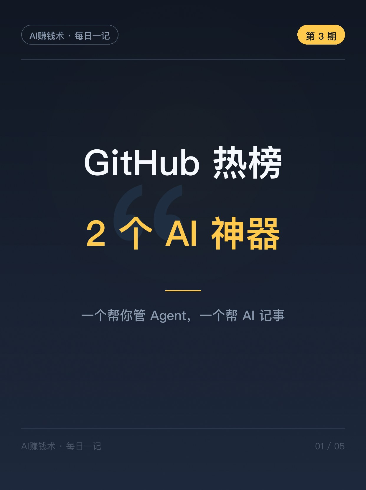
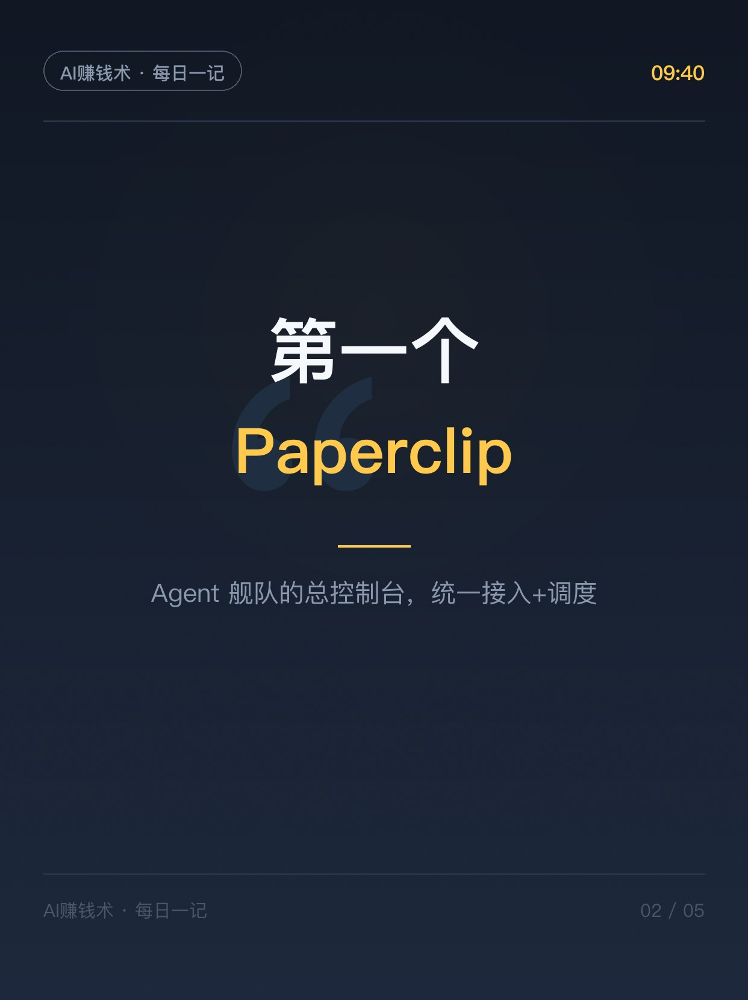
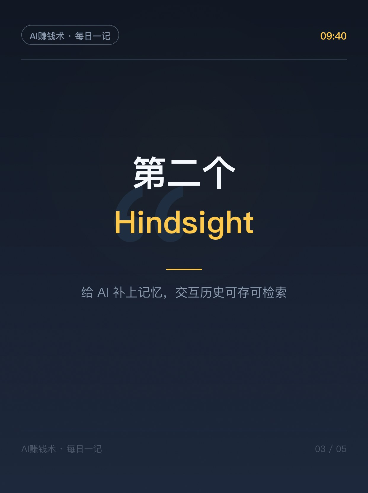
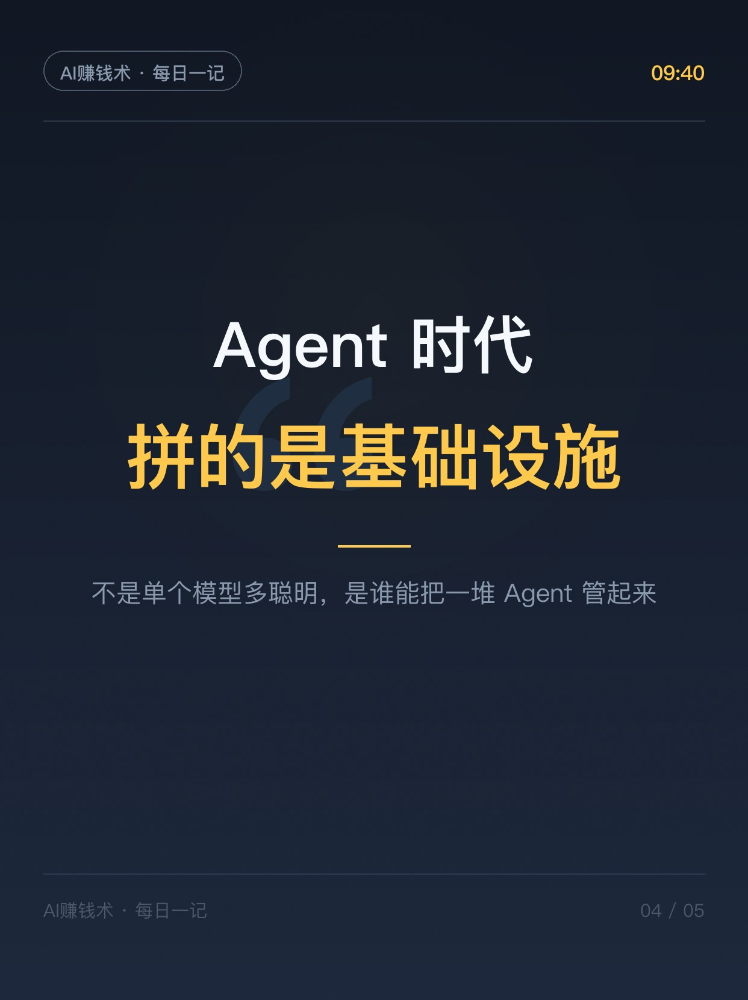
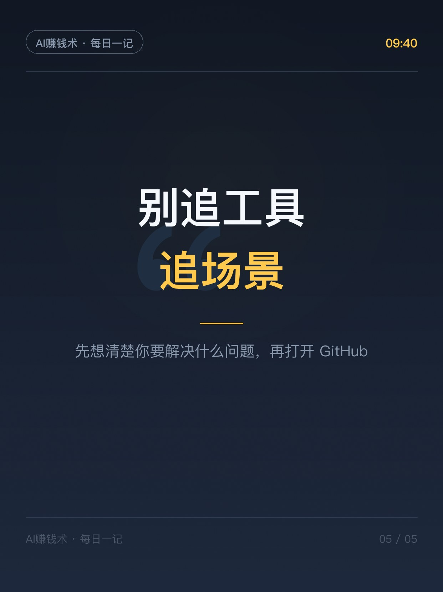

# 2个AI神器：管Agent+记忆

> 第3期 · 2026-10-23 发布 · AI 赚钱内容

## 标题（可直接复制）

```
2个AI神器：管Agent+记忆
```

## 正文（可直接复制发布）

早上 9 点，我照例刷了一遍 GitHub 热榜。
今天不聊风口，聊两个「基础设施」——一个帮你管 Agent，一个帮 AI 记事儿。

1️⃣ Paperclip：Agent 太多，管不过来了
你有没有这种经历：手里五六个 AI 工具、三四个 Agent，每个都要单独开、单独喂、单独看结果？Paperclip 干的就是这件事——把各类智能体应用统一接进来，集中调度，状态监控、任务追踪一站式。对一个人用一堆 AI 干活的人来说，这就是「Agent 舰队的总控制台」。

2️⃣ Hindsight：AI 最大的短板是记不住
每个聊过天的 AI 都像第一次见你——历史、偏好、上下文，全部归零。Hindsight 就是给智能体补这块短板：结构化存储交互历史，快速检索，甚至带记忆自我优化。Agent 想从「工具」变「员工」，记忆是必修课。

说点实话：这两个项目现在还早期，star 涨得快不代表已经成熟，别急着往生产环境堆。但它们指的方向很明确：Agent 时代，拼的不再是单个模型多聪明，而是基础设施——谁能把一堆 Agent 管起来、让它们记住事，谁就能把「一个人 = 一支团队」落到实处。

你手里有几个 AI 工具在并行用？评论区报个数，我猜超过 5 个的不少👇

## 话题标签

#AI #效率工具 #副业

## 配图（5 张）







## 素材来源

用户提供的 GitHub trending 素材（灵感库/GitHub/2026-10-23-用户提供.md）

## 发布信息

| 项 | 值 |
|---|---|
| 平台 | 小红书 |
| 期数 | 第3期 |
| 发布时间 | 2026-10-23  |
| 正文长度 | 537 字 |
| 图片数量 | 5 张 |
| 状态 | 已发布 |
