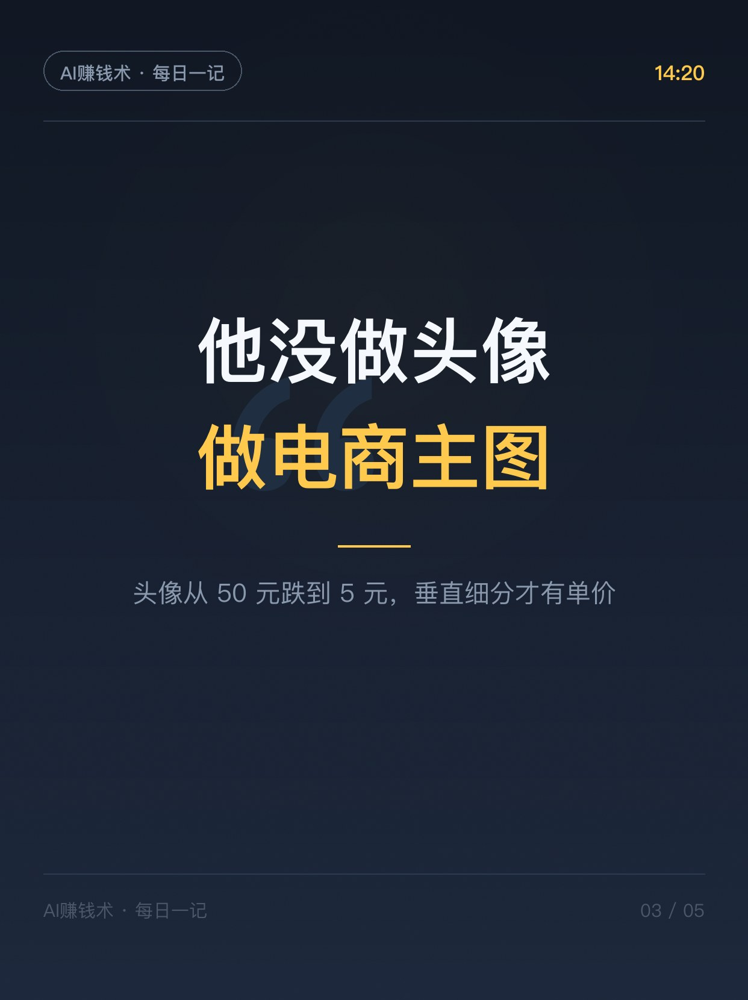
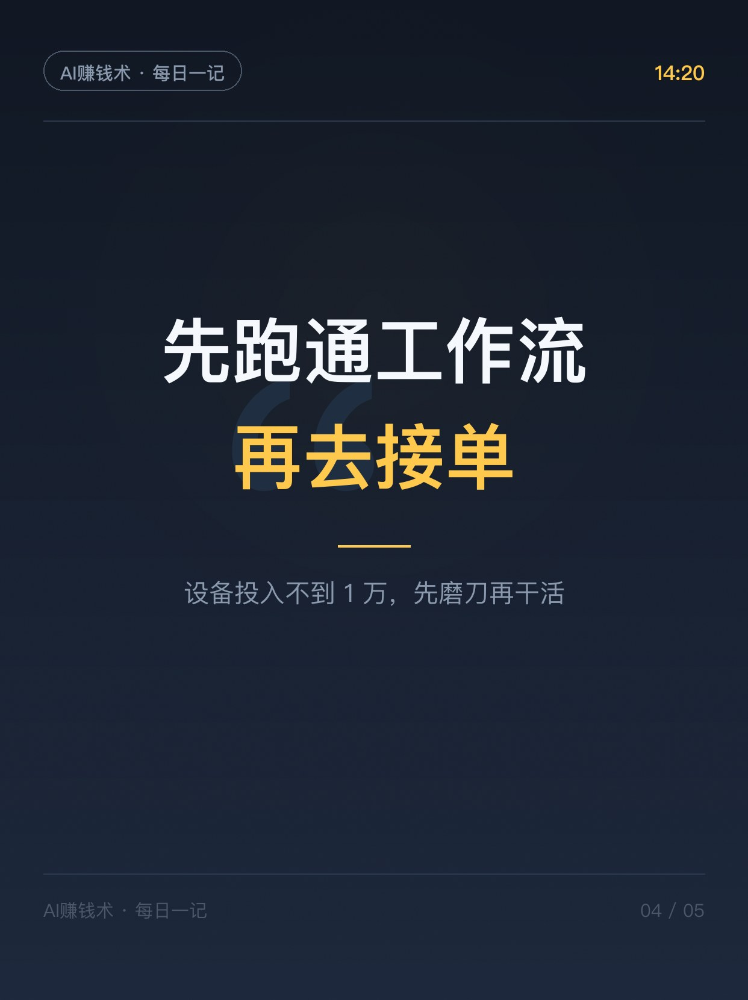
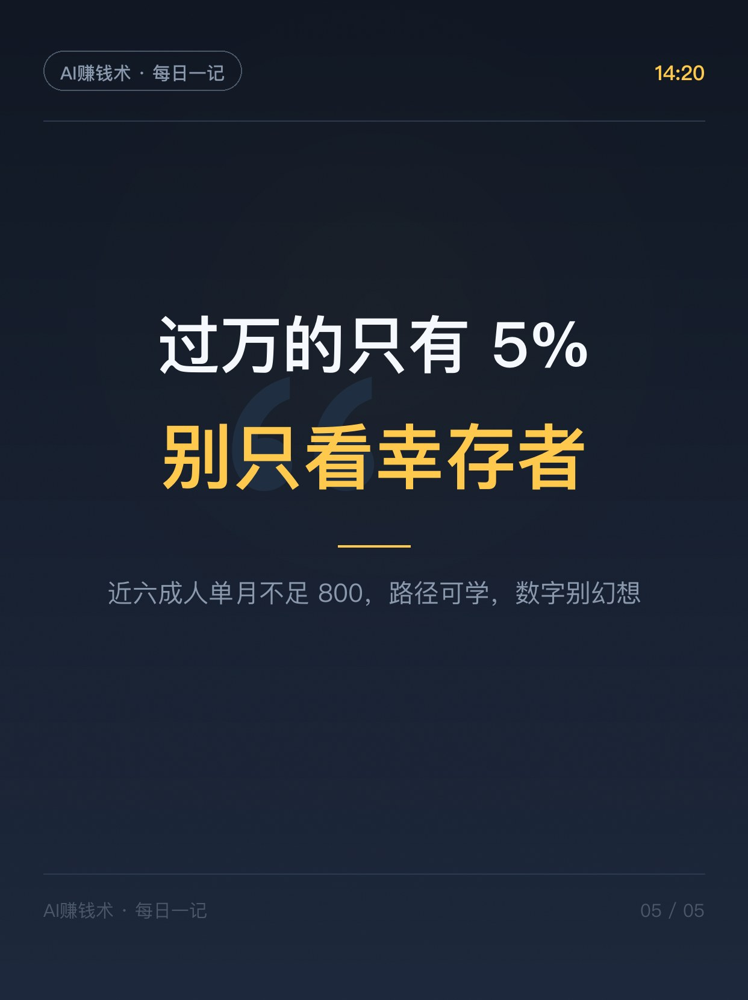

# 月薪5000的设计师，AI副业2.8万

> 第4期 · 2026-10-23 发布 · AI 赚钱内容

## 标题（可直接复制）

```
月薪5000的设计师，AI副业2.8万
```

## 正文（可直接复制发布）

下午 2 点，我刷到一篇报道：一个化名「阿杰」的小公司平面设计师，原来月薪 5000，2025 年 8 月在闲鱼接到了 AI 绘画的单子。到 2026 年 5 月，单月稳定在 1.5 万，有一个月接了 67 单、收入 2.8 万（据今日头条报道，人物为化名）。

先别急着羡慕，我把这个案例拆开看了两遍，真正可复制的是这三件事。

1️⃣ 他把 8 小时的活压到 10 分钟
阿杰用 Stable Diffusion + ComfyUI 搭了一套电商主图工作流：抠图、生成背景、合成、光影调整，一套 6 张主图 15 分钟搞定。原来一张图 8 小时，现在 10 分钟——产能放大 10 倍。设备是一台带 RTX 4070 的电脑，总投入不到 1 万。

2️⃣ 他没做头像，做的是电商主图
这点关键。基础头像的单价已经从 50 元跌到 5 元，低端市场早就崩了。他选的是电商主图这种垂直细分——商家有持续需求、付费能力强、竞争还小。越垂直，越赚钱。

3️⃣ 先跑通工作流，再去接单
他不是先开店铺，而是先把工作流磨出来。学会 ComfyUI 是他和其他人的分水岭——同样用 AI，有人一张收 50 元，有人一套 6 张收几百。

说点实话：那篇报道里有个数据，稳定单月过万的从业者只占尝试者的 5% 以内，近六成人单月不足 800 元。阿杰是幸存者，但他的路径——「一技之长 + AI 放大 + 垂直细分」——普通人真的能学。

你身上有什么一技之长？评论区聊聊👇

## 话题标签

#AI #副业 #赚钱

## 配图（5 张）






## 内容要点

1. 8 小时压到 10 分钟：SD+ComfyUI 电商主图工作流，产能放大 10 倍，投入不到 1 万
2. 不做头像做电商主图：头像单价从 50 元跌到 5 元，垂直细分才有单价
3. 先跑通工作流再接单：ComfyUI 是分水岭

## 素材来源

Web 检索「AI 副业真实案例」→ CSDN 汇总文（转引今日头条《从月薪五千到月入三万：一个 AI 绘画师的 2026 年翻身实录》，人物化名「阿杰」）

## 发布信息

| 项 | 值 |
|---|---|
| 平台 | 小红书 |
| 期数 | 第4期 |
| 发布时间 | 2026-10-23  |
| 正文长度 | 633 字 |
| 图片数量 | 5 张 |
| 状态 | 已发布 |
