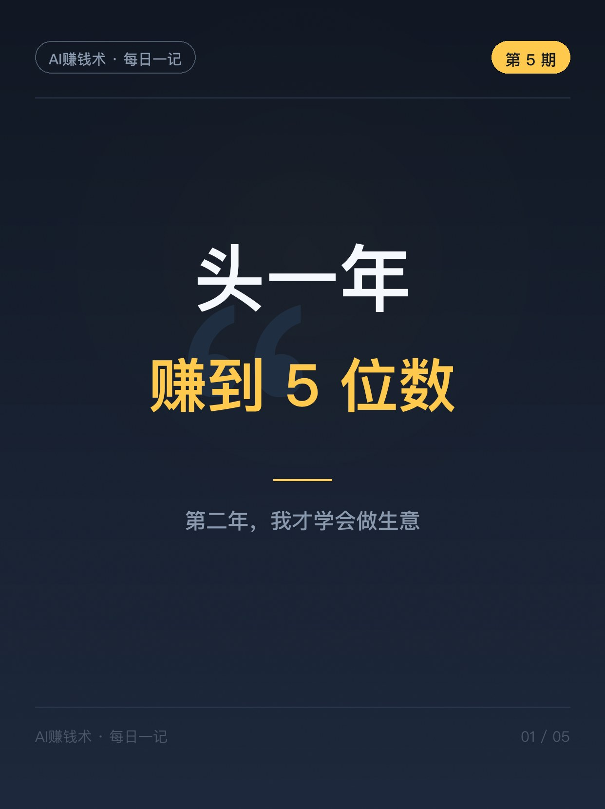
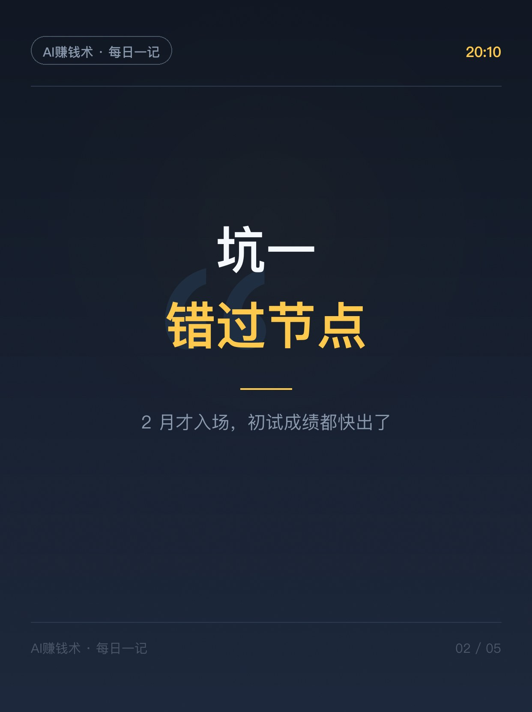
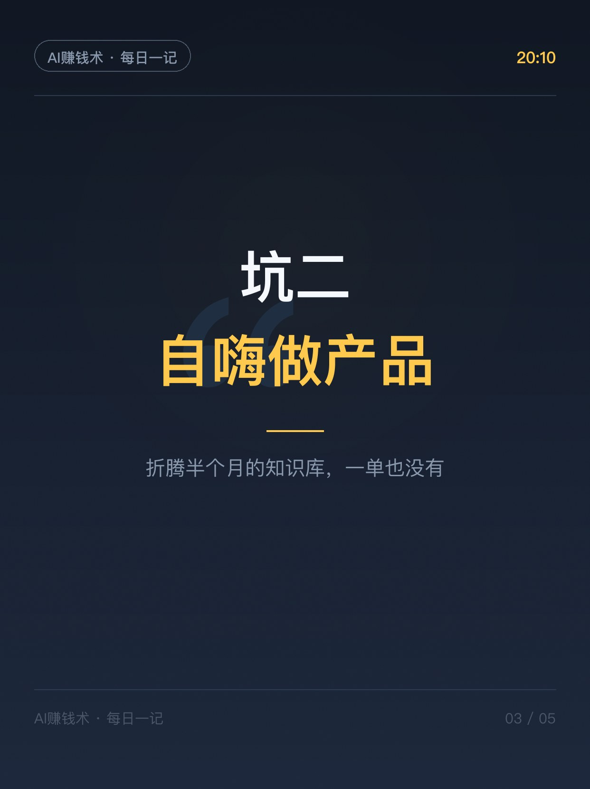
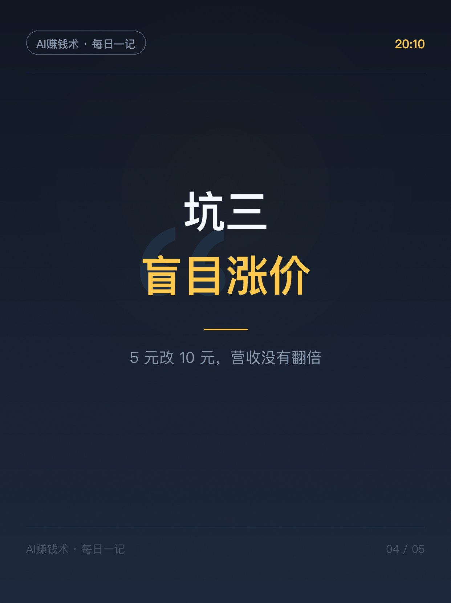
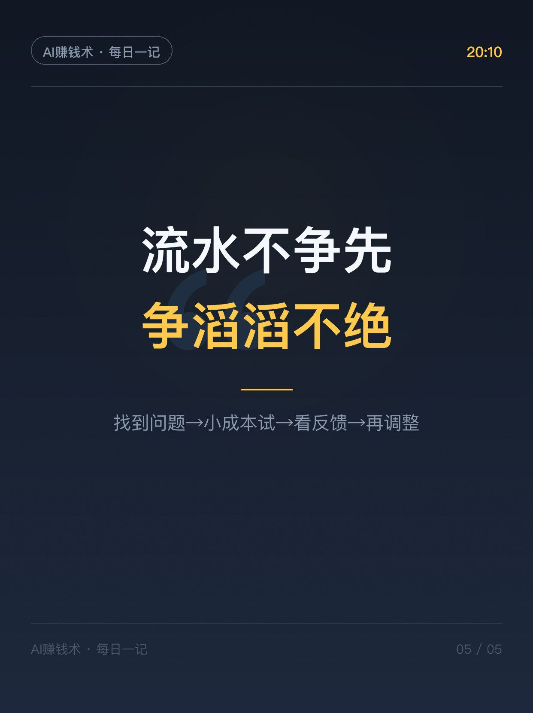

# 头一年赚5位数，第二年学会做生意

> 第5期 · 2026-10-23 发布 · AI 赚钱内容

## 标题（可直接复制）

```
头一年赚5位数，第二年学会做生意
```

## 正文（可直接复制发布）

晚上 8 点，我读完一篇万字复盘，是一个做小红书虚拟资料的圈友写的。她头一年做到了单月 5 位数，但她说：头一年学会了怎么把东西卖出去，第二年才开始学怎么经营一门能持续的生意。

我把她写的三个「本可以」的遗憾看了三遍，每一个都值得抄下来。

1️⃣ 错过考研面试节点：入场太晚，只能零零星星出几单
她 2 月份才意识到能做考研面试题，那时候初试成绩都快出了，急急忙忙做产品、上架、发笔记，结果只出了几单。强节点生意，等用户已经集中搜索时才入场，留给内容铺设的时间太少了。她的解法：提前 1-2 个月就发干货攒关注，商品和承接搜索的内容都提前备好。

2️⃣ 自嗨做产品：折腾半个月的知识库，一单也没有
她想做求职知识库提升客单价，吭哧吭哧做了半个月，产品越做越完整，人也被耗空了，到后来没心力发笔记、测市场。她复盘说核心的错误是：在需求确定性还不够高的时候，提前支付了完整产品的制作成本。现在的做法：制作成本要跟需求确定性匹配，需求没验证就先 build in public，用笔记数据和评论区说话。

3️⃣ 盲目涨价：5 元改 10 元，营收并没有翻倍
她原来的想法很朴素：5 块卖 1000 份是 5000，涨到 10 块还卖 1000 份不就是 1 万？结果并没有。定价是营收的一环，不是独立变量。GMV = 商品访客 × 支付转化率 × 客单价，三个指标一起起作用——缺流量的时候，涨价解决不了任何问题。

她复盘里有句话我特别喜欢：流水不争先，争的是滔滔不绝。

你做过什么「本可以」的选择？评论区聊聊👇

## 话题标签

#AI #副业 #赚钱

## 配图（5 张）







## 内容要点

1. 错过节点：2 月才入场考研面试题，强节点生意要提前 1-2 个月铺商品+内容
2. 自嗨做产品：半个月知识库零订单——需求没验证别提前支付完整制作成本，先 build in public
3. 盲目涨价：5 元改 10 元营收没翻倍——GMV = 商品访客 × 支付转化率 × 客单价，缺流量涨价无用

## 素材来源

飞书文档《小红书虚拟资料二年级：第一年月入5位数，第二年才学会做生意》（圈友千酱复盘，已存 灵感库/参考文章/千酱-虚拟资料二年级复盘.txt）

## 发布信息

| 项 | 值 |
|---|---|
| 平台 | 小红书 |
| 期数 | 第5期 |
| 发布时间 | 2026-10-23  |
| 正文长度 | 659 字 |
| 图片数量 | 5 张 |
| 状态 | 已发布 |
