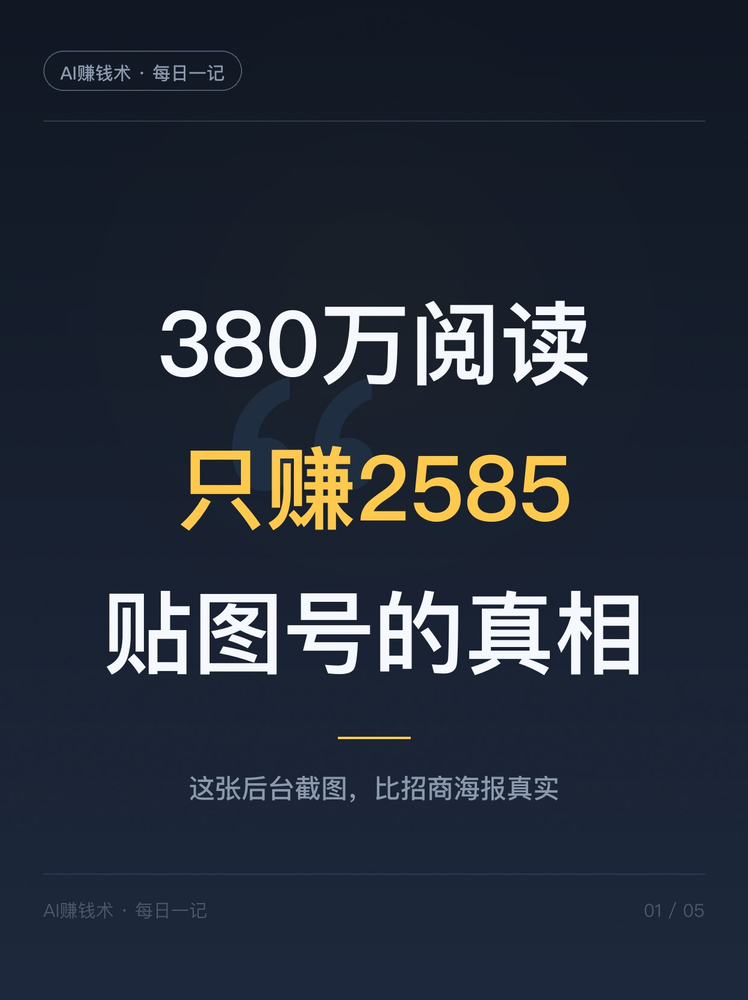
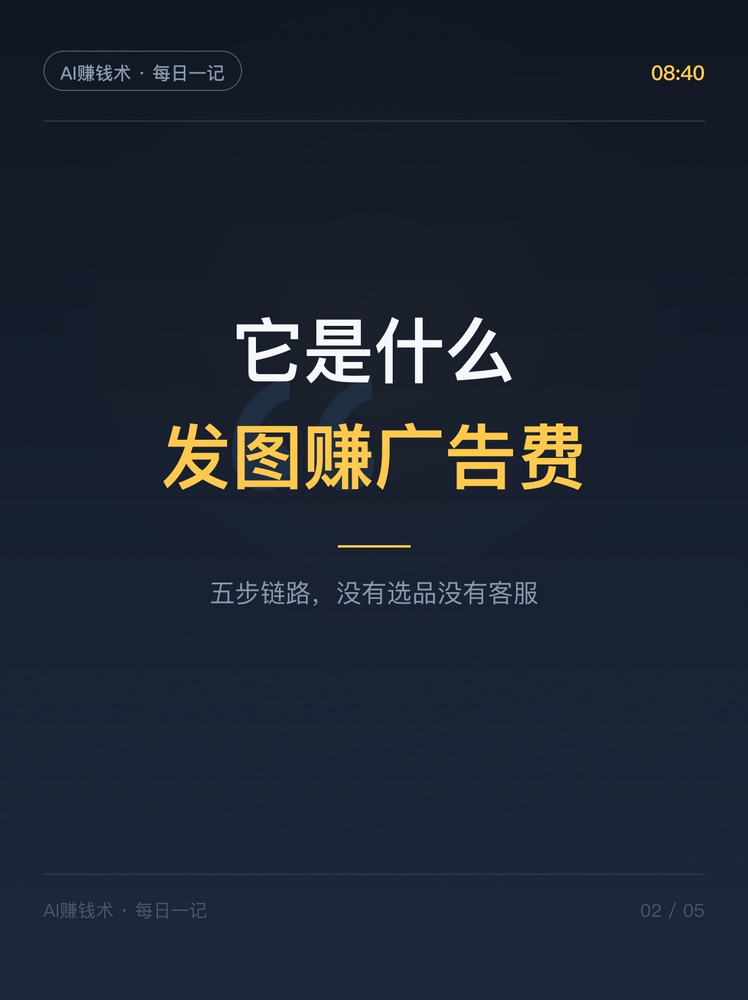
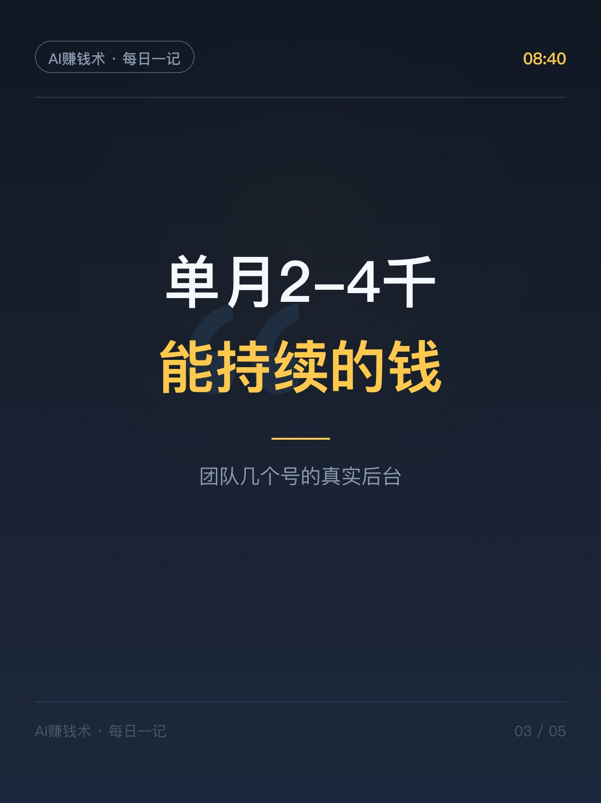
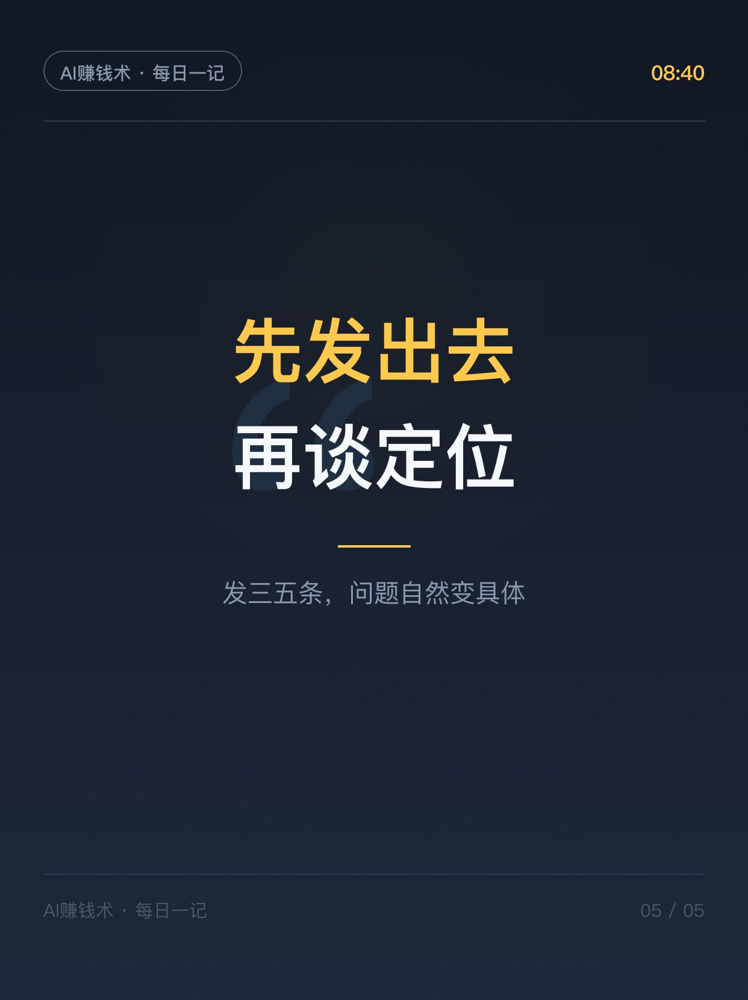

# 380万阅读，只赚了2585块

> 早档第1篇 · 2026-10-24 08:39 发布 · AI 赚钱内容

## 标题（可直接复制）

```
380万阅读，只赚了2585块
```

## 正文（可直接复制发布）

昨天翻一份圈友的复盘，看到一张贴图号的后台截图，我盯着看了半分钟。
两篇贴图，同一天，合计380万阅读。当天流量主到手2585块。
截图的人自己补了一句：这是那一天的结果，不是每天都能复制的日薪。

我觉得这句补充比截图本身值钱。
很多人看到380万先激动，看到2585又觉得被骗。两个反应都太快了。

贴图号这东西，我拆三块讲。

1️⃣ 它是什么，链路有多短
公众号发图文，图为主字为辅。用户刷到、点开、往下翻，页面里的广告产生有效展示，你拿流量主分成。
五步走完：内容被推荐，标题首图留住人，阅读翻图留言，广告展示，后台出钱。
没有选品，没有客服，没有发货。一台电脑，一天几条，就能跑。
门槛低到很多人不屑于试。但门槛低不等于天花板低。

2️⃣ 真实的钱有多少
同一个作者公开了几个矩阵号的单月后台：2624、3912、1956、3621、3552。
单看一个号，两三千，不够看。可这是能持续的钱，而且不用每天想新花样。
他还提到团队做的Agent工具，三个月左右做到约5万利润，1000多位付费用户，人基本是从抖音、公众号、视频号、小红书这些公域内容过来的。
这条路径值得记：先用贴图把流量跑通，再把做内容的能力接成产品。贴图是入口，不是终点。

3️⃣ 很多人搞错的一件事：阅读量不等于收入
有人点进来，广告不一定展示；广告展示了，单价还会变。
同样一万阅读，两篇到手可能差不少。所以后台要分开看：曝光、阅读、互动、广告曝光量、收入、eCPM，六个字段各说各的事。
拿一个阅读数直接套收入，算出来的都是幻觉。这也是为什么有人晒百万阅读，实际到手几百块。

真正值钱的不是那几个数字，是你在这条路上被迫练出来的东西：什么选题会爆，什么首图会被点，用户刷到你那两秒在想什么。
这些换个赛道照样能用。

所以别纠结定位了。宠物卷不卷、婚姻能不能做，想一年也想不明白。
发三五条，问题自己会变具体：曝光有了没人点，回头改标题首图；点进来没读完，看正文有没有接住那张图；读完了没人说话，就是这个题没戳到点上。

建议先收藏，真要动手的时候翻出来对着看，比收藏一堆教程有用。
你手里有没有一个一直没开的号？评论区说赛道，我帮你看开头该发什么👇

头一笔钱解决不了收入焦虑。它只是把「我行不行」这个问题，换成了「下条改哪」。

## 话题标签

#副业 #自媒体 #公众号 #流量主 #贴图号 #内容创业 #普通人的副业 #AI赚钱术日记

## 配图（5 张）







## 发布信息

| 项 | 值 |
|---|---|
| 平台 | 小红书 |
| 期数 | 早档第1篇 |
| 发布时间 | 2026-10-24 08:39 |
| 正文长度 | 961 字 |
| 图片数量 | 5 张 |
| 状态 | 已发布 |
