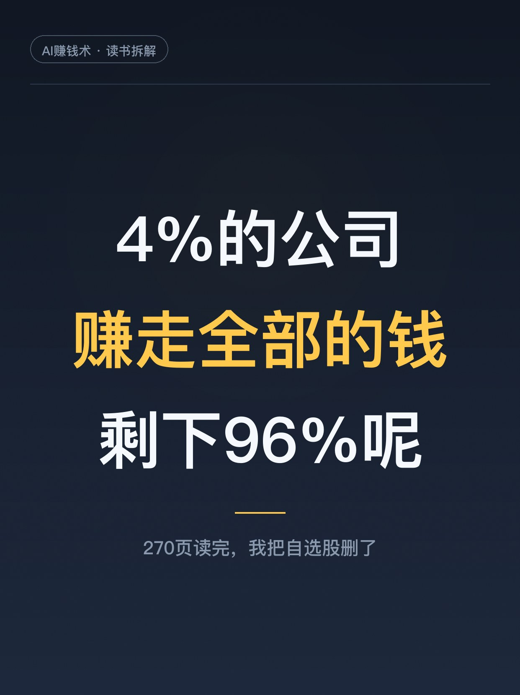
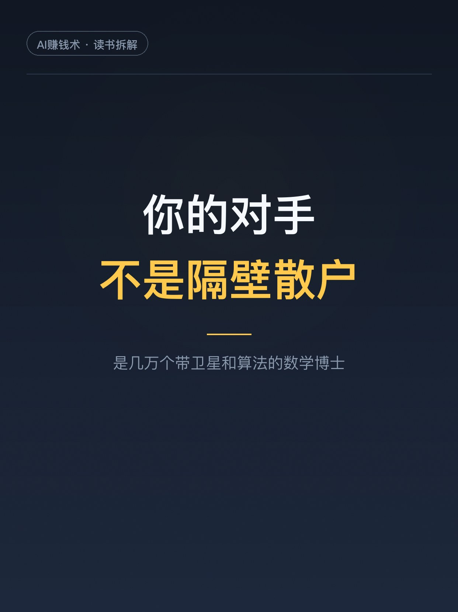
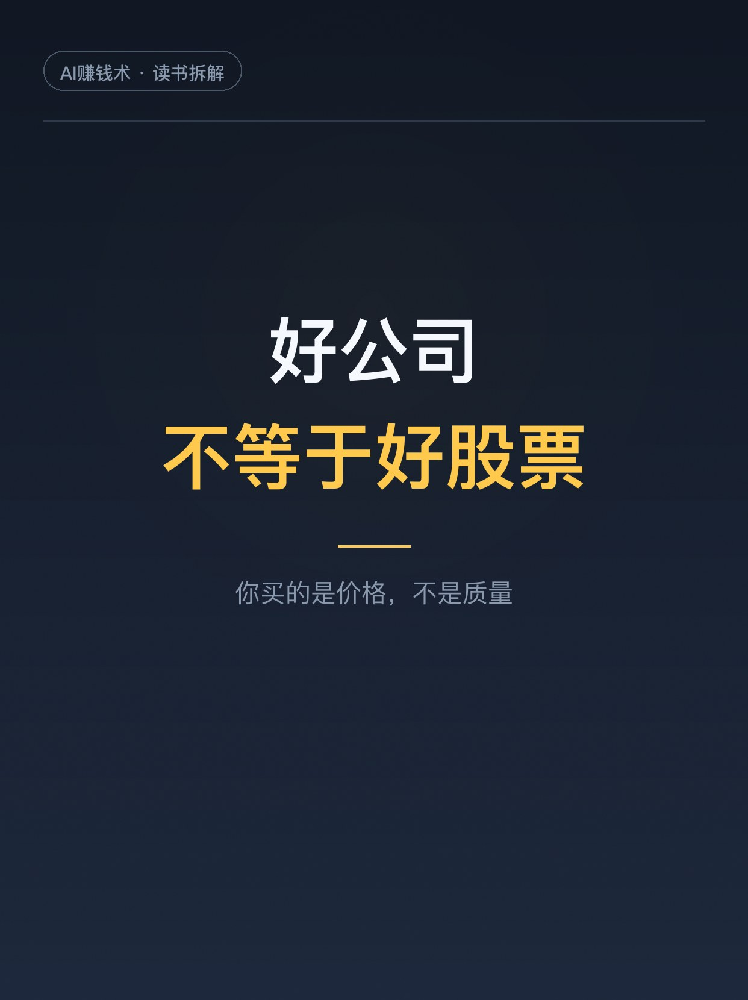
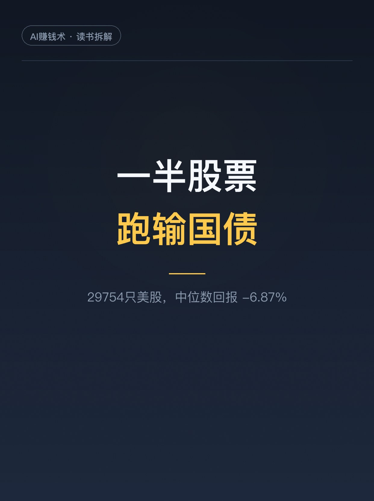
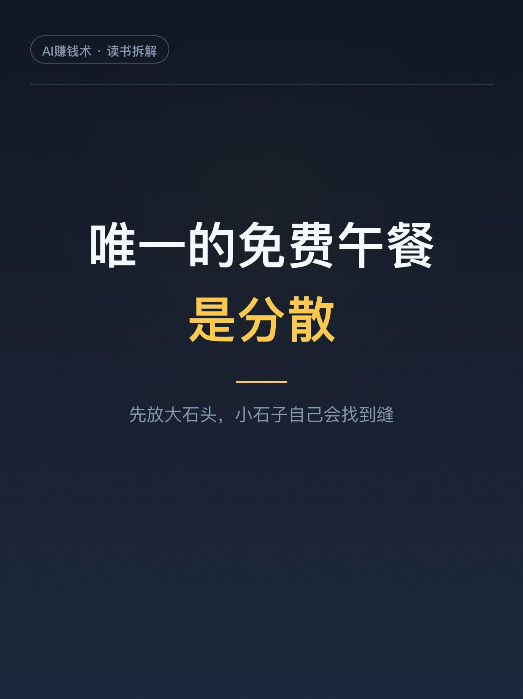

# 4%的公司，赚走全部的钱

> 第7期 · 2026-10-24 11:52 发布 · AI 赚钱内容

## 标题（可直接复制）

```
4%的公司，赚走全部的钱
```

## 正文（可直接复制发布）

朋友上周问我，某只票能不能拿。我没敢答，先翻出这本书给他看了组数字。
美国股市一百年，29754 只股票，中位数回报 -6.87%。一半以上的股票，长期拿着是亏的。
跑赢大盘的只有 27.6%。
但同期，1 美元变成了 15041 美元。
同一个市场，两种命运。差的不是努力，是你站的位置。

这本《致富未来》，作者拉里·斯韦德罗，写了 18 本投资书。全书 42 篇短章，每章拆掉一个「我能战胜市场」的理由。读完有个很强的感受：他不是在劝我保守，是拿数据堵死我所有操作的借口。

讲三个我印象深的。

1️⃣ 你的对手不是隔壁散户
你以为在跟市场情绪博弈。实际上股价里已经压进了财报、供应链、卫星拍的停车场车辆数。你的对手盘是几万个数学博士加算法。
书里有个词叫「技能悖论」：参与者越专业、水平越接近，结果就越靠运气。市场越有效，你越努力，相对优势反而越小。努力不变成超额回报，只变成手续费。

2️⃣ 好公司不等于好股票
这条挺反直觉。伟大的公司，市场早就知道它伟大，价格里把溢价付掉了。你买的是价格，不是质量。
所以人人称道的好公司，长期回报常常让人失望；没人想要的便宜公司，只要没变得更差，回报反而不错。不是让你买垃圾股，是说：质量本身不构成超额回报，价格才是。

3️⃣ 4% 的公司，赚走全部的钱
1926 到 2025，美股 91 万亿美元净财富，全部来自 1082 家公司，占 3.72%。剩下 96% 加起来，扣掉国债回报后是零。
撑起一半财富的公司数，从 89 家掉到 46 家。
所以随机买一只股票长期持有，你有一半以上概率跑输国债。指数涨 1.5 万倍，是因为它自动持有那 1082 家。你的自选股没有这个换血机制。

那怎么办。
答案不性感：低成本宽基指数、全球分散、定好股债比例、然后少动。
他有个「大石头」比喻：一个桶，先放小石子，大石头就放不进去；先放大石头，小石子自己会找到缝。
大石头是储蓄率、资产配置、成本、纪律。选哪只基金，是小石子。
大多数人把九成精力花在小石子上。

建议先收藏，哪天想认真理财时翻出来对一遍。
你手里有几只个股？评论区报个数👇

（读书笔记，不构成投资建议。历史数据不代表未来。）

## 话题标签

#理财 #投资 #指数基金 #被动投资 #资产配置 #读书笔记 #普通人理财 #AI赚钱术日记

## 配图（5 张）







## 素材来源

灵感库/参考文章/致富未来-成功投资的关键-精读笔记.md（原书 *Enrich Your Future: The Keys to Successful Investing*，Larry E. Swedroe，2024，270 页 / 42 篇短章）

## 发布信息

| 项 | 值 |
|---|---|
| 平台 | 小红书 |
| 期数 | 第7期 |
| 发布时间 | 2026-10-24 11:52 |
| 正文长度 | 921 字 |
| 图片数量 | 5 张 |
| 状态 | 已发布 |
