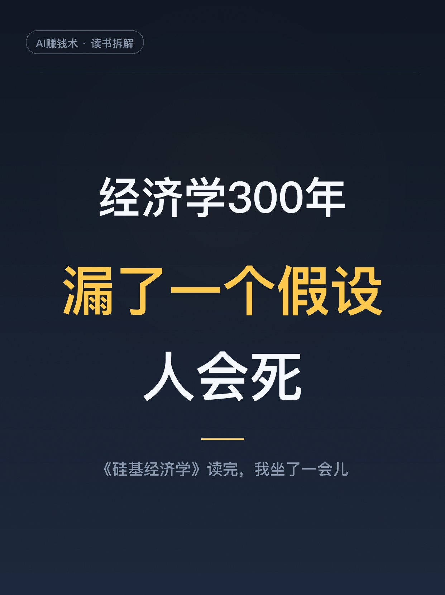
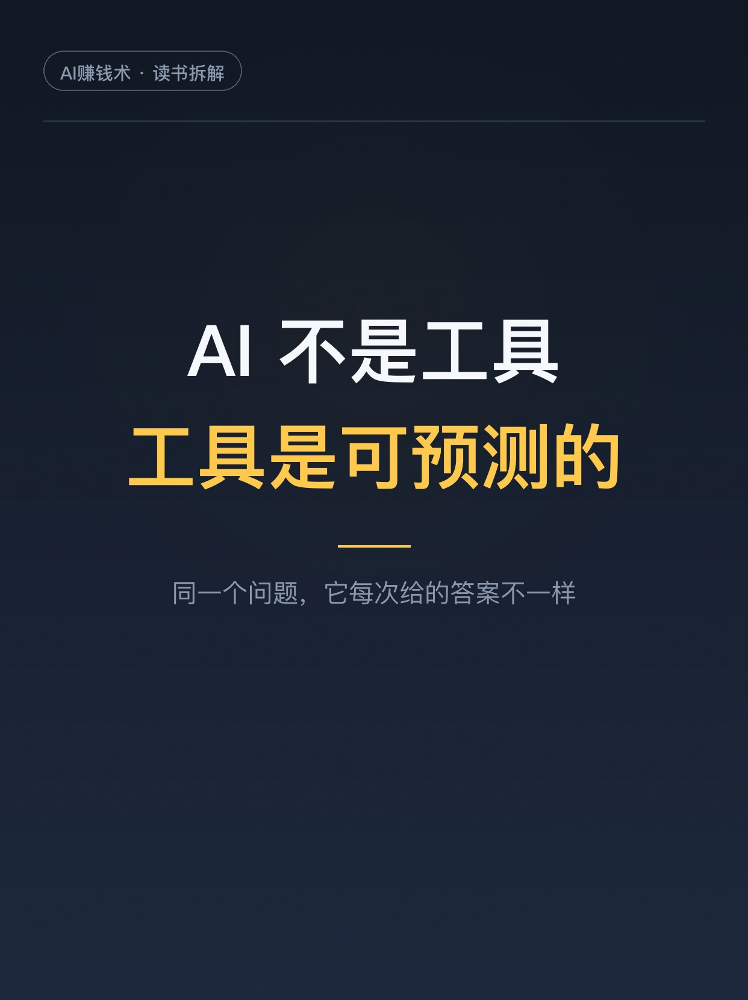
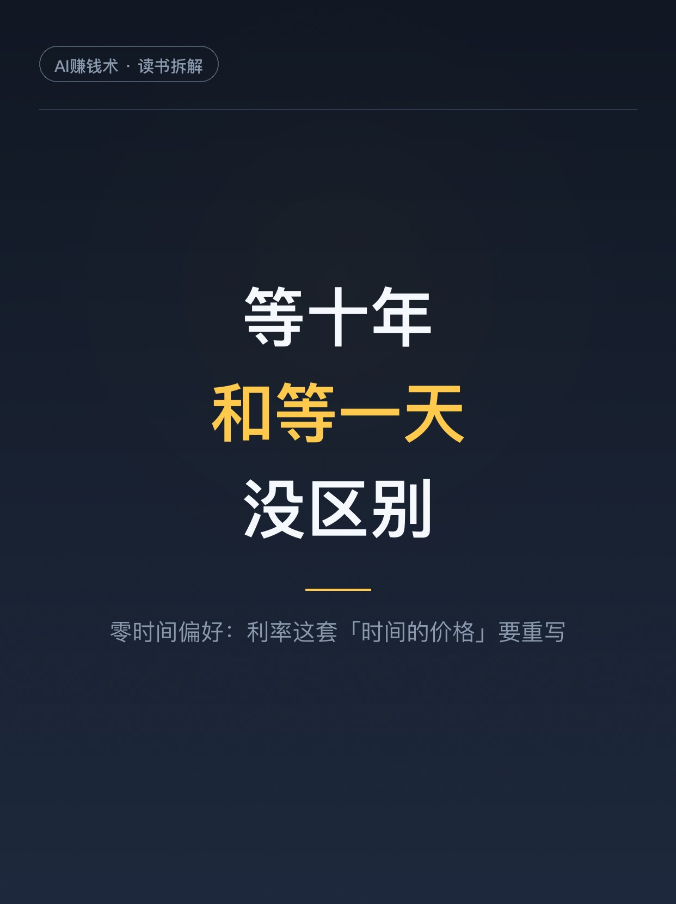
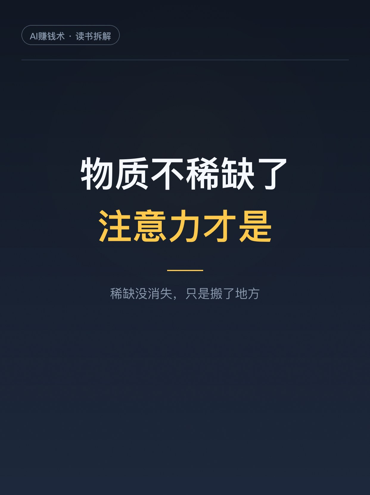
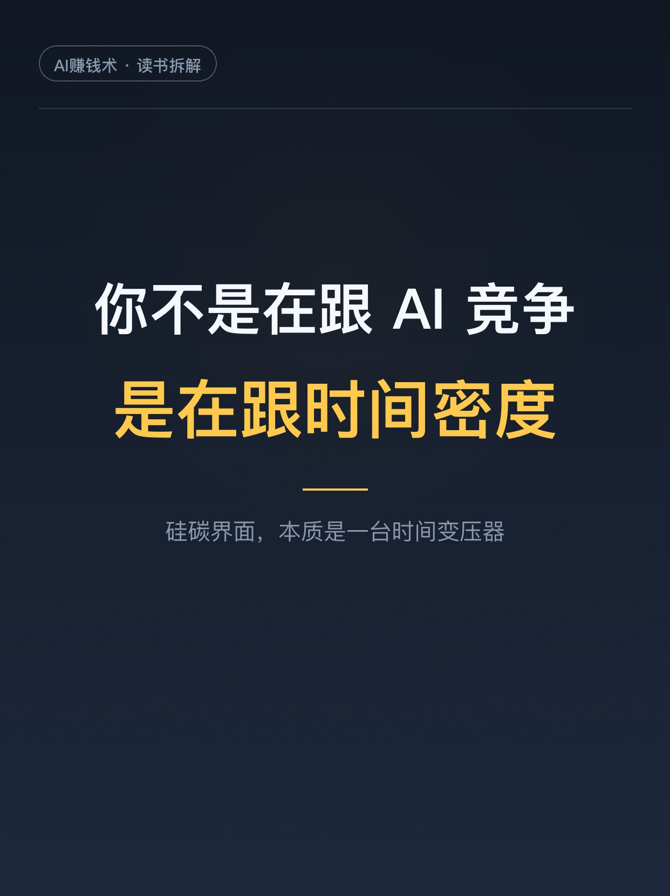
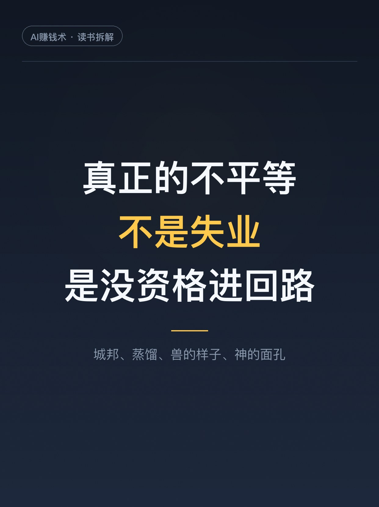
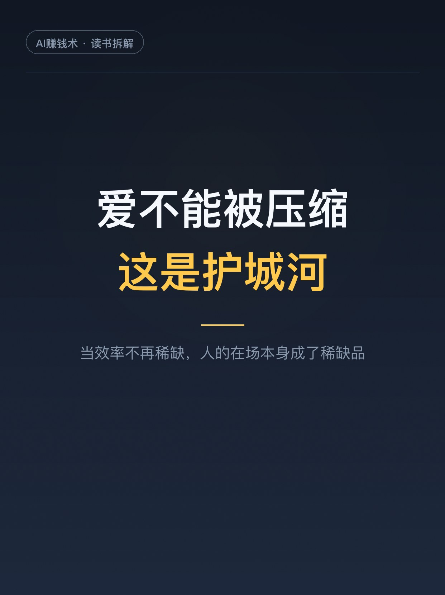

# 经济学300年，漏了一个假设

> 第8期 · 2026-10-24 13:10 发布 · AI 赚钱内容

## 标题（可直接复制）

```
经济学300年，漏了一个假设
```

## 正文（可直接复制发布）

书里有一句话，我看了三遍才反应过来。
经济学算了三百年的「稀缺」，却从没点破：稀缺的尽头是死亡。
人会死，所以今天的一百块比明年的一百块值钱；会死，所以有耐心成本，有利率，有折旧，有「来不及了」。
整套经济学的地基，其实是一个生物学事实：我们会死。
然后 AI 登场了。它不会死，不会累，等十年和等一天没区别。
作者邵怡蕾把这一刻叫经济学的「哥白尼时刻」，不是地球不在中心，是人不再是经济的唯一主角。

这本《硅基经济学》，中信今年出的。作者是普林斯顿计算机博士、华东师大人工智能金融学院创始院长。我原以为又是一本讲 AI 多厉害的书，读完发现它问的是另一个问题：当机器也成了经济主体，我们这些会死的人，该怎么安放时间、欲望、责任和爱。

三个我反复想的点。

1️⃣ AI 不是工具
判断标准很干脆：计算器、Excel 是完全可预测的，你输入什么它输出什么；AI 不是，同一个问题它可能给你不同答案，而且会随着交互变化。
可预测的只能当工具，不可预测且会自我调整的，才有资格叫「主体」。

2️⃣ 不会死的主体，没有时间偏好
贴现的前提是等待有成本，而等待的成本来自生命在流逝。不会死、能无限并行迭代的东西，等待成本是零。
书里往下推：利率是「时间的价格」，如果有一方对时间不定价，这套定价逻辑就得重建。
我不完全认同（它不融资的话，未必撬得动利率），但这个视角很值钱：你所有关于「等一等更划算」的判断，都建立在你会死这件事上。

3️⃣ 稀缺没消失，只是搬了家
AI 的核心动作不是生产，是压缩：把要几个人几天做完的事，压成一次计算。
物质和常规劳动越来越不稀缺，但注意力成了绝对稀缺，因为人的注意力总量是生物学固定的。
所以真正的不平等不是「会不会失业」，而是「谁还有权留在决策回路里」。

那普通人能做什么。
我自己的三条：先判断你做的事能不能被拆成「输入→规则→输出」，能就有风险；把注意力当资产配置；保住不能压缩的部分，判断、承担、审美、关系。
书里末章把爱叫作「反压缩」。当效率不再稀缺，人的在场本身就成了稀缺品。

建议先收藏，这本书值得慢慢读。
你觉得自己现在做的事，可压缩吗？评论区聊聊👇

（读书笔记，不构成任何建议。）

## 话题标签

#AI #人工智能 #硅基经济学 #AI经济 #读书笔记 #认知升级 #普通人如何应对AI #AI赚钱术日记

## 配图（7 张）









## 素材来源

灵感库/参考文章/硅基经济学-AI时代的主体革命-精读笔记.md

## 发布信息

| 项 | 值 |
|---|---|
| 平台 | 小红书 |
| 期数 | 第8期 |
| 发布时间 | 2026-10-24 13:10 |
| 正文长度 | 921 字 |
| 图片数量 | 7 张 |
| 状态 | 已发布 |
