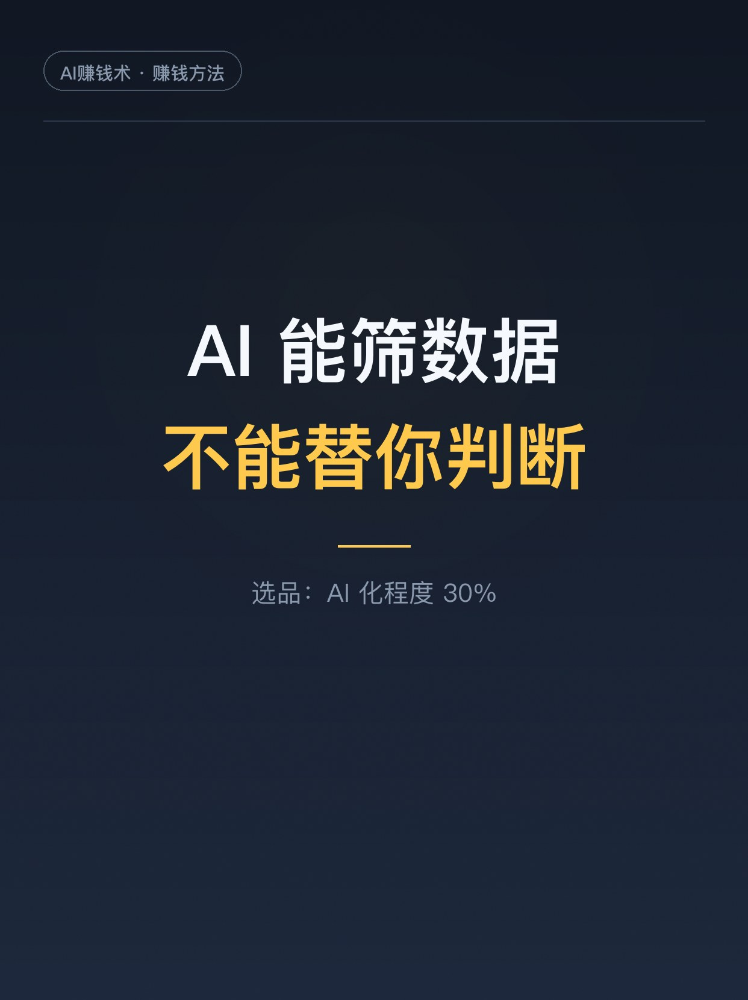
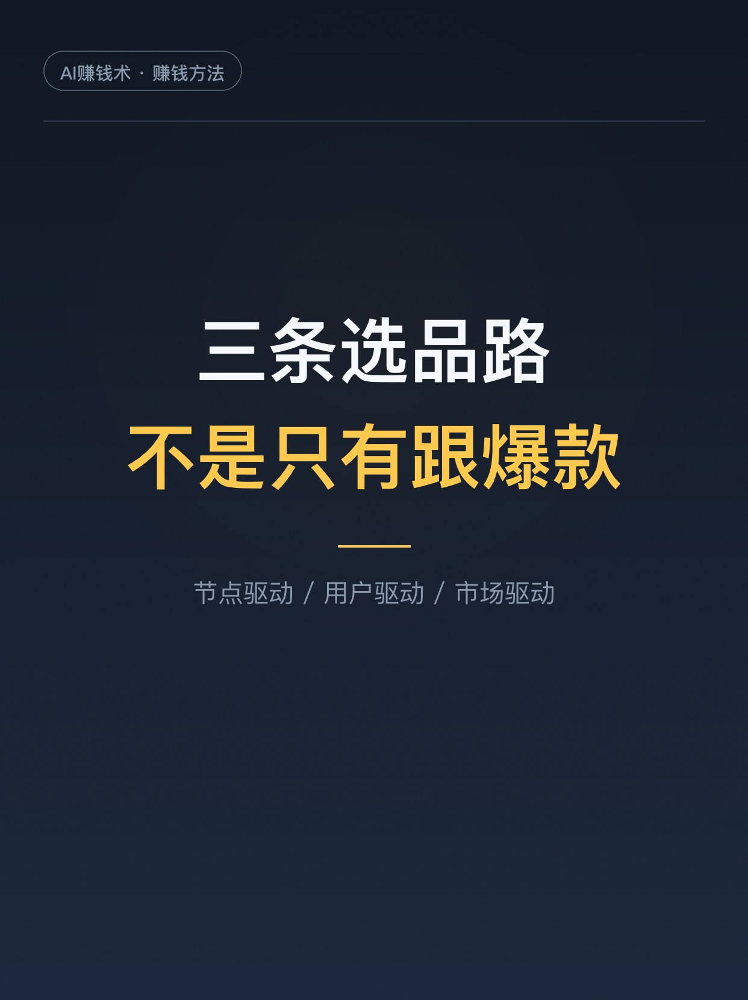
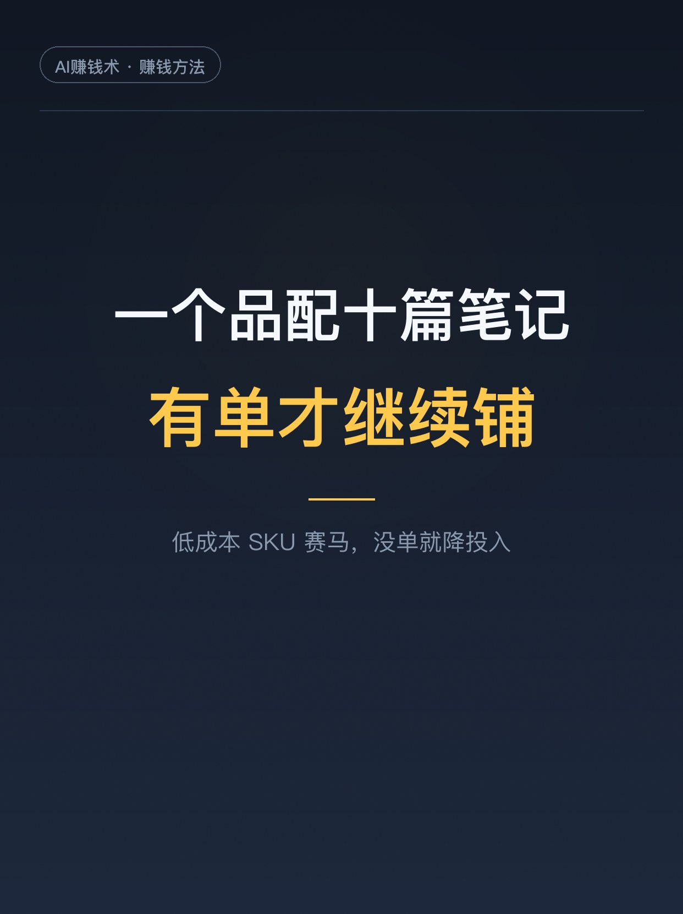
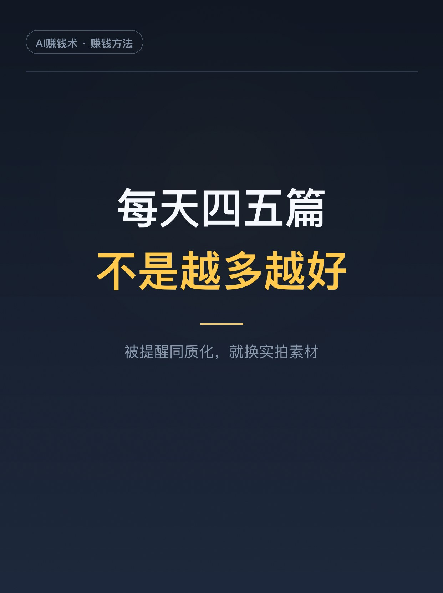

# 一个人卖虚拟资料，AI只占三成

> 第9期 · 2026-10-25 10:18 发布 · AI 赚钱内容

## 标题（可直接复制）

```
一个人卖虚拟资料，AI只占三成
```

## 正文（可直接复制发布）

下午三点，我把一篇万字复盘看完了。作者做小红书虚拟资料，第二年，一个人几个店，5 位数。

看到一半我停下来，因为她给自己做了张表，算 AI 在这门生意里占多少：

选品 30%。制作 90%。笔记 90%。数据分析 80%。

这张表有点反常识。我们总以为 AI 时代是「一键生成，躺着卖」，可一门生意里最值钱的那一环，恰好是它帮不上忙的。

1️⃣ 选品：AI 只占三成
AI 能给她一份候选清单，能告诉她哪些专业保研人多、哪些教材被反复提到。但「这个品值不值得做」，她说 AI 替代不了真实成交。她的判断很土：这群人我懂不懂，需求是不是长期的，价格带挤不挤。

2️⃣ 三条选品路，别只会跟爆款
节点驱动：面试题这类有明确高峰的，提前一到两个月铺内容。等大家都开始搜才入场，承接的时间已经不够了。
用户驱动：从自己熟的人群里挖没被解决的急需求。她靠留学私域经验，拓出过没有对标的方向。
市场驱动：不熟的赛道先跟品，小成本试几个，再从数据里收窄。她试了开学季班会和心理第一课，后者数据好，就围着它横扩纵切。

3️⃣ 一个品配十篇笔记，有单才继续
她拿新品当赛马：低成本做一批 SKU，每个配十篇左右笔记。节点没到就先看搜索；节点到了，有流量却没人点，那就不是流量的事，是选题或者商品不对。有单继续铺，没单降投入。

4️⃣ 制作能交给 AI，但 AI 会偷懒
流程是：调研出框架，搭文件夹补知识点，整合成稿，最后把这套做成一个 Skill，以后只输入专业和教材就能出成品。代价是必须提前写死每个模块的信息密度和交付标准，否则它会自己省略，做出来的东西看着专业，其实很水。

5️⃣ 笔记这环，她反而放弃了自动化
理由很实在：批量写出来的东西人机感太重，返工的时间比自己一句句改还长。她只给 AI 三样东西，母题、营销母文档（定位、卖点、适合人群、解决什么问题）、固定的文案结构，剩下自己调。发布节奏是每天四五篇，一个号。

她说这一年真正学会的不是哪个技巧，是把「找到问题、小成本试、拿到反馈、调整方向」跑成了肌肉记忆。

那张表我存下来了。手上正在做的事，哪一环 AI 能替、哪一环必须你自己上，对一眼就知道。

你现在的副业，AI 帮你到几成？评论区聊聊👇

## 话题标签

#副业 #AI #虚拟资料 #AI副业 #小红书运营 #知识付费 #AI赚钱术日记

## 配图（8 张）










## 内容要点

1. 她的 AI 占比表：选品 30% / 制作 90% / 笔记 90% / 数据分析 80%
2. 三条选品路径：节点驱动、用户驱动、市场驱动（不熟的赛道先跟品再收窄）
3. 一个新品配约 10 篇笔记，有单继续铺、没单降投入
4. 制作可交给 AI，但必须提前写死信息密度与交付标准，否则 AI 自行省略
5. 笔记这环她主动放弃自动化——人机感重、返工比手改更久

## 素材来源

飞书文档《小红书虚拟资料二年级：第一年月入5位数，第二年才学会做生意》（千酱复盘）

## 发布信息

| 项 | 值 |
|---|---|
| 平台 | 小红书 |
| 期数 | 第9期 |
| 发布时间 | 2026-10-25 10:18 |
| 正文长度 | 933 字 |
| 图片数量 | 8 张 |
| 状态 | 已发布 |
