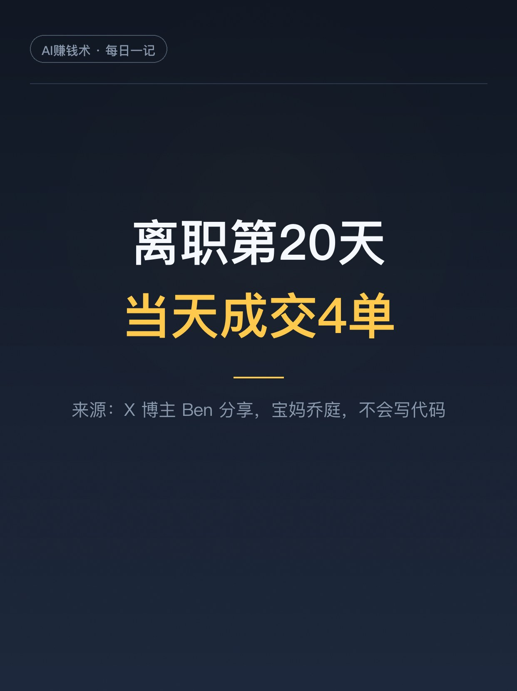
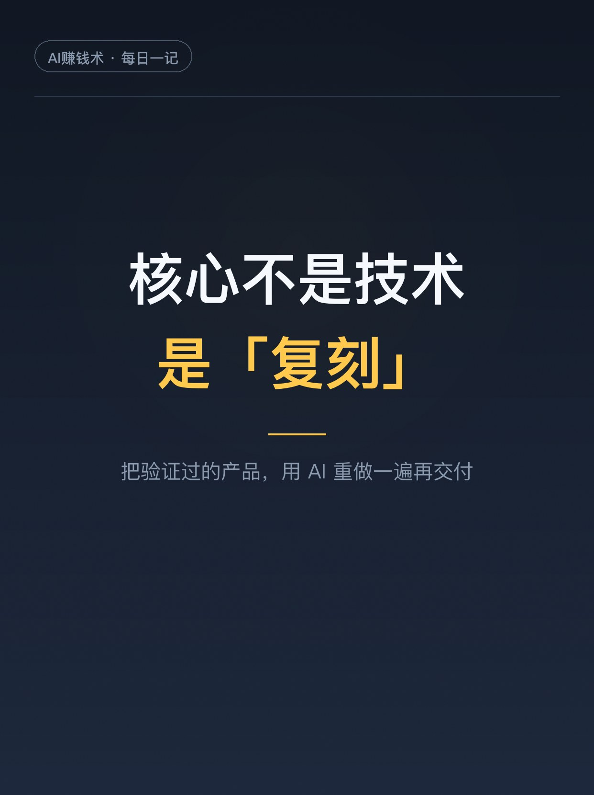
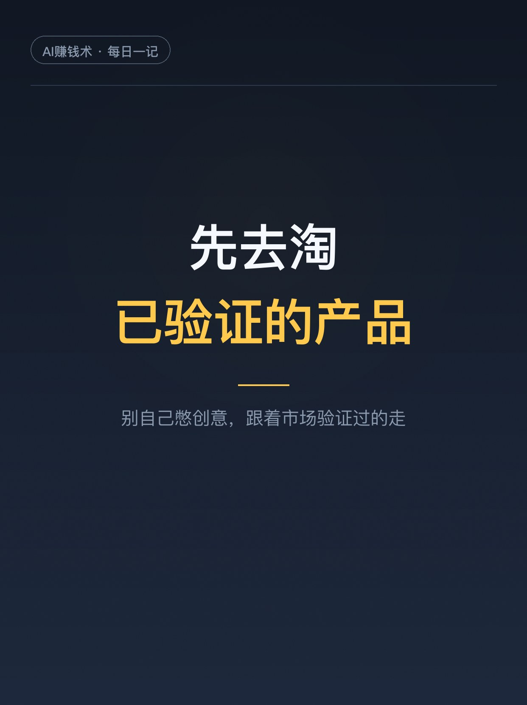
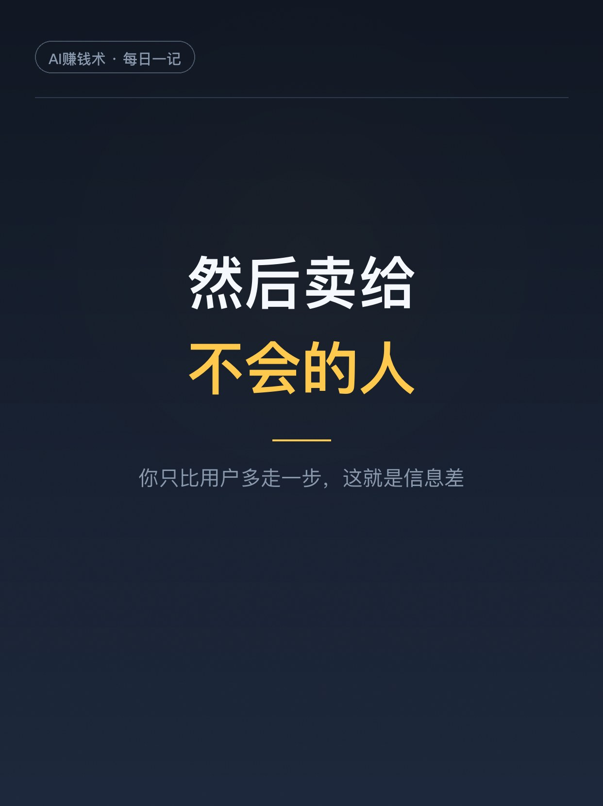
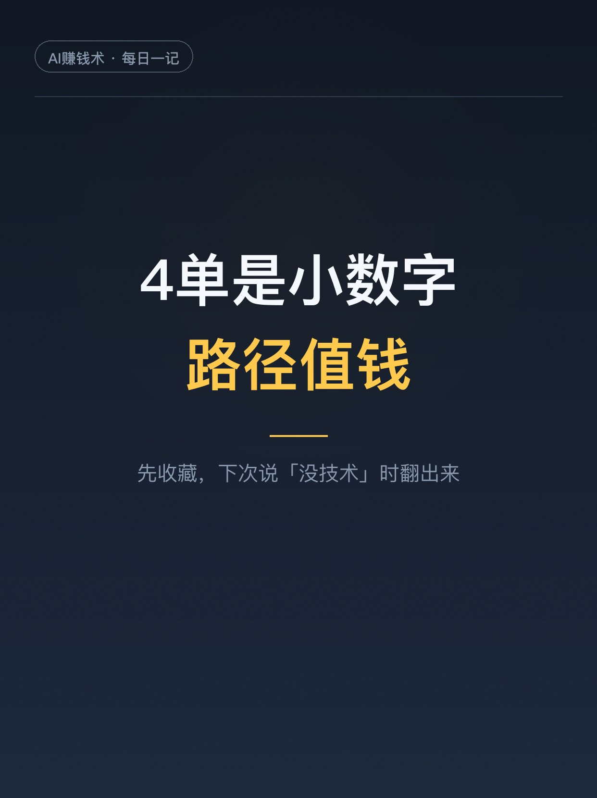

# 宝妈离职20天，靠AI复刻当天开单

> 第10期 · 2026-10-25 14:41 发布 · AI 赚钱内容

## 标题（可直接复制）

```
宝妈离职20天，靠AI复刻当天开单
```

## 正文（可直接复制发布）

晚上刷 X，一条推文把我困意看没了。

一个叫乔庭的宝妈，离职第 20 天，靠 AI 做出了自己的一个产品，当天成交 4 单。（案例转述自 X 博主 Ben 的帖子，数字以原帖为准。）

就 4 单，钱真不多。但我盯着这行字看了半天——她不会写代码。

这事有意思的地方在于：她干的事，你也能干。我把她的路子翻出来细看，核心就一句话：把已经被市场验证过的产品，用 AI 重做一遍，再卖给同样不会做的人。听着简单，钱恰恰藏在这种「不原创」里。

1️⃣ 先去淘「已验证」的产品
别自己憋创意。市面上已经跑通、有人真金白银花钱买过的 AI 工具，就是现成的选题库。别人已经帮你试过错，跟着走就行。多刷榜单、社群和评论区，哪个工具底下全是「求教程」，哪个就是机会。记住一个标准：已经有人靠它收到钱的，才值得跟。

2️⃣ 再用 AI 把它复刻成你的版本
这一步有点反直觉：不用学编程。现在会打字，就能让 AI 把代码一行行写出来。界面丑没关系，先跑起来，再一版一版改到能收钱为止。你交付的不是技术，是「我帮你弄好了」。

3️⃣ 然后卖给和你一样懵过的人
这是整个模式的钱眼。你觉得「这还要教？」的事，多的是人不会。你是宝妈就找宝妈圈，是新手就找新手圈，你只比目标用户多走了一步，这一步就是信息差，就是定价权。定价也别贪，前期便宜点没关系，先把案例和好评攒出来，再慢慢涨。

推文里还说，她把完整 SOP 开源了。态度摆在这：路径她敢公开，说明护城河本来就不在代码里，在执行，在先发的那几步。

冷水也得泼。4 单就是 4 单，开张和赚钱之间，差着一百次推广。这案例有运气成分，当故事看可以，当路径学，要冷静。真要学，学她的顺序：先验证，再动手，后吆喝。顺序反了，努力全白费。

但「离职第 20 天就把东西卖出去了」这件事，对普通人的参考价值是实打实的：你不需要很厉害才能开始，你需要一个被验证过的对标，加一次「用 AI 重做一遍」的执行。剩下的，交给重复。

建议先收藏，下次再想说「我没技术，做不了」的时候，翻出来打脸。

你身上有什么「以为大家都会、其实大量人不会」的技能？评论区聊聊👇

（反正我是坐不住了，今晚就去翻榜单。）


## 话题标签

#副业 #AI #AI副业 #一人公司 #AI创业 #普通人的副业 #AI赚钱术日记

## 配图（7 张）









## 素材来源

X 推文 @Bengz168（2026-10-24 采集，灵感库/X推特/2026-10-24.md）

## 发布信息

| 项 | 值 |
|---|---|
| 平台 | 小红书 |
| 期数 | 第10期 |
| 发布时间 | 2026-10-25 14:41 |
| 正文长度 | 916 字 |
| 图片数量 | 7 张 |
| 状态 | 已发布 |
