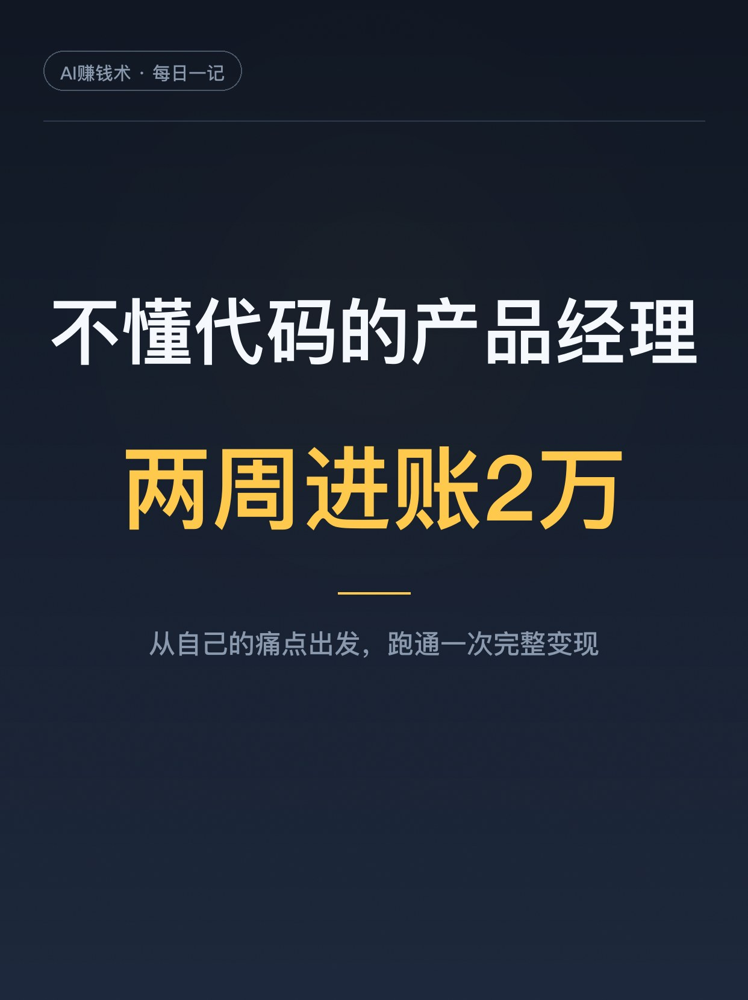
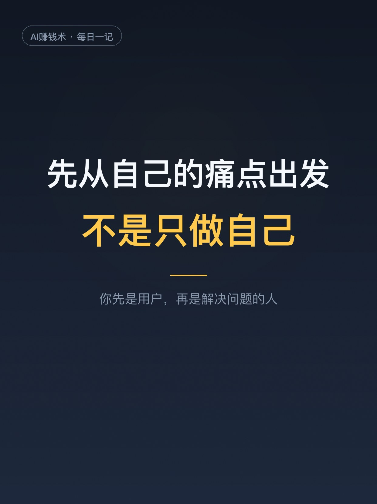
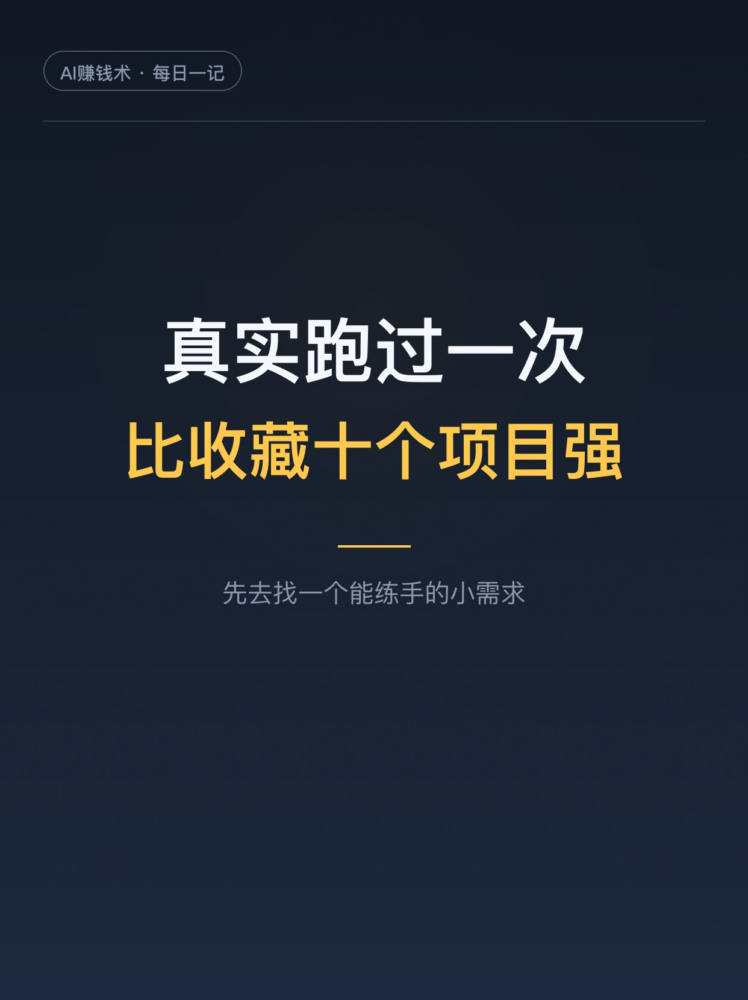

# 为脱单做个小工具，两周进账2万

> 第11期 · 2026-10-25 10:24 发布 · AI 赚钱内容

## 标题（可直接复制）

```
为脱单做个小工具，两周进账2万
```

## 正文（可直接复制发布）

晚上刷到一篇复盘，看得我坐直了。一个北邮硕士，在360和百度做过几年产品经理，24岁年薪60万，唯一的心病是：不懂代码。

今年他为自己做了个小工具，叫「AI展示面大师」。要解决的痛点特别具体：男生在交友软件上，翻遍相册，找不出几张能看的照片。

结果呢，两周进账接近2万。

我酸了。但酸完发现，这事能学的地方有五处，一处比一处实在。

1️⃣ 先从自己的痛点出发
他做这个，起因是自己相册里全是工作截图。但他强调了一点：从自己出发，不是只做自己。你先是这个问题的用户，再变成解决问题的人，判断会准很多。动手之前照样要出门看一眼：有没有人已经在为这事付钱，现有方案贵在哪、慢在哪。

2️⃣ 花399块，买一次同行交付
确认需求存在后，他没直接开干，先花钱买了同行的399元教程。付完才看清：用户拿到手的是一堆教程加一个复杂平台，token还要另外充值。问题根本没被解决，只是换了个地方放着。买一次，比看十篇拆解都管用。

3️⃣ 从199降到69，是在缩短用户的路
一开始他跟着同行定价199，二十个咨询转不了一单。降到69以后，三个咨询能成一个。他说这不是降价换量：工具是自己的，用户后续充值还留在他的体系里，69只是入门门槛。定价不看你想要多少，看用户付完钱，离想要的结果还有多远。

4️⃣ 收入分三层，别把流水当能力
69元产品卖了一百多单；三分之一的人后续充值，单笔50左右；还有一位用户下了8000元代运营单，他接了，就想把这条链路也跑一遍。他特意提醒：高客单的心力也高，时间、注意力、可复制性，都是成本。

5️⃣ 真正的坑，在引流承接
有条视频爆了以后，用户大量加微信，他的个人号被干废了6个。后来想明白了：69元这种低客单，压根不用硬拉私域，看内容、进小程序、付款、直接用，链路越短越好。私域留给需要深度沟通的人。

他把这套流程跑完，结论就一句：真实跑过一次，比收藏十个「AI变现项目」都强。

建议先收藏，找项目的时候翻出来对照着看。你相册里，有几张拿得出手的照片？评论区聊聊👇

## 话题标签

#副业 #AI #AI副业 #一人公司 #AI创业 #普通人的副业 #AI赚钱术日记

## 配图（7 张）







## 内容要点

1. 从自己的痛点出发，但不是只做自己：先当用户，再当解决问题的人，动手前先看有没有人付过钱
2. 花 399 元买一次同行交付：付完钱才看清用户卡在哪，买一次比看十篇拆解管用
3. 定价 199 降到 69：不是降价换量，是缩短用户离结果的距离，转化率从 1/20 到 1/3
4. 收入三层：69 元入门 100 多单 + 三分之一用户复充 + 8000 元服务单；高客单心力也高
5. 真正的坑在引流承接：视频爆了个人号被干废 6 个；低客单走短链路，别硬拉私域

## 素材来源

飞书文档《为了用交友软件匹配上更多女生，零编程基础的我做了个 AI 展示面工具，2周变现2万》（作者：洛更 / Logan，生财有术精华）

## 发布信息

| 项 | 值 |
|---|---|
| 平台 | 小红书 |
| 期数 | 第11期 |
| 发布时间 | 2026-10-25 10:24 |
| 正文长度 | 852 字 |
| 图片数量 | 7 张 |
| 状态 | 已发布 |
