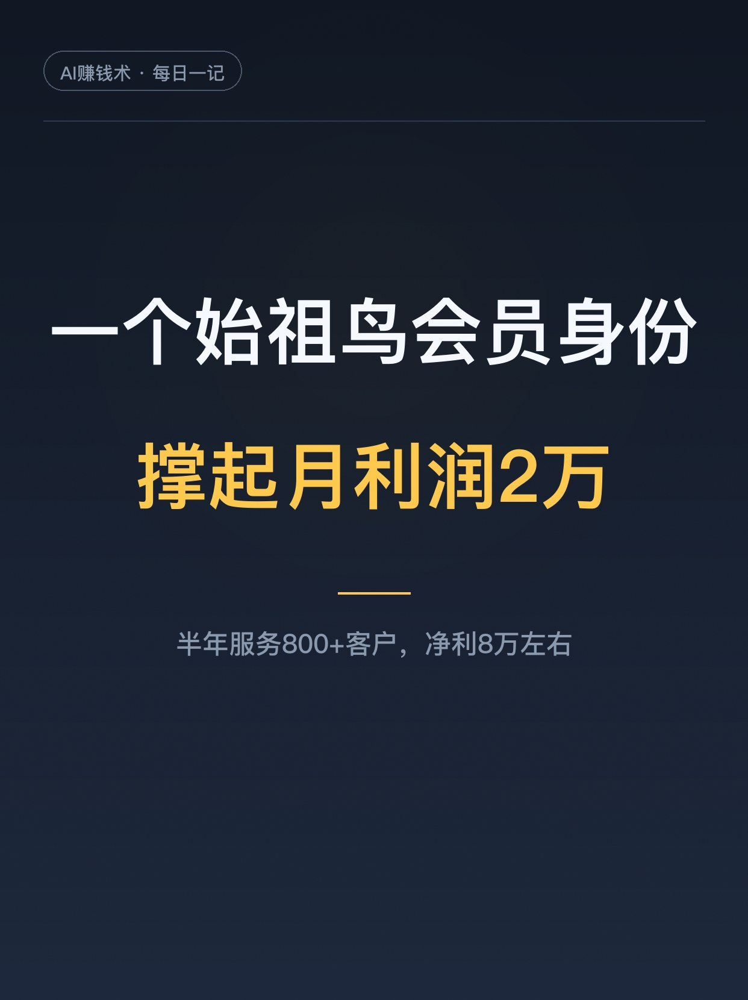
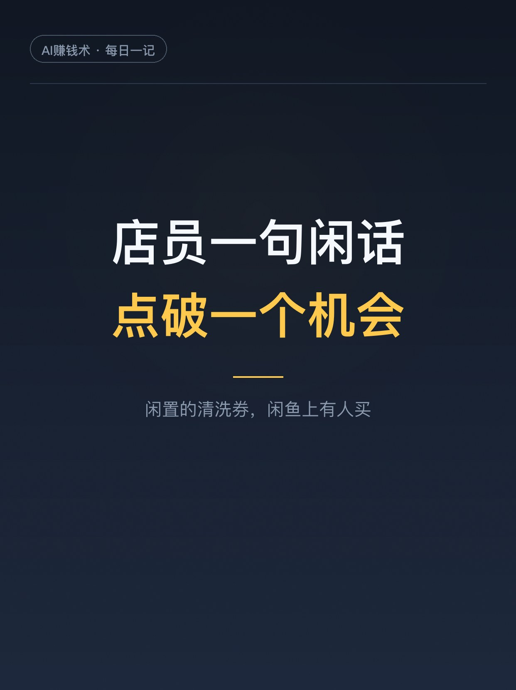
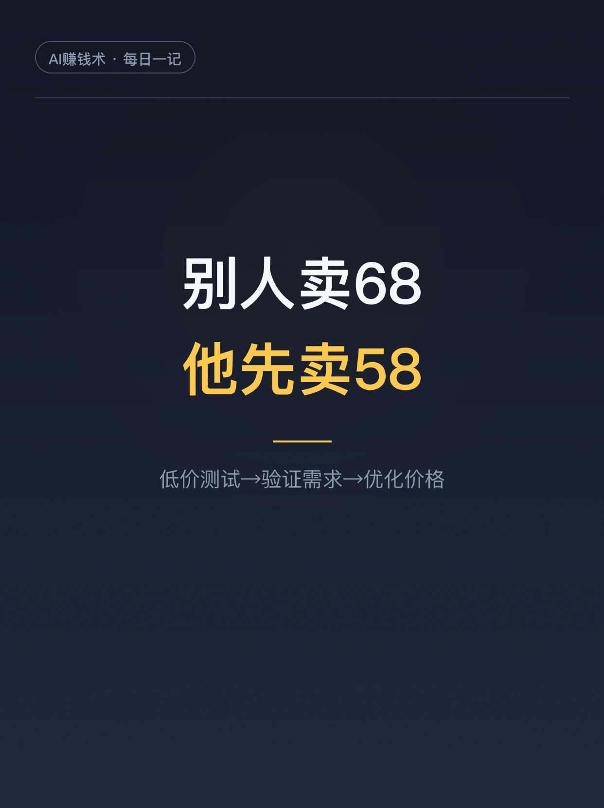
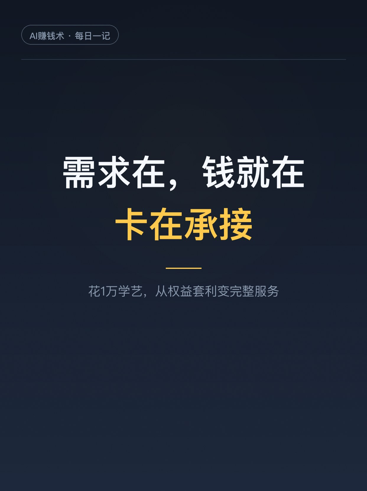
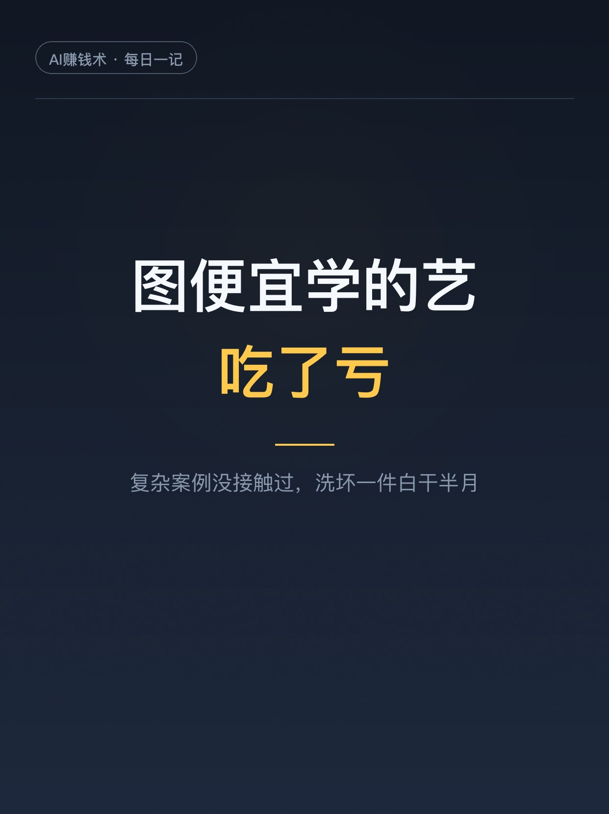
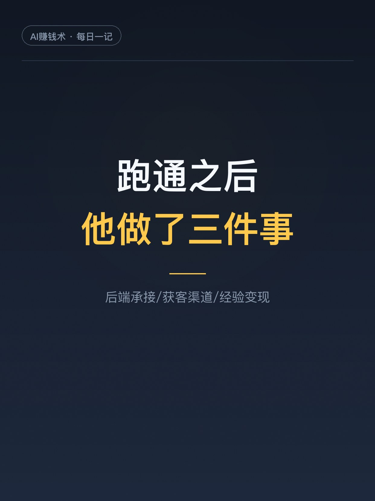
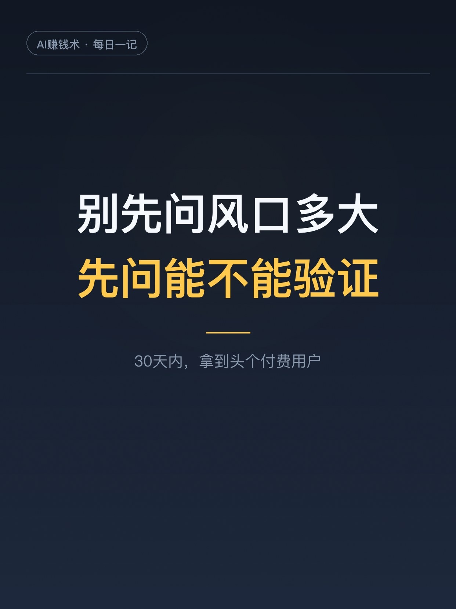

# 一个始祖鸟会员身份，撑起月利润2万

> 第12期 · 2026-10-25 10:32 发布 · AI 赚钱内容

## 标题（可直接复制）

```
一个始祖鸟会员身份，撑起月利润2万
```

## 正文（可直接复制发布）

先问一句：你身上有没有那种「没用起来」的小优势？

讲个真事。主人公在杭州，毕业三年，干过叮咚管培、阿里国际站销售、得物卖鞋、球鞋修复，后来做起了冲锋衣洗护。半年时间，服务客户800多人，营收10万左右，净利润8万左右，单月利润接近2万。

而这一切的起点，只是他手里几个始祖鸟Alpha账号。

1️⃣ 机会是店员一句闲话点破的
为了拿商场会员权益，他常去始祖鸟门店买东西，再挂得物卖掉，衣服不亏钱，权益白拿。攒了几个年消费10万的Alpha账号，里面的清洗券一直闲置。有次店员闲聊提了一句：这券在闲鱼有人卖。他回去一搜，果然，销量还不错。

2️⃣ 别人卖68，他先卖58
低价只为快速验证需求，很快成交。跟同行聊过才发现，人家标68，实际成交更高。于是他把价格调了回来。顺序是：低价测试、验证需求、优化价格。他说不投流，闲鱼本身就够吃饱，这让他确认需求不是偶然。

3️⃣ 需求在，钱就在，卡在承接
做了一个月，客户多到接不过来。他的清洗权益有限，但需求一直在。他意识到：问题不是市场不存在，是承接能力不够。于是他跑去成都学艺，学费加住宿花了1万，回来自己就能洗，从权益套利变成了完整服务。

4️⃣ 学费上栽了个跟头
成都两家机构，8800和5980，他图省钱选了便宜的。回来才发现，复杂案例根本没接触过。一件几千上万的衣服，洗坏了半个月白干。冲锋衣是复合面料，压胶多，很多去污化料不能用，洗前不告知风险，洗后开胶起泡全是纠纷。他的原话：创业里贵的成本不是花钱，是走错方向浪费时间。

5️⃣ 跑通之后，他做了三件事
提升后端：学技术，找本地门店合作，以后只管获客。洗衣服是为了不洗衣服。拓展渠道：从闲鱼扩到小红书、抖音，这行成交的大障碍是信任。再加一层：把经验教给想入行的人，学费是另一份收入。

他说普通人找副业，别先问风口多大，先问自己：能不能在30天内，拿到头个付费用户。一个小需求，加一个小优势，再加一个快速验证的闭环，也可能改变收入结构。

建议先收藏，找方向的时候翻出来看看。你身上有什么闲置的小优势？评论区聊聊👇

## 话题标签

#副业 #创业 #小生意 #年轻人创业 #个体创业 #普通人的副业 #AI赚钱术日记

## 配图（7 张）









## 内容要点

1. 机会发现：始祖鸟 Alpha 账号闲置的清洗券，被店员一句闲话点破，闲鱼已验证有需求
2. 低价验证：别人卖 68 他先卖 58，验证需求后再把价格调回来
3. 承接卡点：需求在钱就在，权益有限就花 1 万去成都学艺，从权益套利变完整服务
4. 学费踩坑：图省钱选 5980 的课，复杂案例没接触过；洗坏一件几千块的白干半月
5. 放大三件事：后端承接（找门店合作）、获客渠道（闲鱼扩到小红书抖音）、经验变现（带学员）

## 素材来源

飞书文档《不要盲目寻找风口：我是如何利用一个始祖鸟会员身份，跑通一个月利润近2万的小生意》（作者：不被大风刮跑，生财有术精华）

## 发布信息

| 项 | 值 |
|---|---|
| 平台 | 小红书 |
| 期数 | 第12期 |
| 发布时间 | 2026-10-25 10:32 |
| 正文长度 | 868 字 |
| 图片数量 | 7 张 |
| 状态 | 已发布 |
