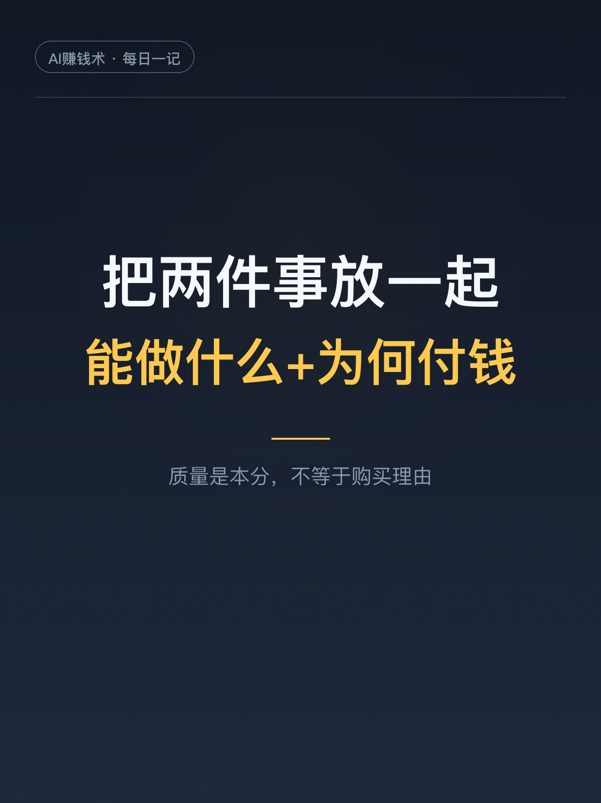
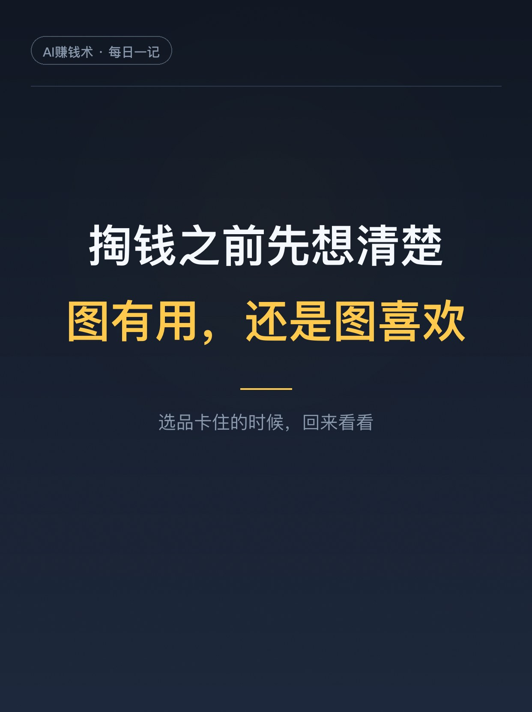

# 教辅三月卖1000，图纸半月6000

> 第14期 · 2026-10-25 13:38 发布 · AI 赚钱内容

## 标题（可直接复制）

```
教辅三月卖1000，图纸半月6000
```

## 正文（可直接复制发布）

两个数字摆在一起，挺扎心的：有人花三个月做教辅资料，卖了1000块。转头做了张拼豆图纸，挂上小红书，半个月卖了6000多。

同一个人，同样的认真。差别在哪？我把它翻出来看完了，这篇复盘值得每个做虚拟产品的人看一遍。

1️⃣ 教辅：质量上去了，购买欲没上来
她做教辅较真到底。配图不是装饰，是帮孩子理解知识点的，AI生成的图整体看着行，细看总有细节画错，只能一遍遍改。同行价格低、资料量大，她做得慢，数量也不占优势。三个月，销售额1000块，还没算AI订阅费。她后来想明白了：家长是精打细算的，会比价格、比资料数量。你认可质量，他们还是选便宜量大的。

2️⃣ 图纸：买的是喜欢，不是参数
拼豆图纸完全是另一个逻辑。看到一个好看图案，想亲手拼出来，愿意为这份喜欢付钱。当然，好看不够，图纸还得真能照着拼。这种兴趣付费黏性更强，拼完一张，还想找下一张。做图纸的效率也上来了：AI负责生成，她负责挑和改，但把关的环节从不省。

3️⃣ 转折发生在9月12日下午
她去玩拼豆，突然想自己做张图纸。起初就是给自己拼的，没当成项目。做完顺手发了小红书，挂上售卖链接。当天发了八张超大图和八张52格小图。帖子直接爆了：两天涨粉1000，当天就有人下单。她后来复盘，图纸能爆，是因为戳中的是「我也想拼一个」的冲动。

4️⃣ 爆了之后，她也摔了一跤
9月16号，因为操作不当，账号被限流，禁止发帖私信，处罚一个月。收入跟着掉。但即便流量受了影响，每天还是有进账，低的那天也有100多。那一个月像坐了趟过山车。这事说明两件事：平台流量直接影响收入；发出去的图纸，本身还能继续带订单。

5️⃣ 她给的教训，就一句话
把「我能做出什么」和「用户愿意为什么付费」放一起考虑。质量是产品的本分，但不等于购买理由。选品的时候先想清楚：对面那个人，掏钱是图有用，还是图喜欢。她后来还搭了工作流：先明确目标减少试错，留出样稿检查环节，画面效果和实际可拼性分开验，版本归档方便后续修改。

建议先收藏，选品卡住的时候回来看看。你在为什么东西付钱？评论区聊聊👇

## 话题标签

#副业 #AI #虚拟资料 #AI副业 #小红书运营 #知识付费 #AI赚钱术日记

## 配图（7 张）





## 内容要点

1. 教辅：质量较真到底，但家长比价格比数量，三个月只卖 1000 块，质量≠购买理由
2. 图纸：兴趣付费，为「想亲手拼出来」的喜欢掏钱，黏性更强，拼完还想找下一张
3. 转折：9月12日下午一条图纸分享帖爆了，两天涨粉 1000，当天开单，15 天卖了 1273 元
4. 摔坑：操作不当被限流处罚一个月，收入掉但没断，说明已发内容本身能继续带订单
5. 教训：把「我能做出什么」和「用户愿意为什么付费」放一起考虑，选品先想掏钱动机

## 素材来源

飞书文档《教辅做了三个月卖了1000元，给自己做的拼豆图纸，半个月卖了6000多》（作者：星，生财有术精华）

## 发布信息

| 项 | 值 |
|---|---|
| 平台 | 小红书 |
| 期数 | 第14期 |
| 发布时间 | 2026-10-25 13:38 |
| 正文长度 | 865 字 |
| 图片数量 | 7 张 |
| 状态 | 已发布 |
