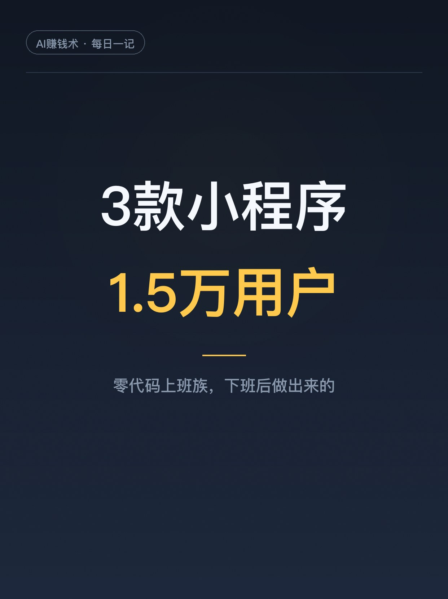
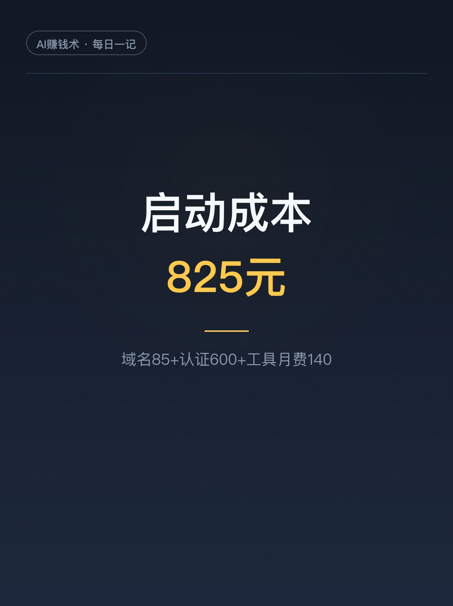
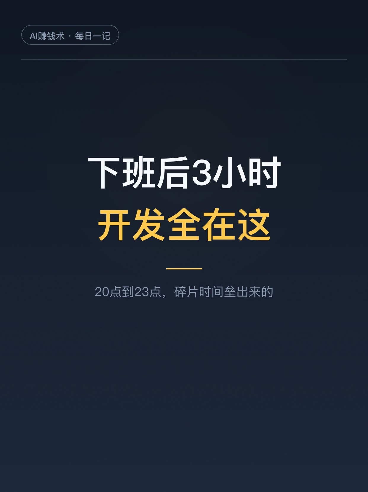
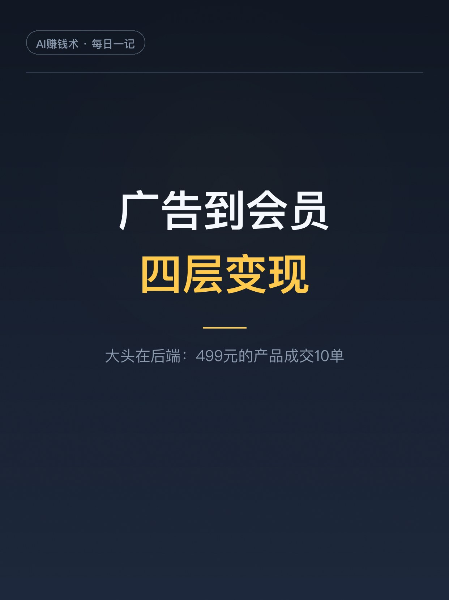

# 零代码上班族，3款小程序1.5万用户

> 第16期 · 2026-10-25 16:45 发布 · AI 赚钱内容

## 标题（可直接复制）

```
零代码上班族，3款小程序1.5万用户
```

## 正文（可直接复制发布）

先看结果：3 款小程序，累计用户约 1.5 万，启动成本 825 元。

主角叫周小白，集团公司员工，加班出差是常态，周末带娃。所有开发都在下班后 20 点到 23 点的碎片时间里完成。他不会写代码，英语也不行，大学读的文学，在音乐学院，不上数学课。

1️⃣ 825 元就把摊子支起来了

域名 85，小程序认证 600，Claude Code 月费 140，服务器平台送。3 月到 5 月陆续上线 3 款小程序，原创治愈头像壁纸用户破 1 万。7 月到 8 月，他把 3 款整合成「周小白工作台」，上架当天成交 2 单，还有一单 3999 的陪跑服务。

2️⃣ 不会代码，真不是门槛

他的原话：审美是核心资产，创意是底层能力，AI 是放大器，代码只是执行层，这一层可以外包给 AI。没有 AI，他肯定做不出这些产品。

3️⃣ 变现四层，大头在后端

广告：用户点广告才能下载图片，两千多块。会员：开会员免广告直接下高清图，占比很大。创作者分成：图库里有别人的作品，一千多。真正的大头是后端服务：从这个入口导到私域，499 元的产品成交 10 单，还有 999 元的其他订单。

壁纸小程序高峰期单月收入到过 5000 块。

4️⃣ 小程序是入口，私域才是根

他说得直接：小程序是承接入口，真正值钱的不只是广告，是背后能不能把人导入私域、能不能和其他产品形成闭环。来下载壁纸的人，顺便看到他的课程和陪跑服务，自然就转化了。三款产品的流量来源也不一样：时间管理那款靠朋友圈和小红书，壁纸那款靠公众号加小红书双渠道，创作助手纯靠之前攒下的 100 多家学员。

5️⃣ 先用访问验证，再叠付费层

他的顺序：先用访问和使用验证需求，再逐步加付费层。广告、会员、图片授权、工具服务，一层层加，每一层都有人掏钱了，才往下走。

6️⃣ 需求从自己身上长出来

做时间管理那款，起因是市面上没有一款适合他的工具：滴答清单、Notion 太重，他又想一眼看到一周的时间块。他用 Excel 做了半年，有效，但手机上用不了。

当你不知道该做什么的时候，别先想市场缺什么，先看自己生活里有什么事让你反复觉得麻烦。

建议先收藏，想搞副业的时候翻出来看看。你每天有没有被什么小事折磨到？评论区聊聊👇

## 话题标签

#副业 #自媒体 #AI #AI副业 #上班族副业 #普通人的副业 #AI赚钱术日记

## 配图（8 张）








## 内容要点

1. 825元启动：域名85+认证600+工具月费140，3到5月上线3款小程序
2. 开发全在下班后20点到23点，加班出差带娃的上班族
3. 不会代码不是门槛：审美是核心资产，AI是放大器，代码是执行层
4. 变现四层：广告、会员、创作者分成、后端服务；大头是499元产品成交10单
5. 小程序是入口，私域才是根：来下载壁纸的人顺便买了课程和陪跑
6. 先用访问验证需求，再一层层叠付费层

## 素材来源

飞书文档《【实战】上班族用AI做小程序：0代码上线3款产品，1.5万用户，跑通内容×产品×服务闭环》（作者：周小白补习班，生财有术精华，2026-08-27）

## 发布信息

| 项 | 值 |
|---|---|
| 平台 | 小红书 |
| 期数 | 第16期 |
| 发布时间 | 2026-10-25 16:45 |
| 正文长度 | 947 字 |
| 图片数量 | 8 张 |
| 状态 | 已发布 |
