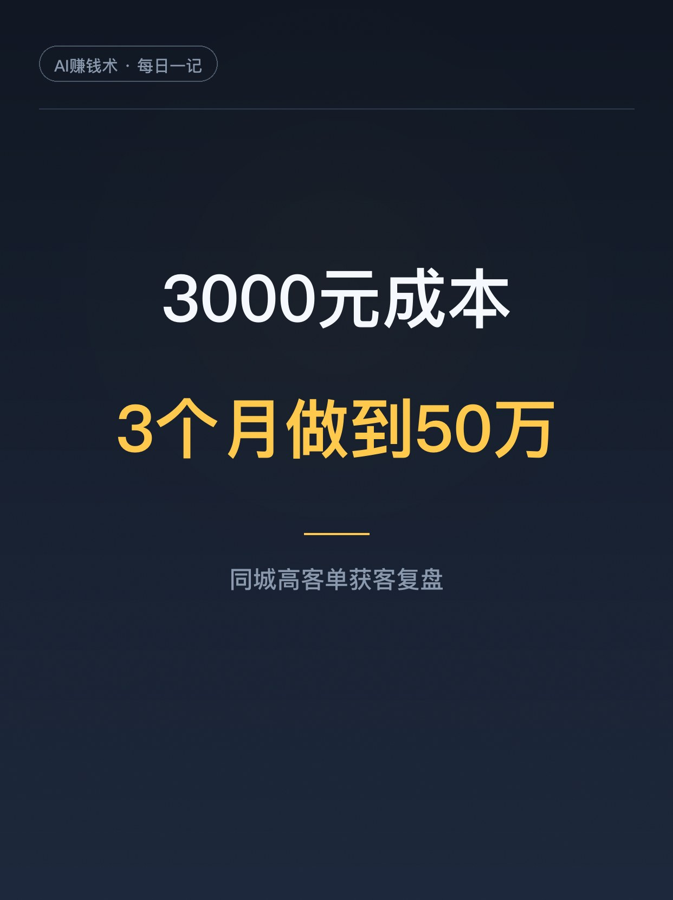
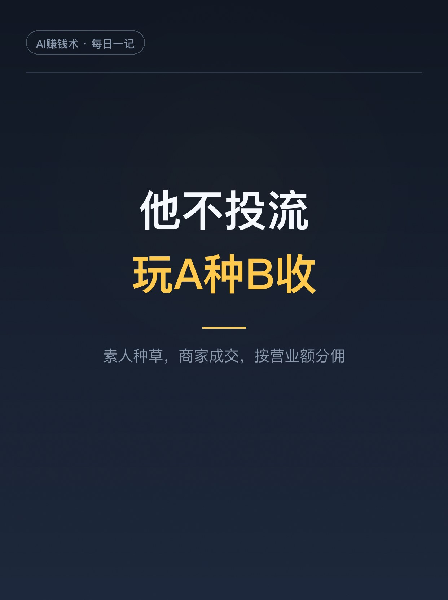
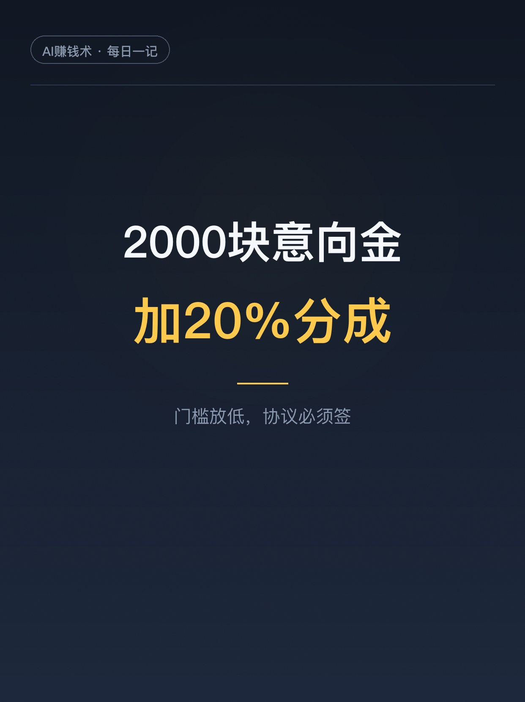
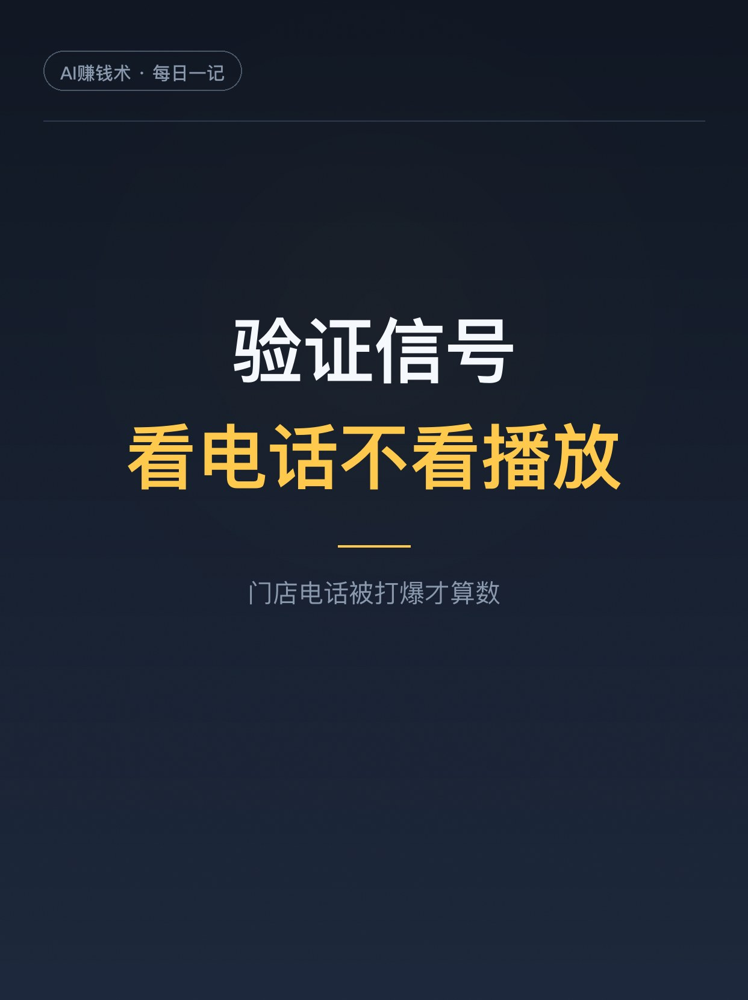
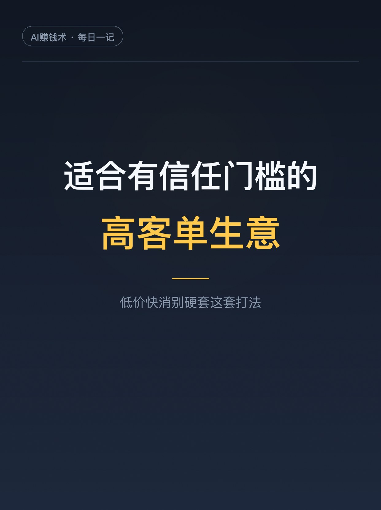

# 3000元成本，帮商家3个月做50万

> 第18期 · 2026-10-25 20:51 发布 · AI 赚钱内容

## 标题（可直接复制）

```
3000元成本，帮商家3个月做50万
```

## 正文（可直接复制发布）

晚上十点多，刷到份同城项目复盘，我直接从沙发上坐起来了。

一个做同城获客的哥们，现金投入 3000 块，3 个月帮商家拉到 500 个到店客户，商家做了 50 万营收，他分到 10 万利润。每天就花 1 小时。

我酸了。但酸完看，这套打法普通人真能学，拆成 5 件说。

1️⃣ 他不投流，玩的是「A种B收」

3000 块里，1000 是启动费，2000 是素人代发加流量激励，没走投流。

路径：素人种草 → 第三方信任 → 客户咨询 → 到店 → 商家成交 → 按营业额分佣。

A 是素人号、本地小号，负责造势；B 是商家主账号、门店电话，负责成交。商家自己说好，用户天然防着；第三方讲「我为什么来、体验咋样」，用户才肯信。

2️⃣ 挑商家，只看 5 个条件

他看了七八家，选中那家符合：线上几乎空白、有成交能力、客单价拉得高、老板心态开放、适合第三方种草。

其中「线上空白」容易被人误解。商家线下有能力、线上没系统，他进去才有价值。反过来，商家自己线上做得飞起，凭什么分你 20%。

3️⃣ 2000 块意向金，把合作谈下来

没要代运营费，只收 2000 意向金，加营业额 20% 分成。商家试错成本低，他拿真实项目练手。

但他反复强调：必须签协议。数据归属、业绩核算、分佣边界提前写清楚。线上来的客户，商家报不报备全凭自觉，不写死，跑起来就是扯皮。

4️⃣ 验证期，看电话不看播放

测试期前 10 条内容爆了一条百万播放。但他判断这事能成，不是播放好看，是门店电话被打爆了，还有客户从浙江专程跑过来。

播放量只是热闹，咨询和到店才是信号。

5️⃣ 每天 1 小时，活是怎么分出去的

他只管四件事：找素材、找爆款、判断内容方向、用 AI 改写文案，再把任务丢进表格和在线文档，素人去分发。5 分钟拍完一个星期的图文素材。

他不是把所有事抓在手里，是搭了一套低成本分发系统。

这套打法有门槛：适合有信任门槛的高客单生意。低价快消看价格就下单，A种B收价值没那么大。

看完我把通讯录里的店想了一遍。建议先收藏，想帮本地商家做事时翻出来对照。你身边有没有「线下有能力、线上全空白」的店？评论区聊聊👇

## 话题标签

#创业 #副业 #同城获客 #实体店转型 #一人公司 #普通人搞钱 #AI赚钱术日记

## 配图（7 张）









## 内容要点

1. 结果：现金投入 3000 元（1000 启动费+2000 素人代发），3 个月 500 个到店客户，商家营收 50 万，分佣 10 万利润，每天 1 小时
2. 模式「A种B收」：素人种草 → 第三方信任 → 咨询 → 到店 → 商家成交 → 按营业额分佣；A 造势，B 承接
3. 选商家 5 条件：线上空白、有成交能力、客单价高、老板开放、适合第三方种草
4. 启动：2000 元意向金 + 20% 分成，必须签协议写清数据归属和分佣边界
5. 验证信号看电话不看播放；每天 1 小时只做找爆款、AI 改写、表格派活、素人分发
6. 适用边界：有信任门槛的高客单生意，低价快消不适用

## 素材来源

飞书文档《3000元成本，3个月营收50万：一个同城高客单项目的复盘》（作者：楚中天，生财有术精华，2026-07-29）

## 发布信息

| 项 | 值 |
|---|---|
| 平台 | 小红书 |
| 期数 | 第18期 |
| 发布时间 | 2026-10-25 20:51 |
| 正文长度 | 917 字 |
| 图片数量 | 7 张 |
| 状态 | 已发布 |
