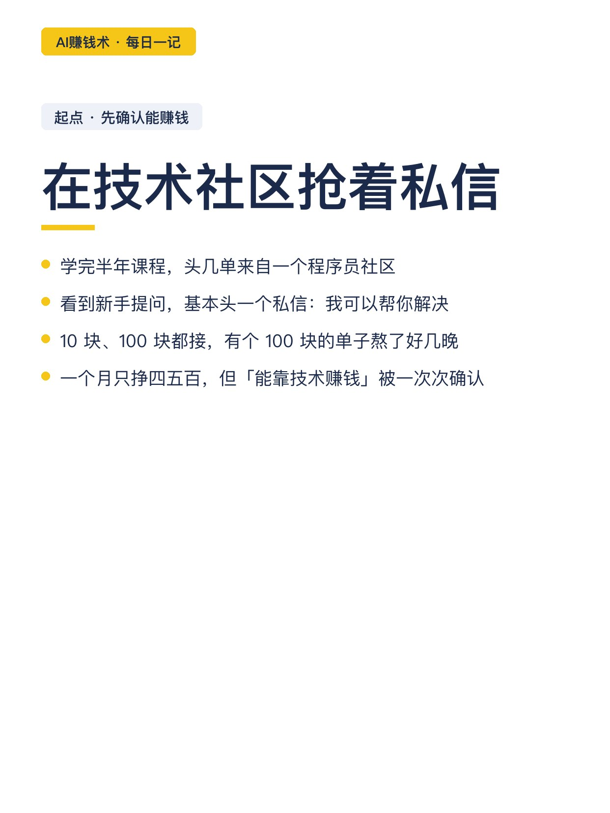
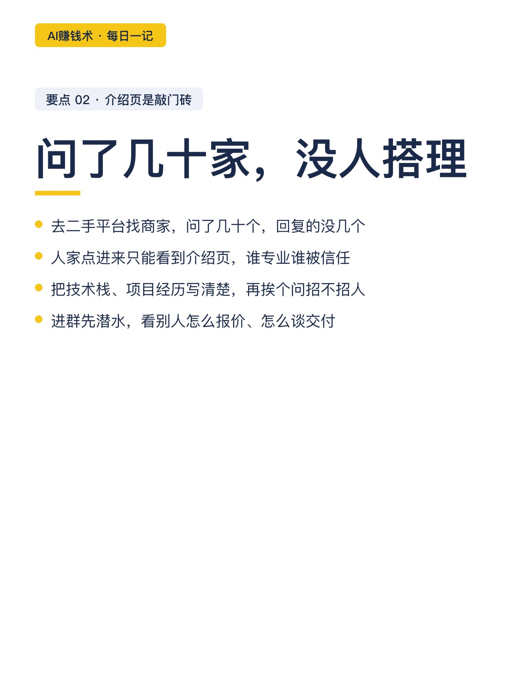
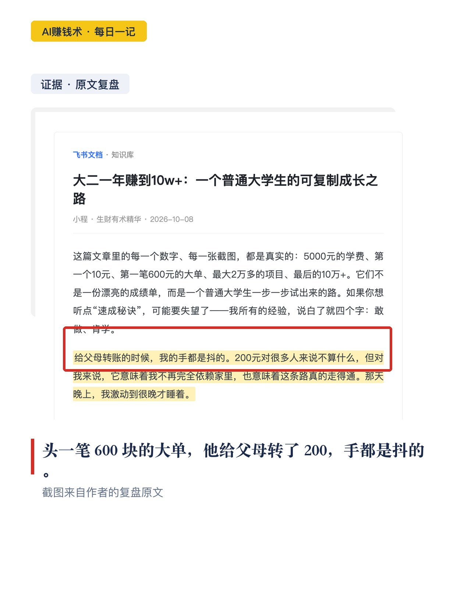
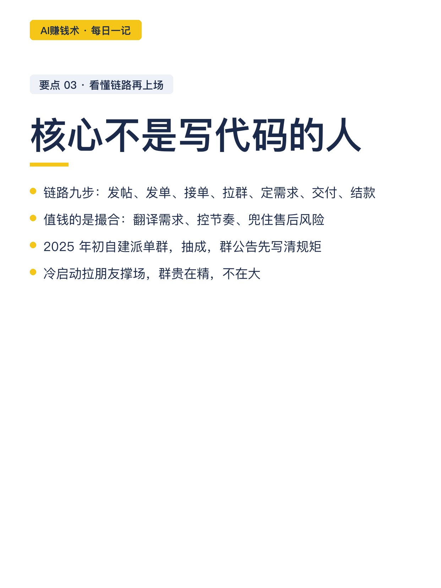
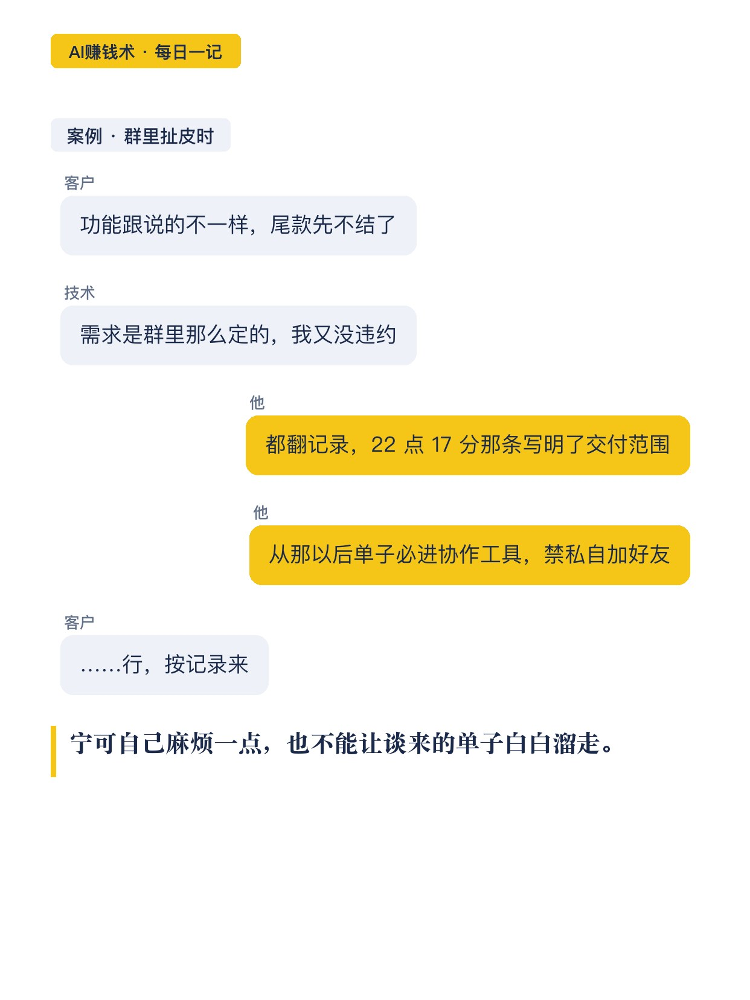
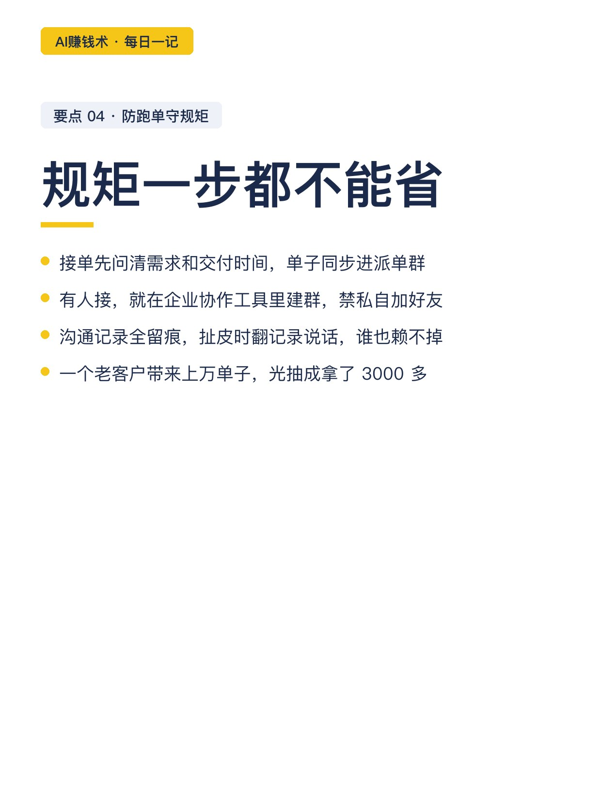
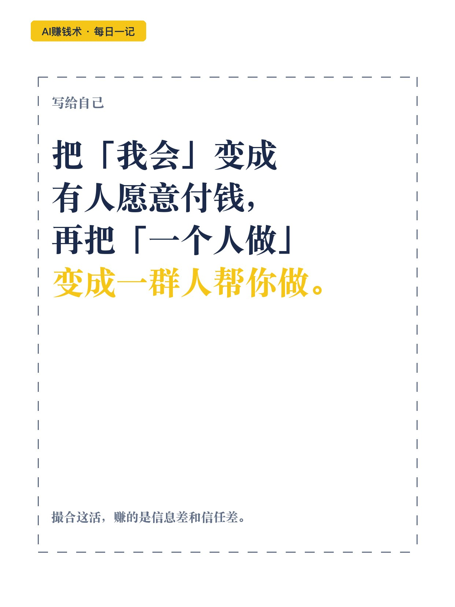

# 大学生起步10元，一年赚到10万

> 第19期（重做） · 2026-10-26 14:16 发布 · AI 赚钱内容

## 标题（可直接复制）

```
大学生起步10元，一年赚到10万
```

## 正文（可直接复制发布）

5000 块的学费，是分期付的。每月 1500 块生活费，他抠出 500 交学费，剩下的 1000 过日子。

这个叫小程的大学生，大一开学时连电脑都不太会，练代码靠手机。一年后，他靠接单加派单，赚到 10 万。

注意，是接单加派单。到后面，不少单子不全是他自己做的。

我翻完这份复盘，印象深的不是 10 万，是他走的四步。

1️⃣ 起步：在技术社区抢着私信

学完半年课程，头几单来自一个程序员社区。他天天刷，看到新手提问，基本头一个私信过去：需要的话，我可以帮你解决。

10 块、100 块都接。⏰ 有个 100 块的单子熬了好几晚才交付，一个月下来只挣四五百。但「能靠技术赚钱」这件事，就是这么一次次确认的。

2️⃣ 介绍页，是接单的敲门砖

后来他去二手平台找商家，问了几十个，没人搭理。他想明白了：这种地方，人家点进来只能看到介绍页，谁写得专业，谁被信任。

他把技术栈、项目经历写清楚，再挨个问人家招不招人、能不能拉群。👀 进群先潜水，看别人怎么报价、怎么谈交付。

头一笔 600 块的大单前后花了三天，交付那晚他给父母转了 200，手都是抖的。

3️⃣ 看懂链路，他自己建了派单群

接单群就那几步：发帖引客户、中介发单、程序员接单、拉群、定需求、交付、结款。

他看熟了整条链路，发现值钱的不是写代码的人，是撮合的角色：🧩 把需求翻译给技术，把交付节奏控住，把售后风险兜底。2025 年初，他自建派单群，抽成。

4️⃣ 防跑单，他靠企业协作工具

接单先问清需求和交付时间，单子同步进派单群。有人接，就在企业协作工具里建群：能禁双方私自加好友，沟通记录全留痕，扯皮时翻记录说话。

📌 他还有个数字：光一个老客户，前前后后带来上万的单子，光抽成拿了 3000 多。

💡 说实在的，这套玩法不神秘：把「我会」变成「有人愿意付钱」，再把「我一个人做」变成「一群人帮我做」。

🤔 我现在的疑问是：撮合这件事，AI 能替多少，又不能替多少。想明白再写。

## 话题标签

#副业 #自媒体 #大学生 #接单 #信息差 #普通人搞钱 #AI赚钱术日记

## 配图（9 张）











## 内容要点

1. 起点：5000 元学费分期，每月 1500 生活费抠 500；大一开学连电脑都不太会，练代码靠手机
2. 起步：程序员社区抢着私信新手，10 块 100 块都接；100 块单子熬好几晚，月挣四五百
3. 敲门砖：二手平台问几十家没人搭理后，把介绍页写专业，进接单群潜水学报价谈交付
4. 升级：看懂九步链路后自建派单群抽成；企业协作工具禁私加好友、记录留痕防跑单
5. 复购：一个老客户带来上万单子，光抽成 3000 多

## 素材来源

飞书文档《大二一年赚到10w+：一个普通大学生的可复制成长之路》（作者：小程，生财有术精华，2026-10-08）

## 发布信息

| 项 | 值 |
|---|---|
| 平台 | 小红书 |
| 期数 | 第19期（重做） |
| 发布时间 | 2026-10-26 14:16 |
| 正文长度 | 840 字 |
| 图片数量 | 9 张 |
| 状态 | 已发布 |
