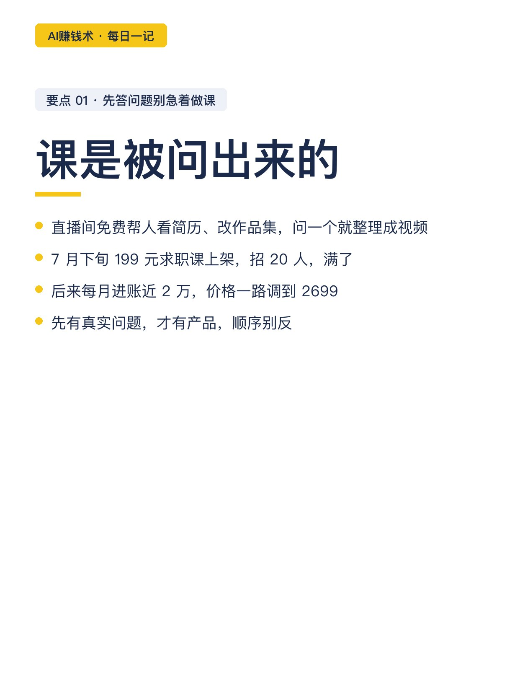
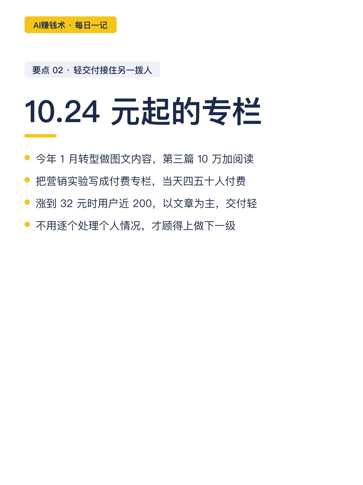
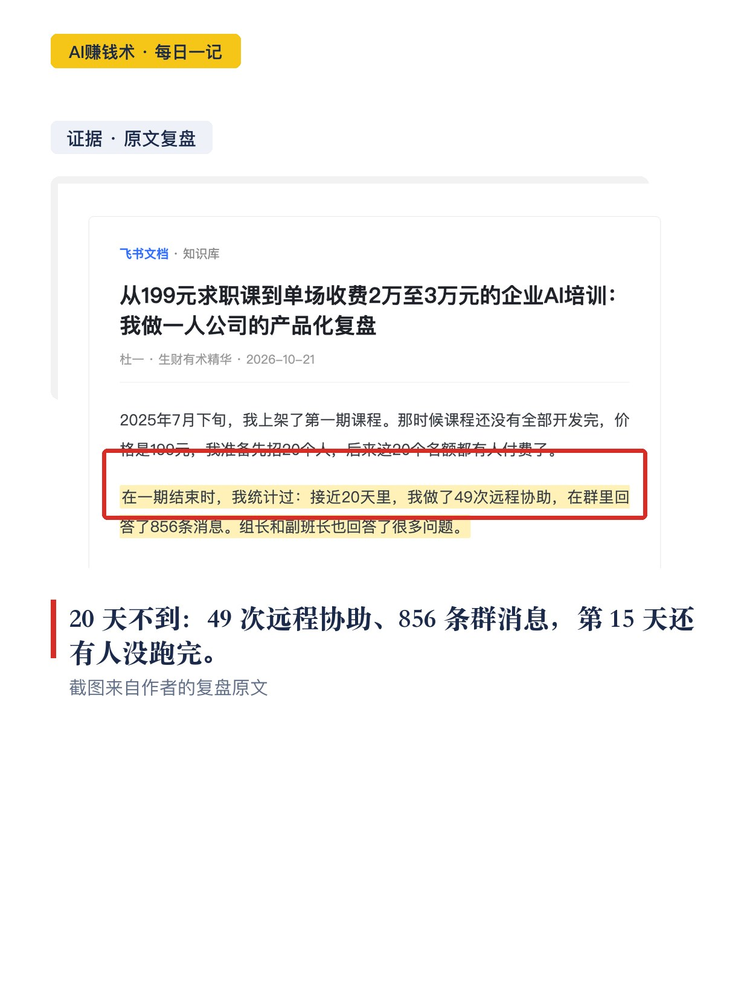
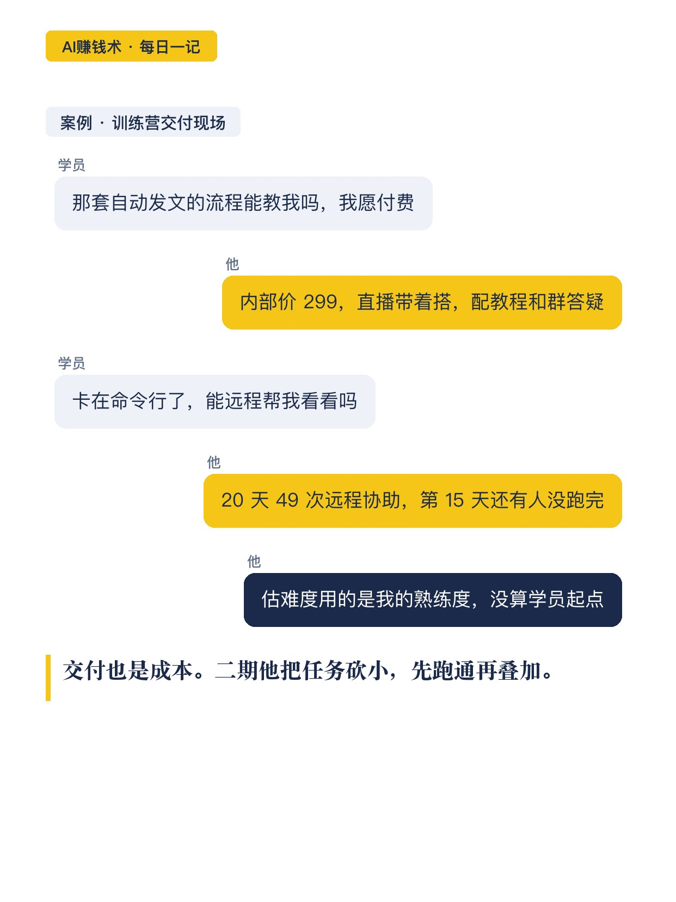
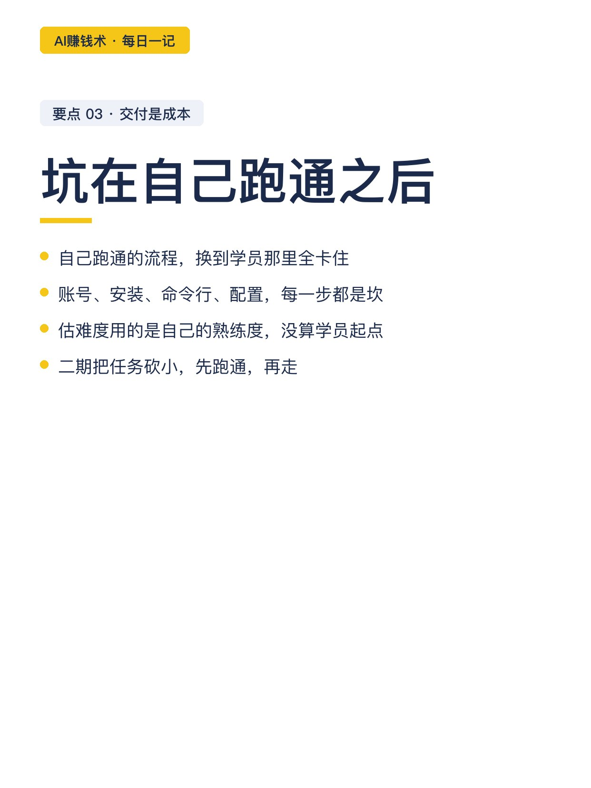
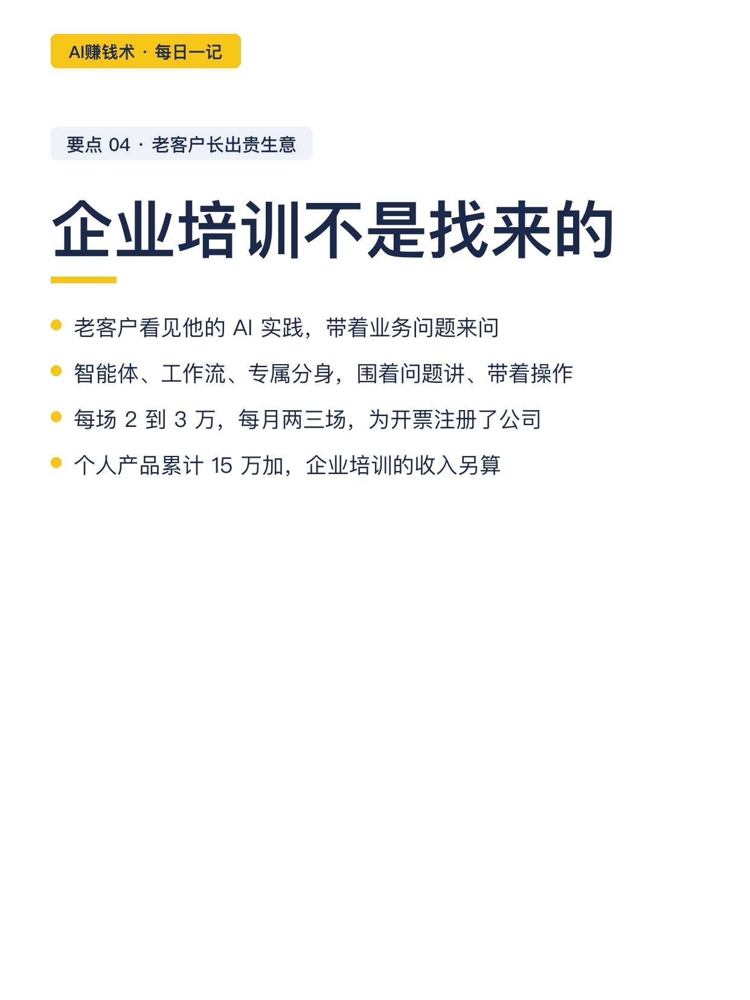
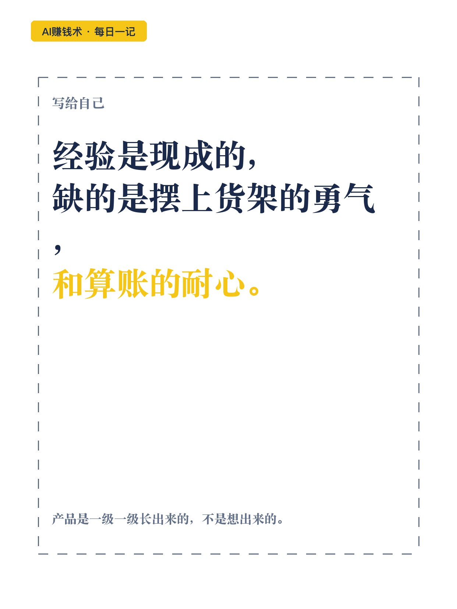

# 199元的求职课，卖到单场2万

> 第20期（重做） · 2026-10-26 16:20 发布 · AI 赚钱内容

## 标题（可直接复制）

```
199元的求职课，卖到单场2万
```

## 正文（可直接复制发布）

😮 一份复盘看得我坐直了：做了六年新媒体运营的人，去年 7 月前，还不知道怎么把经验做成产品。

两年做内容没赚到钱，焦虑到只剩老客户来找才动一动。6 月底，他刷到一条吐槽的帖子，没忍住回了条视频。

💬 就这条视频，长出一条产品线：199 元的求职课、付费专栏、AI 训练营，直到单场 2 到 3 万的企业培训。能抄的是四步。

1️⃣ 先回答真实问题，别急着做课

有人来问：这行到底干啥，零经验怎么入行。他就在直播间免费帮人看简历、改作品集，问一个就整理成一条视频。

📌 问的人多了，有人直接问有没有课。7 月下旬，199 元的求职课上架，招 20 人，满了，后来每月进账近 2 万。

课不是想出来的，是被问出来的。

2️⃣ 轻交付产品，接住另一拨人

今年 1 月他转型做图文内容，第三篇 10 万加阅读。来的新人不少自己有经验，关心怎么把能力卖出去。

他把营销实验写成付费专栏，10.24 元起，当天四五十人付费，涨到 32 元时用户近 200。这类产品以文章为主，不用逐个处理个人情况，交付轻。

3️⃣ 训练营栽跟头：交付也是成本

有人问：那套自动发文的流程能教我吗。内部价 299、公开价 399，70 多人来。

他自己跑通的流程，换到学员那里全卡住：账号、安装、命令行、配置。⏰ 20 天不到，49 次远程协助、856 条群消息，😅 第 15 天还有人没跑完。

🧩 复盘：估难度用的是自己的熟练度，没算学员起点。二期他把任务砍小，先跑通再叠加。

4️⃣ 老客户看见新能力，长出贵生意

企业培训不是找来的，是老客户看见他的 AI 实践后来问的：智能体、工作流、专属分身。对方带着业务问题来，他围着问题讲、带着操作，💰 每场 2 到 3 万，每月两三场。

他后来还涨过价：课程从 199 一路调到 2699。但他说，一对一的服务照样消耗人。

💡 说白了他这条路：经验是现成的，缺的是摆上货架的勇气，和算账的耐心。

🤔 我现在的疑问是：这套四级阶梯，换一行经验还成立吗。想明白再写。

## 话题标签

#副业 #自媒体 #知识付费 #一人公司 #个人IP #普通人搞钱 #AI赚钱术日记

## 配图（9 张）











## 内容要点

1. 起点：六年新媒体运营，2025 年 7 月前不会把经验做成产品，两年做内容没赚到钱
2. 第一级：直播间免费改简历被问出需求 → 199 元求职课招 20 人满员 → 每月进账近 2 万，后涨价至 2699
3. 第二级：付费专栏 10.24 元起，当天四五十人付费，32 元时用户近 200，交付轻
4. 第三级：AI 训练营 299/399 元 70 多人；交付坑：20 天 49 次远程协助、856 条群消息，第 15 天有人没跑完；二期砍小任务
5. 第四级：老客户看见 AI 实践来问，企业培训每场 2 到 3 万、每月两三场；个人产品累计 15 万加

## 素材来源

飞书文档《从199元求职课到单场收费2万至3万元的企业AI培训：我做一人公司的产品化复盘》（作者：杜一，生财有术精华，2026-10-21）

## 发布信息

| 项 | 值 |
|---|---|
| 平台 | 小红书 |
| 期数 | 第20期（重做） |
| 发布时间 | 2026-10-26 16:20 |
| 正文长度 | 859 字 |
| 图片数量 | 9 张 |
| 状态 | 已发布 |
