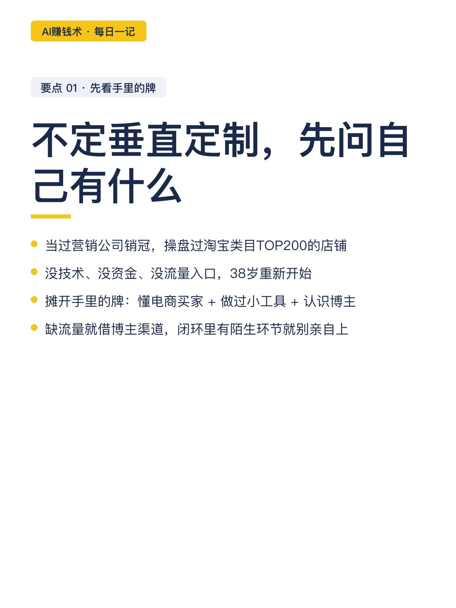
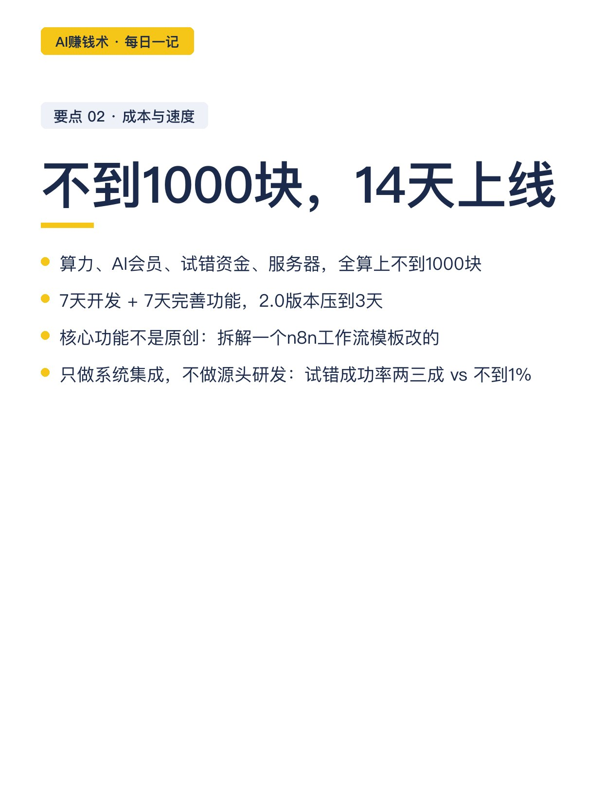
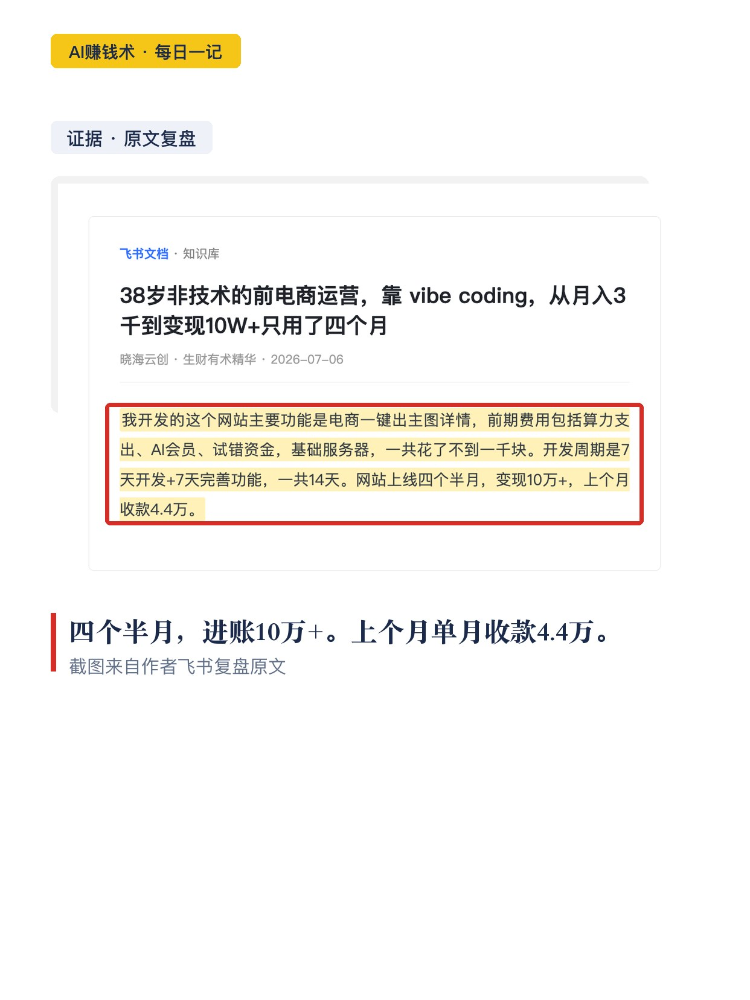
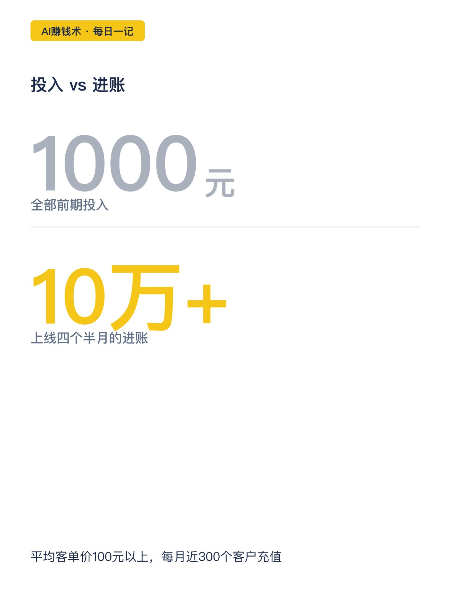
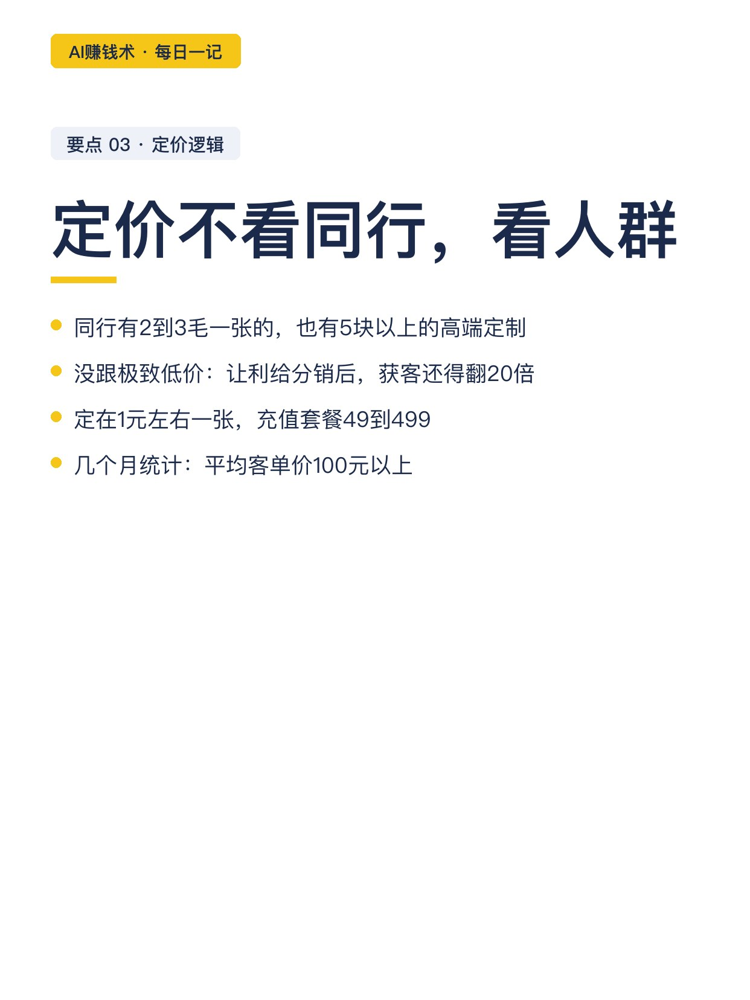
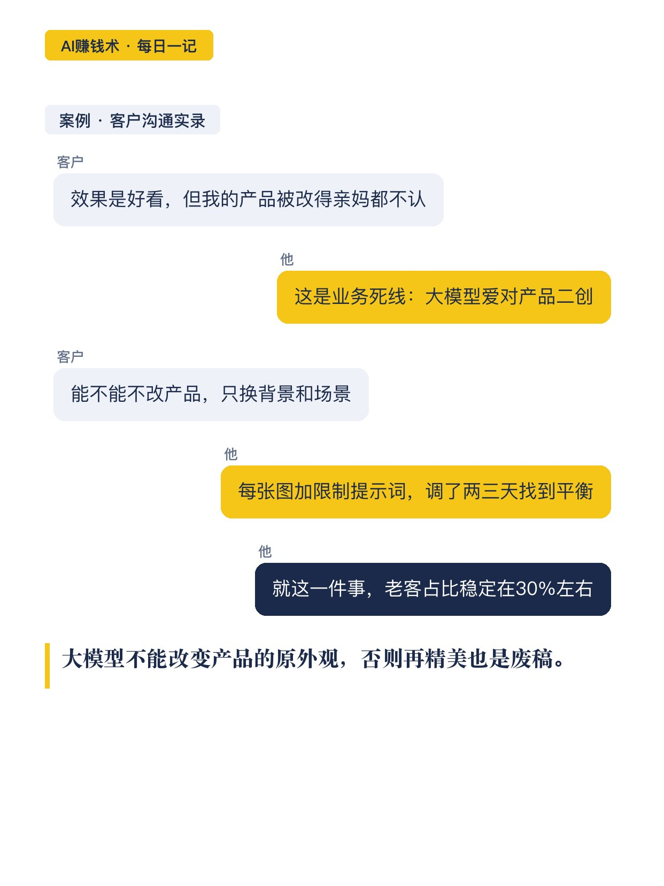
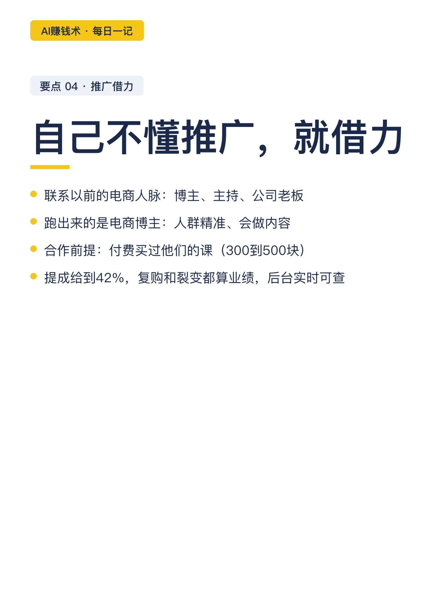
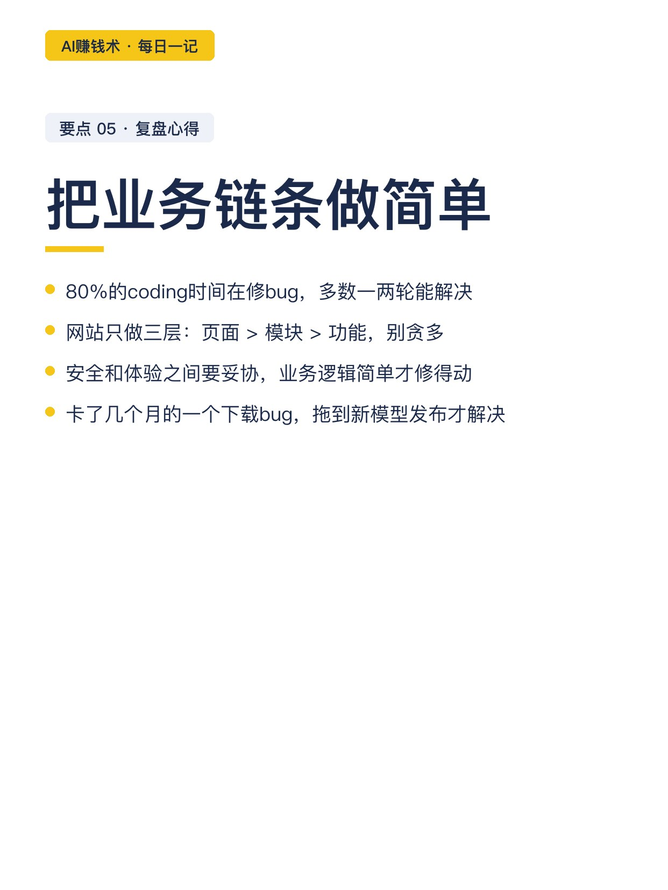
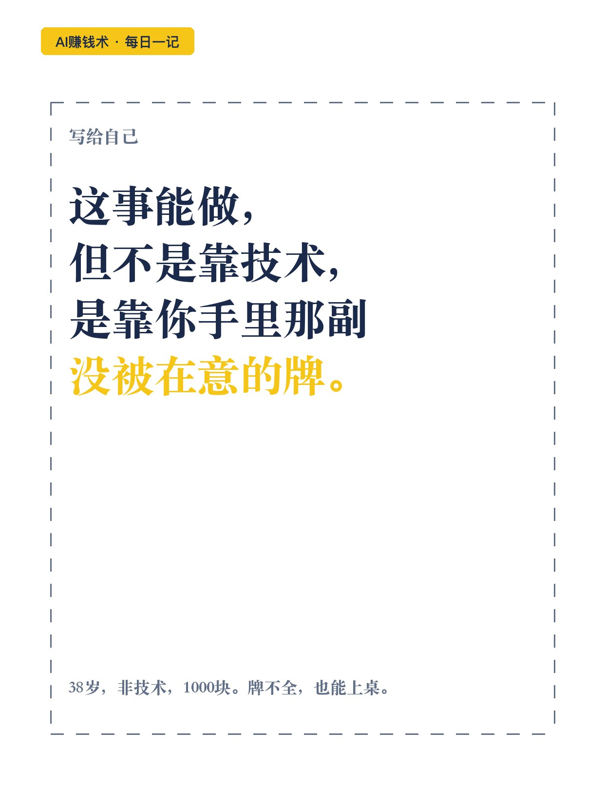

# 38岁非技术，14天做个网站进账10万

> 第21期 · 2026-10-26 09:15 发布 · AI 赚钱内容

## 标题（可直接复制）

```
38岁非技术，14天做个网站进账10万
```

## 正文（可直接复制发布）

晚上 11 点，一篇万字复盘我翻到第三遍，坐直了。一个 38 岁的前电商运营，不懂代码，今年做了个电商出图网站：全部投入不到 1000 块，开发 14 天，上线四个半月，进账 10 万+，上个月单月收款 4.4 万。💰

我酸了。但酸完发现，能学的地方有五处，一处比一处实在。😮

1️⃣ 定项目前，先看手里的牌
他当过营销公司销冠，操盘过电商平台办公家具类目 TOP200 的店铺。38 岁重新开始，没技术、没资金、没流量入口。他的做法是先把牌摊开：懂电商买家要什么、做过电商小工具、认识一堆电商博主。不懂垂直定制，就做中小卖家的通用出图工具；缺流量，就借博主的分销渠道。

2️⃣ 1000 块成本，14 天上线
算力、AI 会员、试错资金、服务器，加起来不到 1000 块。7 天开发加 7 天完善，第二版压缩到 3 天。核心功能也不是原创：拆解一个网上的 n8n 工作流模板，换成自己的业务逻辑。他只做系统集成，不做源头研发，前者的试错成功率有两三成，后者不到 1%。

3️⃣ 定价不看同行，看人群
同行有 2 到 3 毛一张的极致性价比，也有 5 块以上的高端定制，他都没跟。低价意味着要给分销更多让利，获客量还得翻 20 倍。他定在 1 元左右一张，充值套餐 49 到 499，平均客单价 100 以上，每月近 300 个客户充值。

4️⃣ 自己不懂推广，就借力
闭环里有陌生环节，他没亲自上，联系以前的电商人脉：博主、刷单主持、电商公司老板。跑出来的是两个电商博主，共同点是半年前付费买过他们的课，也就 300 到 500 块；他还免费帮人开发过带人家专属二维码的小工具。分销提成给到 42%，复购和裂变都算合作者的业绩，后台实时可查。头一个月就出了八千多业绩。📌

5️⃣ 先找到业务死线
这个领域的死线是：大模型不能改变产品的原外观，否则再精美也是废稿。上线测试后用户立刻反馈了这个问题，他的方案是给每张图加限制提示词，调了两三天找到平衡。就这一件事，老客占比稳定在 30% 左右。💡

他复盘里有一句，我抄在了手机备忘录：有想法先行动，大部分想象中的问题并不是问题。

我现在的疑问是：这套打法换到一个我不懂的行业，还成立吗。想明白这个，再动手。

## 话题标签

#副业 #AI #AI副业 #一人公司 #互联网副业 #普通人的副业 #AI赚钱术日记

## 配图（10 张）












## 内容要点

1. 定项目前先看手里的牌：懂电商买家、做过小工具、认识博主，缺流量就借博主渠道
2. 成本与速度：算力/会员/试错/服务器不到 1000 块，7+7 天上线，2.0 版压到 3 天；只做系统集成不做源头研发
3. 定价看人群不看同行：不跟 2-3 毛低价（让利+20 倍获客不现实），定 1 元左右一张，客单价 100+
4. 推广借力：半年前付费买过博主课（300-500）+ 免费帮开发带二维码小工具；提成 42%，后台实时可查
5. 业务死线：大模型不能改产品原外观；限制提示词调两三天找到平衡，老客占比 30%

## 素材来源

飞书文档《38岁非技术的前电商运营，靠 vibe coding，从月入3千到变现10W+只用了四个月》（作者：晓海云创，生财有术精华）

## 发布信息

| 项 | 值 |
|---|---|
| 平台 | 小红书 |
| 期数 | 第21期 |
| 发布时间 | 2026-10-26 09:15 |
| 正文长度 | 935 字 |
| 图片数量 | 10 张 |
| 状态 | 已发布 |
