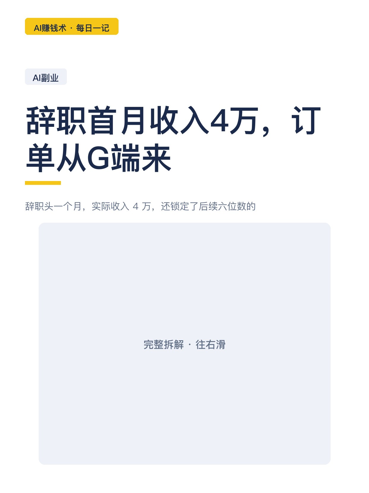
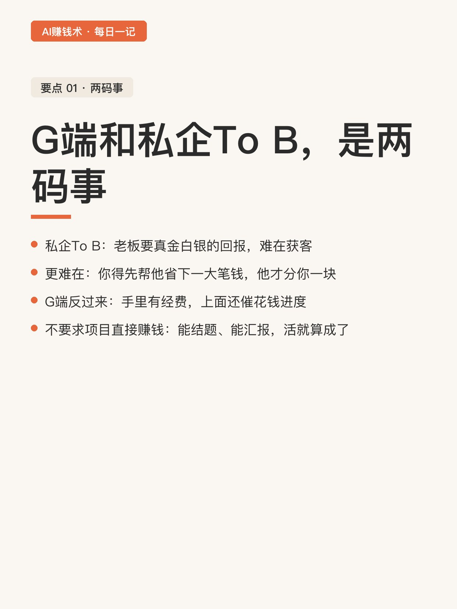
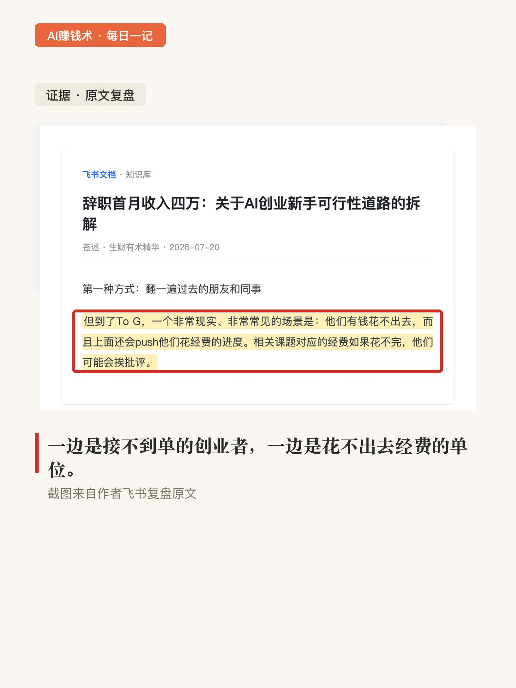
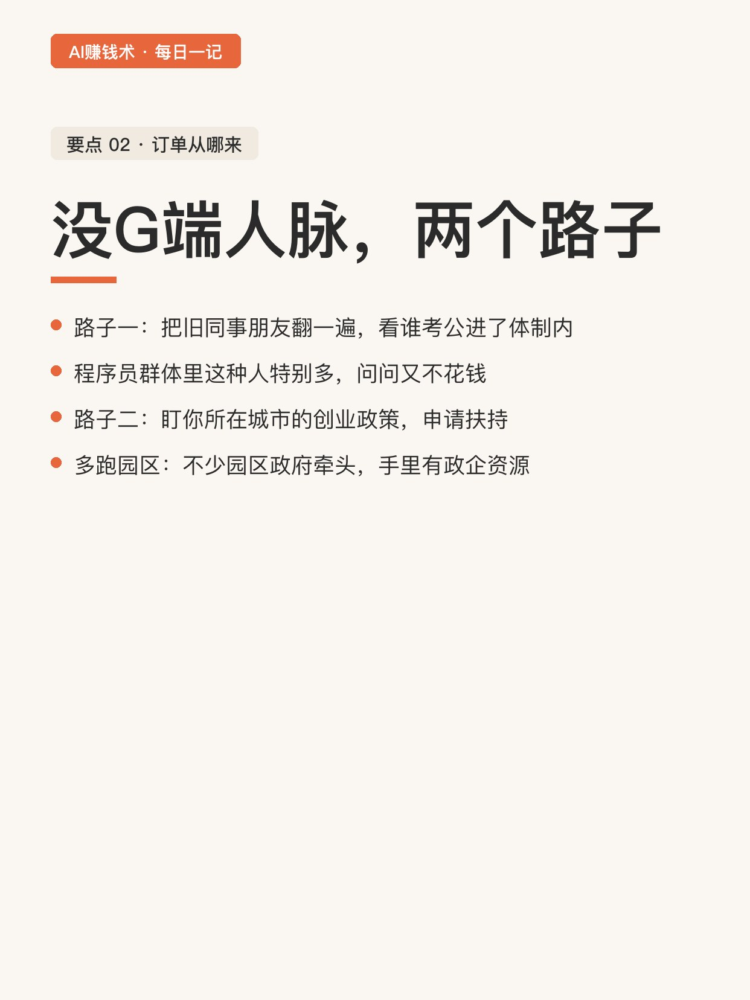
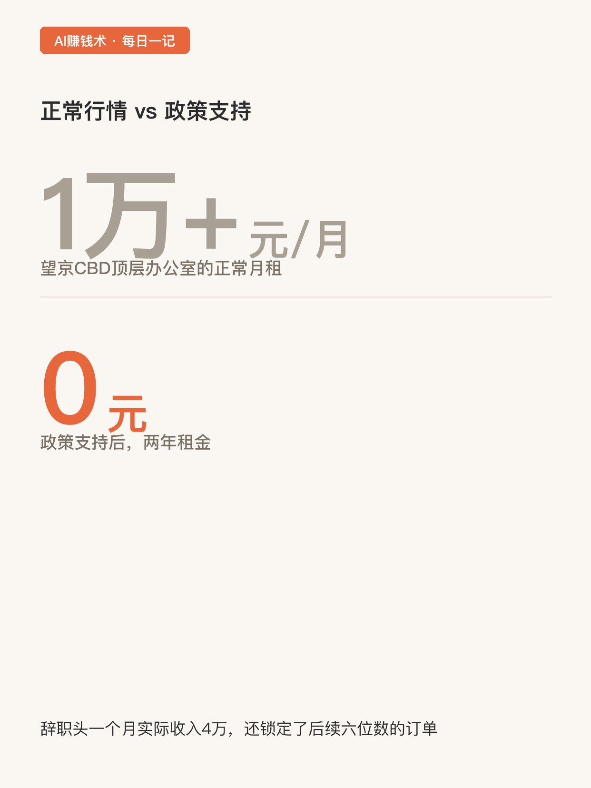
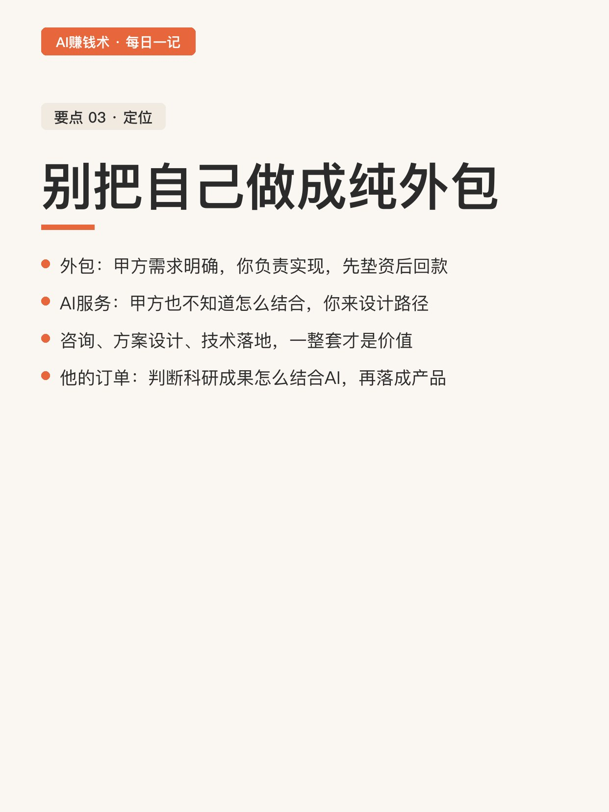
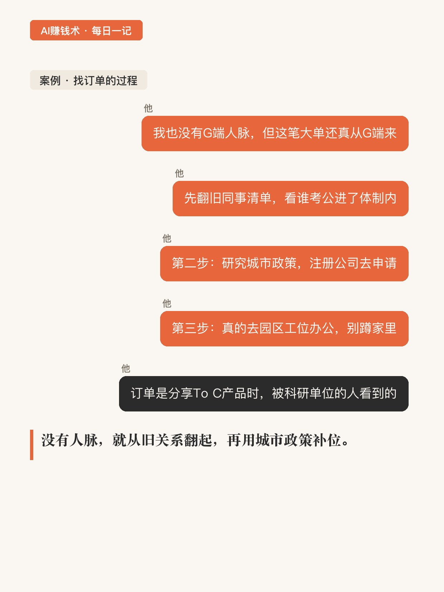
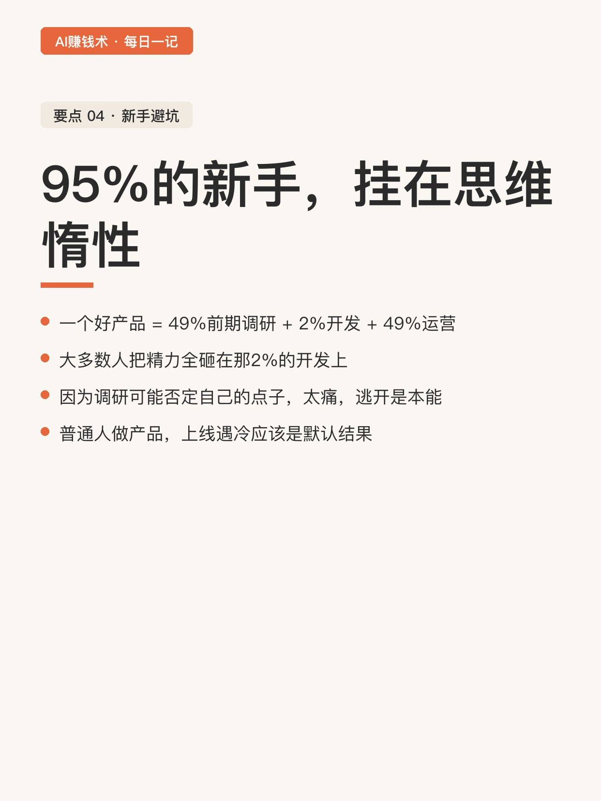
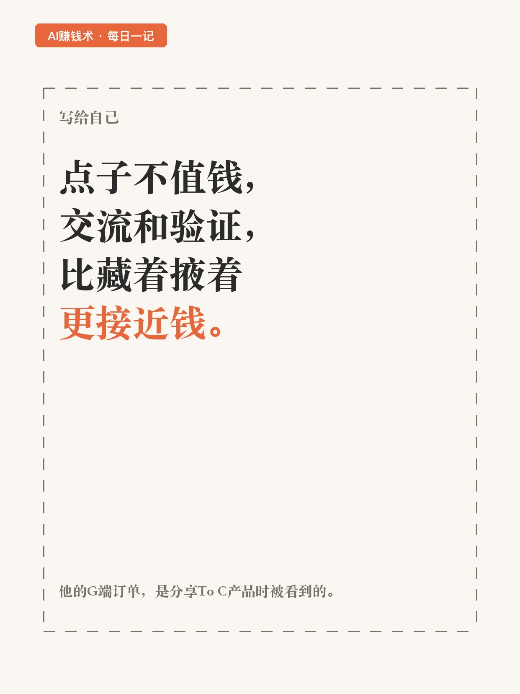

# 辞职首月收入4万，订单从G端来

> 第22期 · 2026-10-26 12:12 发布 · AI 赚钱内容

## 标题（可直接复制）

```
辞职首月收入4万，订单从G端来
```

## 正文（可直接复制发布）

辞职头一个月，实际收入 4 万，还锁定了后续六位数的订单。说这话的人叫苍述，前字节 Coze 底层 Workflow 引擎工程师，放弃了大几十万的年薪。💰

我盯着「G 端」两个字看了十分钟。一边是接不到单的 AI 创业者，一边是经费花不出去、天天被催进度的单位。这道缝里，全是机会。😮

1️⃣ G 端和私企 To B，是两码事
私企 To B 难在获客，更难在：老板要的是真金白银的回报，你得先帮他省下一大笔钱，他才从里面分你一块。G 端反过来，很多科研单位手里有经费，上面还盯着花钱进度，花不完要挨批评。而且它不要求项目直接见到钱，流程提效、能结题、向上汇报有交代，你的活就算成了。📌

2️⃣ 没 G 端人脉，单子从哪来
他也没有。路子一，把过去的同事朋友翻一遍，看谁考公进了体制内，程序员群体里这种人特别多，问问又不花钱。路子二，抓住你所在城市的政策资源：他拿到的北京相关扶持，在望京 CBD 顶层有独立办公室，正常月租超过 1 万，政策支持两年 0 租金。多跑几个园区，不少园区本身就是政府牵头建的，手里有政企和科研资源，你人在里面，就比外面多一次被看见的机会。💡

3️⃣ 别把自己做成纯外包
外包是甲方需求明确，你负责实现。AI 企业服务要做的是：甲方自己也不知道怎么跟 AI 结合，由你提供咨询、方案设计到技术落地的一整套。他现在的订单，来自帮科研单位判断成果怎么结合 AI、落成什么产品，再进入原型验证和交付。✅

4️⃣ 95% 的新手，挂在思维惰性
这是全文扎我的一段。一个好产品，49% 是前期调研，2% 是开发，49% 是商业化运营。大多数人把全部精力砸在那 2% 上，因为调研可能否定自己的点子，太痛了，逃开是本能。他还补了一句：普通人做产品，上线遇冷应该是默认结果，能在遇冷里继续推，才轮得到谈运气。

他给新手的忠告就两条：做足调研；把预期设成开局一定失败。

我现在的疑问是：To G 这道缝，对没有大城市政策的小城市玩家，还留不留余地。

## 话题标签

#副业 #AI #AI副业 #一人公司 #AI创业 #普通人的副业 #AI赚钱术日记

## 配图（9 张）











## 内容要点

1. G 端和私企 To B 是两码事：科研单位有经费、上面催进度，不要求项目直接见到钱，能结题能汇报就算成
2. 没 G 端人脉的两个路子：翻旧同事看谁考公进体制内；盯城市创业政策（望京 CBD 办公室月租 1 万+，政策两年 0 租金）；多跑政府牵头的园区
3. 别把自己做成纯外包：甲方不知道怎么结合 AI 时，咨询+方案+落地一整套才是价值
4. 95% 的新手挂在思维惰性：好产品 = 49% 调研 + 2% 开发 + 49% 运营；上线遇冷是默认结果

## 素材来源

飞书文档《辞职首月收入四万：关于AI创业新手可行性道路的拆解》（作者：苍述，生财有术精华）

## 发布信息

| 项 | 值 |
|---|---|
| 平台 | 小红书 |
| 期数 | 第22期 |
| 发布时间 | 2026-10-26 12:12 |
| 正文长度 | 837 字 |
| 图片数量 | 9 张 |
| 状态 | 已发布 |
