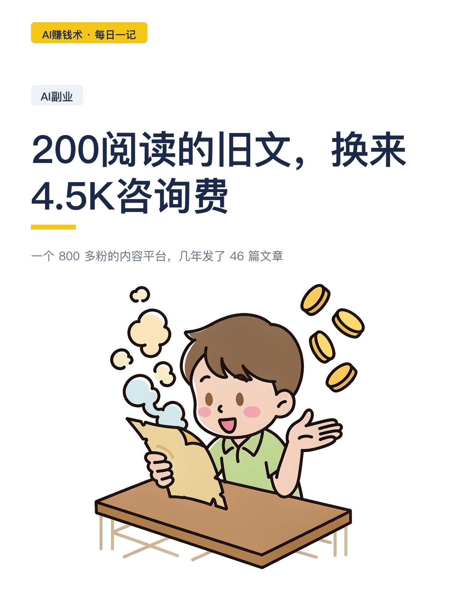
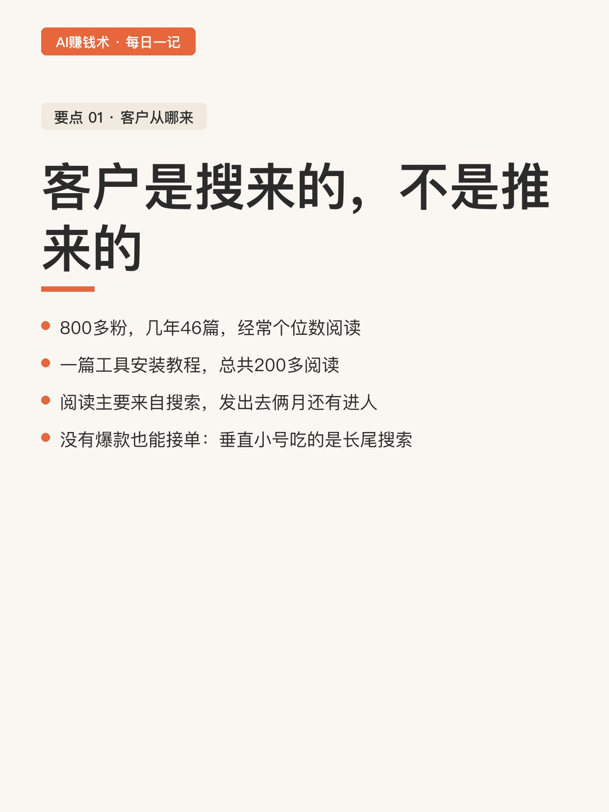
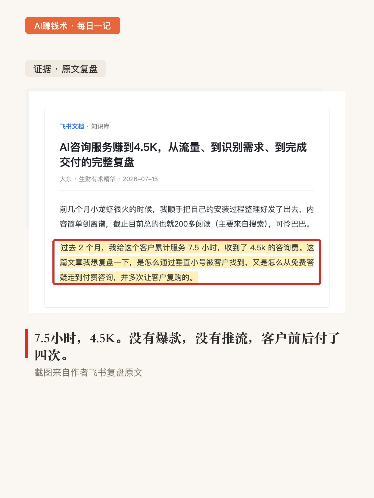
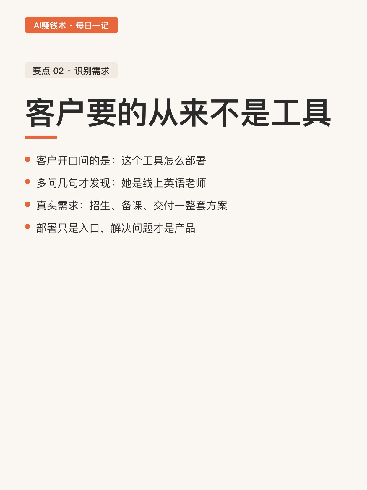
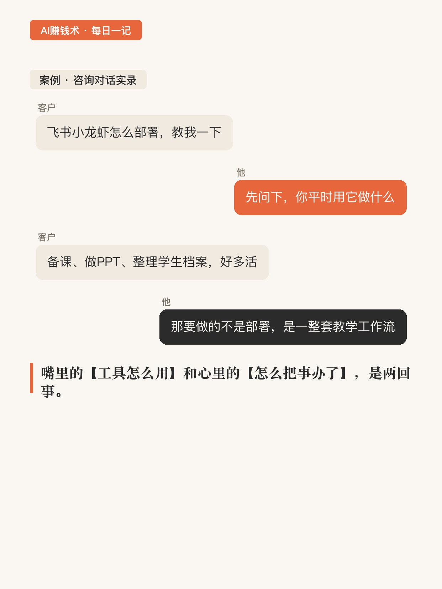
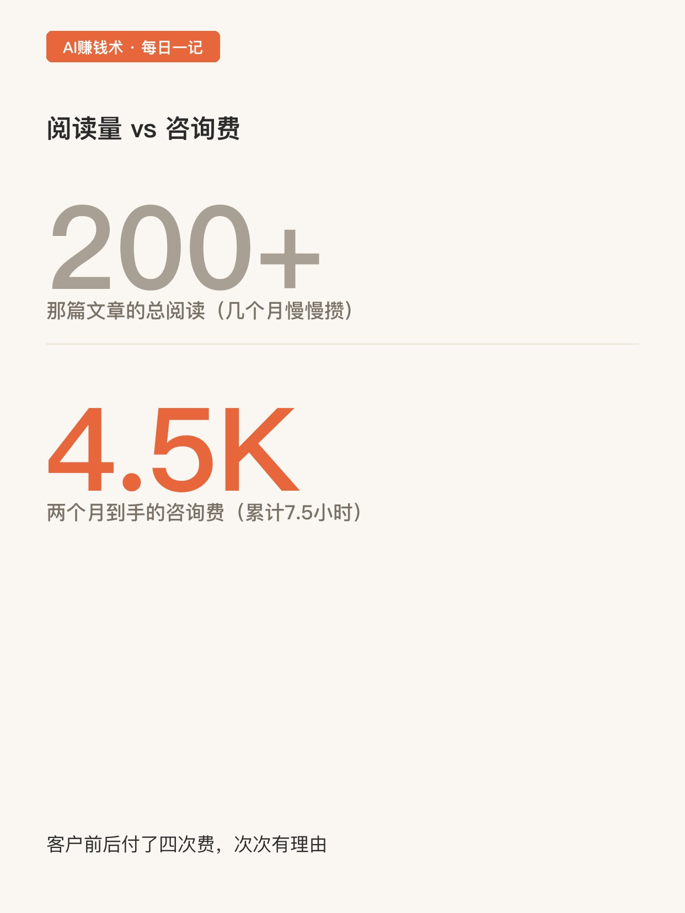
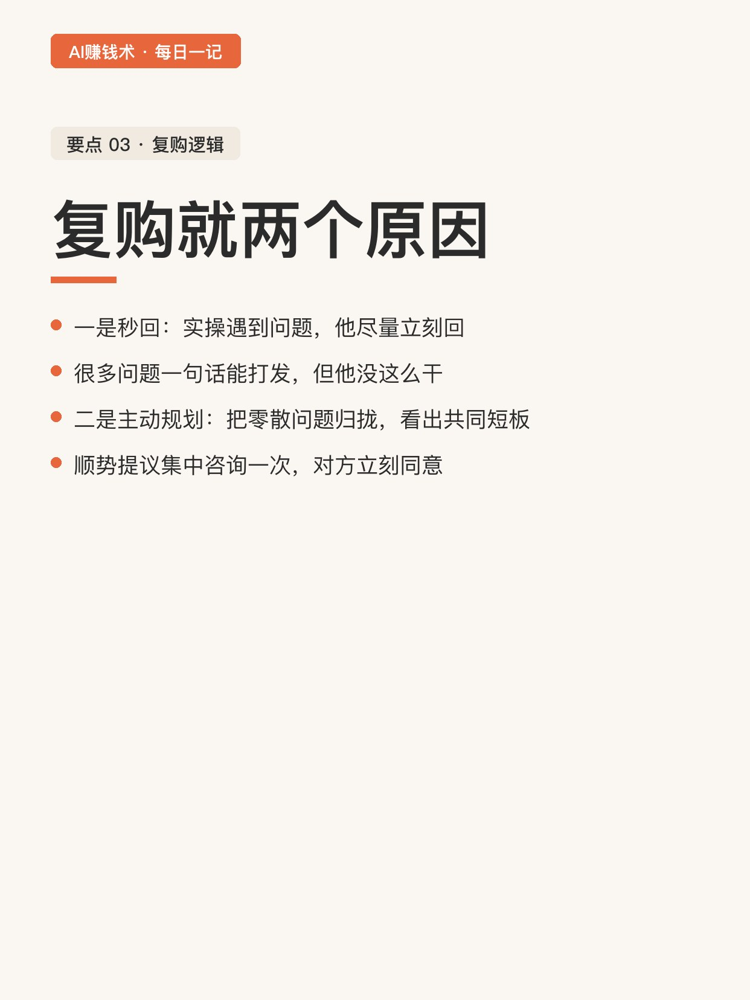
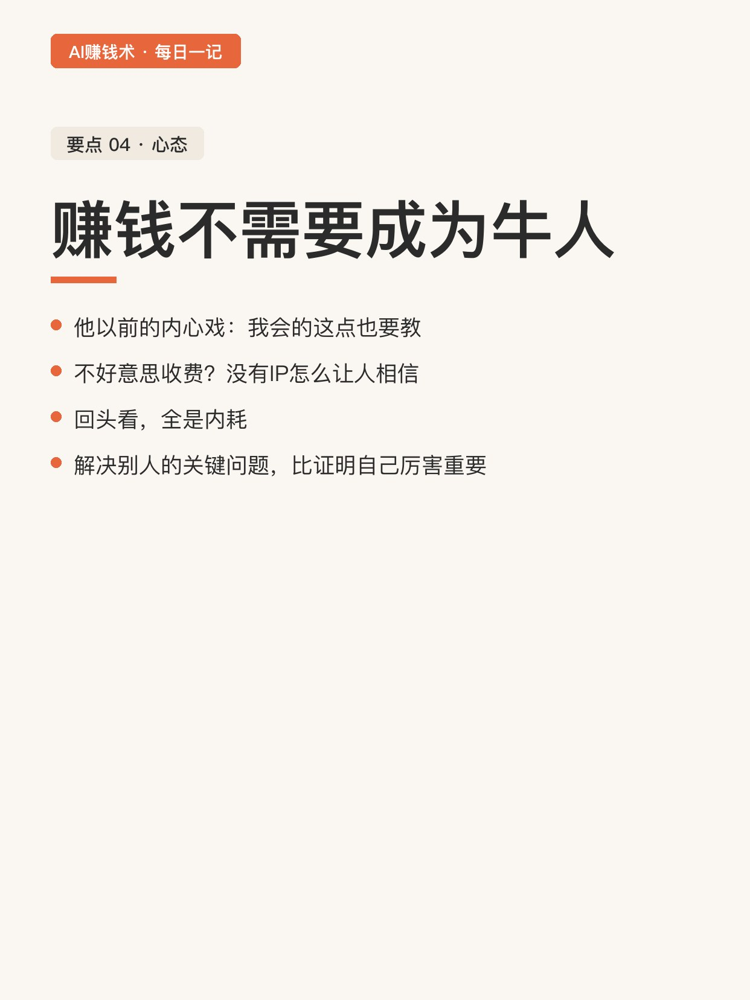
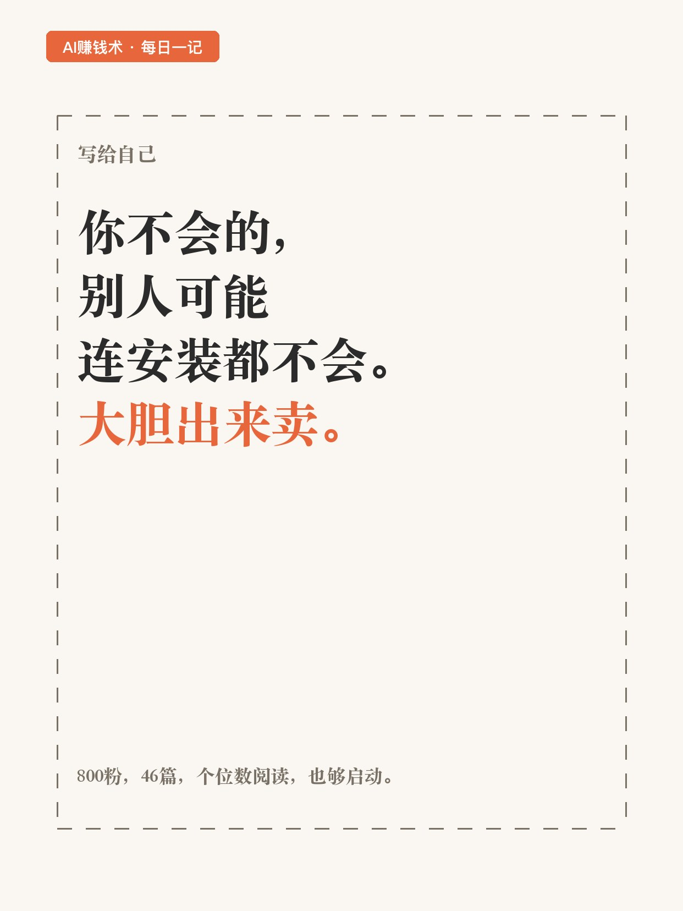

# 200阅读的旧文，换来4.5K咨询费

> 第23期 · 2026-10-26 16:53 发布 · AI 赚钱内容

## 标题（可直接复制）

```
200阅读的旧文，换来4.5K咨询费
```

## 正文（可直接复制发布）

一个 800 多粉的内容平台，几年发了 46 篇文章，经常个位数阅读。就这么个号，一篇讲工具安装的旧文，总共 200 多阅读，两个月里给他带来一个客户，累计服务 7.5 小时，收了 4.5K 咨询费。💰

客户前后付了四次钱。我把这篇复盘翻了三遍，能学的地方有四处。😮

1️⃣ 客户是搜来的，不是推来的
那篇文章简单到离谱，发出去俩月都没动静，阅读主要来自搜索。等客户自己想解决这个问题，搜关键词，就找到了他。没投过流，没社群，就靠一篇篇旧文慢慢进人。没有爆款也能接单，垂直小号的价值就在这：你写的那点东西，恰好是别人搜遍全网要找的。🔍

2️⃣ 客户要的从来不是工具
客户开口问的是「这个工具怎么部署」。他多问了几句：你用它做什么、以前怎么做、做出来给谁用、偶尔用还是天天用。问完才发现，对方是线上英语老师，要的是招生、备课、交付一整套方案。部署只是入口。嘴里的【工具怎么用】和心里的【怎么把事办了】，是两回事。💡

3️⃣ 复购就两个原因
一是秒回。客户看完直播自己实操，问题一堆，他尽量立刻回，哪怕很多问题一句话就能打发。二是主动规划：把近期的零散问题归拢，看出共同短板，建议集中咨询一次。第三次咨询就是这么来的，客户提到招生旺季活多，他顺势提议完整演示一次工作流搭建，对方立刻同意。📌

4️⃣ 赚钱不需要你成为牛人
他说以前内心戏特别多：我会的这点东西也要教？怎么好意思收费？没有 IP 谁会信我？回头看，全是内耗。客户买课看完还是不会操作，卡在具体一步上，你帮她把这一步迈过去，这钱就挣得理直气壮。后来客户还把自己付费买的产品送给他，这就是靠谱换来的信任。

结尾他写：大胆出来卖。

我现在的疑问是：这套「问出真实需求」的本事，换到别的行业还灵不灵。

## 话题标签

#副业 #AI #AI副业 #个人IP #互联网副业 #普通人的副业 #AI赚钱术日记

## 配图（9 张）











## 内容要点

1. 客户是搜来的不是推来的：800 粉小号、46 篇、个位数阅读；安装教程总共 200 多阅读，两个月后客户搜关键词找到他
2. 客户要的从来不是工具：多问四句（场景/以前怎么做/给谁用/频率），才发现真实需求是招生-备课-交付一整套方案
3. 复购就两个原因：秒回（实操问题尽量立刻回）+ 主动规划（归拢零散问题，建议集中咨询一次）
4. 赚钱不需要成为牛人：以前的内心戏全是内耗；帮客户迈过卡住的那一步，钱就挣得理直气壮

## 素材来源

飞书文档《Ai咨询服务赚到4.5K，从流量、到识别需求、到完成交付的完整复盘》（作者：大东，生财有术精华）

## 发布信息

| 项 | 值 |
|---|---|
| 平台 | 小红书 |
| 期数 | 第23期 |
| 发布时间 | 2026-10-26 16:53 |
| 正文长度 | 733 字 |
| 图片数量 | 9 张 |
| 状态 | 已发布 |
