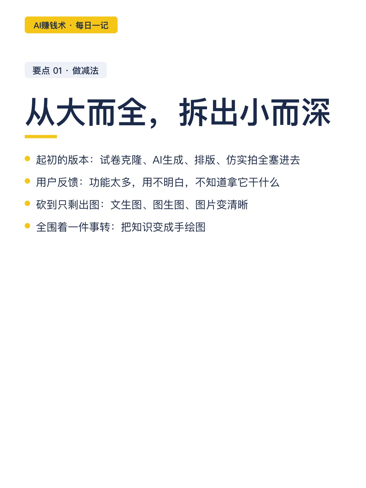
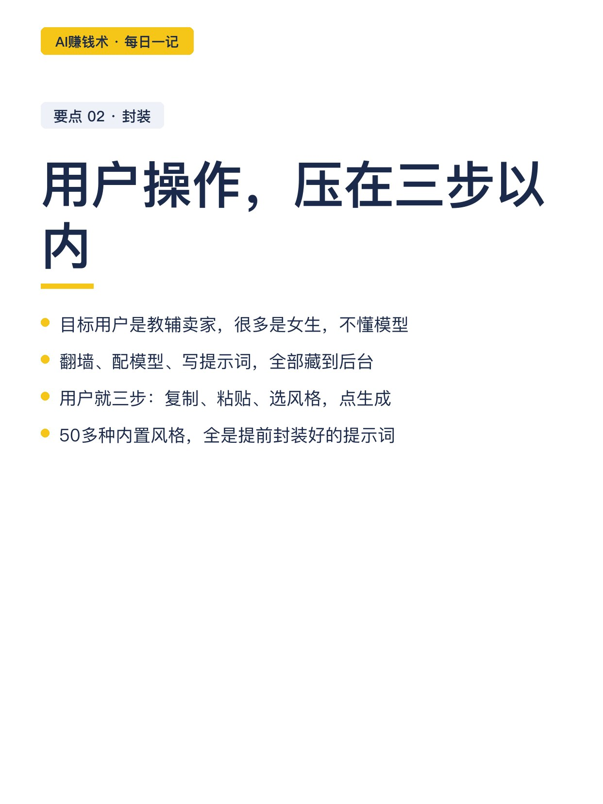
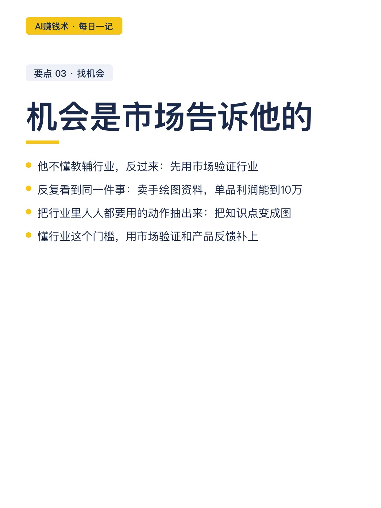
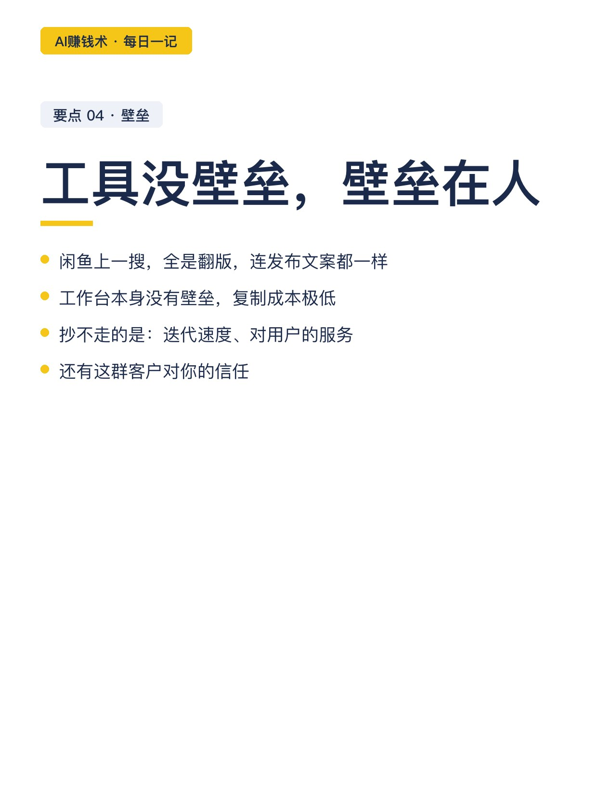
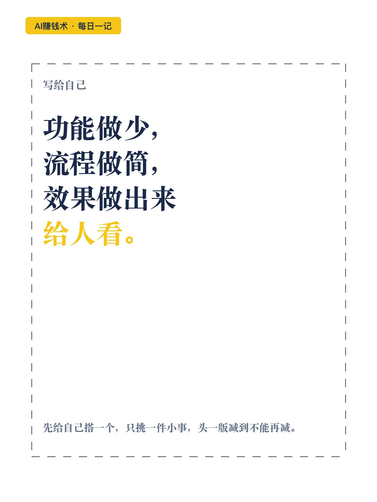

# 砍掉90%的功能，工具反而开始赚钱

> 第24期 · 2026-10-26 16:57 发布 · AI 赚钱内容

## 标题（可直接复制）

```
砍掉90%的功能，工具反而开始赚钱
```

## 正文（可直接复制发布）

一个教辅出图工具，功能砍到只剩三件事，反而开始赚钱了。注册使用 1200 人，185 人续费。作者泽言，不懂教育，也不懂教辅行业。😮

反常识在哪：功能多的时候，用户用不明白；砍到只剩一个动作，付费的人反而多了。

1️⃣ 从大而全里，拆出小而深
起初的版本是个聚合工具：试卷克隆、教辅生成、模板贴图、知识手绘、批量分割、AI 排版，六个功能全塞进去。做出来发现，用户反馈并不好：功能太多，不知道拿它干什么。他干脆只留出图，文生图、图生图、图片变清晰，全围着「把知识变成手绘图」这一件事转。

2️⃣ 封装到三步以内
用户很多是女生，很多人连模型是什么都不知道。所以翻墙、配模型、写提示词，全部藏到后台。用户看到的就是三步：复制知识点，粘贴进去，选个风格，点生成。50 多种内置风格，全是提前封装好的提示词，点一下就用。他的原话：每多一步不必要的流程，都有人觉得这软件不适合自己。💡

3️⃣ 机会是市场告诉他的
他不是教辅行业的人。做法是反过来：先大量看帖验证，反复看到同一件事，卖彩绘版手绘图资料，单品利润能到 10 万以上。于是他不去学教辅，直接把行业里人人都要用的那个动作抽出来，做成工具。懂行业这个门槛，用市场验证补上了。他还留了个心眼：出图接口不是自己的，上游卡顿失败是常态，备两三个接口能自动切换才稳。💰

4️⃣ 工具没壁垒，壁垒在人
现在二手平台上一搜，全是翻版，名称、界面、甚至发布文案都能一样。他的答案很直接：工作台本身没有壁垒，抄不走的是迭代速度、对用户的服务，和客户对你的信任。📌

💬 他给同路人的行动清单：先给自己搭一个，只挑一件小事，头一版减到不能再减。

我现在的疑问是：被抄得这么快的工具，除了快跑和做深服务，还有别的活法吗。

## 话题标签

#副业 #AI #AI副业 #一人公司 #AI工具 #普通人的副业 #AI赚钱术日记

## 配图（9 张）










## 内容要点

1. 从大而全拆出小而深：六个功能的聚合工具用户用不明白，砍到只剩文生图/图生图/变清晰，全围着一件事转
2. 封装到三步以内：翻墙配模型写提示词全藏后台；用户就复制、粘贴、选风格、点生成；50 多种内置风格
3. 机会是市场告诉他的：不懂教辅，先看帖验证（手绘图资料单品利润 10 万+），把人人都要用的动作抽出来做成工具
4. 工具没壁垒壁垒在人：闲鱼全是翻版连文案都一样；抄不走的是迭代速度、服务和客户信任

## 素材来源

飞书文档《我砍掉了 90% 的功能，这个 AI 工具反而开始赚钱了》（作者：泽言，生财有术精华）

## 发布信息

| 项 | 值 |
|---|---|
| 平台 | 小红书 |
| 期数 | 第24期 |
| 发布时间 | 2026-10-26 16:57 |
| 正文长度 | 731 字 |
| 图片数量 | 9 张 |
| 状态 | 已发布 |
