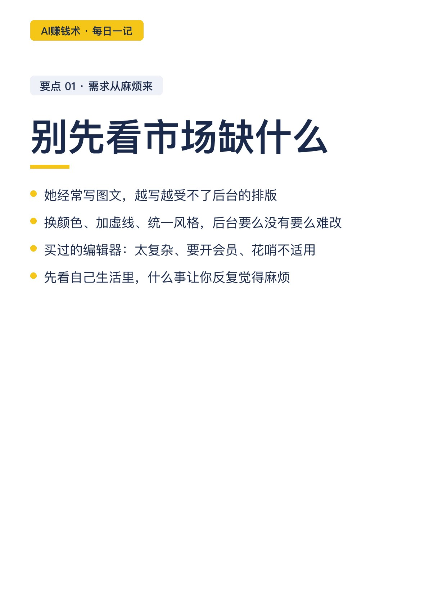
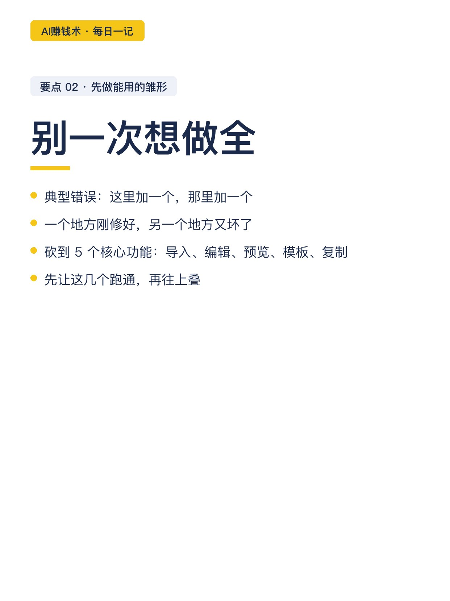
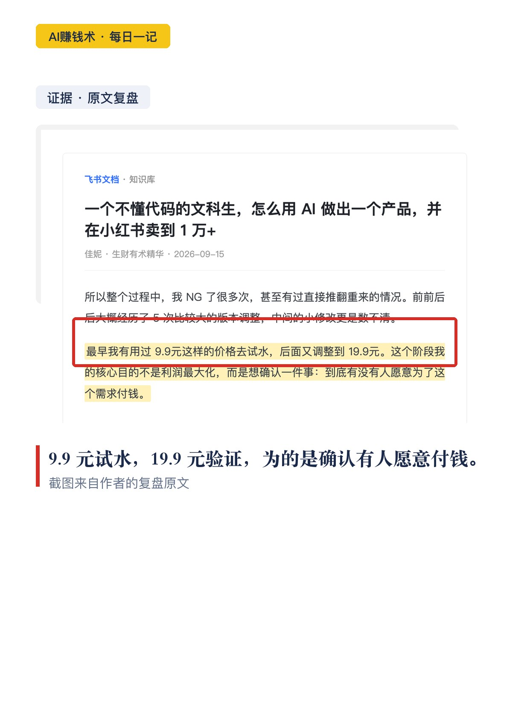
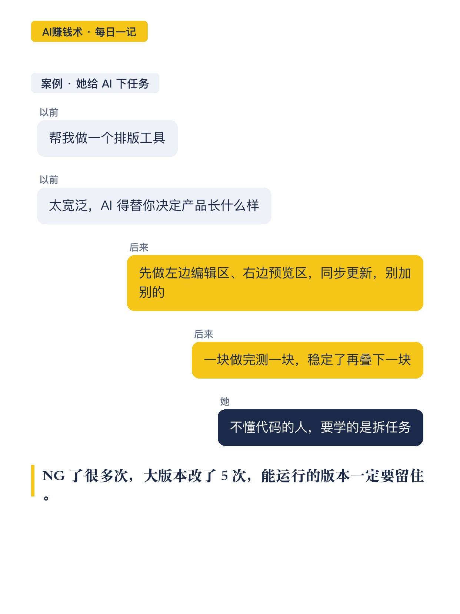
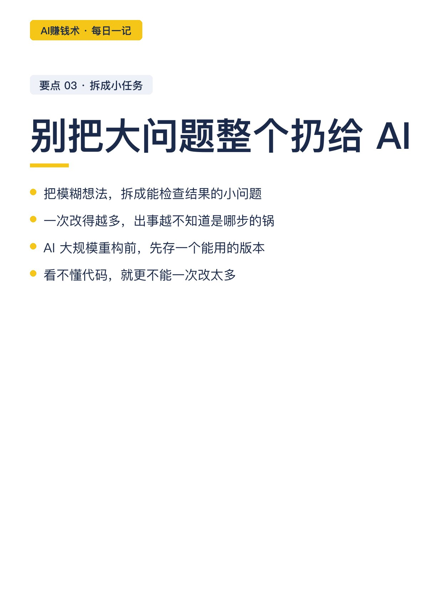
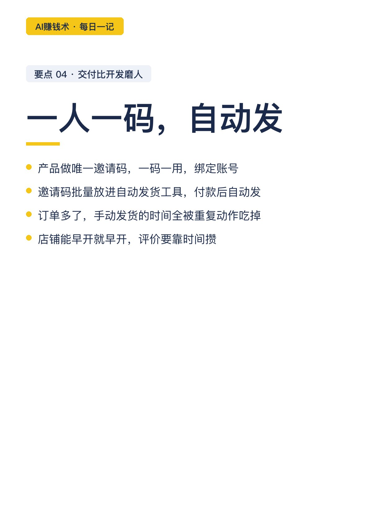
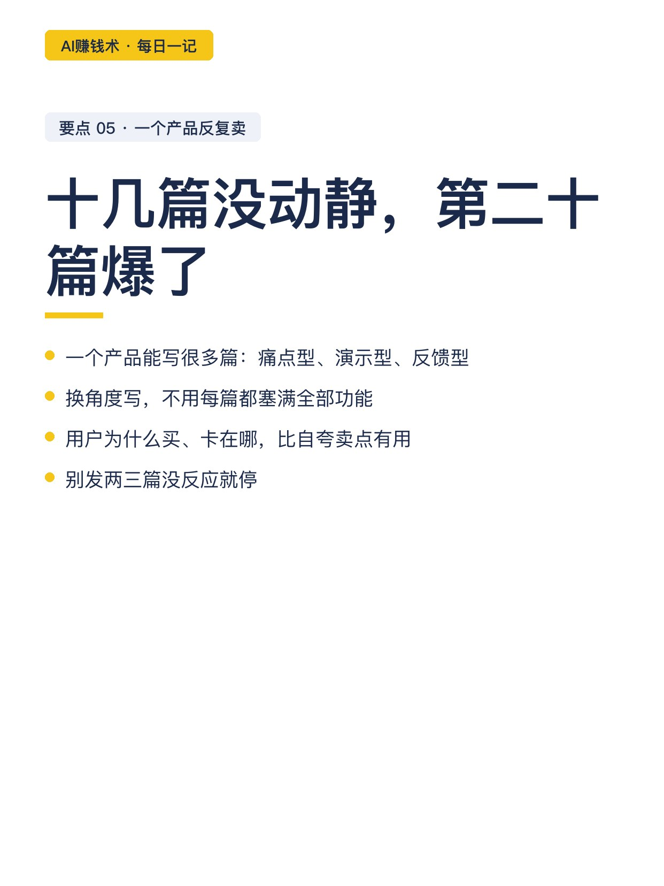
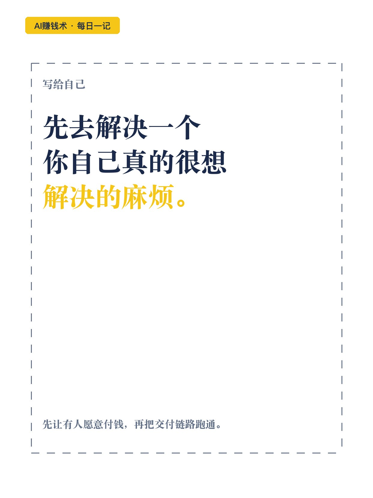

# 不懂代码的文科生，把麻烦卖成1万+

> 第25期 · 2026-10-26 17:22 发布 · AI 赚钱内容

## 标题（可直接复制）

```
不懂代码的文科生，把麻烦卖成1万+
```

## 正文（可直接复制发布）

一个不懂代码、英语很差的文科生，今年 3 月开始做个排版工具。前前后后推翻重来，大版本改了 5 次。到现在，这个工具累计卖到 1 万加。

她叫佳妮。翻完她的复盘，我发现这条路跟「学开发」基本没关系。

1️⃣ 需求不从市场来，从自己的麻烦来

她经常写图文，越写越受不了后台排版：换个颜色、加条虚线、统一风格，后台要么没有，要么特别麻烦。

也买过第三方编辑器和模板：太复杂的、要开会员的、花哨不合适的，都用不长久。

她要的不是功能越来越多的编辑器，是自己用起来顺手的工具。

💡 她的逻辑：不知道做什么的时候，别先看市场缺什么，先看自己生活里有什么事让你反复觉得麻烦。

2️⃣ 别一次想做全，先做能用的雏形

她犯过典型错误：既然要开发，就这里加一个、那里加一个，结果刚修好一处，另一处又坏。

后来她把工具砍到 5 个核心功能：导入、编辑格式、手机预览、模板配色、排完复制。先让这几个跑通，再往上叠。

3️⃣ 不会代码的人，要学的是给 AI 下任务

她至今不认为自己在「写代码」。她学会的，是把模糊想法，拆成 AI 能执行的小任务。

以前她会说：帮我做一个排版工具。这对 AI 太宽泛。

后来她说：先做左边编辑区、右边预览区，改动同步，暂时不加别的。一块做完测一块，稳定再叠。

⚠️ 她踩过的坑：不保留能运行的版本。AI 大规模重构，原来好好的功能说坏就坏。

4️⃣ 先低价验证，再涨价

💰 一开始 9.9 元试水，后面调到 19.9。目的不是利润，是确认有没有人愿意付钱。

头一篇笔记就有人下单。产品迭代完整后，她逐步提到几十块，还按使用周期做了套餐。低价能验证需求，但不能当永远的定价。

5️⃣ 交付和内容，比开发更磨人

订单多了，手动发货很耗人。她的做法：产品做唯一邀请码，一码一用，批量放进自动发货工具，付款后自动发码。

内容上，一个产品反复写：痛点型、演示型、反馈型。她写过十几篇没动静，😅 第二十篇突然爆了，持续带单。

她还劝退过不适合的客户，也遇到过劝退反被骂。她的结论：产品不可能适合所有人。

🤔 我现在的疑问是：这套「从自己麻烦出发」的路子，换到一个她完全不熟的行业，还成立吗。

## 话题标签

#副业 #自媒体 #AI副业 #个人IP #知识付费 #普通人的副业 #AI赚钱术日记

## 配图（10 张）












## 内容要点

1. 起点：不懂代码、英语很差的文科生，2026 年 3 月从自己的排版麻烦出发做工具，大版本改了 5 次，累计卖到 1 万加
2. 需求：不从市场热点来，从自己反复觉得麻烦的事来；买过的编辑器都用不长久
3. 方法：先做能跑通的雏形（砍到 5 个核心功能）；把模糊想法拆成 AI 能执行的小任务；保留能运行的版本防重构改崩
4. 验证与定价：9.9 元试水 → 19.9 → 几十块加套餐；低价验证需求，不当永远定价
5. 交付与内容：唯一邀请码 + 自动发货工具；一个产品反复写（痛点/演示/反馈型），十几篇没动静第二十篇爆了；劝退不适合的客户

## 素材来源

飞书文档《一个不懂代码的文科生，怎么用 AI 做出一个产品，并在小红书卖到 1 万+》（作者：佳妮，生财有术精华，2026-09-15）

## 发布信息

| 项 | 值 |
|---|---|
| 平台 | 小红书 |
| 期数 | 第25期 |
| 发布时间 | 2026-10-26 17:22 |
| 正文长度 | 916 字 |
| 图片数量 | 10 张 |
| 状态 | 已发布 |
