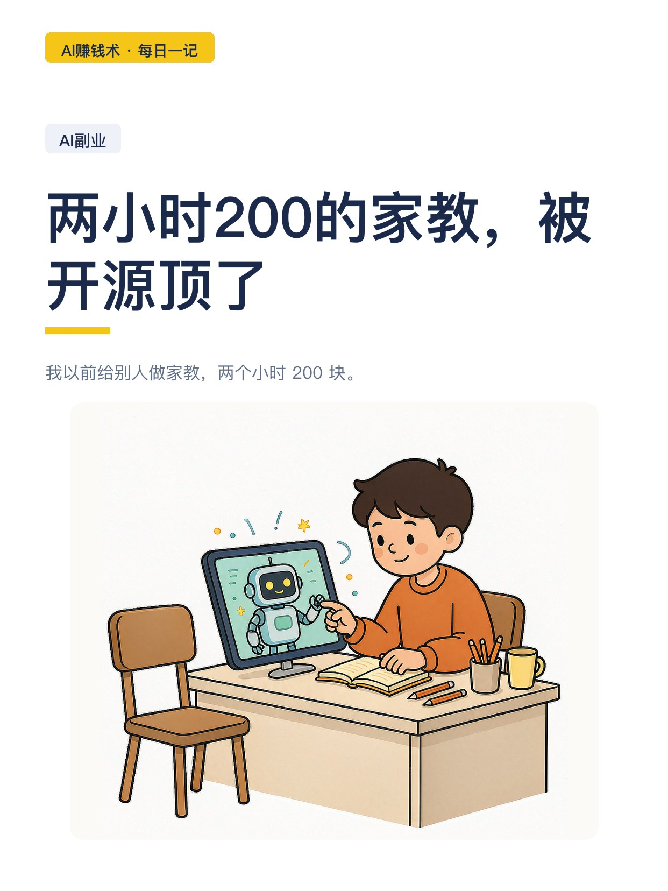
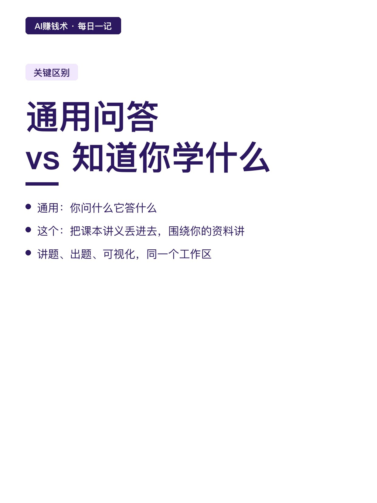
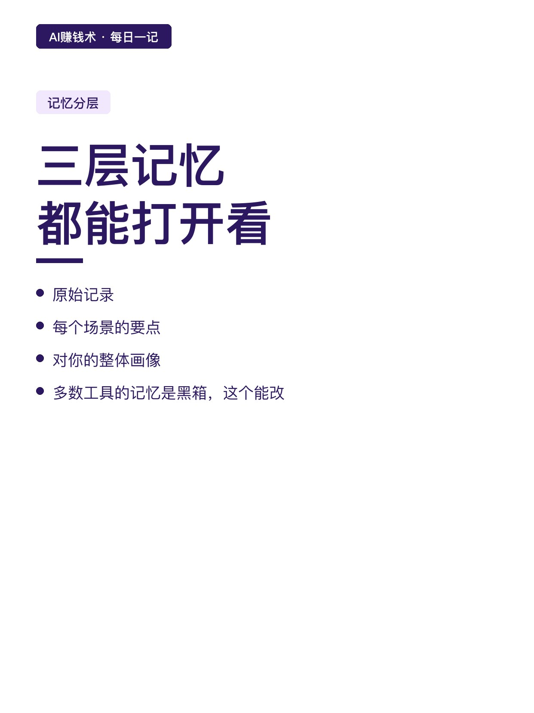
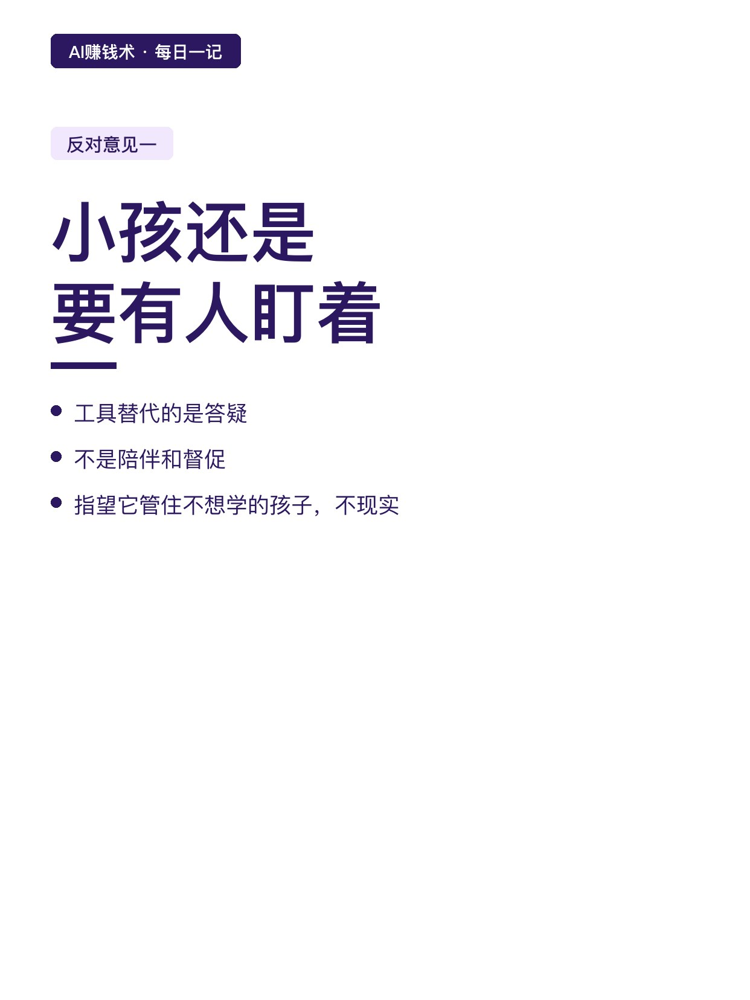
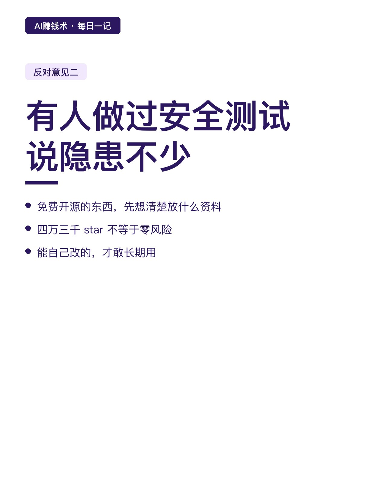
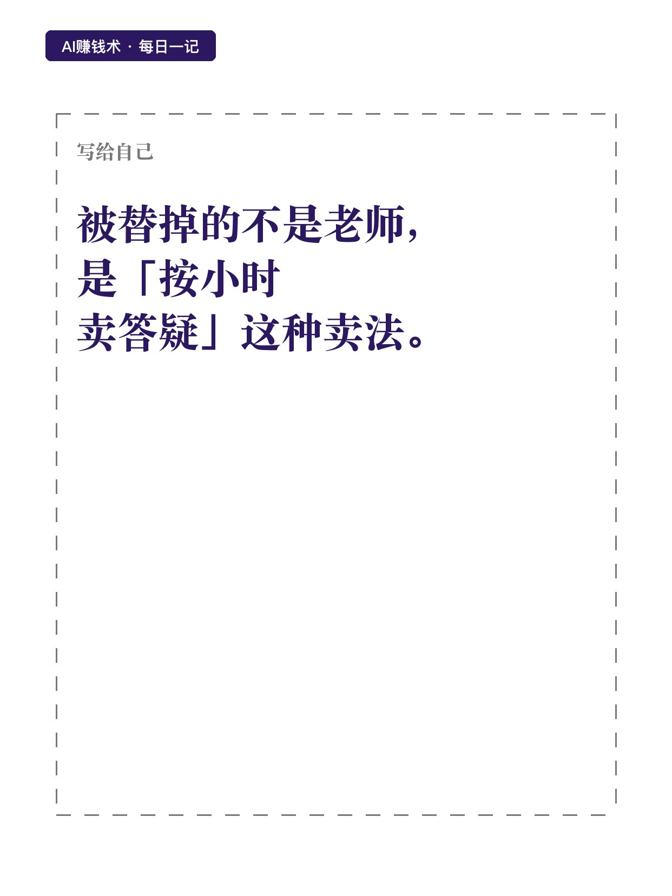

# 两小时200的家教，被开源顶了

> — · 2026-10-27 20:52 发布 · AI 赚钱内容

## 标题（可直接复制）

```
两小时200的家教，被开源顶了
```

## 正文（可直接复制发布）

我以前给别人做家教，两个小时 200 块。😮

现在一个月的 AI 会员不到 200 块，随时问，还有耐心。

这两天港大开源了一个 AI 私教，四万三千个 star。我看了它的设计，觉得真正被替掉的不是「老师」这个职业。

📌 它跟普通问答框的区别

不是问一句答一句。

你把课本、讲义、笔记丢进去，它围绕你自己的资料讲。讲题、出题、做深度研究、画可视化讲解，都在同一个工作区里。

差别在哪？通用问答是「你问什么它答什么」，这个是「它知道你在学什么」。

⏰ 记忆是分层的

它记住你学到哪，换个会话进度和错题也接得上。

更关键的是记忆拆成三层：原始记录、每个场景的要点、对你的整体画像。三层都能打开看，也能自己改。

这一点很少有产品做到。🔍多数工具的记忆是个黑箱，你不知道它记了什么，错了也改不了。🧠

💡 成本对照，这才是重点

家教：两小时 200 块，一周两次，一个月一千六。

AI 私教：一个月不到 200 块，不限次数。

差价八倍。这不是「便宜一点」，是换了定价模型——按时间卖，变成按月卖。💰

✅ 但有两种反对意见，我觉得都得听

第一种：「小孩还是要有人盯着，能真正解放家长还得有人。」

对。工具替代的是答疑，不是陪伴和督促。指望它管住一个不想学的孩子，不现实。

第二种来自一个做过安全测试的人：「隐患还比较多，已经提交给作者。」

这提醒我一件事：免费开源的东西，用它之前先想清楚你在里面放什么资料。

📌 我的判断

被替掉的不是老师这个职业，是「按小时卖答疑」这一种卖法。

真正值钱的老师，卖的是设计学习路径、判断你哪里卡住、逼你完成。这些 AI 现在还做不好。

我现在的疑问是：如果按小时卖的活都能被按月替代，那我手上还有哪些活是按小时在卖的。这个得好好数一数。

## 话题标签

#副业 #AI #AI副业 #AI工具 #普通人搞副业 #AI赚钱术日记

## 配图（8 张）










## 发布信息

| 项 | 值 |
|---|---|
| 平台 | 小红书 |
| 期数 | — |
| 发布时间 | 2026-10-27 20:52 |
| 正文长度 | 755 字 |
| 图片数量 | 8 张 |
| 状态 | 已发布 |
