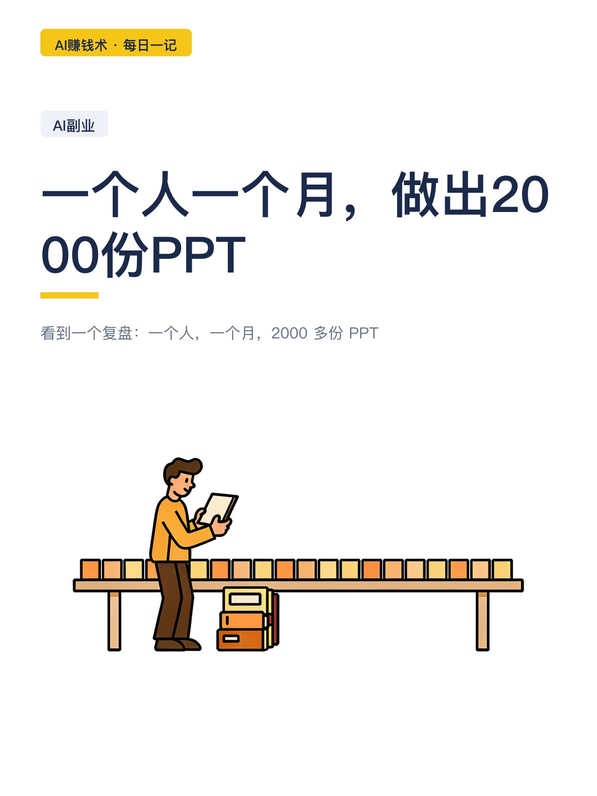
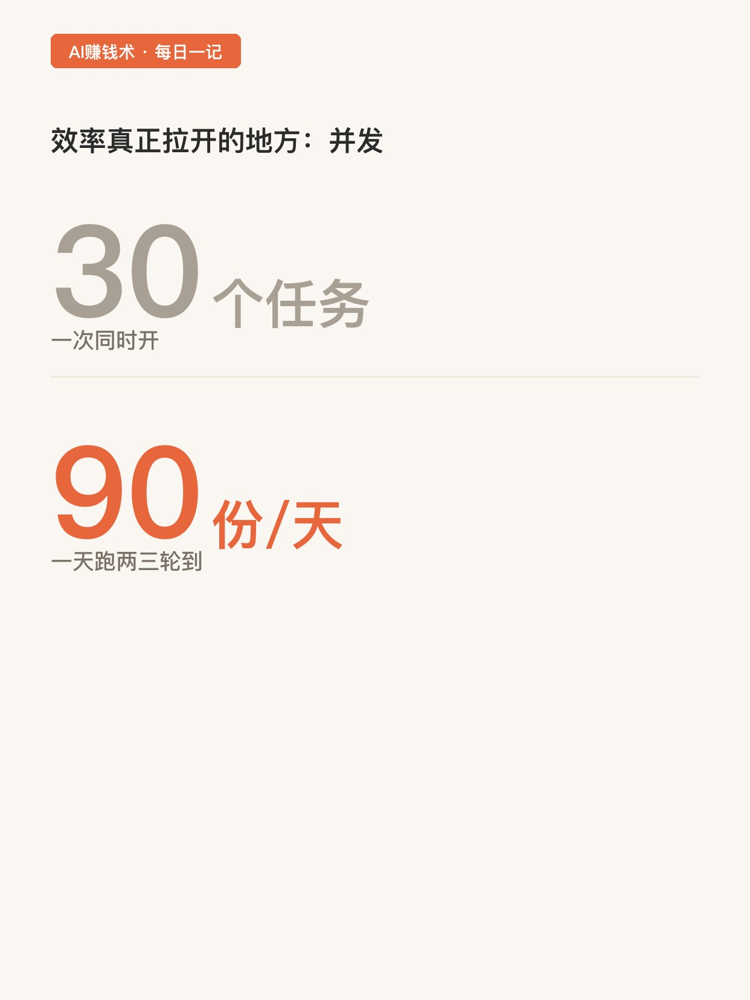
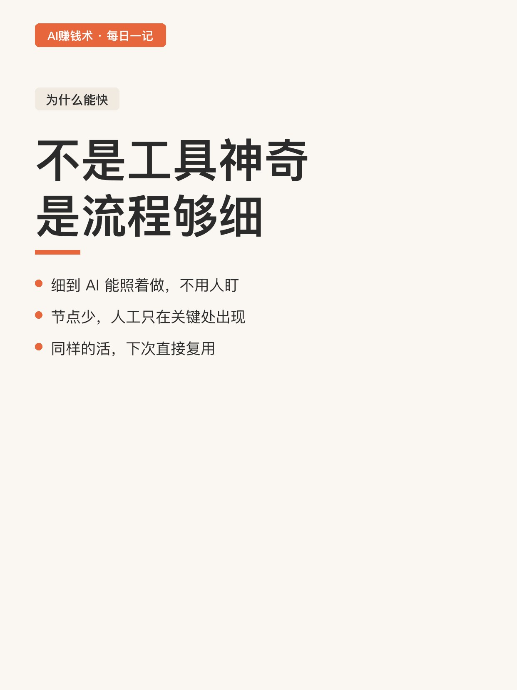
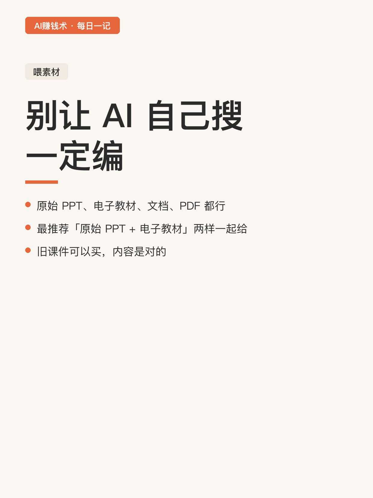
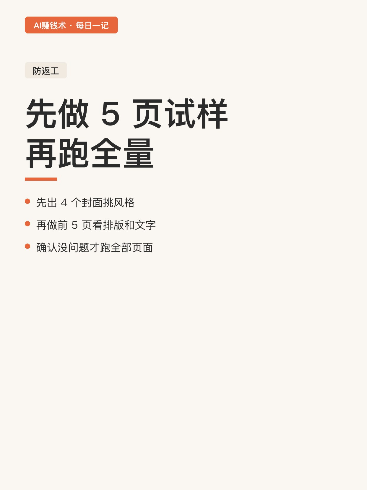
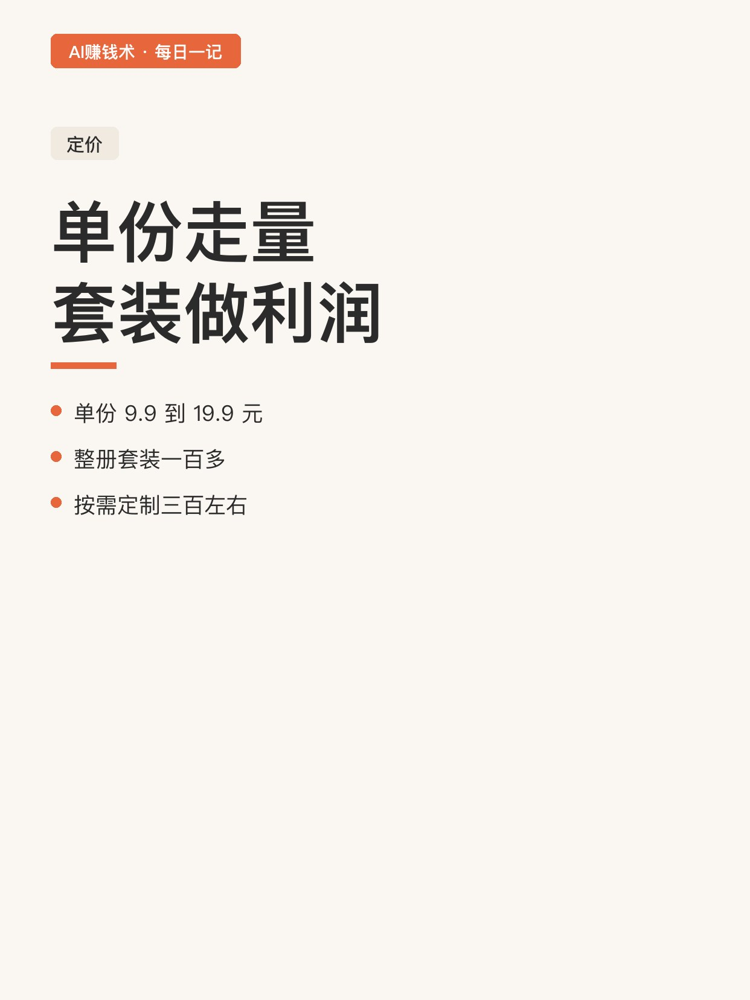
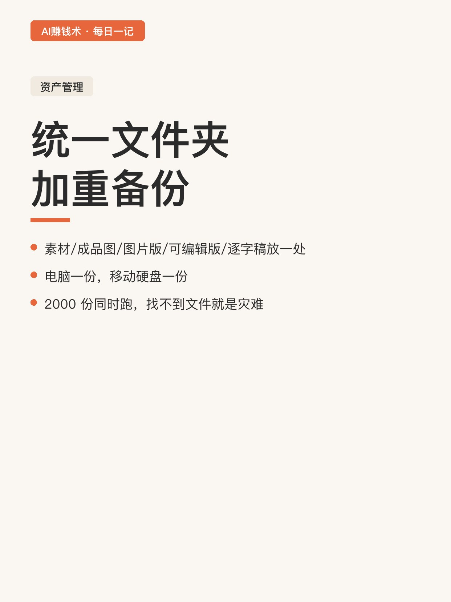
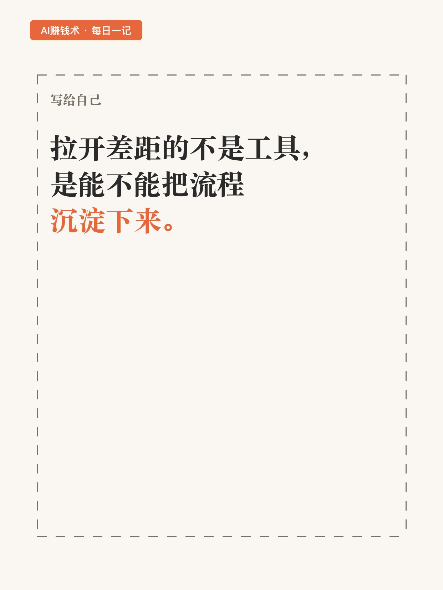

# 一个人一个月，做出2000份PPT

> 第24期 · 2026-10-27 12:14 发布 · AI 赚钱内容

## 标题（可直接复制）

```
一个人一个月，做出2000份PPT
```

## 正文（可直接复制发布）

看到一个复盘：一个人，一个月，2000 多份 PPT。😳

不是团队，没堆人力，就是一个人加一套流程。

他的做法不复杂，但每一步都想清楚了。我拆给你们看。

📌 第一步：先拆流程，再谈自动化

他把做 PPT 拆成五步：提取素材、规划页面、生成图片、转可编辑版、导出交付。

然后把这五步写成一套轻量 skill，扔进 AI 工具里跑。

关键是：只在几个节点人工确认，其余全自动。

⏰ 第二步：一次开 30 个任务并发

这是效率真正拉开的地方。

不是一份一份做，是一次开 30 个任务并行跑，一天跑两三轮到。

算一下：30 个任务 × 3 轮 = 90 份/天，一个月 2700 份。⚡

他说得很实在：不是哪个工具神奇，是把流程拆细了，细到 AI 能照着做。

💡 第三步：素材别让 AI 自己搜

让 AI 凭空写，一定编。正确做法是喂资料：原始 PPT、电子版教材、文档、PDF 都行。

做课件最推荐「原始 PPT + 电子版教材」两样一起给，AI 理解得准，后面补说明的成本也低。

原始 PPT 去哪找？二手平台买旧课件，虽然旧，但内容是对的，拿来当素材正合适。

✅ 第四步：先做 5 页试样，再批量

这一步很多人省掉，结果全批返工。

他的做法是：先生成 4 个封面让他挑，定下风格；再生成前 5 页看排版、文字、画面；确认没问题，才跑全部页面。

📌 第五步：卖的不是 PPT，是复购

定价分两层：

成品单份 9.9 到 19.9 元，靠量走；整册套装一百多，定制按需做，三百左右。

关键是最后那句：PPT 是货，客户名单才是资产。📇

因为客户下学期备课、下次汇报，还会回来找你。🔁同一份内容可以卖很多次，每多卖一单几乎没新增成本。

💡 一个容易被忽略的细节

他给每份 PPT 建了统一文件夹：素材、成品图、图片版、可编辑版、逐字稿，五个都在一处。

2000 多份同时跑，找不到文件就是灾难。他还做了双重备份，电脑一份、移动硬盘一份。💾

我现在的疑问是：这套「拆流程 + 并发 + 卖复购」，换成别的品类还成立吗。比如报告、简历、方案。想清楚再写一篇。

## 话题标签

#副业 #AI #AI副业 #内容生产 #普通人搞副业 #AI赚钱术日记

## 配图（8 张）










## 发布信息

| 项 | 值 |
|---|---|
| 平台 | 小红书 |
| 期数 | 第24期 |
| 发布时间 | 2026-10-27 12:14 |
| 正文长度 | 900 字 |
| 图片数量 | 8 张 |
| 状态 | 已发布 |
