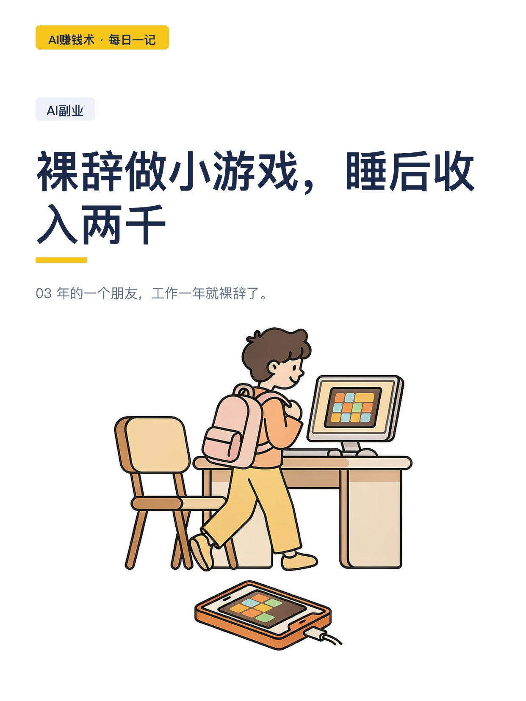
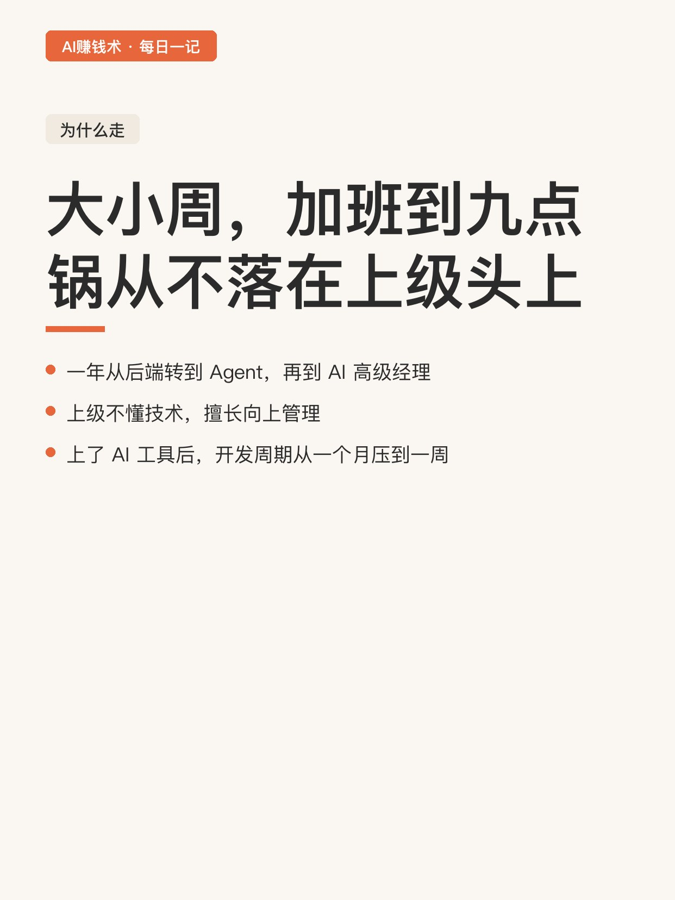
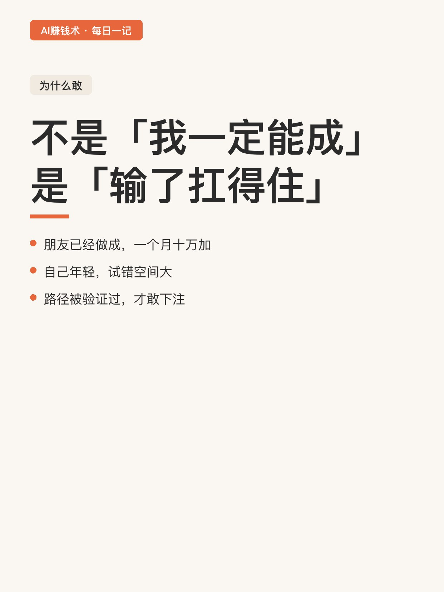
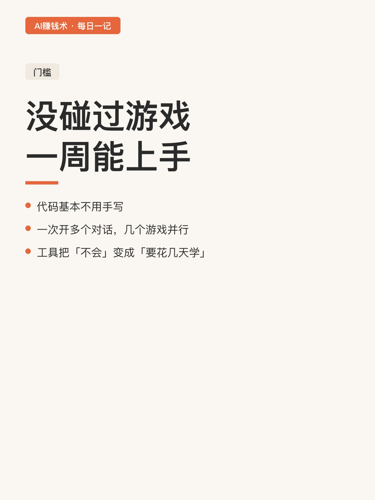
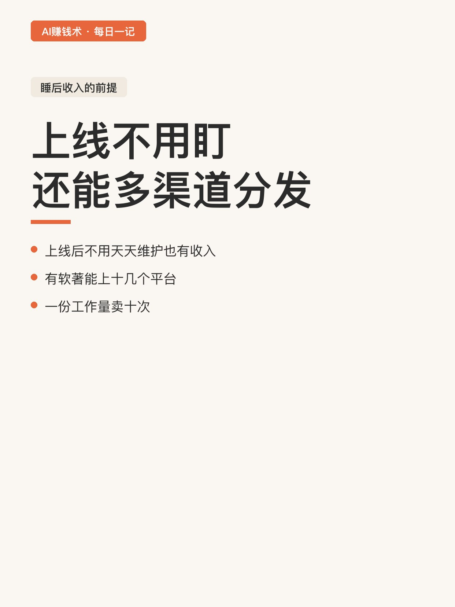
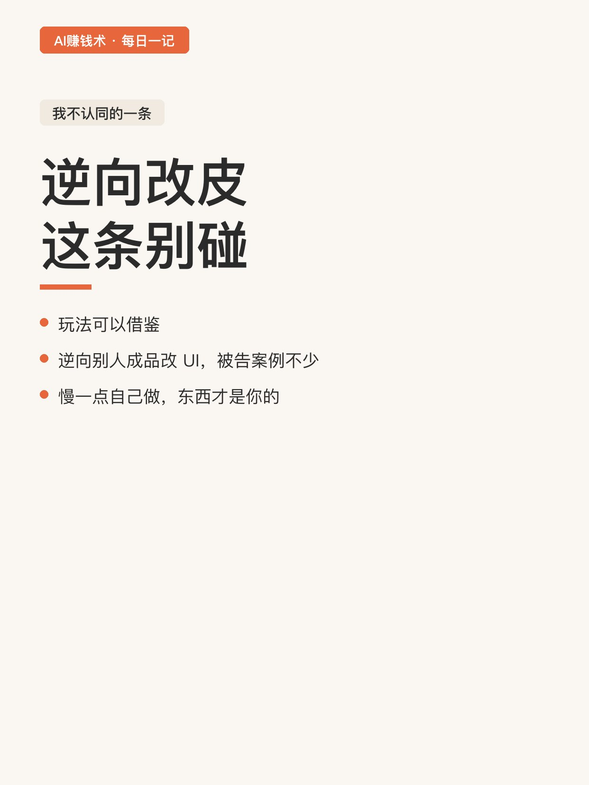

# 裸辞做小游戏，睡后收入两千

> 第28期 · 2026-10-27 21:55 发布 · AI 赚钱内容

## 标题（可直接复制）

```
裸辞做小游戏，睡后收入两千
```

## 正文（可直接复制发布）

03 年的一个朋友，工作一年就裸辞了。现在做小游戏，睡后收入两千多。😮

目标是十万。差得还很远，但他敢把这两个数字一起放出来。

我觉得这个坦率比数字本身有意思。📌

📌 他为什么走

大小周，日常加班到九点后，偶尔十一点。

一年里从后端转到 Agent，再到 AI 高级经理，晋升算快的。

但他说上级不懂技术，最擅长向上管理。上了 AI 编程工具之后，开发周期被从一个月压到一周，技术选型流行什么试什么，锅从来不落在上级头上。

四月开始做小游戏，五月有收入，当月就提了离职。⏱️

⏰ 他为什么敢走

两个理由，都很实在：

一是朋友已经做成了，做到一个月十万加，路径验证过。✅

二是自己年轻，试错空间大。

不是「我一定能成」，是「输了也扛得住」。这个心态区别很大。🧭

💡 门槛到底降到哪了

他说代码基本不用手写，在 AI 编程工具里一次开多个对话，几个游戏并行开发。

没碰过游戏开发的人，一周内能上手。

这一点我信。我们做卡片、做插画也是同一个逻辑：工具把「不会」变成了「要花几天学」。

✅ 睡后收入的前提

他特意说了两个条件：

一是上线后不用天天盯，也能持续有收入。

二是有软著的话，能上十几个平台分发。

第二点很多人忽略。同一款游戏铺十个渠道，等于把一份工作量卖了十次。

📌 有个地方我不认同

他给的路径里有一条是「逆向或复刻一版，UI 换成自己的」。

这条我不建议碰。游戏玩法可以借鉴，但逆向别人的成品改皮，被告的案例不少，账号和作品都可能没了。

要做就从玩法出发自己实现，慢一点，但东西是你的。

我现在的疑问是：两千到十万之间，差的是产量还是选品。他没说，我也还没想明白。

## 话题标签

#副业 #AI #AI副业 #小游戏 #普通人搞副业 #AI赚钱术日记

## 配图（8 张）










## 发布信息

| 项 | 值 |
|---|---|
| 平台 | 小红书 |
| 期数 | 第28期 |
| 发布时间 | 2026-10-27 21:55 |
| 正文长度 | 712 字 |
| 图片数量 | 8 张 |
| 状态 | 已发布 |
