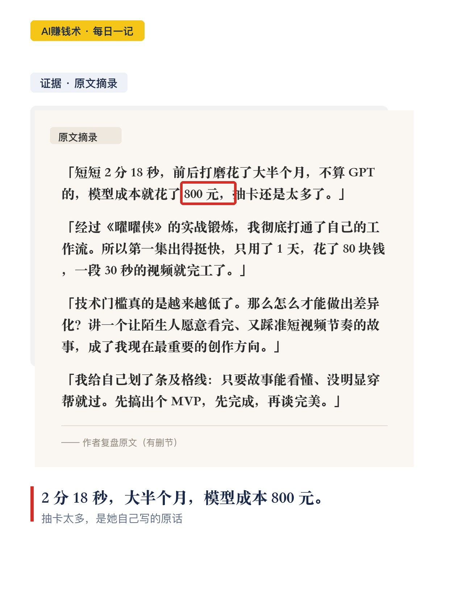

# 第一支AI片800元，第二支80元

> 第29期 · 2026-10-27 22:57 发布 · AI 赚钱内容

## 标题（可直接复制）

```
第一支AI片800元，第二支80元
```

## 正文（可直接复制发布）

她第一支 AI 短片，花了 800 块，磨了大半个月。😮

第二支，80 块，一天。

两个数字放一起，比任何「AI 多厉害」的说法都有说服力。但让我停下来想的不是省钱。🤔

📌 她不是新手

视效合成出身，在好莱坞参与过《西部世界》《怪奇物语》，团队还靠《哥谭市》拿过艾美奖。

回国后去外企做视效制片兼总监，一年交付五千多个镜头，再往后去游戏公司做项目管理。今年 7 月裸辞。

按这份履历，她最该擅长的就是画面。😐

💡 但她卡住的地方，根本不是画面

她的原话大意是：技术门槛降到极低之后，做 AI 视频最难的已经不是技术，是怎么讲好一个故事。

技术那关她花一阵子就跑通了第一套流程。真正让她头大的是讲故事。

⏰ 一开始她也只能「挤出几秒」

网上教程散落，摸索半天只挤出几秒画面，又不敢盲目烧积分，就在原地打转。很多人卡在这。

于是她划了一千块预算专门试错——在做出完整作品之前，先找到适合自己的风格和工作流。

这笔钱买的不是工具，是「允许自己先做得烂」的许可。

🔍 她试过组队，最后决定一个人干

AI 迭代太快，还没有稳定流程，各人审美不一样，意见没统一就会呈现在片子里，风格割裂，观众看得出来。

她说和传统制作相反，人多了没变快，反而更累。因为各岗位边界模糊了，不像以前能拆成剧本、拍摄、剪辑、特效、配音。

✅ 第一支片：800 块，2 分 18 秒

为了给小孩一点情绪价值，做了个超级英雄故事，让他穿盔甲在楼下公园打怪兽。

那时候她还控制不住 AI，一个镜头反复抽卡。做合成的自己盯着瑕疵想改，做制片的自己在算成本。最后划条及格线：故事看懂、没明显穿帮就过。

先做出个能看的版本。先完成，再谈完美。👌

📌 第二支片：80 块，一天，30 秒

工作流打通之后，成本是断崖式下来的。

但她的反思更值钱：第一支片发出去，认识的人觉得亲切，陌生人只看到一个穿盔甲的小孩打怪兽，没共鸣。

她还带着传统影视娓娓道来的习惯，铺垫太长，冲突太晚，放短视频里明显慢。

黄金三秒、强冲突、强悬念——这些才是最考验人的。

🧠 我的判断

成本从 800 降到 80，不是因为模型变便宜了，是因为她终于知道要拍什么、怎么剪。

技术会继续变便宜，故事不会。💭

我现在的疑问是：如果连画面这种「看起来最专业」的部分都被抹平了，我手上还有哪些活，是靠「我会用某个软件」撑着的。

## 话题标签

#副业 #AI #AI副业 #AI视频 #普通人搞副业 #AI赚钱术日记

## 配图（10 张）





## 发布信息

| 项 | 值 |
|---|---|
| 平台 | 小红书 |
| 期数 | 第29期 |
| 发布时间 | 2026-10-27 22:57 |
| 正文长度 | 1000 字 |
| 图片数量 | 10 张 |
| 状态 | 已发布 |
