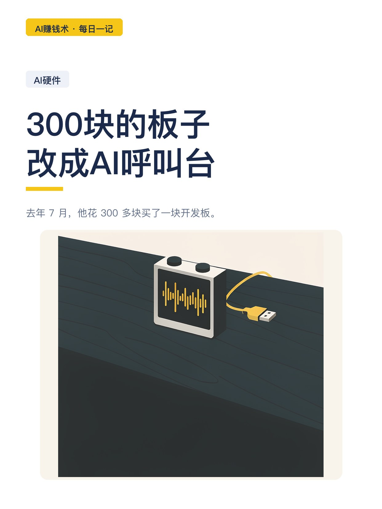
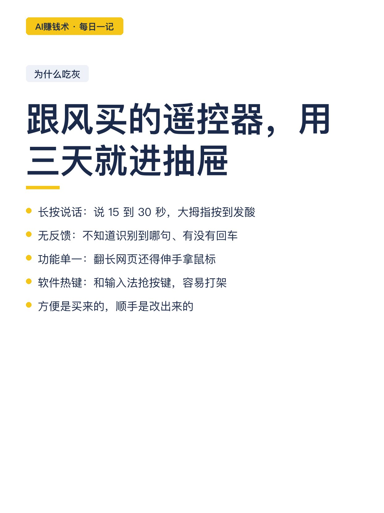
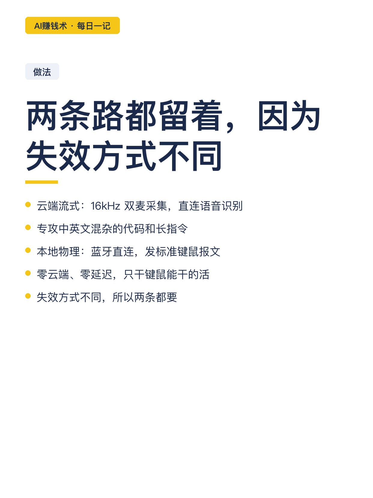
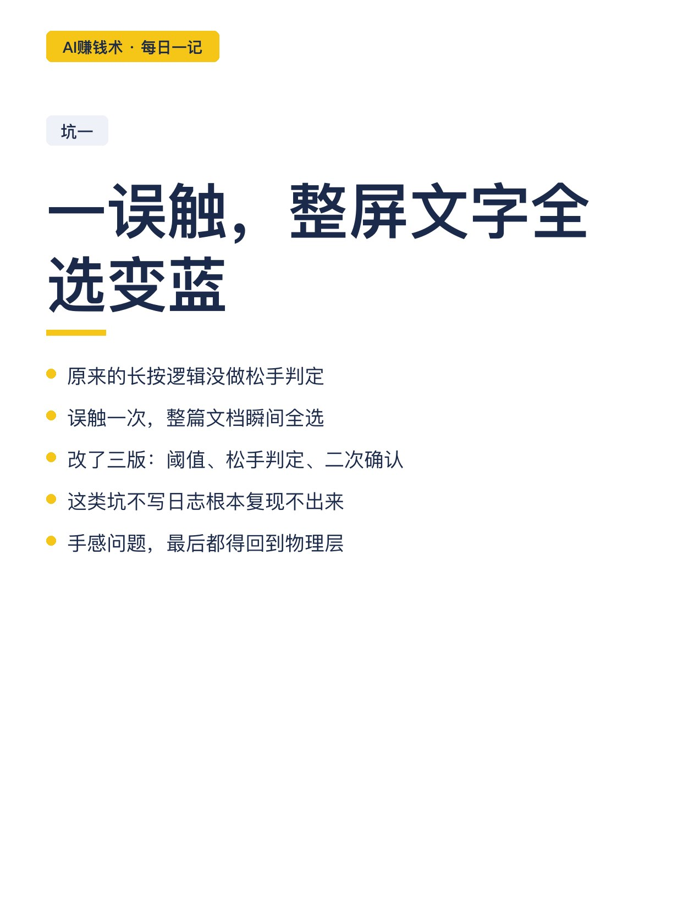
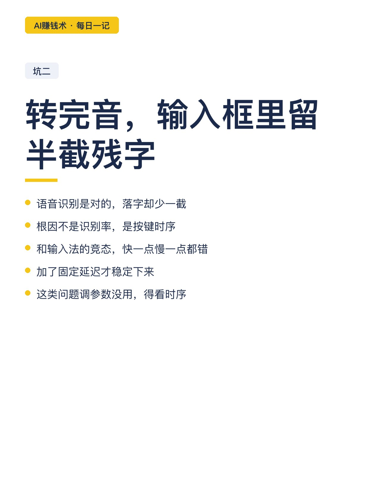
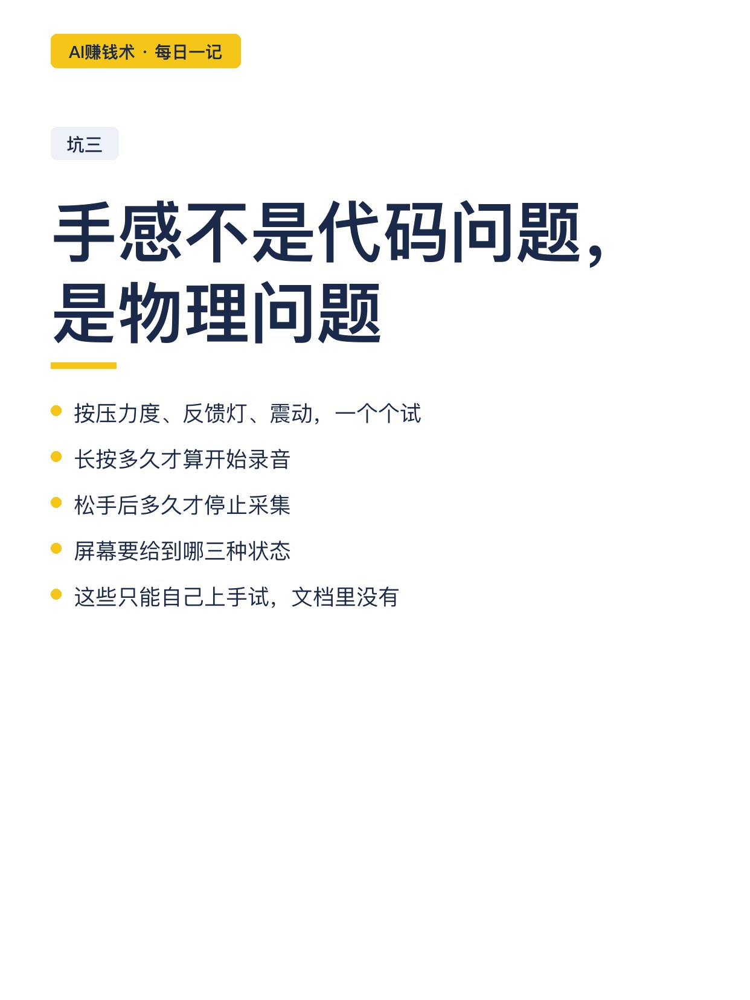
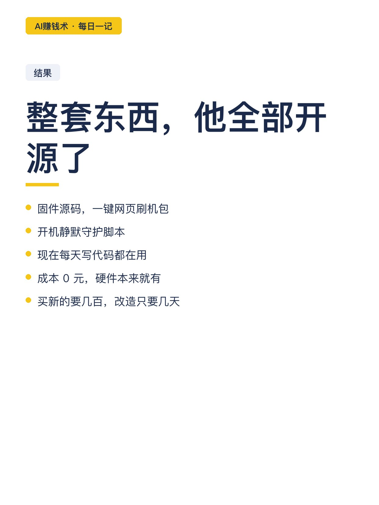
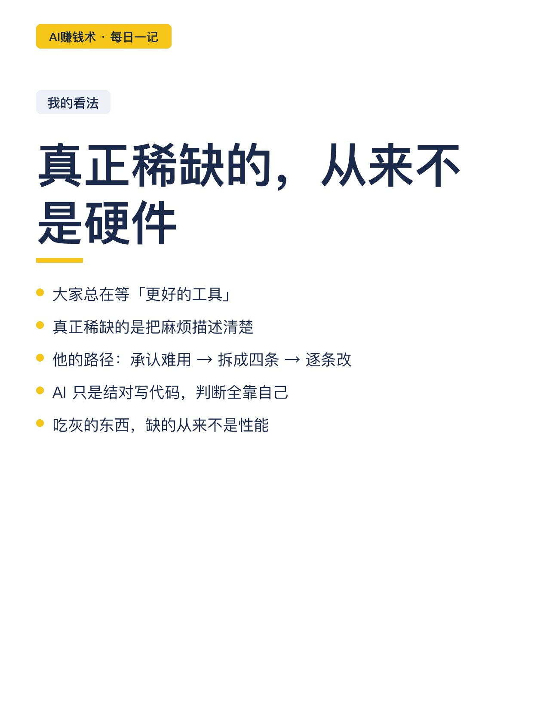

# 300块的板子，改成AI呼叫台

> — · 2026-10-28 22:08 发布 · AI 赚钱内容

## 标题（可直接复制）

```
300块的板子，改成AI呼叫台
```

## 正文（可直接复制发布）

去年 7 月，他花 300 多块买了一块开发板。

2 寸彩屏、双麦克风阵列。买回来用了两天，就丢在桌角吃灰。

最近 AI 编程火了，圈里人纷纷买电视遥控器当语音输入器。他没买新的——把这块吃灰的板子，改成了 AI 呼叫台。😳

📌 为什么遥控器用几天就吃灰

他自己先踩过一遍：

· 长按说话反人类：给 AI 提一段复杂需求，要说 15 到 30 秒，大拇指一直按着，两下就酸
· 没有状态反馈：盲按，不知道有没有识别到、识别到哪句、电脑有没有敲回车
· 功能单一：翻长网页、长代码，还得伸手拿鼠标
· 软件热键不稳：靠全局快捷键注入，容易和输入法打架

📌 改造的思路：两条路都留着

一是云端流式：双麦克风采 16kHz 音频，电脑端直连语音识别，专攻中英文混杂的代码和长指令，标点自动规整。

二是本地物理键鼠：蓝牙直连，发的是标准键鼠报文，不经任何软件钩子。

为什么两条都要？因为它们的失效方式不一样。云端识别准，但依赖网络；本地零延迟，但只能干键鼠能干的活。日常写代码走第一条，需要稳的场景切第二条。🤔

📌 三个真正花时间的坑

坑一：误触。原来长按逻辑没做松手判定，一误触就把整屏文字全选变蓝。改了三版才压住。

坑二：输入法延迟。语音转完，输入框常留半截残字。问题不在识别，在按键时序和输入法的竞态。

坑三：手感。这不是代码问题，是物理问题——按压力度、反馈灯、震动，得一个个试。

他说整整改了好几天，把底层交互、手感、协议全重构了一遍。

📌 值得注意的一点

这套东西他 100% 开源了：固件源码、一键网页刷机包、开机静默守护脚本。

一个吃灰的硬件，加一个具体到不能再具体的痛点，就能变成每天都要用的工具。

📌 我看完最想说的一句

大家总在等「更好的工具」，但真正稀缺的不是硬件，是「把一个具体麻烦描述清楚」的能力。

他做的事其实很朴素：先承认遥控器难用，再把难用拆成四条，最后一条一条对着硬件改。这个过程里，AI 只是结对写代码的伙伴，判断全靠他自己。✨

## 话题标签

#AI赚钱术日记 #副业 #AI硬件 #开源项目 #效率工具

## 配图（10 张）












## 发布信息

| 项 | 值 |
|---|---|
| 平台 | 小红书 |
| 期数 | — |
| 发布时间 | 2026-10-28 22:08 |
| 正文长度 | 849 字 |
| 图片数量 | 10 张 |
| 状态 | 已发布 |
