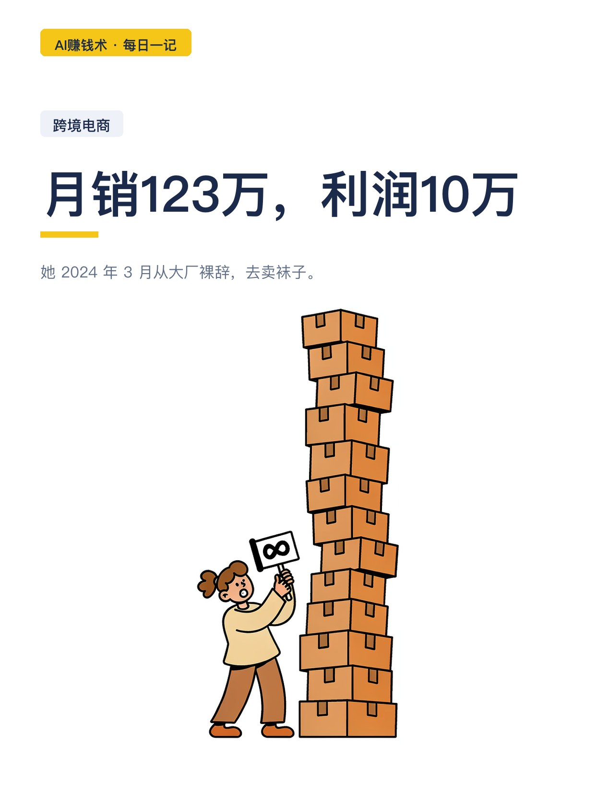
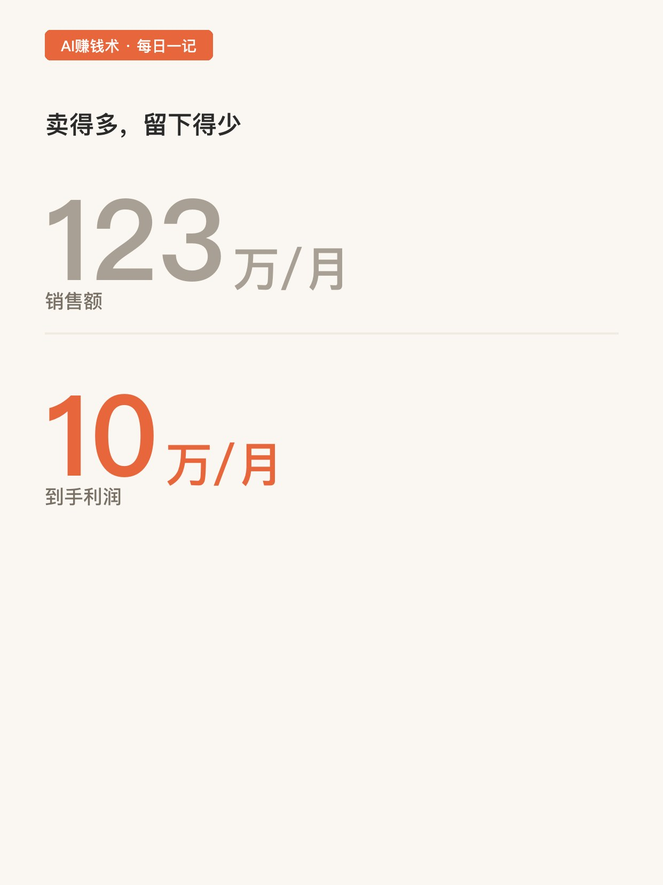
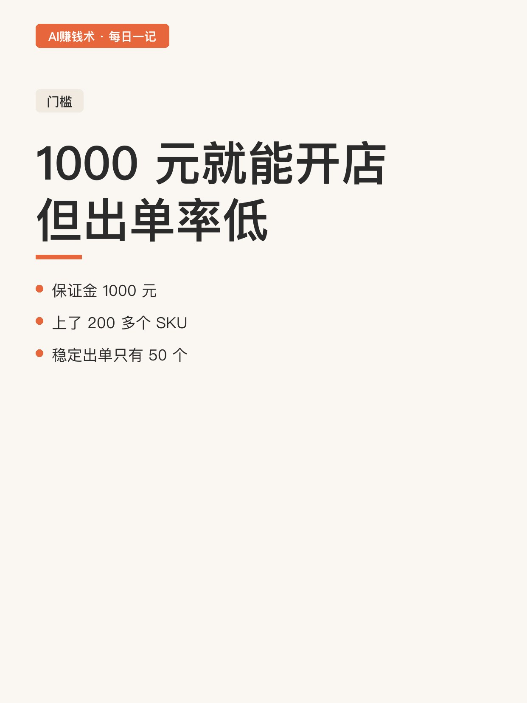
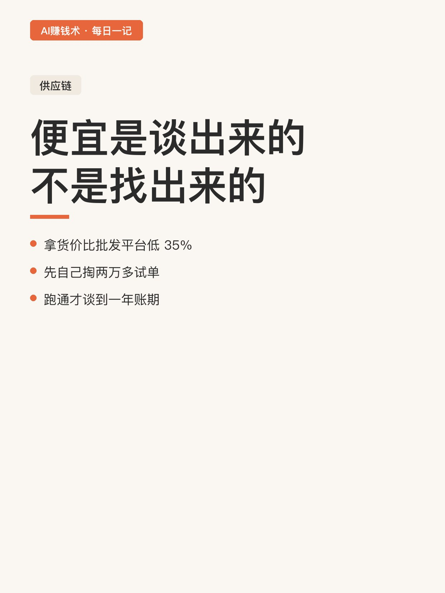
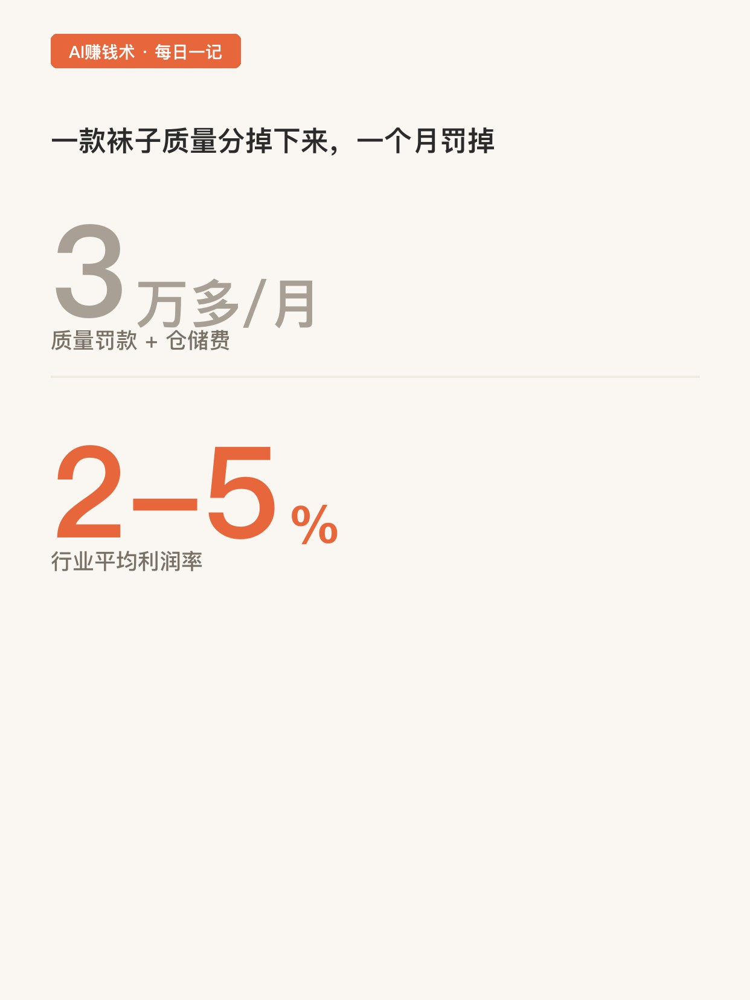
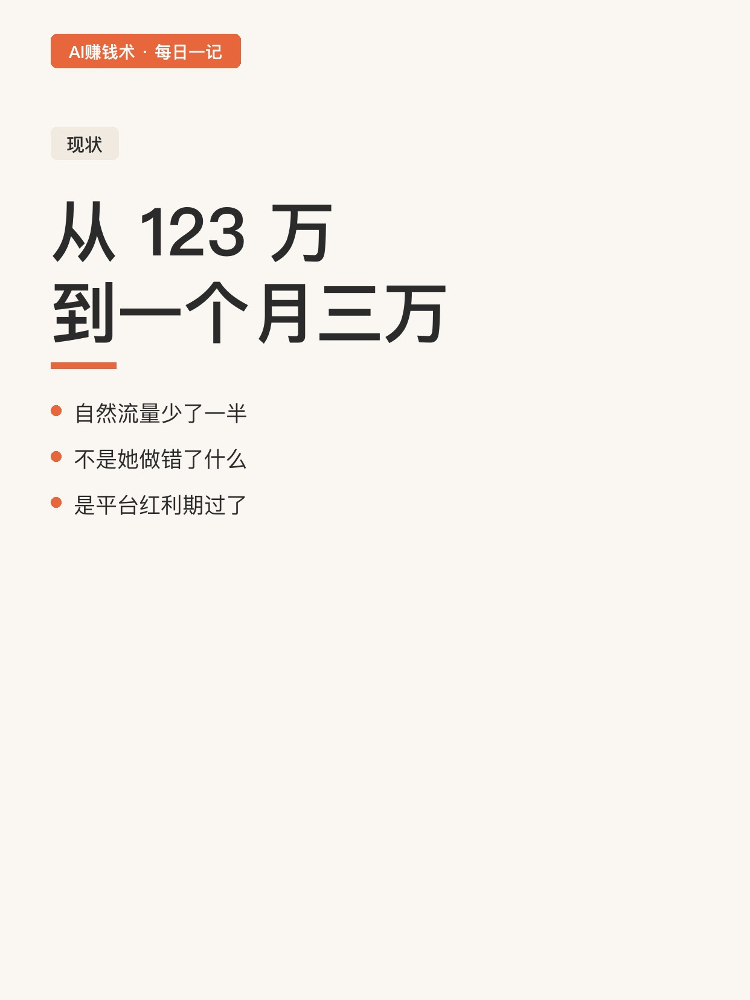
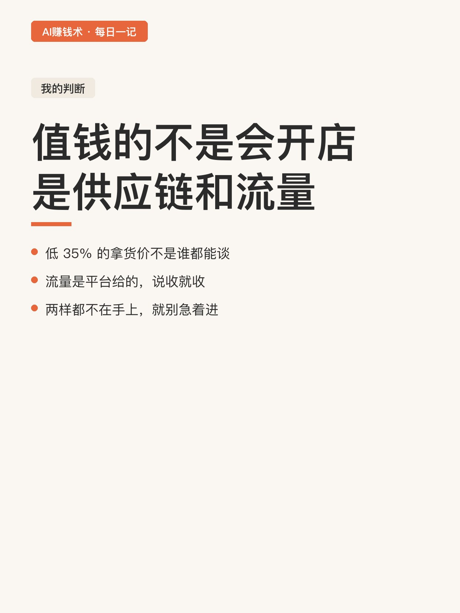
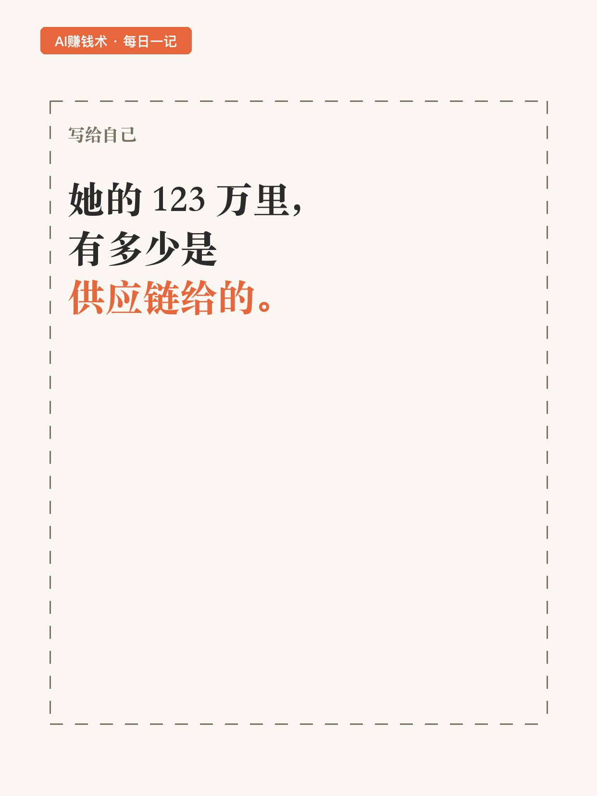

# 月销123万，利润10万

> — · 2026-10-28 11:18 发布 · AI 赚钱内容

## 标题（可直接复制）

```
月销123万，利润10万
```

## 正文（可直接复制发布）

她 2024 年 3 月从大厂裸辞，去卖袜子。😳

高峰期一个月卖 123 万，到手 10 万出头。

这两个数字放一起，很多人第一反应是「利润率怎么这么低」。别急，往下看还有更低的。

📌 门槛低到意外

1000 元保证金就能开店，门槛低到几乎不算门槛。

她一开始上了 200 多个 SKU，你猜稳定出单的有多少个？

50 个。

也就是说，四分之三的选品是白上的。这不是她笨，是这行的常态：先铺量，让数据告诉你哪个能卖。📊

⏰ 便宜是谈出来的，不是找出来的

她拿货价比批发平台还低 35%，做到行业前 3% 的低价。

怎么谈的？

先自己掏两万多块钱拿货试单，跑通了才去跟工厂聊账期，最后谈到一年账期。💡

这一步很多人跳过。想直接要低价、要账期，工厂凭什么给你。

💡 但规模越大，罚得越狠

这是我觉得最该说的一点。

一款雪地袜质量分掉下来，平台减流量、扣质量罚款、加海外仓仓储费，一个月最多罚掉三万多净利。

她那 10 万利润，是在罚款、退货、仓储一层层扣完之后的数。

行业平均利润率，2% 到 5%。

✅ 现在的情况

她说现在自然流量少了一半，一个月三万左右。📉

从 123 万到三万，两年时间。⏳

这不是她做错了什么，是平台红利期过了，早期进去的人吃到了，后面的人只能吃剩下的。

📌 我的一点判断

这条路上真正值钱的不是「会开店」，是两样东西：供应链和平台流量。

她前期能跑起来，是因为拿货价比别人低 35%，这个优势不是谁都谈得下来。

我现在的疑问是：她的 123 万里，有多少是供应链给的，有多少是平台给的。如果两样都不在我手上，我凭什么进去。

## 话题标签

#副业 #跨境电商 #出海 #普通人搞副业 #AI赚钱术日记

## 配图（8 张）










## 发布信息

| 项 | 值 |
|---|---|
| 平台 | 小红书 |
| 期数 | — |
| 发布时间 | 2026-10-28 11:18 |
| 正文长度 | 698 字 |
| 图片数量 | 8 张 |
| 状态 | 已发布 |
