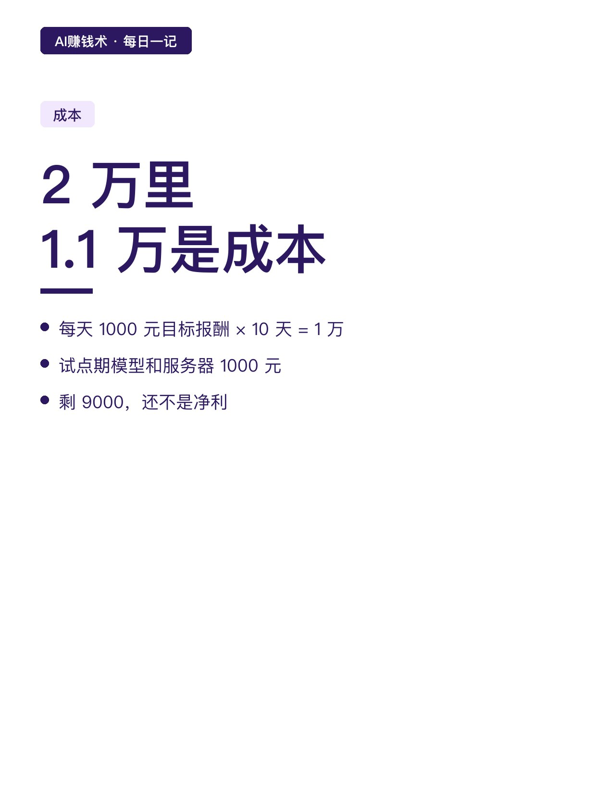
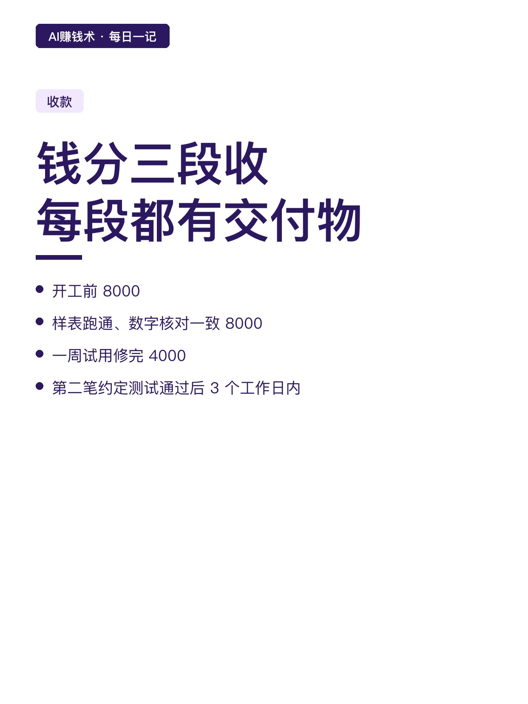
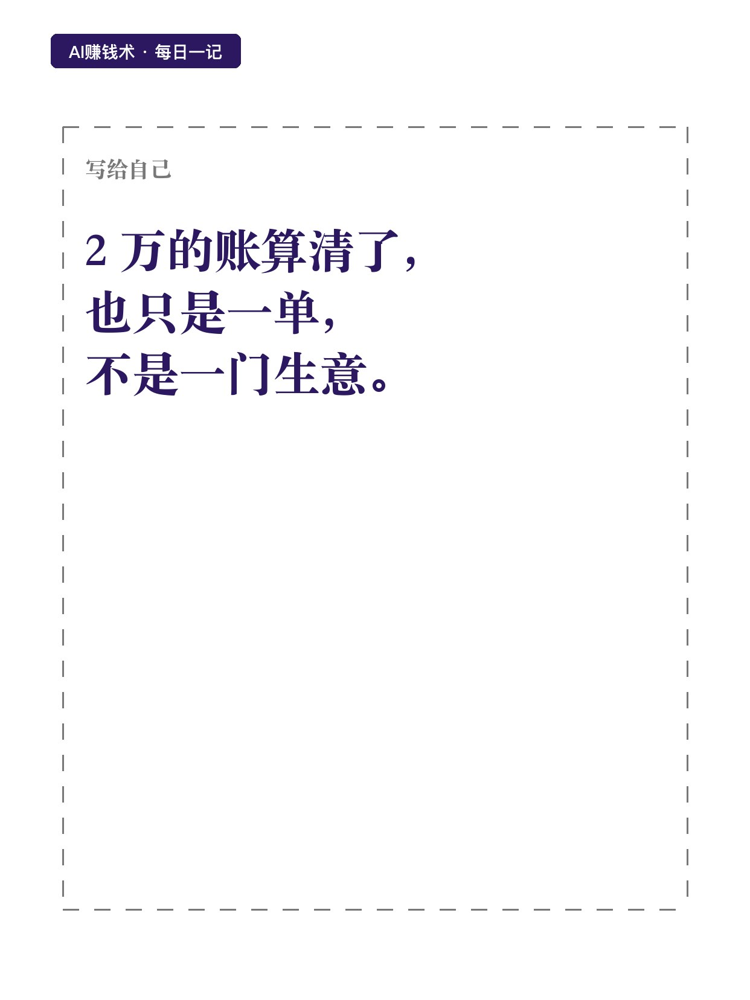

# 2万的单，先收8000再开工

> 第30期 · 2026-10-28 12:25 发布 · AI 赚钱内容

## 标题（可直接复制）

```
2万的单，先收8000再开工
```

## 正文（可直接复制发布）

他给第一个客户报价 2 万，签完才发现：真正落袋的可能不到 9 千。😳

这不是被坑了，是他一开始就没算清楚。

📌 第一个错：按「写代码那几天」报价

他原本以为这活干四五天就能交。

后来老老实实拆了一遍：沟通 2 天、搭建 4 天、测试交接 2 天、修改 2 天。

加起来 10 个工日。

注意，是工日，不是「你觉得能做几天」。📋中间那些来回、等待、改需求，都是要花时间的。

⏰ 第二个错：把成交价当收入

2 万听着不少。

按每天 1000 元的目标报酬算，10 个工日就是 1 万。再加上试点期的模型调用和服务器，1000 元。

成本 1.1 万，收 2 万，剩 9000。💰

但这 9000 还不能叫净利。因为还没算找客户的空档期、日常经营费用、税费。真正净到手，比 9000 少。

💡 第三个错：钱一次收

他现在改成三段收：

开工前收 8000；样表跑通、数字跟人工核对一致，再收 8000；一周试用把问题修完，收尾款 4000。

第二笔约定「测试通过后 3 个工作日内到账」。⏱️

这个设计的用处不是多收钱，是把风险摊开——每一段都有明确的交付物，双方都知道下一步该做什么。

✅ 第一单从哪来

他的建议很朴素：从熟人开始。

先拿模拟数据做一个演示，跑给对方看，然后问一句：「你们有没有人每天手工做日报？」

有，就是需求；没有，就别硬推。

📌 但他说了句实话

司徒 K 做企业服务十几年，他自己说：对个人靠接这种单把它变成一门独立生意，并不太乐观。

所以这 2 万的账，算清了也只是一单，不是一门生意。

我现在的疑问是：一单能算清成本，十单呢。当客户来源不稳定的时候，那些空档期该算进哪一单的成本里。

## 话题标签

#副业 #接单 #自由职业 #普通人搞副业 #AI赚钱术日记

## 配图（8 张）









## 发布信息

| 项 | 值 |
|---|---|
| 平台 | 小红书 |
| 期数 | 第30期 |
| 发布时间 | 2026-10-28 12:25 |
| 正文长度 | 726 字 |
| 图片数量 | 8 张 |
| 状态 | 已发布 |
