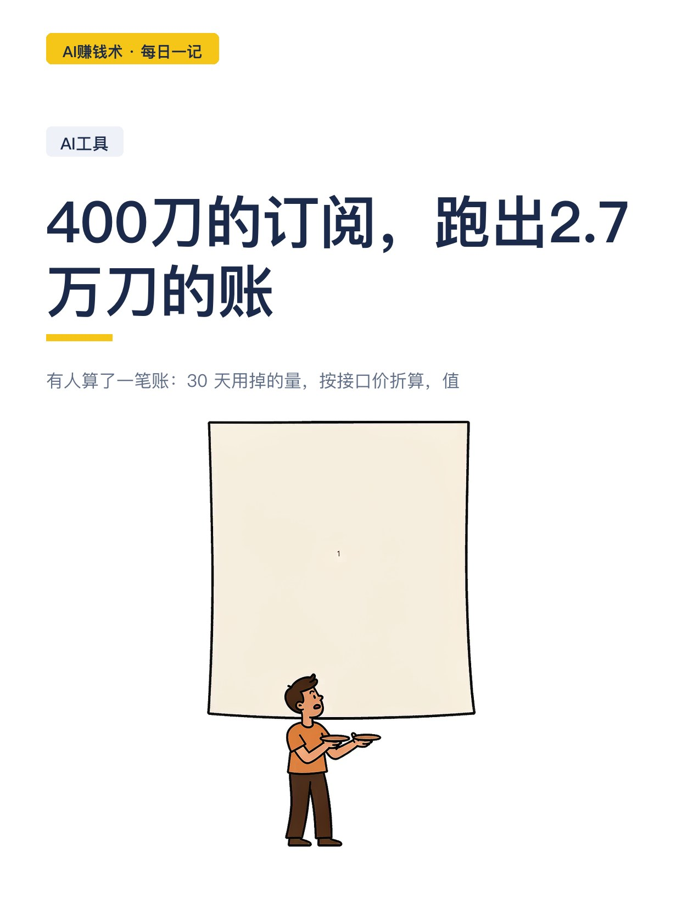
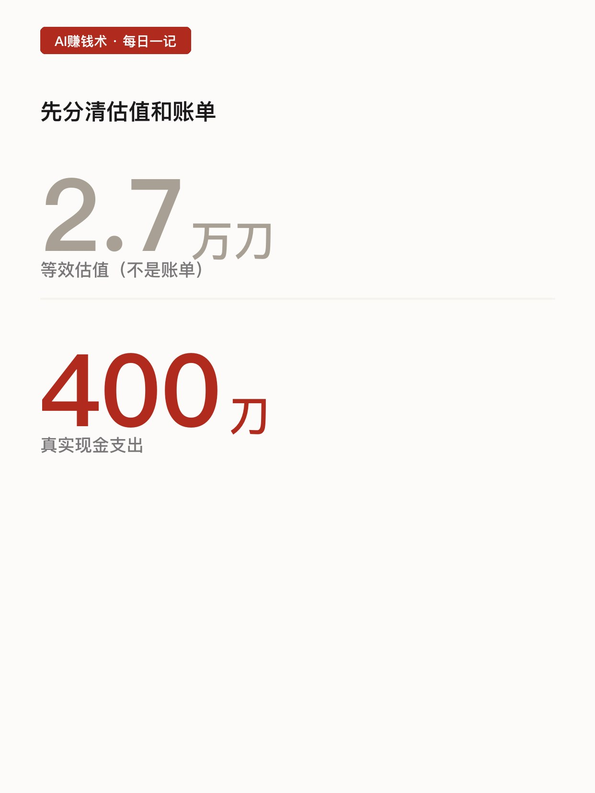
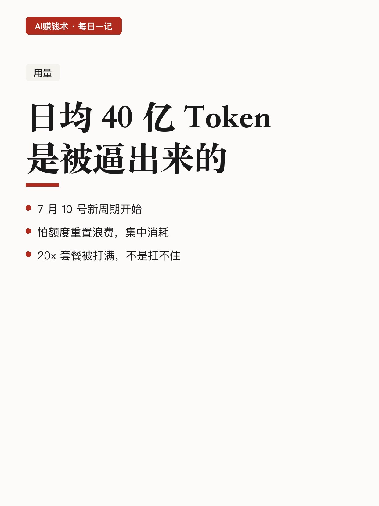
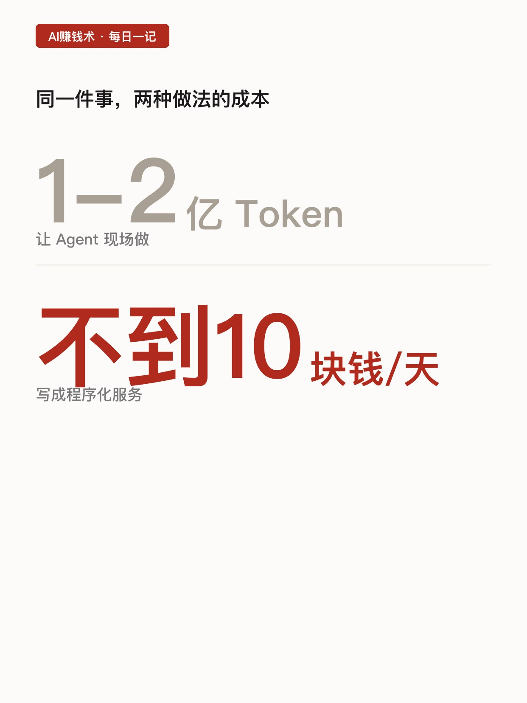
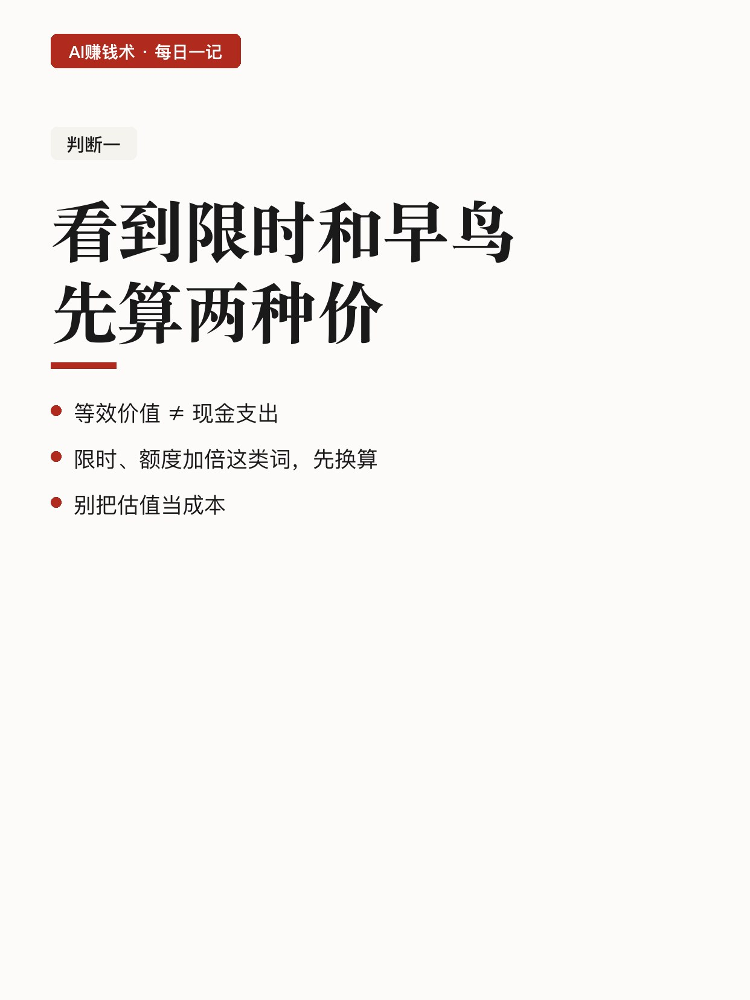
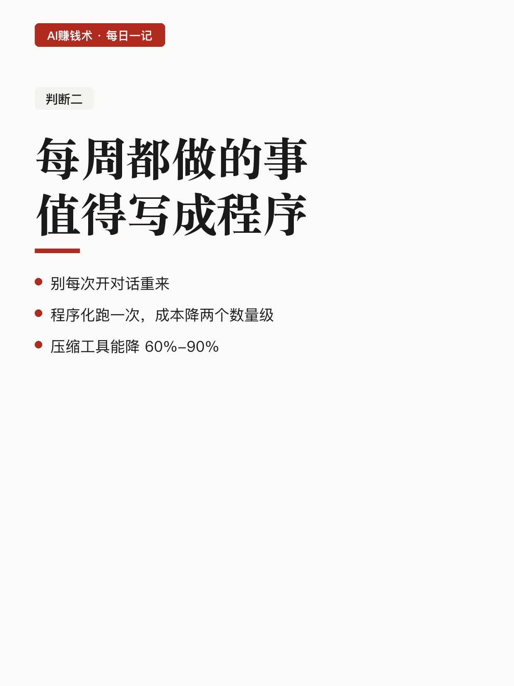
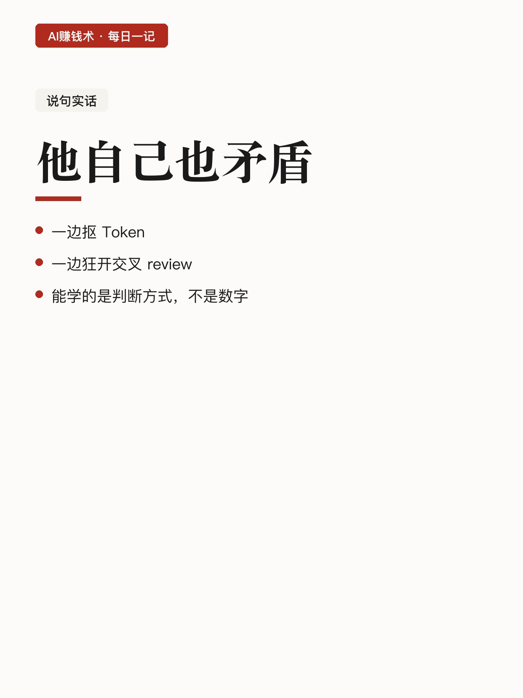
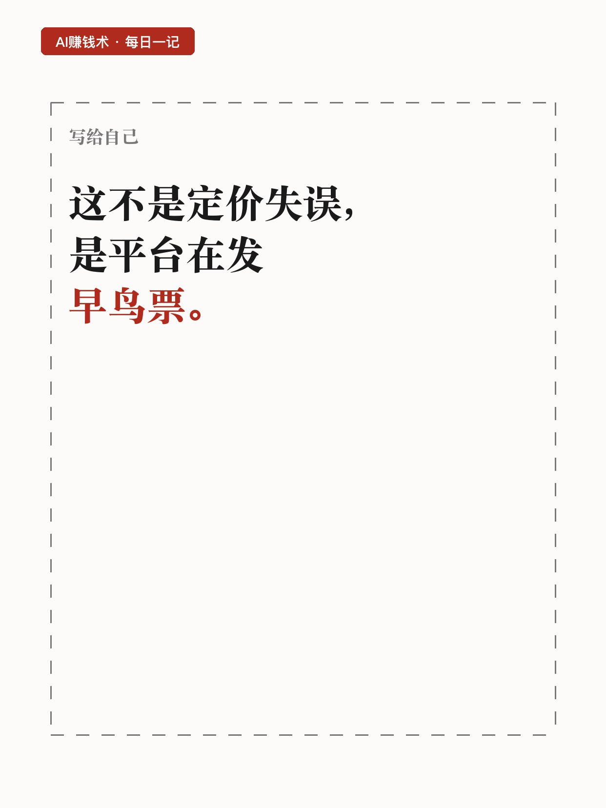

# 400刀的订阅，跑出2.7万刀的账

> 第31期 · 2026-10-28 13:29 发布 · AI 赚钱内容

## 标题（可直接复制）

```
400刀的订阅，跑出2.7万刀的账
```

## 正文（可直接复制发布）

有人算了一笔账：30 天用掉的量，按接口价折算，值 2.7 万多美金。

实际账单：两个 200 刀的订阅。😳

这不是薅羊毛的技巧，是一道定价题。我拆给你看。

📌 先说清楚，2.7 万是估值不是账单

原文自己强调了这一点：那是按接口价折算的等效估值，不是他真掏了 2.7 万。

真实现金支出就是两个 200 刀，一共 400 刀。

这个区别很重要，因为很多人看到「2.7 万」就以为月成本两万七，其实差了两个数量级。

⏰ 量是怎么被逼出来的

7 月 10 号新周期开始，他怕额度重置浪费，就集中消耗。

连续几天日均 40 亿 Token 往上。

注意这句：20x 的套餐是被他打满的，不是他扛不住。💡

也就是说，这个量不是需求推出来的，是「额度快过期了」推出来的。人的行为会被计费周期改变。

💡 真正省钱的地方不在订阅

他对比了两种做法：

同一件事，用 Agent 现场做，可能烧掉一两亿 Token；写成程序化服务，一天七八百万到上千万 Token，每天成本不到 10 块钱。

差两个数量级。

结论很直接：重复的事，别让 AI 每次现场做，写成程序跑一次就够了。🔧

✅ 三个能直接用的判断

一，看到「限时」「早鸟」「额度加倍」，先算等效价值，再算现金支出，别混。

二，一件事如果每周都做，就值得程序化，别每次开对话重来。

三，压缩类的工具能把用量降 60% 到 90%，比换套餐划算。

📌 说句实话

他自己也有矛盾的地方：一边抠 Token，一边狂开交叉 review。

所以这不是一套精算模型，是一个正在摸索的人的账本。能学的是判断方式，不是具体数字。

我现在的疑问是：200 刀的订阅能跑出 1 到 3 万刀的等效消耗，这到底是定价失误，还是平台在发早鸟票。如果是早鸟票，它什么时候停售。

## 话题标签

#副业 #AI #AI工具 #成本 #AI赚钱术日记

## 配图（8 张）










## 发布信息

| 项 | 值 |
|---|---|
| 平台 | 小红书 |
| 期数 | 第31期 |
| 发布时间 | 2026-10-28 13:29 |
| 正文长度 | 770 字 |
| 图片数量 | 8 张 |
| 状态 | 已发布 |
