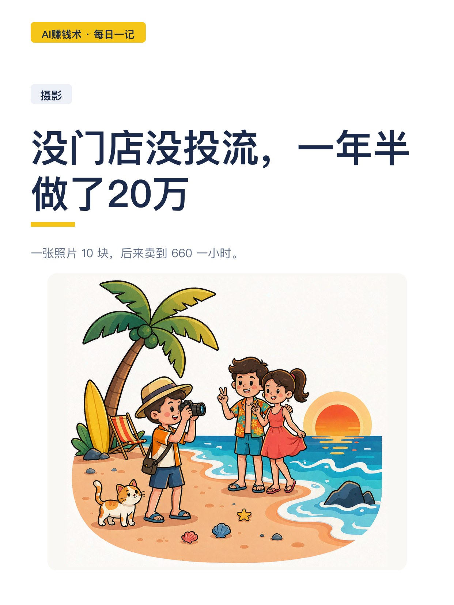
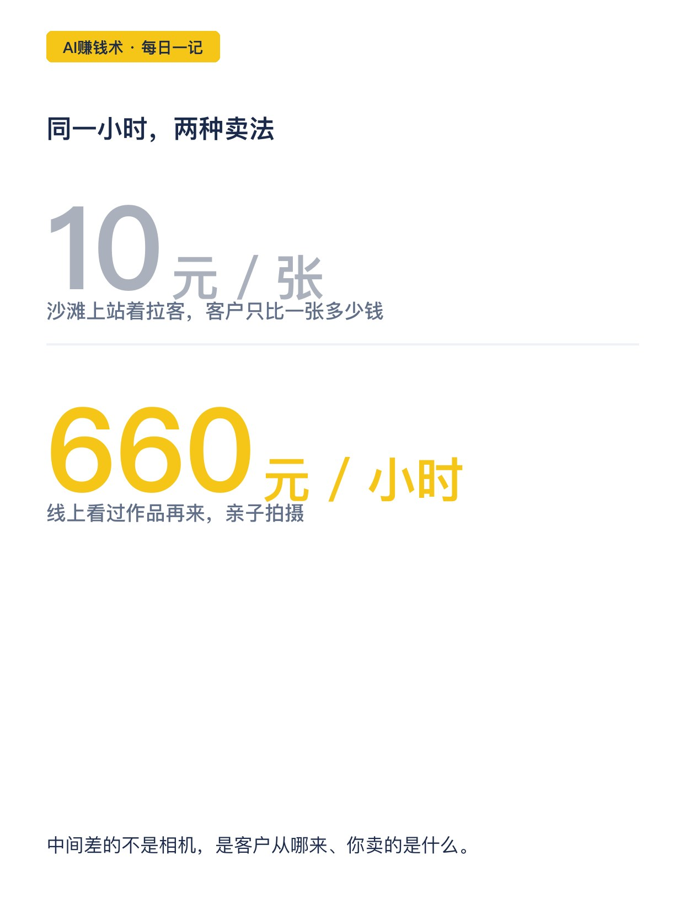
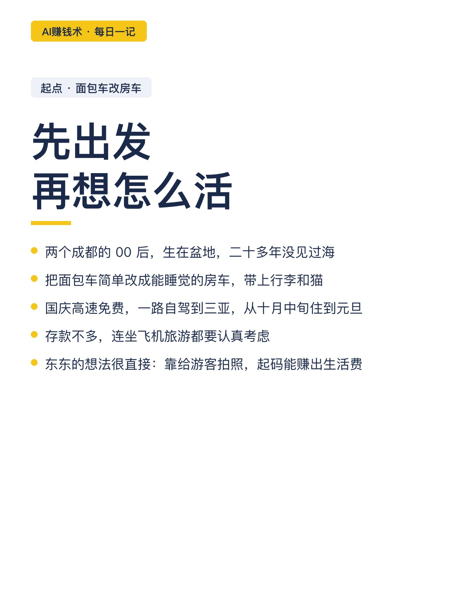
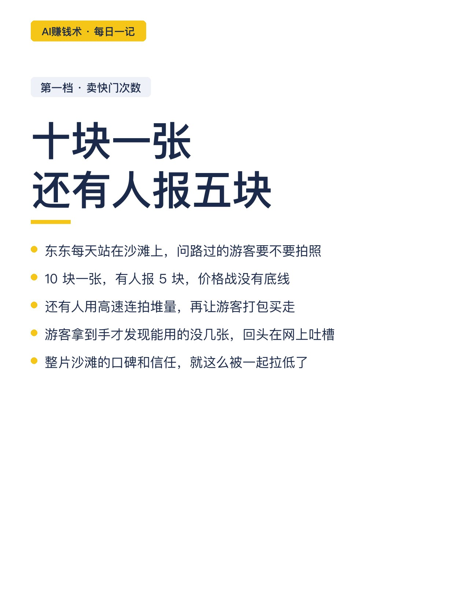
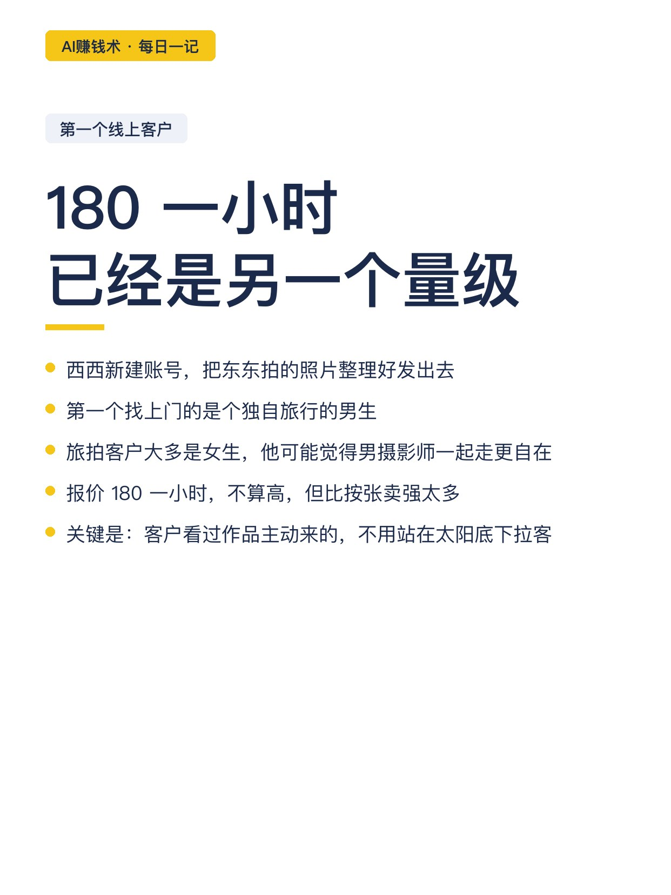
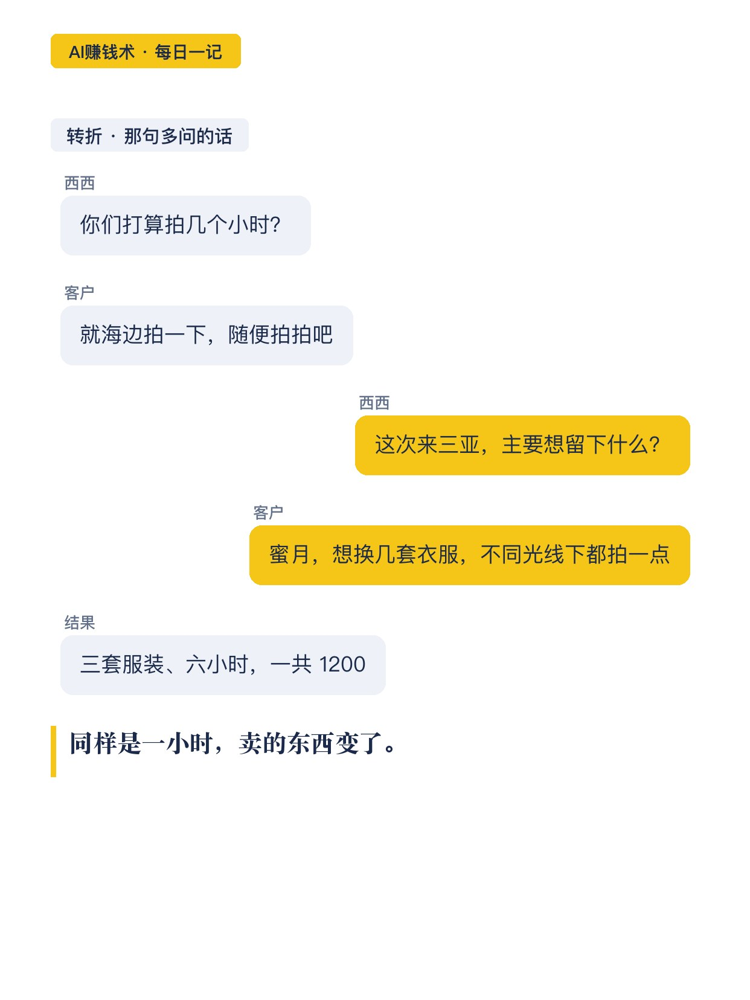
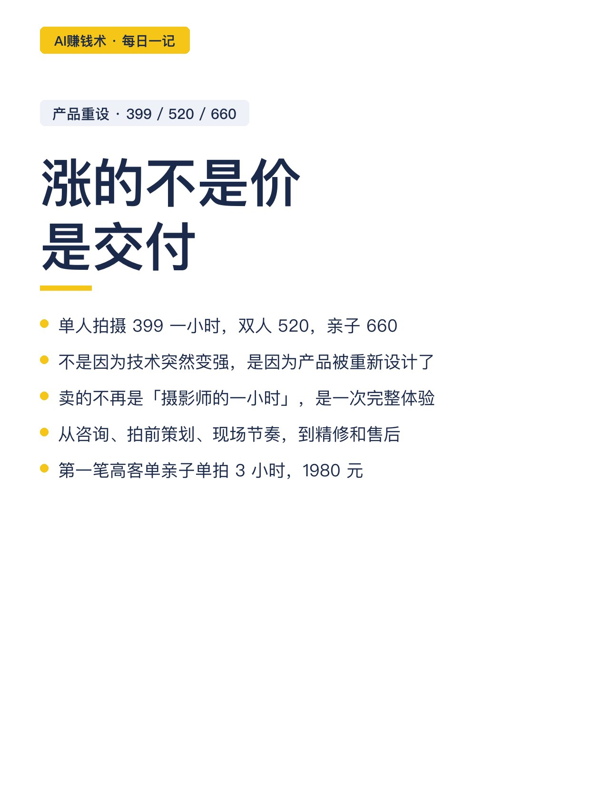
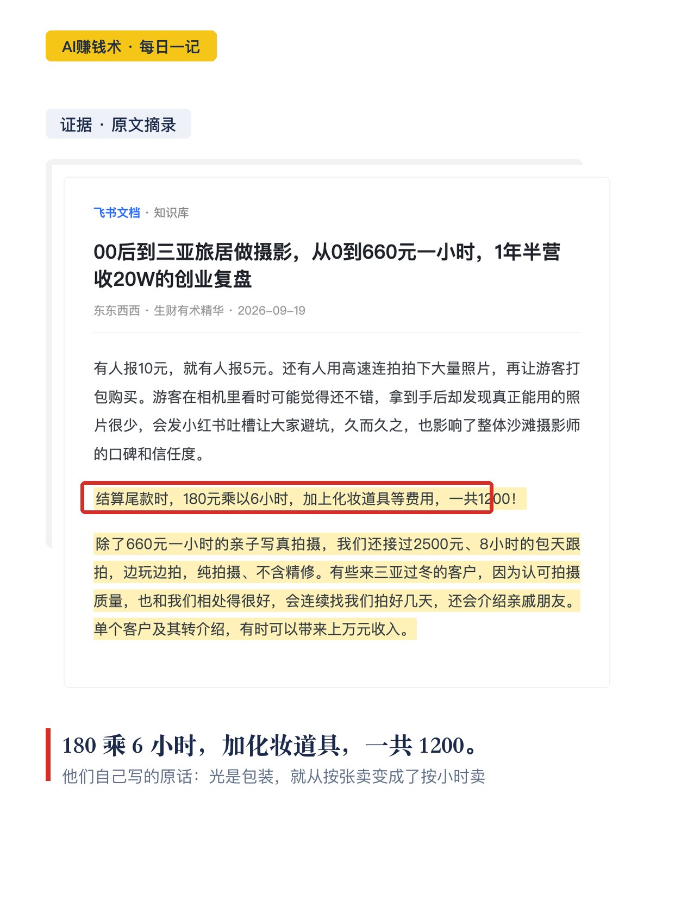
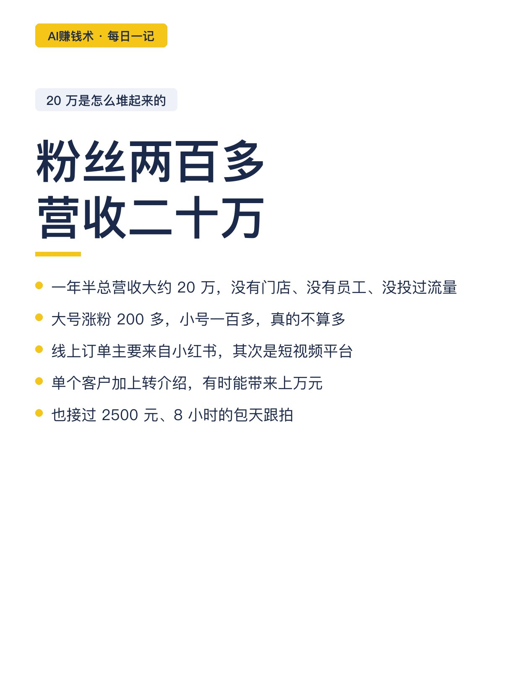
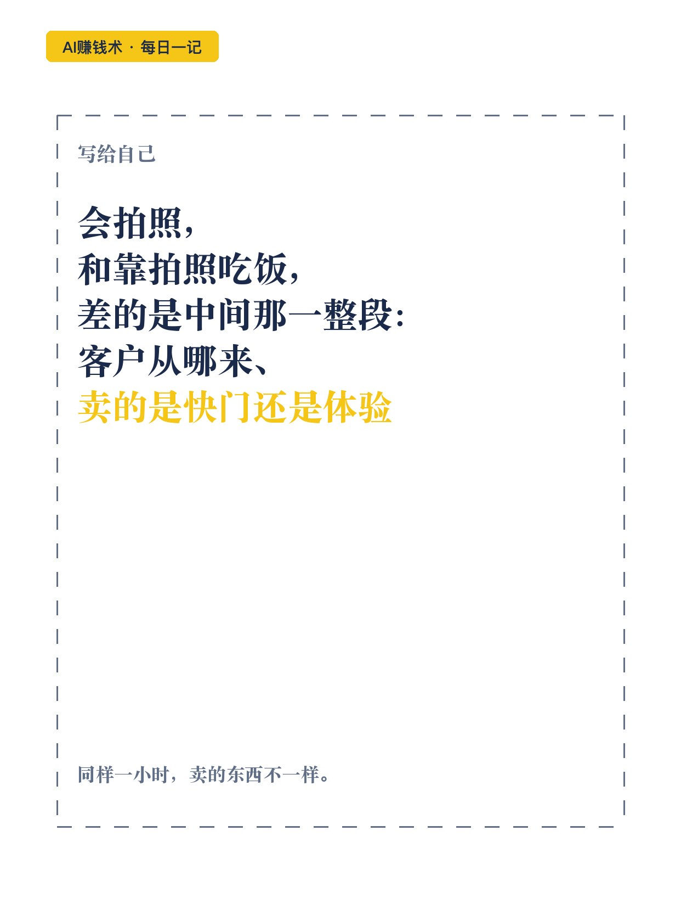

# 没门店没投流，一年半做了20万

> 第32期 · 2026-10-28 17:40 发布 · AI 赚钱内容

## 标题（可直接复制）

```
没门店没投流，一年半做了20万
```

## 正文（可直接复制发布）

一张照片 10 块，后来卖到 660 一小时。

两个成都的 00 后，把面包车改成能睡觉的房车，自驾到三亚。没门店、没员工、没投过一分钱流量，一年半总营收大约 20 万。😳

先说清楚：20 万不多，但这条路比数字有用。

📌 一开始，他们卖的其实是「一张照片」

刚到三亚，东东每天站在沙滩上问游客拍不拍照。10 块一张，有人报 5 块，还有人用连拍堆量、打包卖。游客发现能用的没几张，回头吐槽，整片沙滩的信任都被拉低。

这是最原始的一档：卖的是快门次数。

📌 第一个线上客户，180 一小时

西西新建了账号，把东东拍的照片整理好发出去。第一个找上门的是个独自旅行的男生，可能觉得找个男摄影师一起走更自在。🤔

180 一小时。不算高，但比沙滩上按张卖已是另一个量级。更重要的是：客户是看过作品主动来的，不用再站在太阳底下拉客。

📌 真正的转折，是那句多问的话

第二单是一对来度蜜月的新人。报价还是 180 一小时。

但西西没有只问「你们打算拍几个小时」，而是继续问：这次来三亚，主要想留下什么？💬

聊完才知道，他们要的不只是海边合影，还有换装、不同时段的光线、能发出去的一组完整照片。最后拍了三套服装、六小时。

结账：180 乘 6，加化妆道具，一共 1200。同样一小时，卖的东西变了。🎯

📌 报价重新设计：399 / 520 / 660

后来他们把产品拆开：单人 399 一小时，双人 520，亲子 660。

不是因为技术变强才涨的。他们卖的从「摄影师的一小时」，变成了一次从咨询、策划、现场节奏、精修到售后的完整体验。

第一笔高客单亲子单，拍 3 小时，1980 元。还接过 2500 元、8 小时的包天跟拍。

📌 20 万是怎么堆起来的

· 大号涨粉 200 多，小号一百多，真的不多。📈
· 线上订单主要来自小红书，其次是短视频平台。
· 单个客户加上转介绍，有时能带来上万。

📌 我看完最想说的一句

很多人以为「会拍照」和「靠拍照吃饭」，差的是技术。

差的其实是中间那一整段：客户从哪来、卖的是快门还是体验、交付包含什么、口碑能不能带来下一个客户。😅

沙滩上，客户只能比较一张多少钱。在内容平台上，客户能比较作品、审美、服务和评价。

同样能力，换个渠道，价格完全不同。✨

## 话题标签

#副业 #摄影 #旅拍 #小生意 #AI赚钱术日记

## 配图（10 张）












## 发布信息

| 项 | 值 |
|---|---|
| 平台 | 小红书 |
| 期数 | 第32期 |
| 发布时间 | 2026-10-28 17:40 |
| 正文长度 | 963 字 |
| 图片数量 | 10 张 |
| 状态 | 已发布 |
