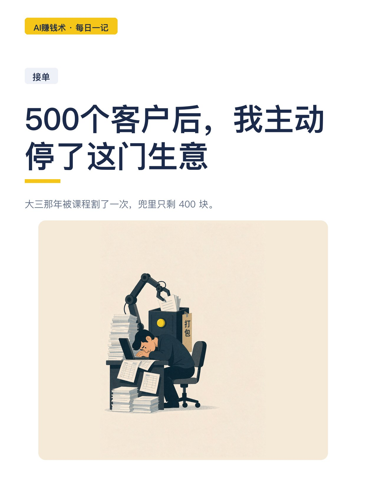
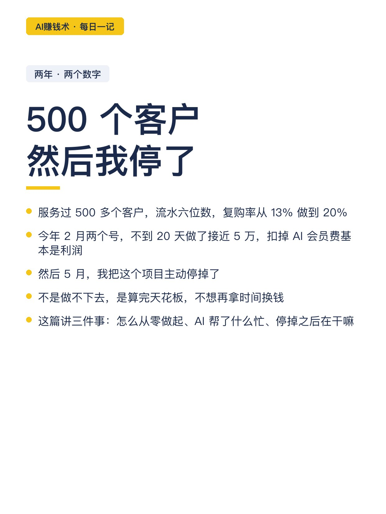
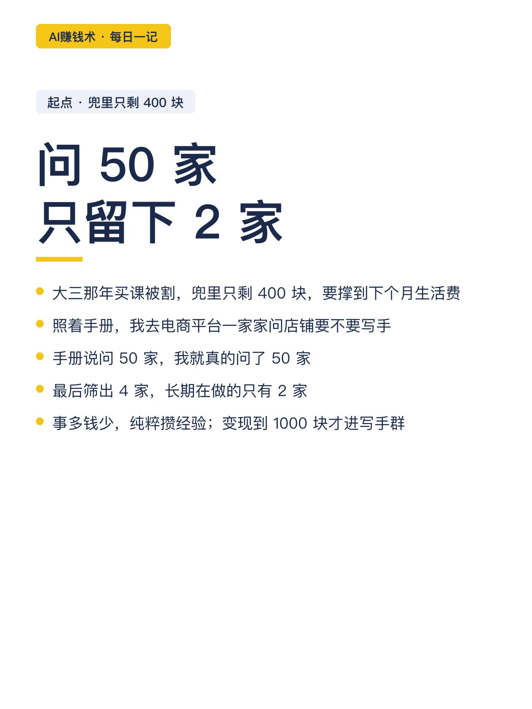
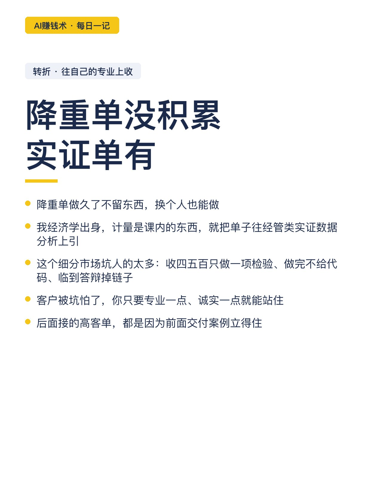
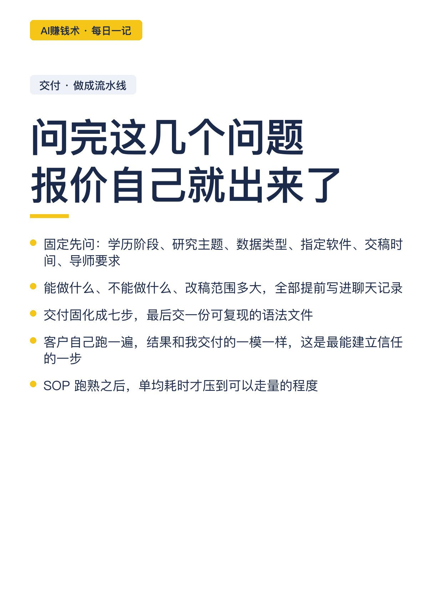
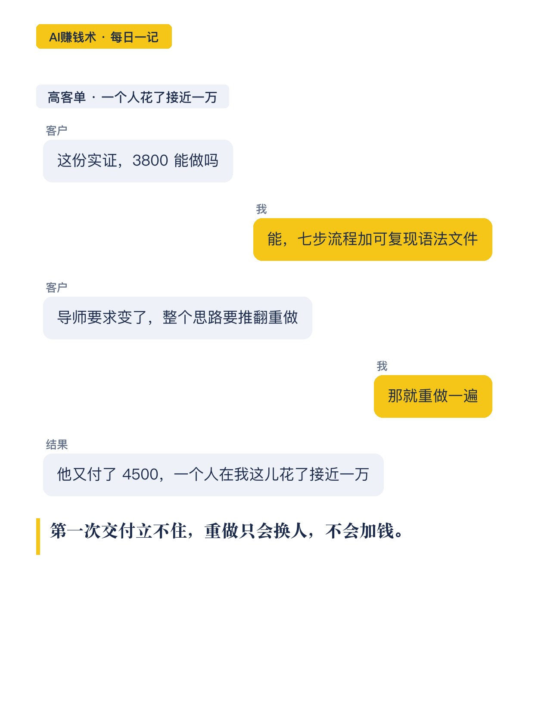
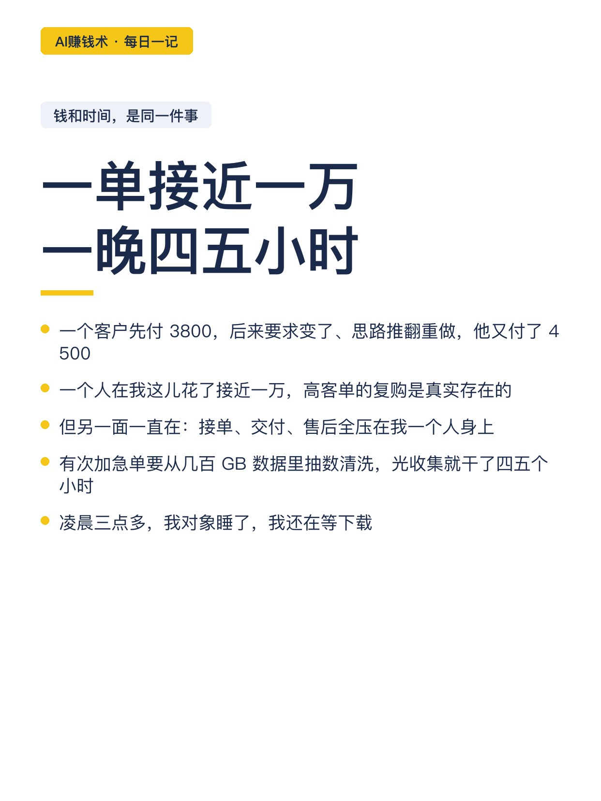
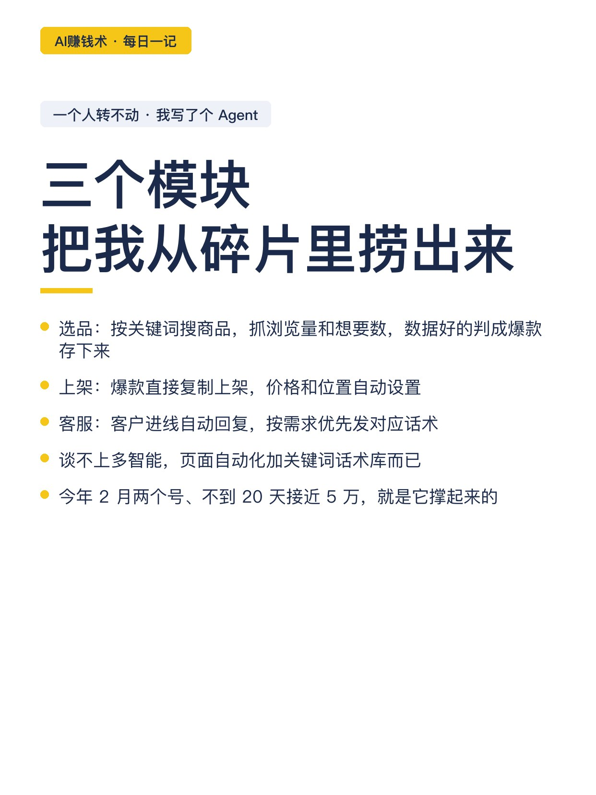
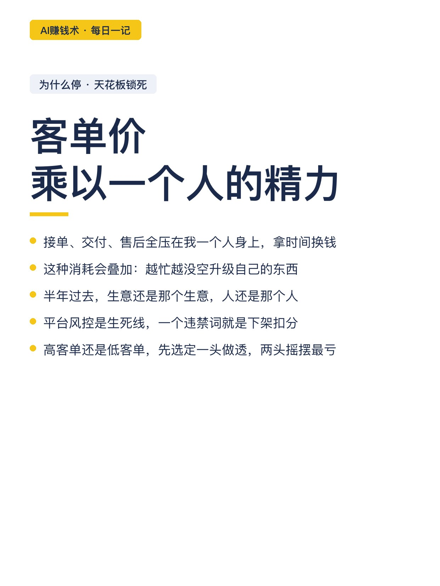
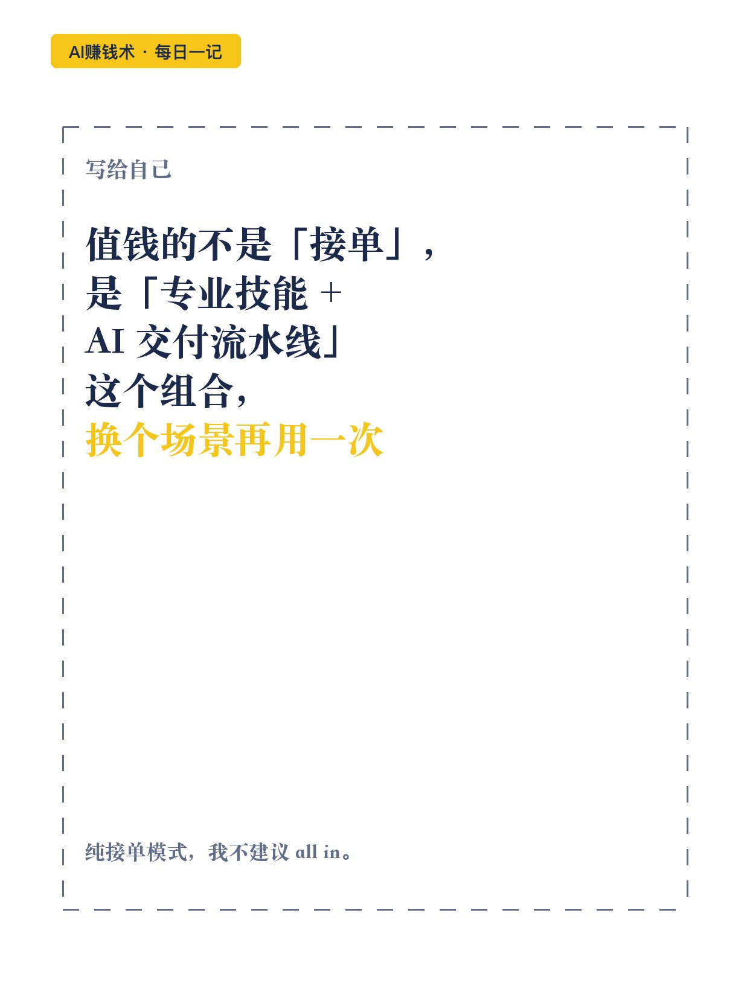

# 500个客户后，我主动停了这门生意

> 第33期 · 2026-10-28 16:37 发布 · AI 赚钱内容

## 标题（可直接复制）

```
500个客户后，我主动停了这门生意
```

## 正文（可直接复制发布）

大三那年被课程割了一次，兜里只剩 400 块。就是那一周，我开始疯狂找赚钱的办法。

两年后，我服务了 500 多个客户，流水六位数，复购率从 13% 做到 20%。今年 2 月两个号，不到 20 天做了接近 5 万，扣掉 AI 会员费基本是利润。

5 月，我把这个项目停掉了。😮

📌 起点：问 50 家，只留下 2 家

照着手册，我去电商平台一家家问店铺要不要写手，问 50 家。最后筛出 4 家，长期做的只有 2 家。变现到 1000 块才进写手群。

📌 转折：把单子往自己专业上收

降重单做久了没积累。我是经济学出身，计量是课内的东西，就把单子往经管类实证数据分析上引。

这个细分市场坑人的太多：收四五百只做一项检验、做完不给代码、临到答辩掉链子。客户被坑怕了，你只要专业一点、诚实一点就能站住。

📌 交付做成流水线，才谈得上走量

接单第一步永远是需求确认：学历阶段、研究主题、数据类型、指定软件、交稿时间、导师有没有特殊要求。问完报价就出来了。

交付固化成七步，最后交一份可复现的语法文件。客户自己跑一遍，结果和我交付的一模一样，这是最能建立信任的一步。SOP 跑熟才能走量。

📌 一个人转不动，我给自己写了个 Agent

单量上来后，选品、上架、回消息把碎片时间全吃掉。我写了三个模块的运营 Agent：选品抓爆款、上架定价、客服发话术。

2 月那波近 5 万就是它撑起来的：我在前面做交付，Agent 在后面选品、上架、回消息。

📌 为什么停

一个客户先付 3800，后来导师要求变了、思路推翻重做，他又付 4500，一个人在我这儿花了接近一万。高客单的复购是真实的。

但另一面一直在：接单、交付、售后全压在我身上。有次加急单要从几百 GB 数据里抽数清洗，光收集就干了四五个小时，凌晨三点还在等下载。

客单价乘以一个人的精力，天花板就锁死了。越忙越没空升级自己，半年过去，生意还是那个生意，人还是那个人。😮‍💨

📌 三个坑

· 平台风控是生死线，一个违禁词就是下架扣分。
· 高客单还是低客单，先选定一头做透。

📌 最后

值钱的不是「接单」这个动作，是「专业技能 + AI 交付流水线」这个组合，搬到复购更好、客单价更高的场景去。

纯接单模式，我不建议 all in。

## 话题标签

#副业 #AI #接单 #一人公司 #AI赚钱术日记

## 配图（10 张）












## 发布信息

| 项 | 值 |
|---|---|
| 平台 | 小红书 |
| 期数 | 第33期 |
| 发布时间 | 2026-10-28 16:37 |
| 正文长度 | 962 字 |
| 图片数量 | 10 张 |
| 状态 | 已发布 |
