# 6.6万用户，只变现173元

> 第34期 · 2026-10-28 20:47 发布 · AI 赚钱内容

## 标题（可直接复制）

```
6.6万用户，只变现173元
```

## 正文（可直接复制发布）

一个查演唱会座位的工具，两个月攒下 6.6 万用户。

累计广告收入 511 元，云开发支出 338 元，账面结余 173 元。😳

山芋第一次用 AI 做小程序。做完他才明白：能把产品做出来、能拿到流量、能靠它持续赚钱，是三件完全不同的事。

📌 起点：解决自己的麻烦

他常去看演唱会，每次都要翻很久才找到某个场馆某个区域的真实视角照片。看到有查剧院座位的小程序，他想：能不能搬到演唱会场景？

需求是真的。但他只问了「有没有人需要」，没问「愿不愿意为它花钱」。🤔

📌 开发不难，难的是上线之后

他没写过代码，不懂前后端和数据库，全靠把需求讲给 AI 搭出第一版。上线第三天就有 1000 多个用户。

推广只有两条：朋友圈和内容平台发帖。然后卡住了——站外引流限制很严，而广告收入一天只有几毛到一两块，为这点收入每天维护迭代不划算，他主动停了大半推广。😅

📌 意外的两万用户

有一天朋友告诉他，有人在做一个几乎一样的小程序，布局都很像。他在海外平台发帖说明，附上对比截图。

第二天，用户从 2000 多涨到 2 万多。

真正该问的是：意外流量来了，产品接得住吗？他当时的答案是接不住。

📌 坑一：从没算过云成本

一开始买 19.9 元的个人版，几百用户够用。流量一爆，他临时升到 79.6 元标准版，又花 199 元续费，每月约 33 万调用积分只是勉强够。

他从没算过：一个用户消耗多少资源，涨到五万时成本会变成什么样。

📌 坑二：唯一的变现方式是广告

6.68 万用户，单日新增最高 4915 人。他已停了大半推广，用户还在涨。广告收入累计 511 元。

不是流量不够。是这类用户用完就走：查完座位，不会回来第二次。广告只按曝光点击算，留不下任何东西。

📌 如果重来，他会先问两个问题

· 我到底靠什么赚钱：帮别人开发收服务费，还是自己运营？
· 这群人有付费动机吗，为什么愿意在我这里花钱？

他现在觉得：几千个愿意付费的用户，可能比几万个免费用户更值得做。

📌 我看完最想说的一句

AI 把「做出来」变得很便宜，很多人以为门槛没了。但门槛只是往前挪了一段：从写代码，挪到想清楚谁付钱、成本怎么算、流量来了接不接得住。

他自己那句话说得挺准：AI 降低了开发门槛，但没有降低赚钱的难度。✨

## 话题标签

#AI赚钱术日记 #副业 #独立开发 #小产品 #避坑

## 配图（11 张）

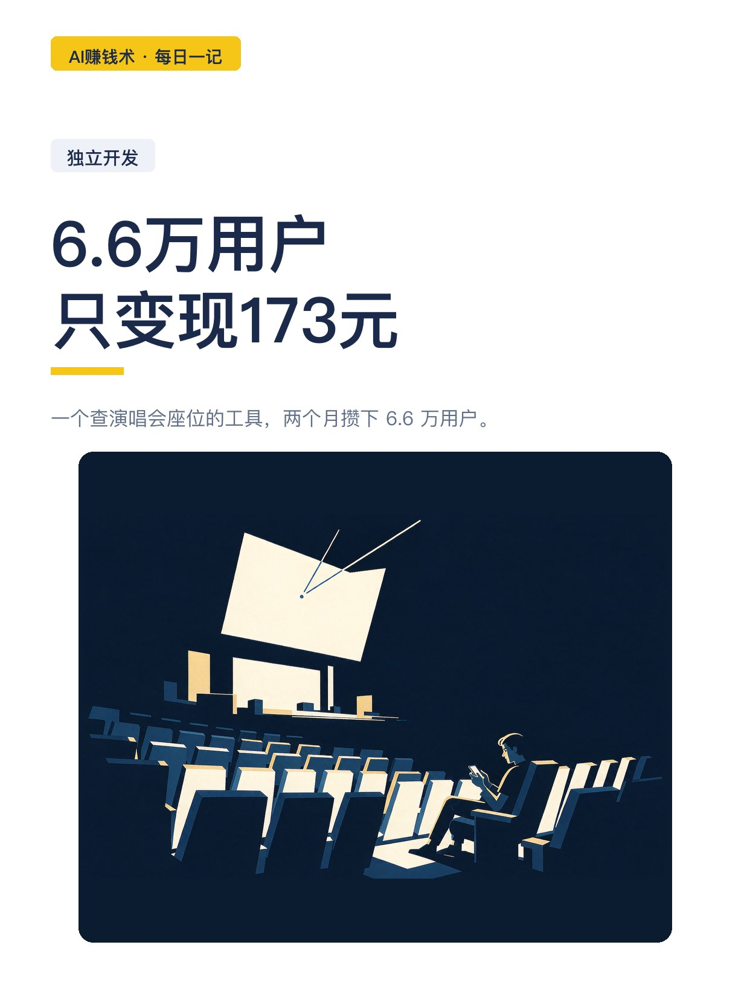
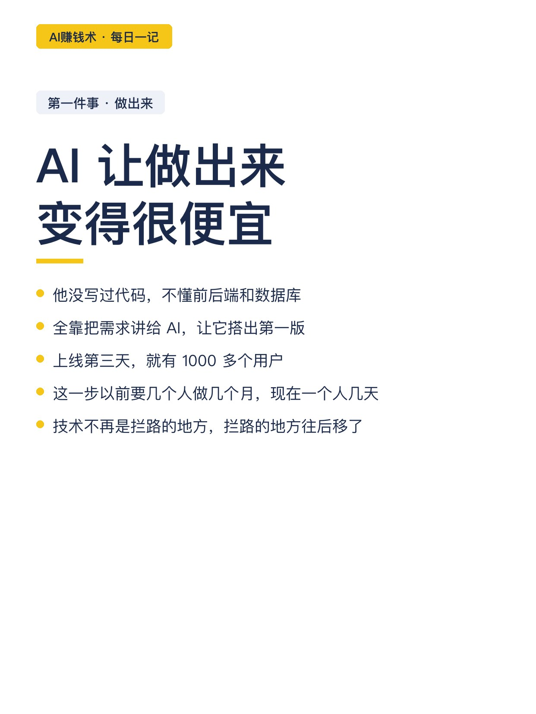
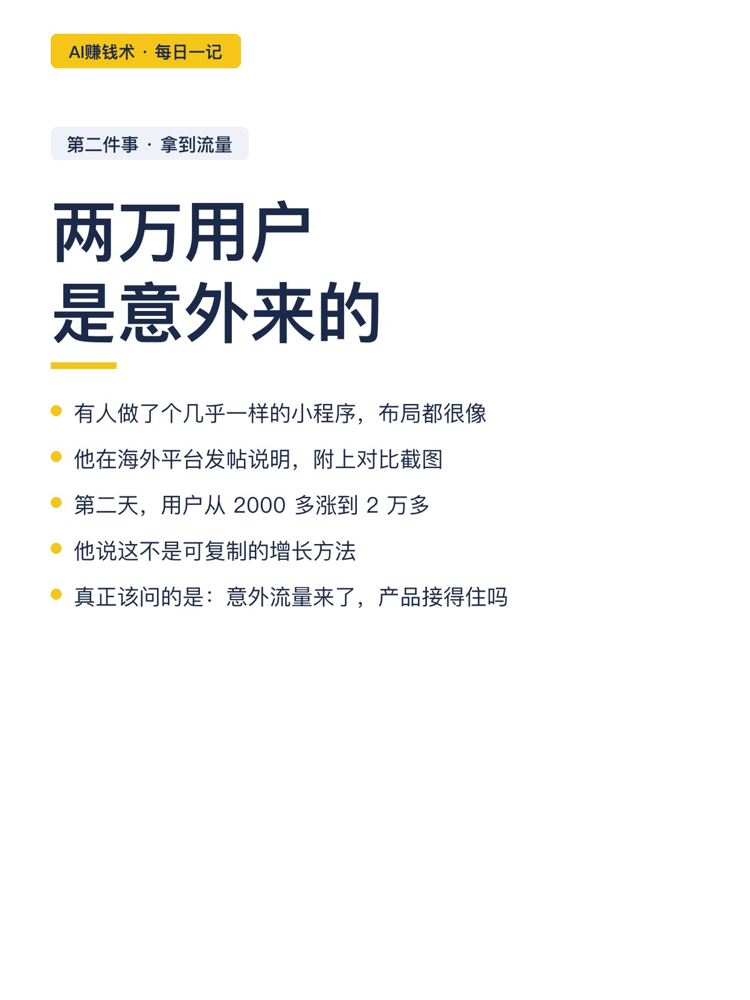
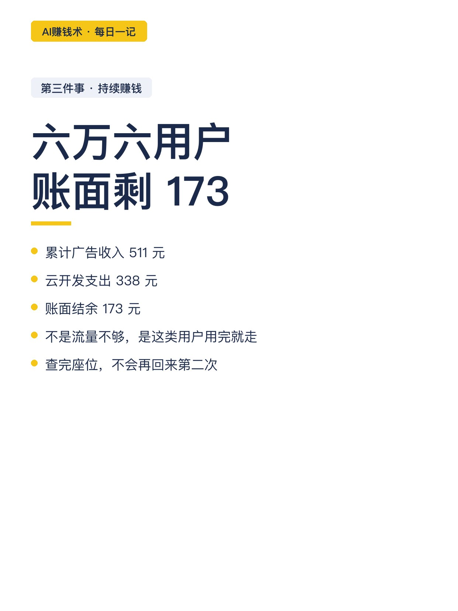
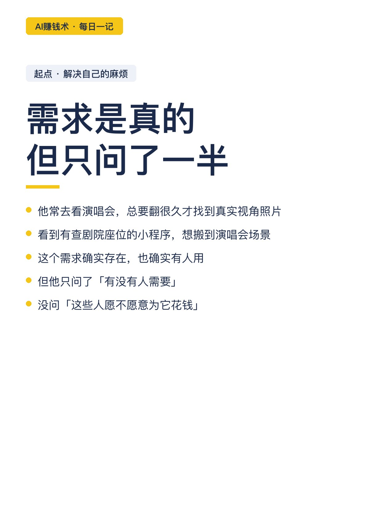
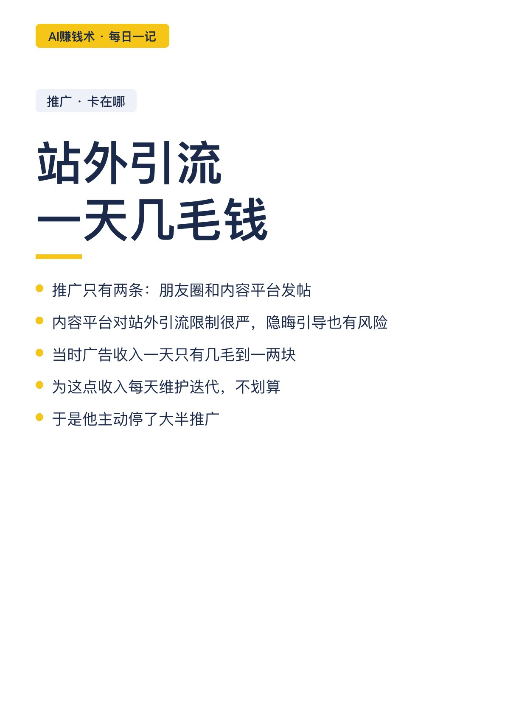
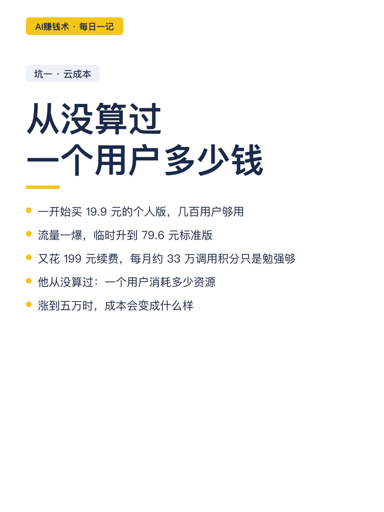
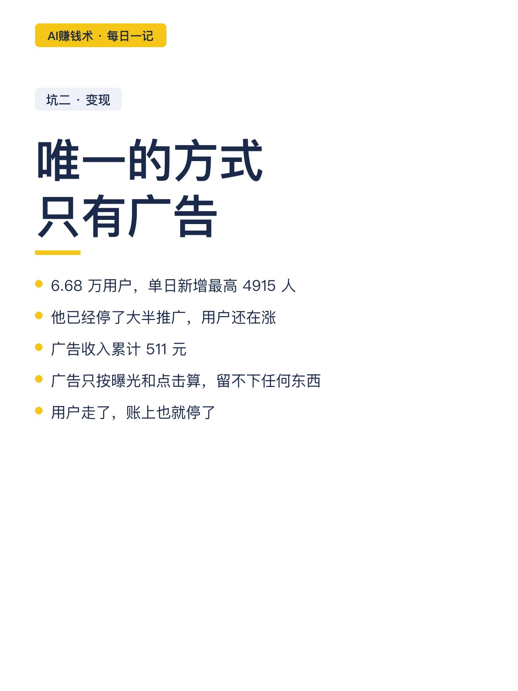
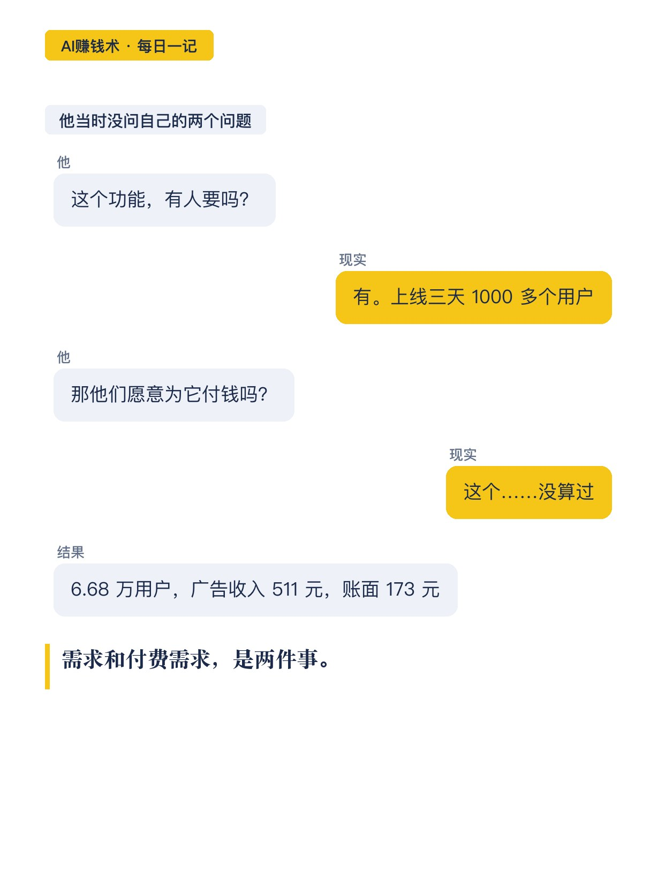
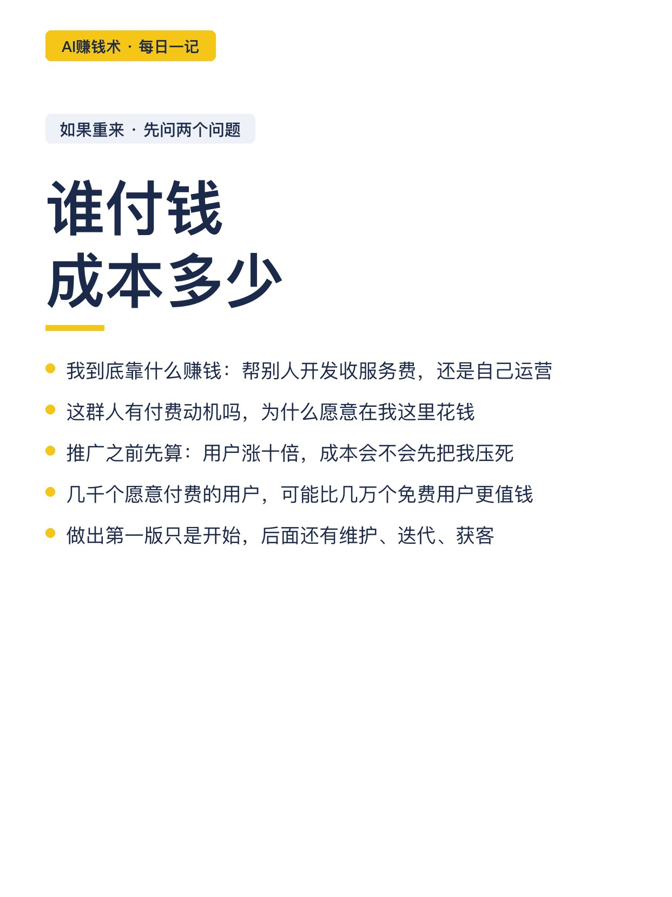
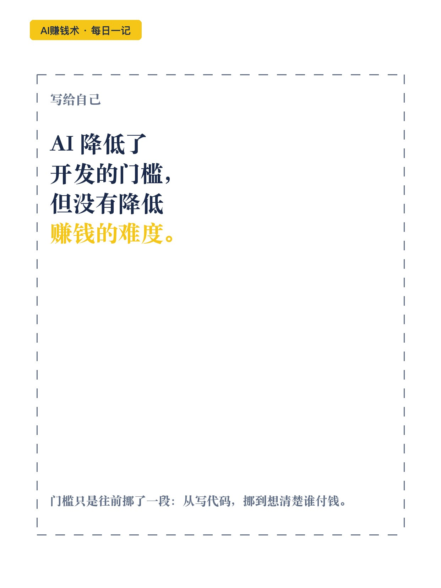

## 发布信息

| 项 | 值 |
|---|---|
| 平台 | 小红书 |
| 期数 | 第34期 |
| 发布时间 | 2026-10-28 20:47 |
| 正文长度 | 967 字 |
| 图片数量 | 11 张 |
| 状态 | 已发布 |
