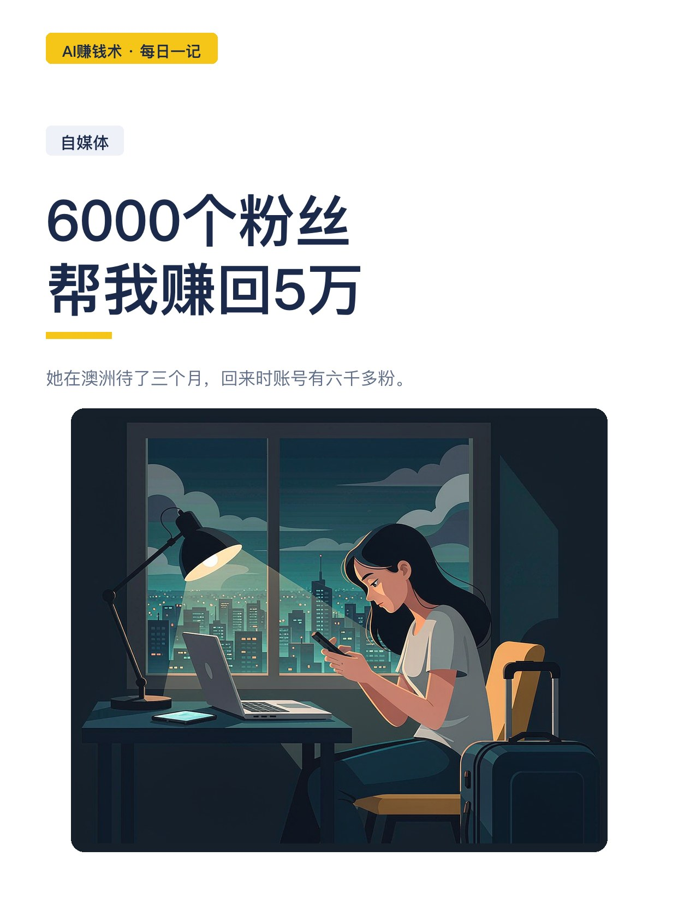
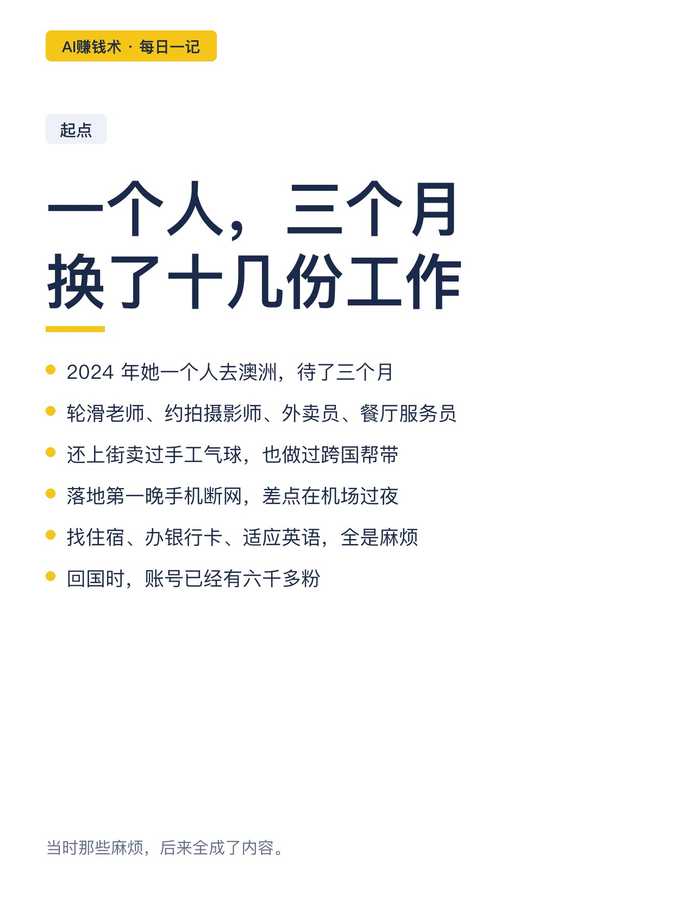
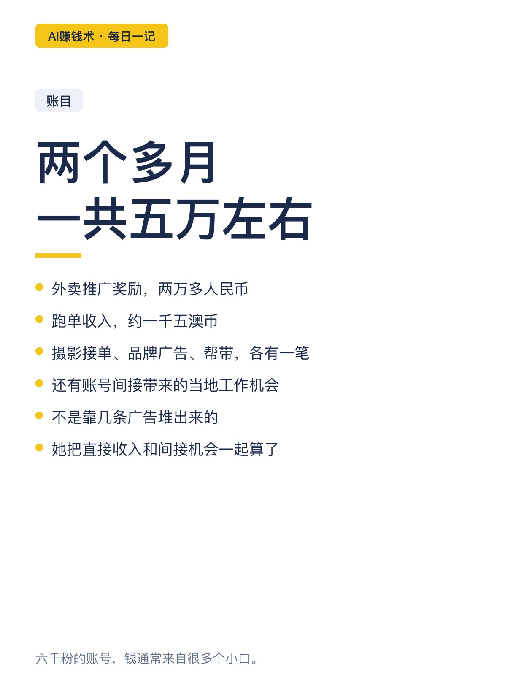
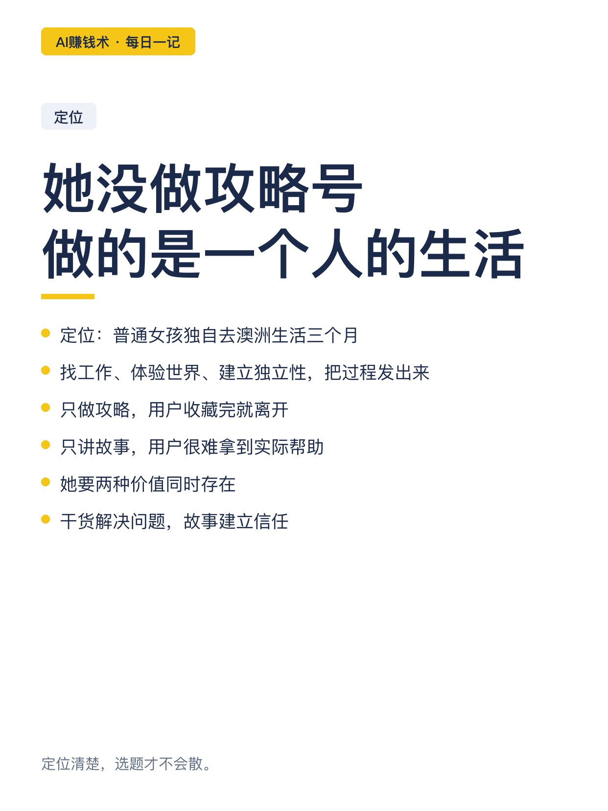
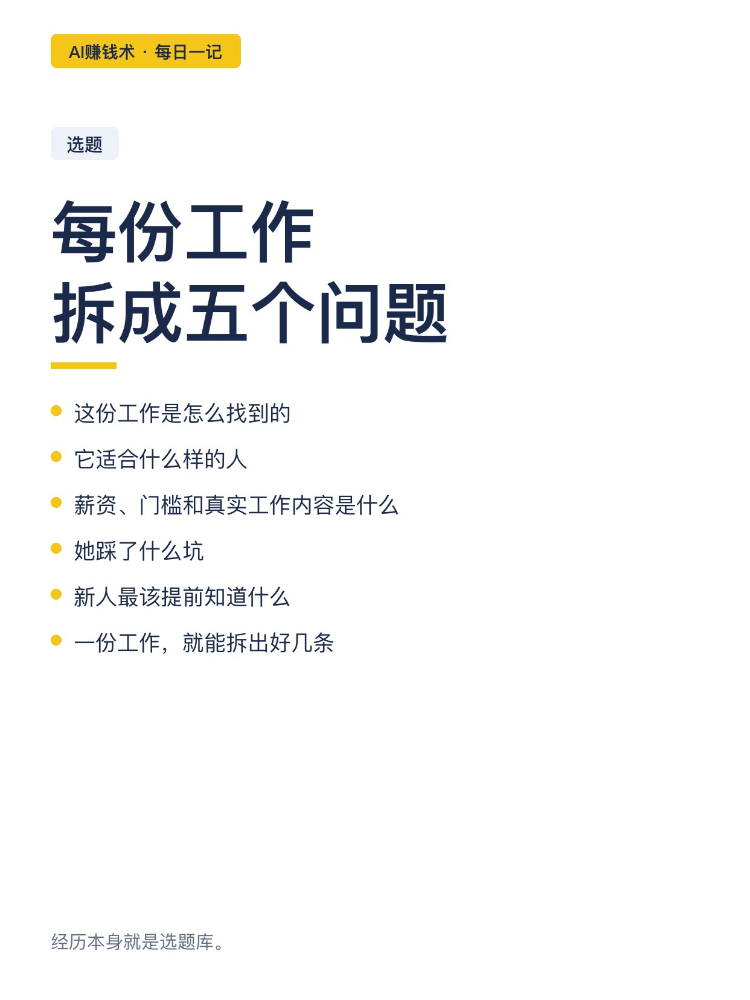
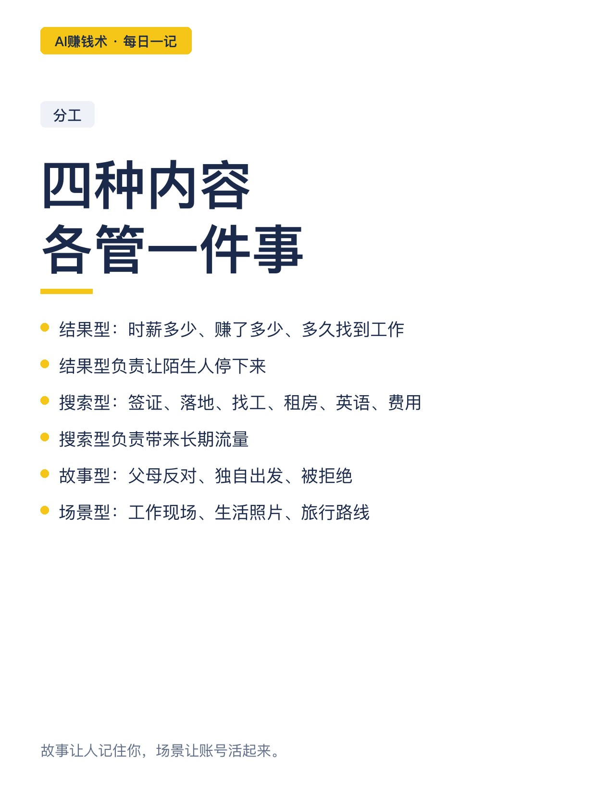
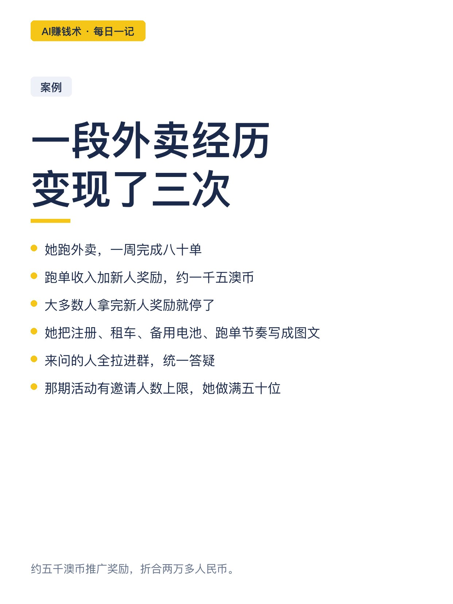
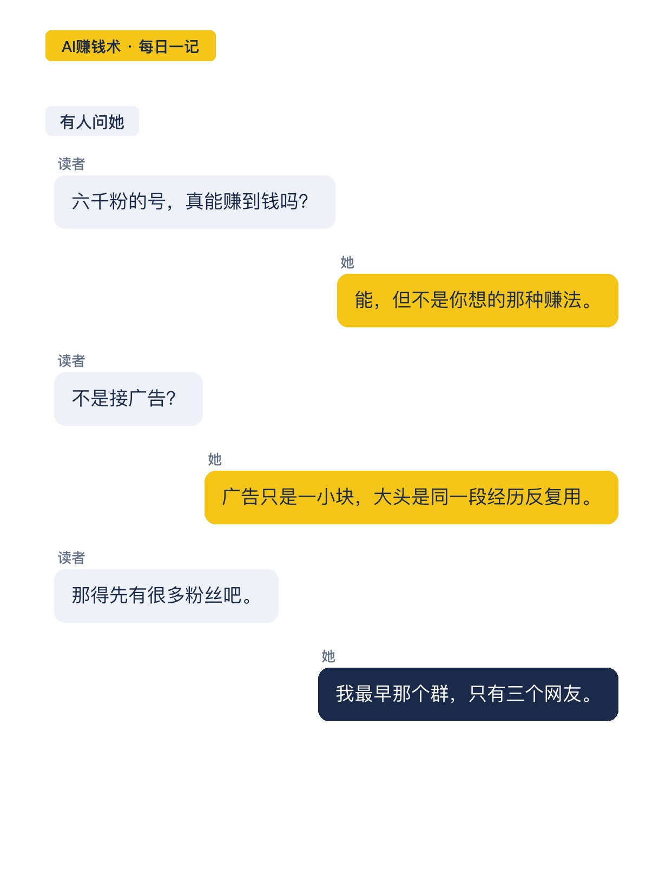
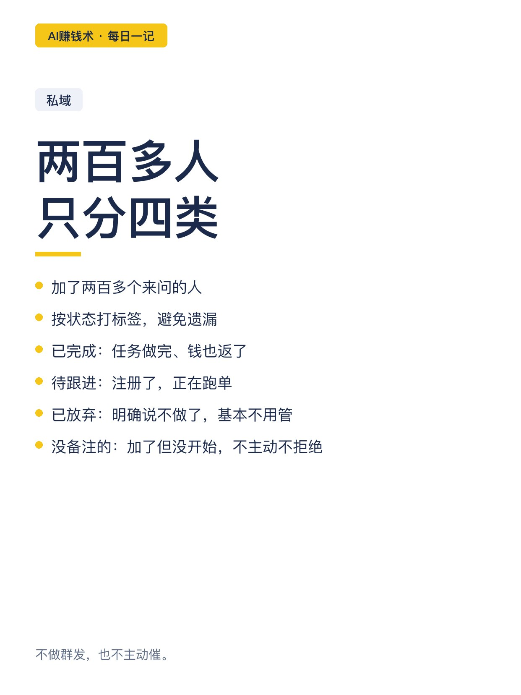
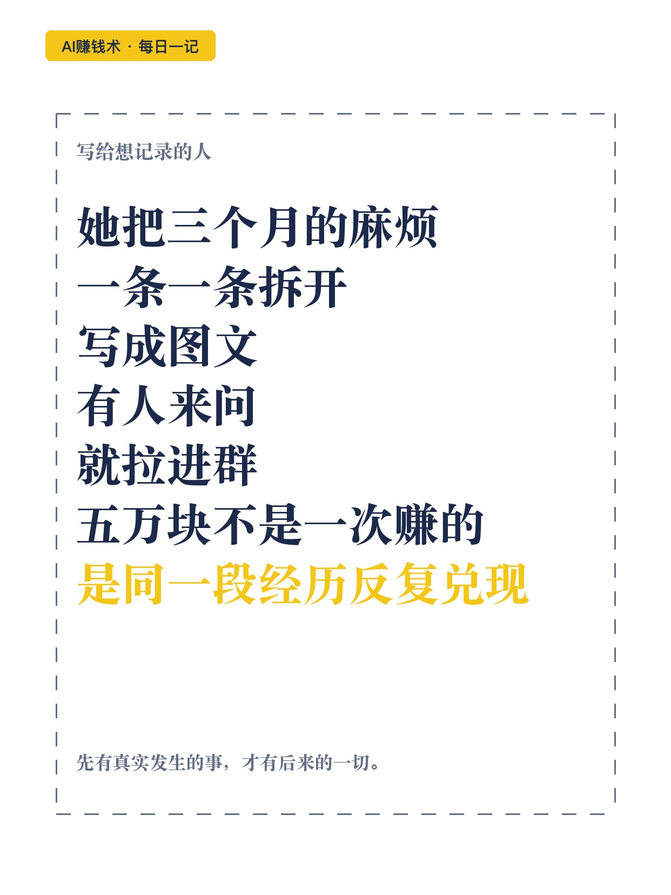

# 6000个粉丝，帮我赚回5万

> — · 2026-10-29 16:21 发布 · AI 赚钱内容

## 标题（可直接复制）

```
6000个粉丝，帮我赚回5万
```

## 正文（可直接复制发布）

她在澳洲待了三个月，回来时账号有六千多粉。

钱是后来才来的。两个多月，直接加间接，一共五万左右。

不是靠几条广告。外卖推广奖励两万多，跑单收入约一千五澳币，还有摄影接单、品牌广告、帮带，以及账号帮她换来的当地工作机会。

📌 一个人，三个月，十几份工作

轮滑老师、约拍摄影师、外卖员、餐厅服务员、街头卖手工气球。

落地第一晚手机断网，差点在机场过夜。这些当时都是麻烦，后来全成了内容。

📌 账号不是攻略号

她给自己的定位是：一个普通女孩独自去澳洲生活三个月，找工作、体验世界、建立独立性，把过程分享出来。

只有攻略，别人收藏完就走；只有故事，别人学不到东西。

干货解决问题，故事建立信任。

📌 每一份工作都是一个选题库

她把十几份工作逐个拆开问五个问题：怎么找到的、适合什么人、薪资门槛和真实内容、踩过什么坑、新人最该提前知道什么。

一份工作能拆出好几条。

📌 四种内容，各管一件事

结果型：时薪多少、赚了多少、落地多久找到工作。让陌生人停下来。

搜索型：签证、落地、找工、租房、英语、费用。带来长期流量。

故事型：父母反对、独自出发、被拒绝。让人记住你。

场景型：工作现场、生活照片、旅行路线。让账号活起来。

📌 一段经历，变现了三次

她跑外卖，一周完成八十单，跑单收入加新人奖励约一千五澳币。

大多数人拿完新人奖励就停了。她把注册、租车、备用电池、跑单节奏写成图文，来问的人全拉进群统一答疑。

那期活动有邀请人数上限，她做满五十位有效邀请，拿到约五千澳币推广奖励，折合两万多人民币。

📌 两百多人，四个标签

加了两百多个来问的人，她按状态打标签：已完成、待跟进、已放弃、还没开始。

不群发，也不主动催，靠标签决定谁值得再跟一次。

📌 六千粉到底值多少

五万这个数字里，只有一部分是广告。剩下的是同一段经历被反复兑现：内容带来信任，信任带来咨询，咨询带来收入。

她最开始那个群，只有三个网友。后来几百人。

三个月很短。但把一段真实发生过的生活拆开、记下来、讲清楚，它就不会随着旅程结束而消失。

## 话题标签

#AI赚钱术日记 #副业 #自媒体 #内容创业 #个人IP

## 配图（10 张）












## 发布信息

| 项 | 值 |
|---|---|
| 平台 | 小红书 |
| 期数 | — |
| 发布时间 | 2026-10-29 16:21 |
| 正文长度 | 874 字 |
| 图片数量 | 10 张 |
| 状态 | 已发布 |
