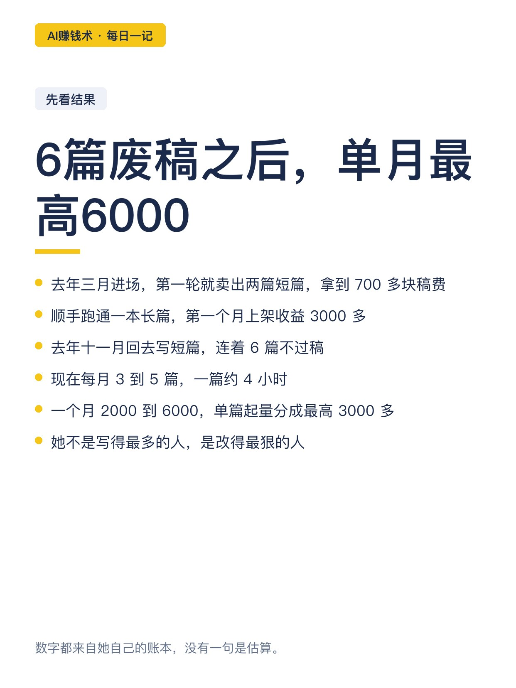
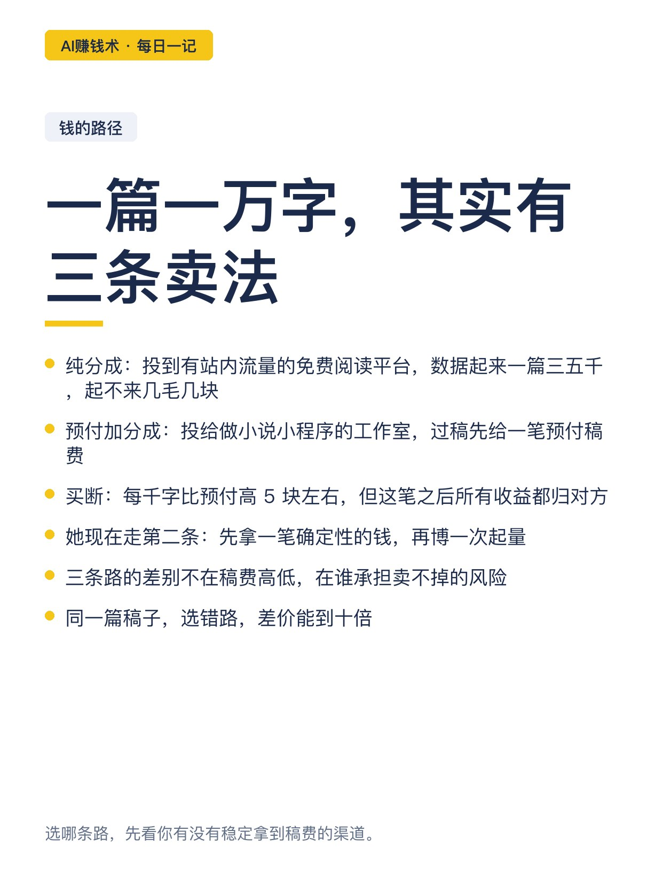
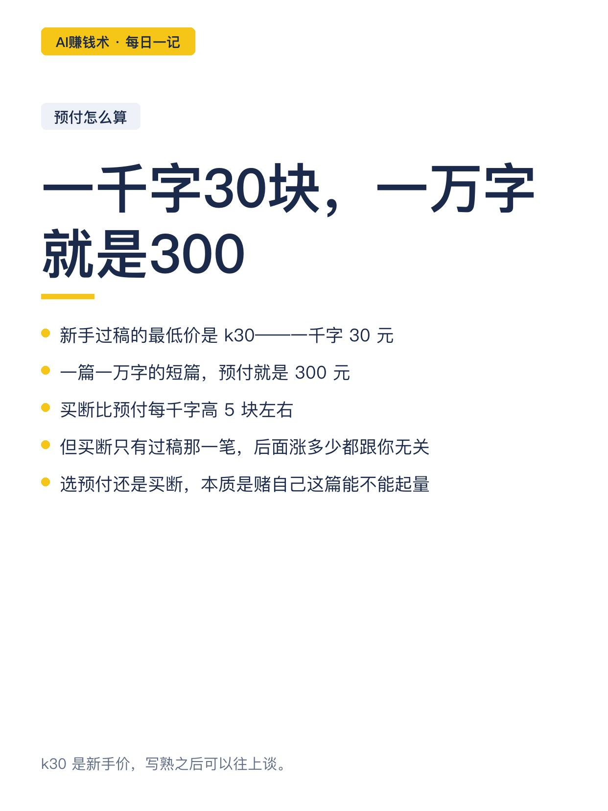
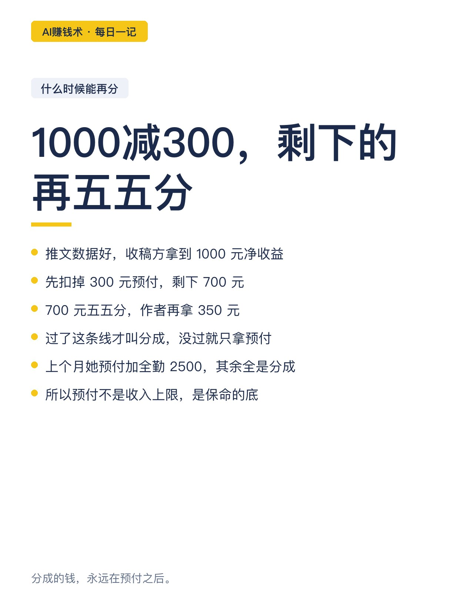
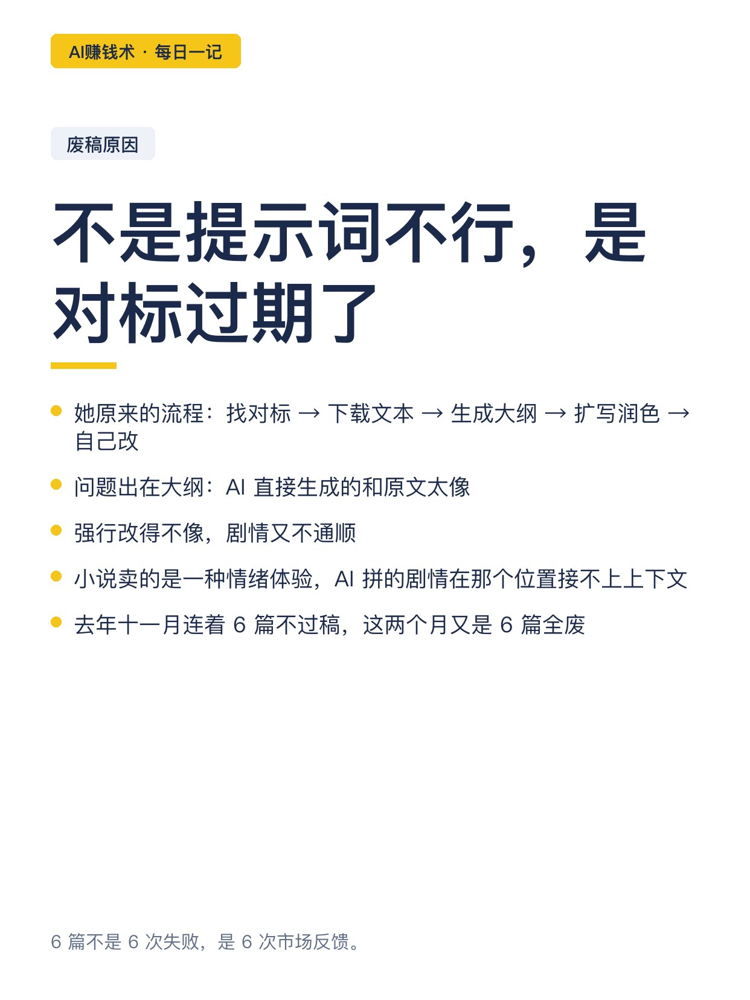
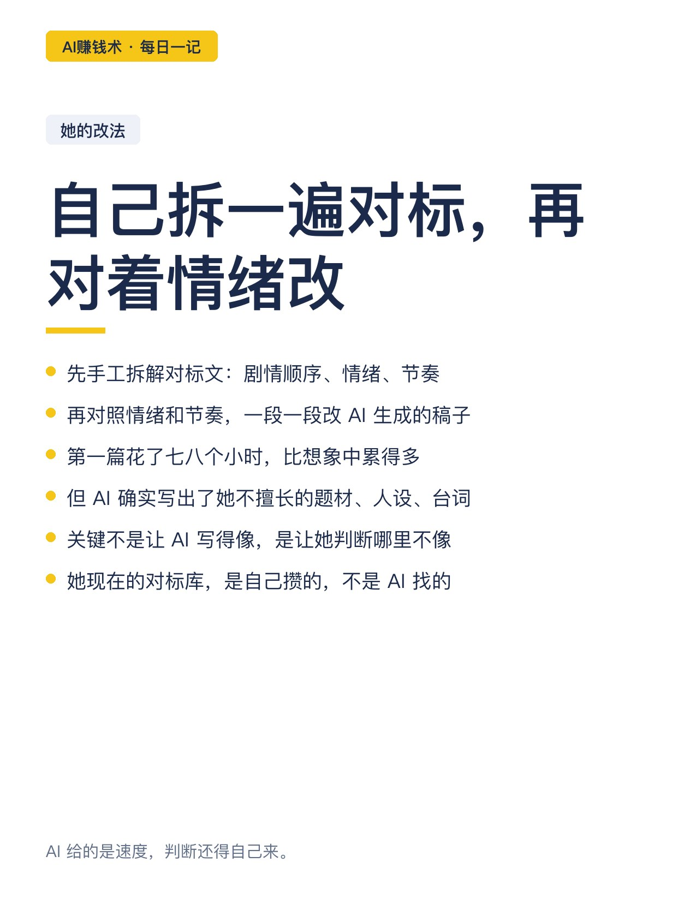
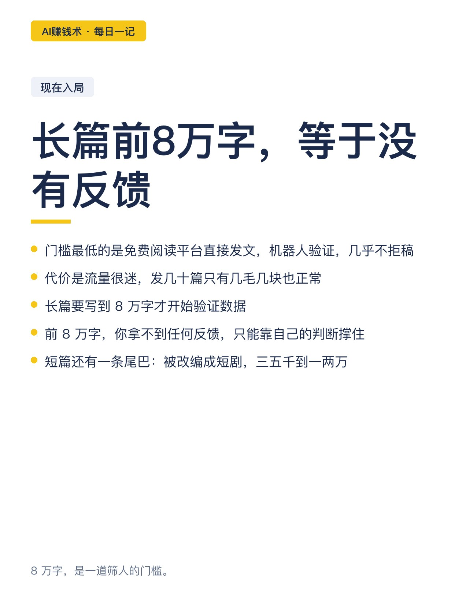
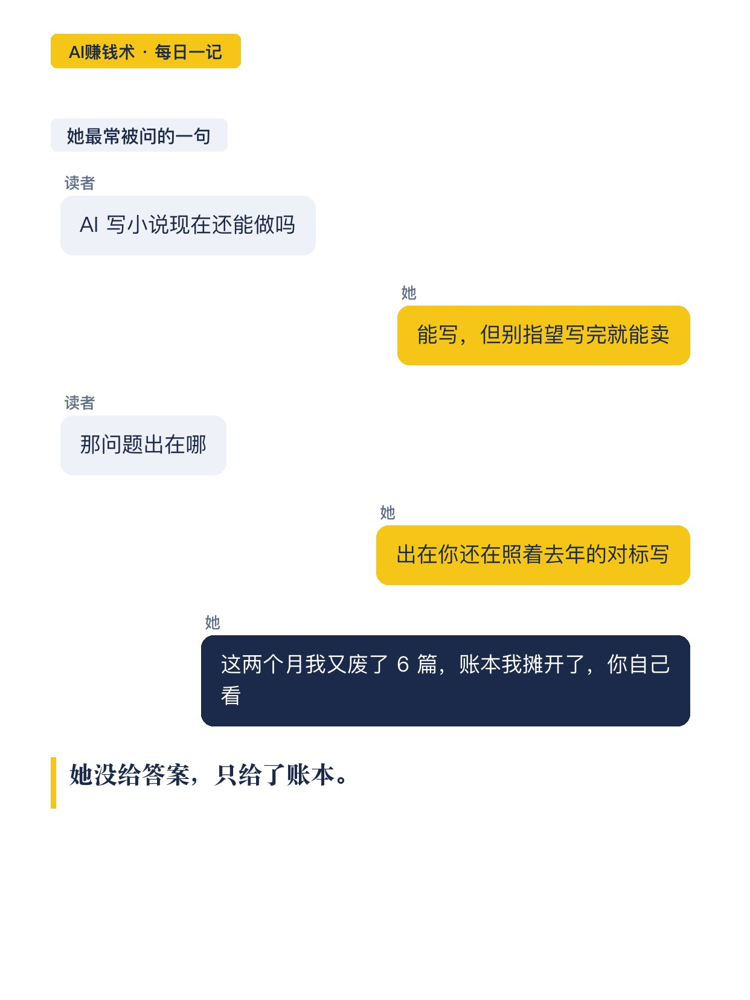
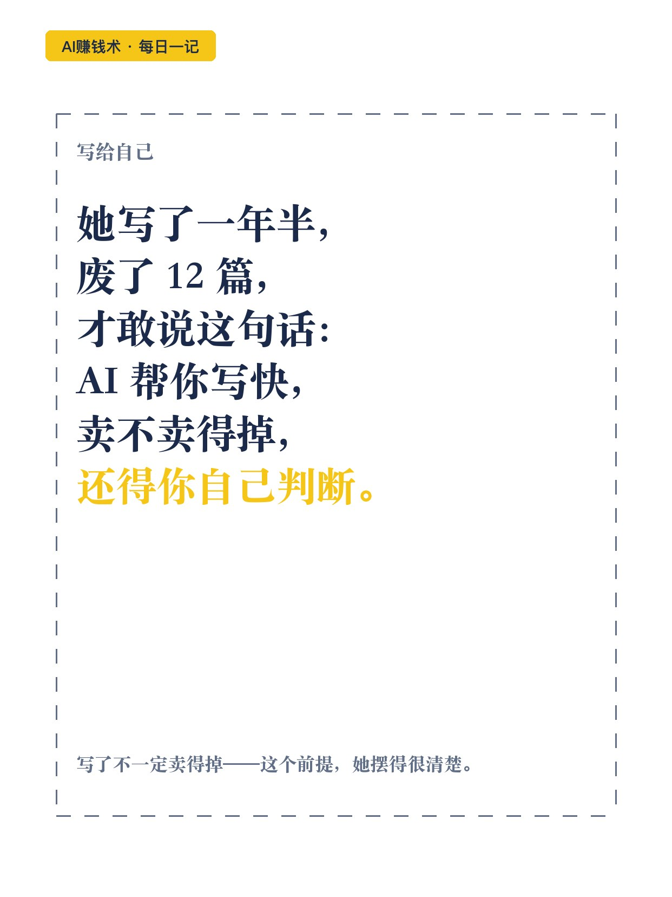

# 6篇退稿后，单月最高6000

> — · 2026-10-29 09:04 发布 · AI 赚钱内容

## 标题（可直接复制）

```
6篇退稿后，单月最高6000
```

## 正文（可直接复制发布）

下班后写小说，一篇 4 小时。

她去年三月进场，第一轮就跟完一期训练营，卖出两篇短篇，拿到 700 多块稿费；顺手跑通一本长篇，第一个月上架收益 3000 多。

然后市场变了。去年 11 月她回去写短篇，连着 6 篇不过稿。

📌 先把钱的路径拆开

一篇短篇一万字左右，三条路：

· 纯分成：投到有站内流量的免费阅读平台，数据起来一篇三五千，起不来几毛几块
· 预付加分成：投给做小说小程序的工作室，过稿先给一笔预付稿费
· 买断：每千字比预付高 5 块左右，但这笔之后所有收益都归对方

她现在走第二条。

📌 预付怎么算，什么时候能再分一次

新手过稿的最低价是「k30」——一千字 30 元。一本一万字的短篇，就是 300 元。

后面如果推文数据好，收稿方拿到 1000 元净收益，先扣掉 300 元预付，剩 700 元五五分，作者再拿 350。

过了这条线才叫分成。上个月她预付加全勤 2500，其余全是分成。

📌 6 篇废稿，废在哪

不是提示词不行。是市场变了，她还在照着去年的对标写。

原来的流程是：找对标 → 下载文本 → 参考对标生成大纲 → 扩写润色 → 自己改。

问题出在大纲。AI 直接生成的和原文太像；强行改得不像，剧情又不通。因为小说卖的是一种情绪体验，AI 拼出来的剧情，在那个位置接不上上下文的情绪。

她的解法是自己拆一遍对标：剧情顺序、情绪、节奏，再对照着改。第一篇花了七八个小时。

📌 现在入局，三条现实

· 门槛最低的是免费阅读平台直接发文，机器人验证，几乎不拒稿，但流量很迷
· 长篇要写到 8 万字才开始验证，前 8 万字等于没有反馈
· 短篇还有一条尾巴：被改编成短剧，三五千到一两万

📌 我看完最想说的一句

她的账本很朴素：每月 3 到 5 篇，一篇 4 小时，一个月 2000 到 6000，单篇起量分成最高 3000 多。

这不是一个「AI 帮你写」的故事，是一个「AI 帮你写快，但卖不卖得掉还得你自己判断」的故事。

写了不一定卖得掉——这个前提，她摆得很清楚。✨

## 话题标签

#AI赚钱术日记 #副业 #AI写作 #内容变现 #小说投稿

## 配图（10 张）












## 发布信息

| 项 | 值 |
|---|---|
| 平台 | 小红书 |
| 期数 | — |
| 发布时间 | 2026-10-29 09:04 |
| 正文长度 | 874 字 |
| 图片数量 | 10 张 |
| 状态 | 已发布 |
