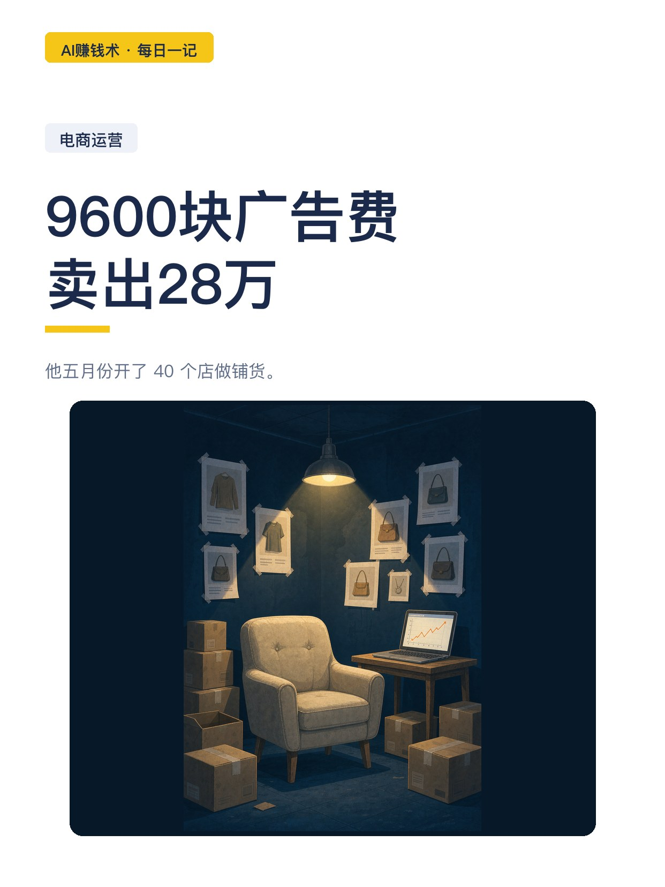
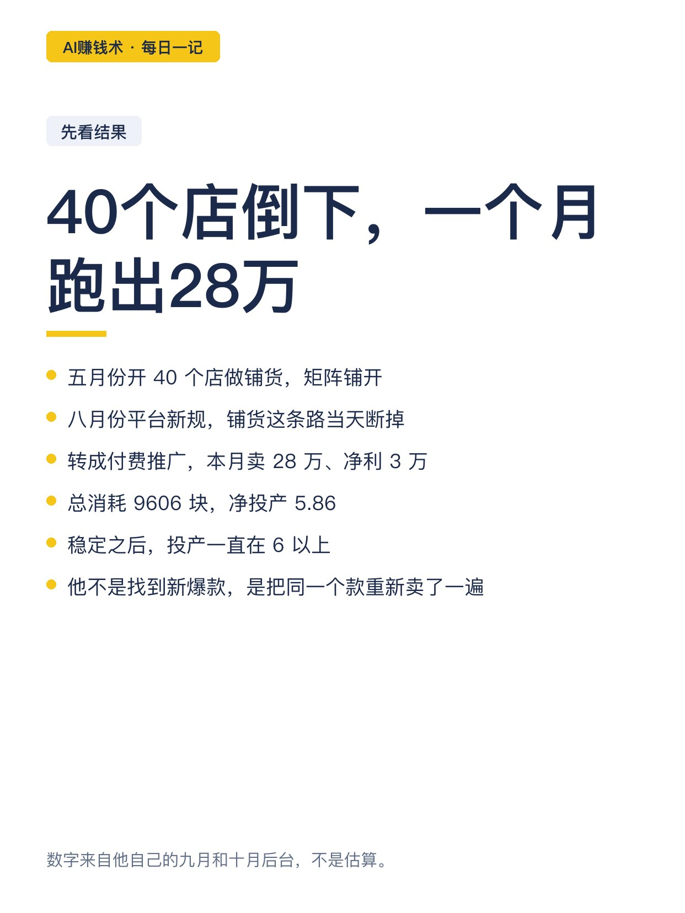
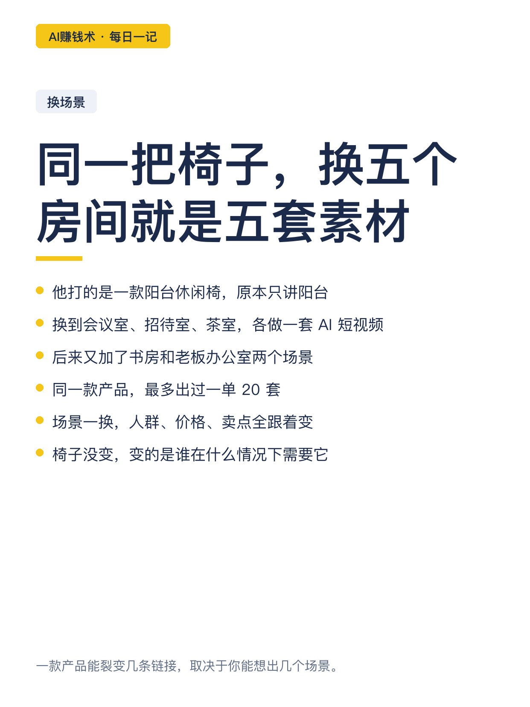
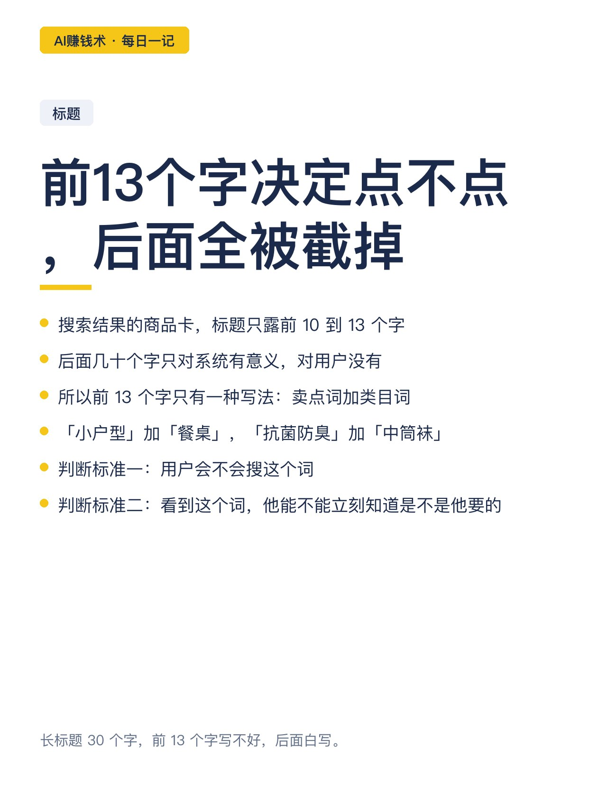
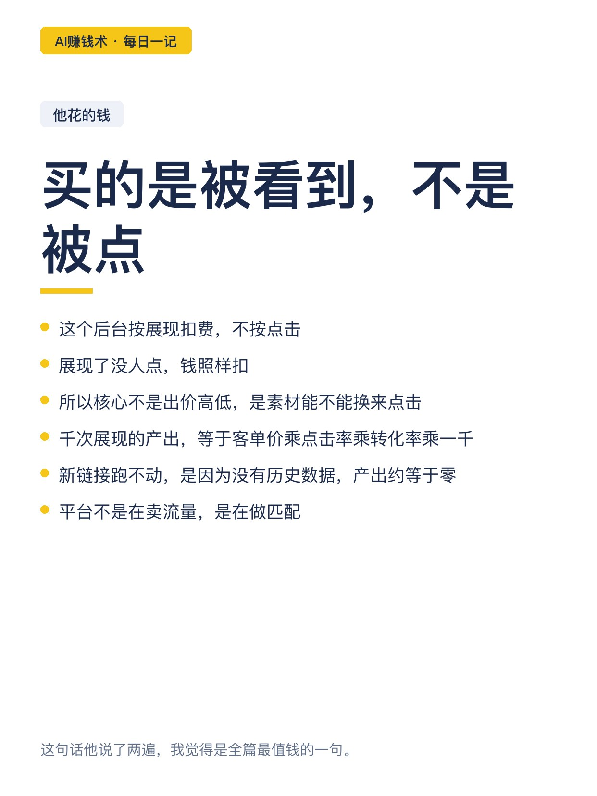
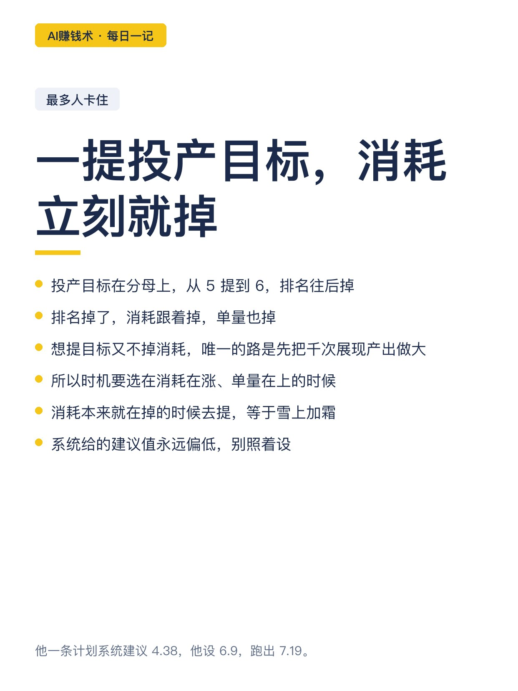
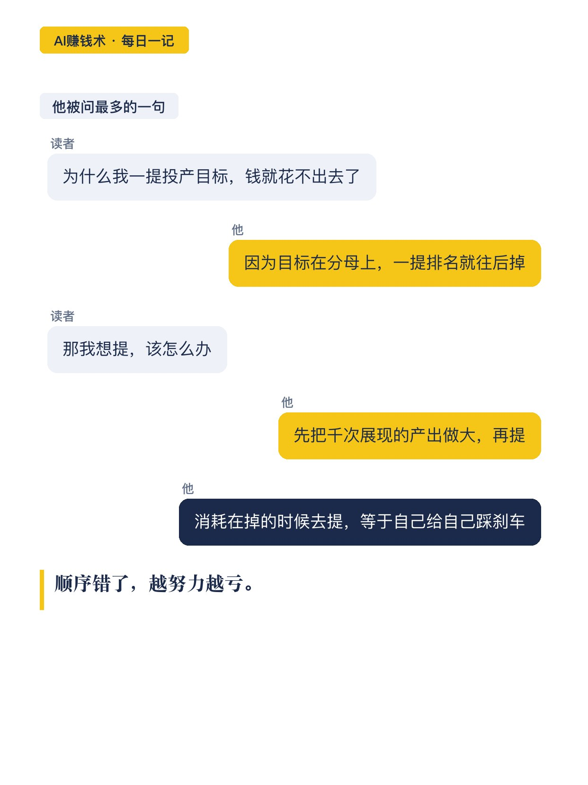
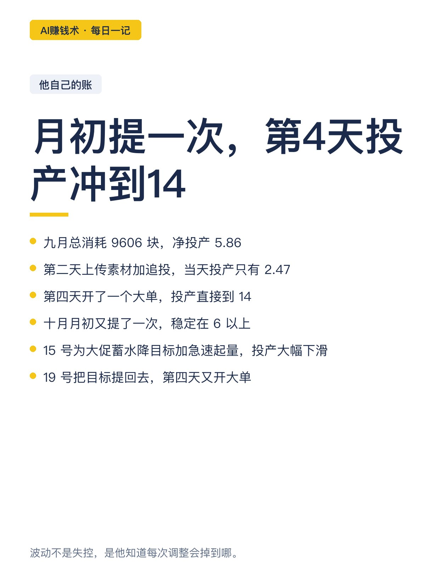
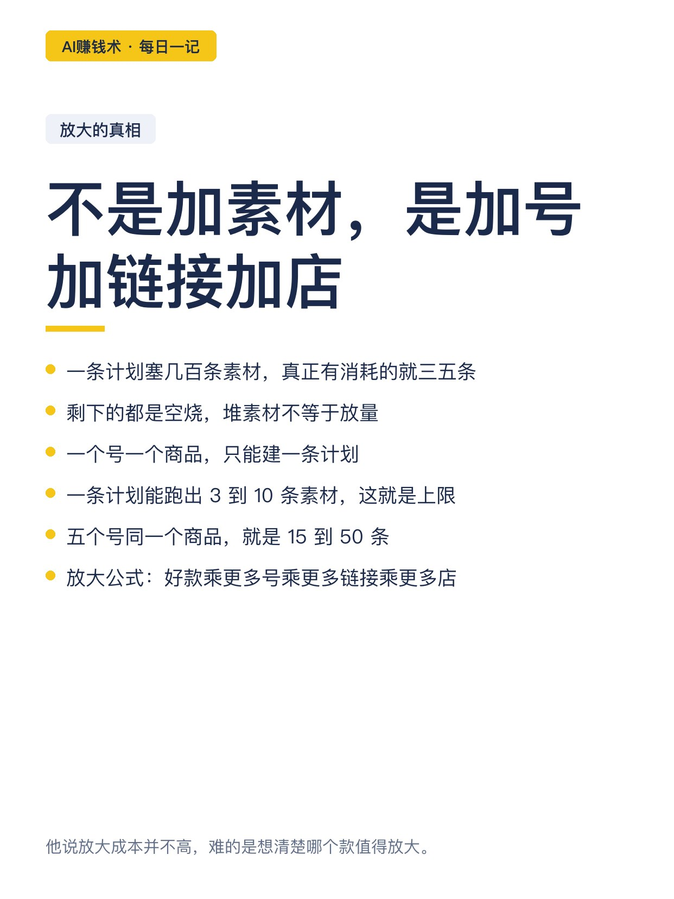
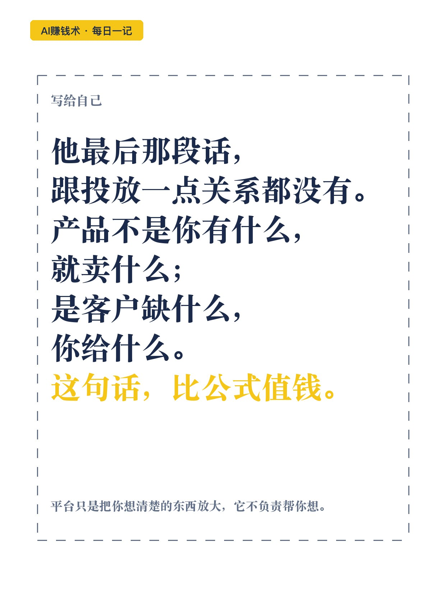

# 9600块广告费，卖出28万

> — · 2026-10-29 10:10 发布 · AI 赚钱内容

## 标题（可直接复制）

```
9600块广告费，卖出28万
```

## 正文（可直接复制发布）

他五月份开了 40 个店做铺货。

八月份规则一改，这条路当天就断了。现在他一个月卖 28 万、净利 3 万，代价是先花掉 9606 块买流量。

📌 铺货死了，才轮到素材

40 个店不能铺了，他转成付费推广。原来靠上更多链接拿量，现在只能靠这条值不值得给钱。

测的顺序是固定的：先测品，再测素材，最后提投产。反了，钱就是白烧。

📌 同一把椅子，换场景就是新素材

他打的是一款阳台休闲椅。同一个款换到会议室、招待室、茶室、书房、老板办公室，每个场景用 AI 各做一套短视频素材。

同一款产品，最多出过一单 20 套。椅子没变，价格没变，变的是谁在什么情况下需要它。

📌 标题前 13 个字，决定点不点

搜索结果的商品卡，标题只露前 10 到 13 个字，后面全被截掉。

所以前 13 个字只有一种写法：卖点词加类目词。「小户型」加「餐桌」，「抗菌防臭」加「中筒袜」。

判断卖点词好不好，问两句：用户会不会搜？看到这个词，他能不能立刻知道是不是他要的？

📌 他花的钱买的是「被看到」

这个后台按展现扣费，不按点击。展现了没人点，钱照样扣。

所以核心不是出价，是素材推出去之后能不能换来点击和转化。

他说得更直接：平台不是在卖流量，是在做匹配。

📌 一提投产目标，消耗就掉

投产目标在分母上。从 5 提到 6，排名往后掉，消耗跟着掉。

想提目标又不掉消耗，唯一的路是先把千次展现的产出做大。所以时机要选在消耗在涨、单量在上的时候；消耗本来就在掉时去提，等于雪上加霜。

他自己的账：月初提了一次，稳定在 6 以上；15 号为了大促蓄水降目标加急速起量，投产掉到 2.47；19 号把目标提回去，第 4 天开大单，投产冲到 14。

📌 放大的真相，不是加素材

一条计划塞几百条素材，真正有消耗的就三五条，剩下的空烧。

真正的放大只有一条路：好款乘更多号乘更多链接乘更多店。一个号一个商品只能建一条计划，一条计划能跑出 3 到 10 条素材；五个号就是 15 到 50 条。

📌 我看完最想说的一句

他最后那段话跟投放没关系：产品不是你有什么就卖什么，是客户缺什么你给什么。

标题、主图、视频，都在回答同一个问题——我这个东西能解决你什么事。答清楚了流量自然来；答不清楚，花钱买的流量也留不住。✨

## 话题标签

#AI赚钱术日记 #副业 #电商运营 #付费推广 #AI做图

## 配图（10 张）












## 发布信息

| 项 | 值 |
|---|---|
| 平台 | 小红书 |
| 期数 | — |
| 发布时间 | 2026-10-29 10:10 |
| 正文长度 | 966 字 |
| 图片数量 | 10 张 |
| 状态 | 已发布 |
