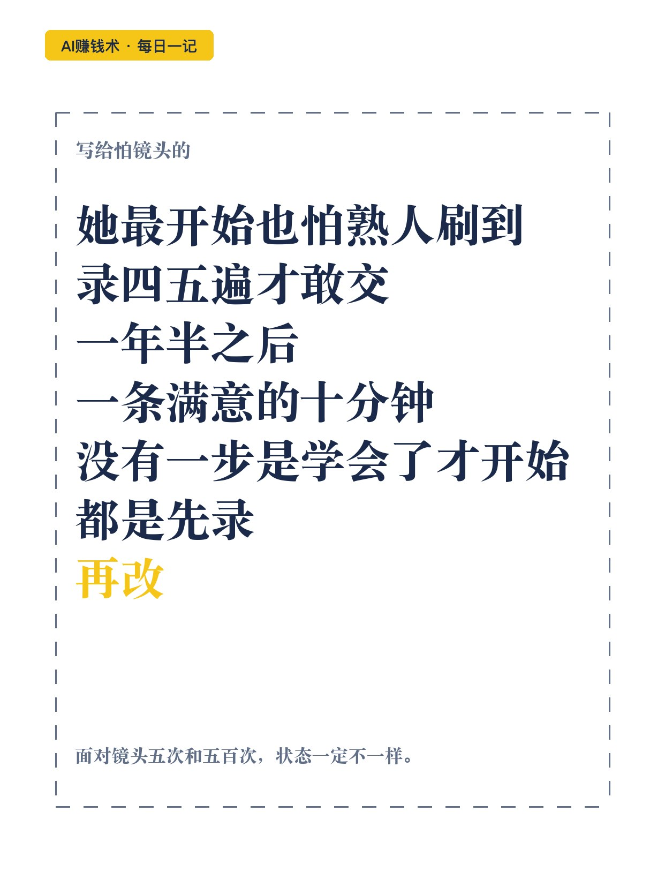

# 一条口播，从1小时压到10分钟

> — · 2026-10-29 14:09 发布 · AI 赚钱内容

## 标题（可直接复制）

```
一条口播，从1小时压到10分钟
```

## 正文（可直接复制发布）

她怕前同事刷到。发出去的内容，自己的主号从来不点赞。

镜头一开就卡壳，一句话没说好，整条重录。录完自己都不好意思回看。

小丫做真人出镜口播一年半。最开始录一条要一两个小时，录四五遍；现在一条满意的，十分钟左右。

📌 为什么非要出镜

一是跟绝大多数不出镜的AI博主分开。二是逼自己开口，练表达。

她的判断：真人出镜的博主，广告报价高于不出镜的。

但真正难的不是设备，是脸。她怕前同事看到，发出去的内容自己主号都不点赞，就怕被推给好友。

后来她想通：你以为大家都在盯着你，其实没人真在意。

📌 先挑一个能最快做出来的形式

她看过几种：坐着对屏幕说、边走边说、一人饰多角。录屏和拍屏也试过，拍屏当时火，但最容易同质化。

她最后选固定场景加静态单人口播。理由很朴素：她能最快做出来。现在主要做录屏教程。

📌 布景越简单，越能开始

她先试过绿幕，借朋友工作室，有灯有背景，质感好。但每次都要跑一趟，抠像加背景也麻烦，对新手不友好。

最后主战场是卧室一个角落。

设备清单很短：一部手机、一个学生台灯、一个落地支架、一个领夹麦（品牌方送的）。软件是手机端提词加粗剪，精剪用电脑版。

一开始连灯都没有，后来发现画质不高清，才补了台灯和背景灯。

📌 时间省在哪

稿子确认了不马上开拍，先读几遍，改到顺口为止。化妆时把稿子丢给AI，让它读得有情绪，一边化妆一边听。

录错不要停。以前一句没录好就从头重录；现在停一下接着往下录，剪的时候剪掉。时间省了，状态也还在。

封面一次拍几十张，再挑一张。

眼神。第一句尽量背出来看着镜头，不然眼睛会跟着提词器跑。

📌 她没上AI剪辑，也没上数字人

AI剪初稿她试过，口水词能处理，但不稳定，效果跟软件自带智能粗剪差不多，速度还更慢。所以粗剪用自带的，精剪自己来。

数字人她早建过自己的分身。远看还行，近看生硬，有股AI味。

她的结论：数字人适合两类人，不愿意出镜的，想做矩阵的。口播熟练后自己录更快。数字人得等、得抽卡，细节调起来也麻烦。

📌 一年半之后

她还在练。吐字平，有点AI感，抑扬顿挫不够；场景也平，没有自己的视觉锤。

方法只有一个：多拍。面对镜头5次和500次，状态一定不一样。

这条路上没有哪一步是学会了才开始。都是先录，再改。

## 话题标签

#AI赚钱术日记 #副业 #自媒体 #口播 #AI工具

## 配图（10 张）




## 发布信息

| 项 | 值 |
|---|---|
| 平台 | 小红书 |
| 期数 | — |
| 发布时间 | 2026-10-29 14:09 |
| 正文长度 | 958 字 |
| 图片数量 | 10 张 |
| 状态 | 已发布 |
