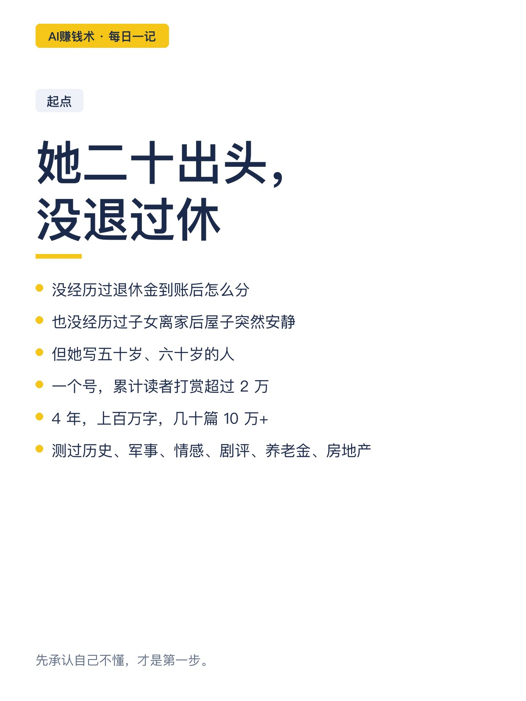
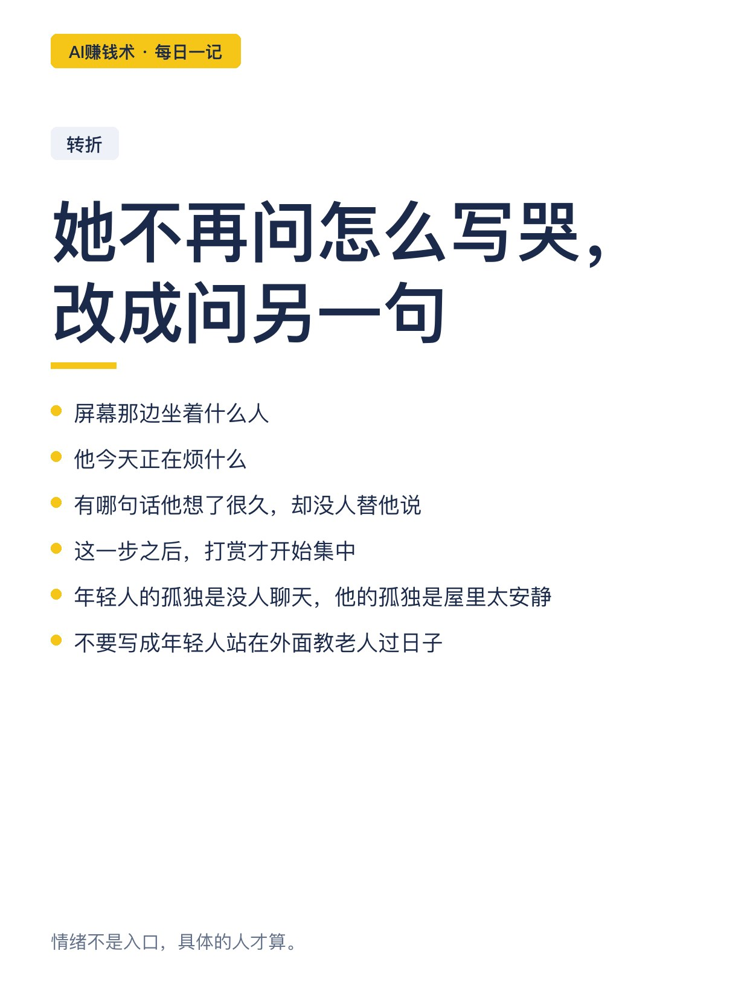
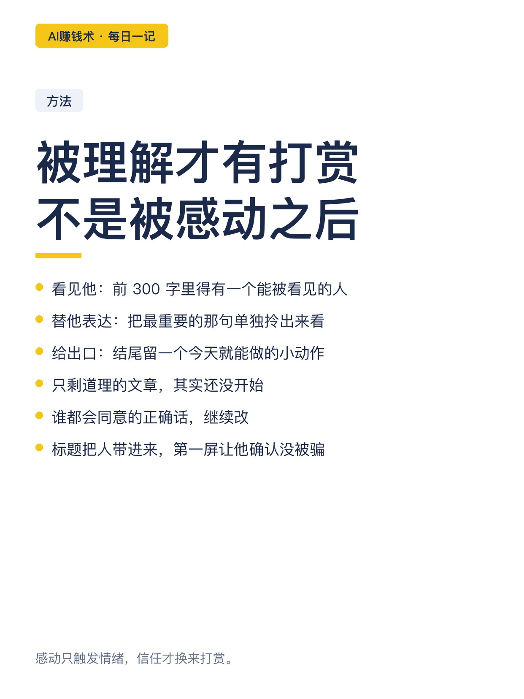
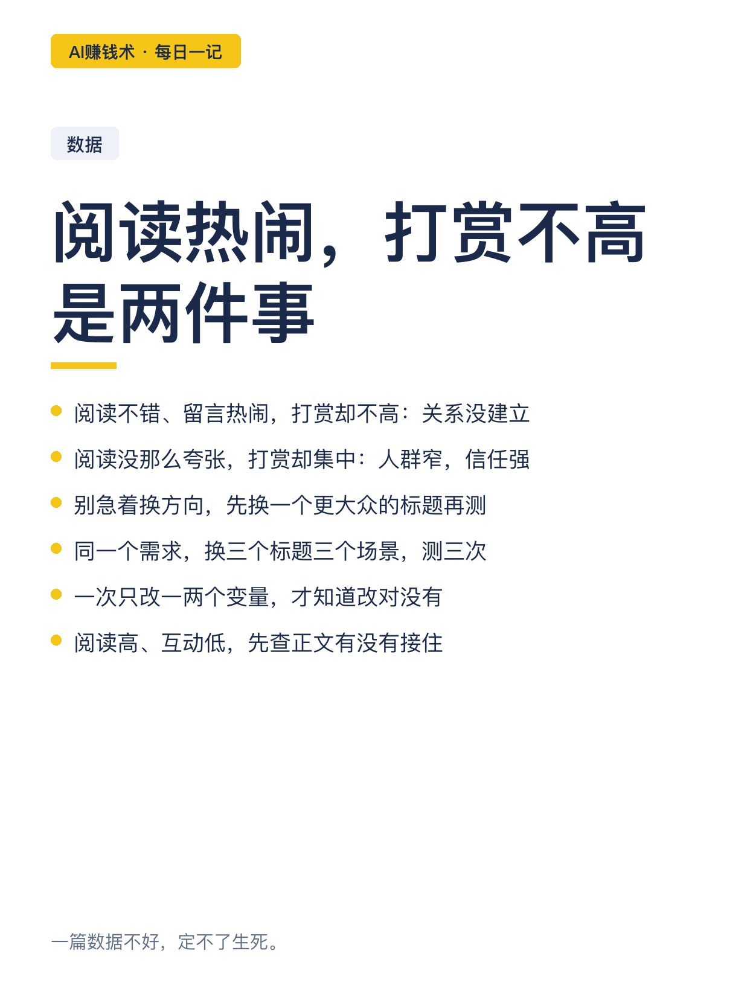
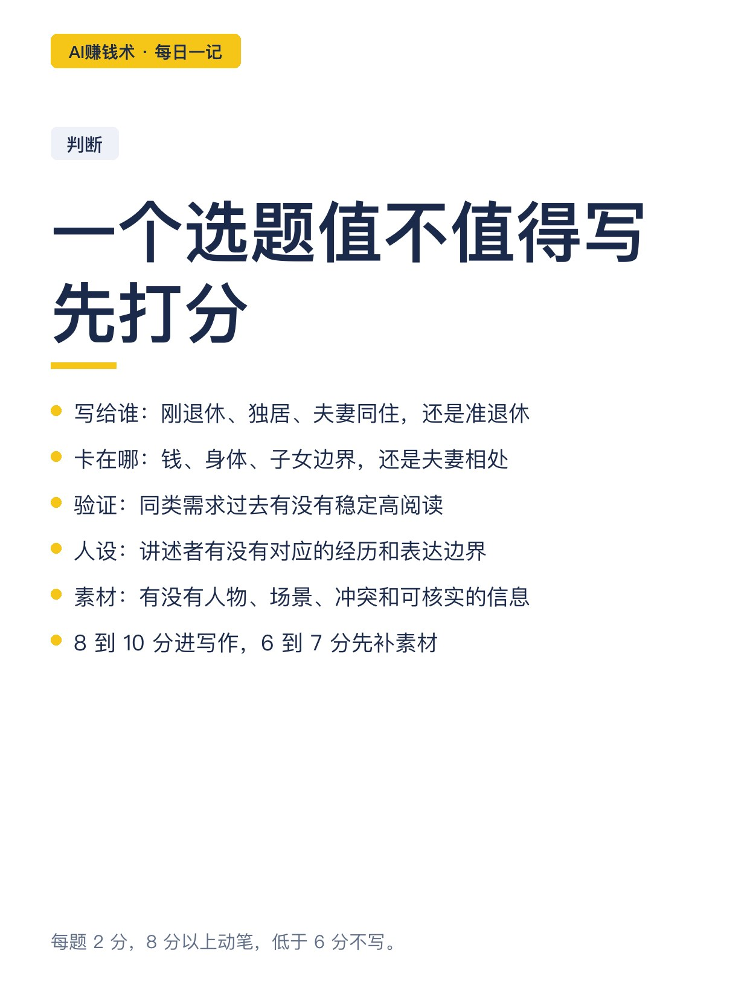
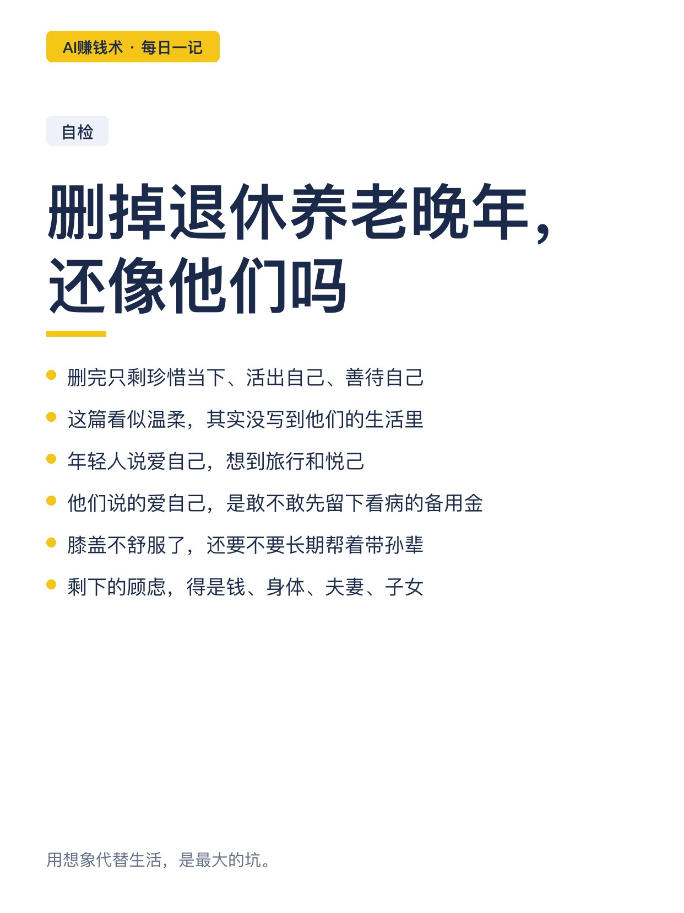
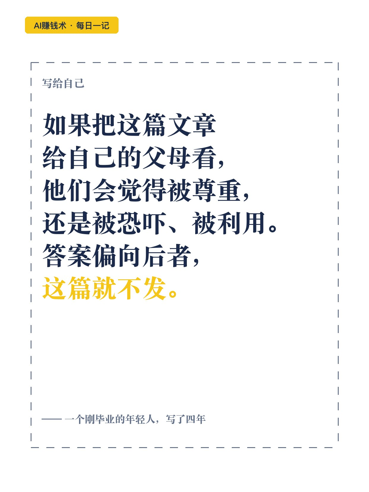

# 年轻人写老年号，赞赏2万

> — · 2026-10-29 11:17 发布 · AI 赚钱内容

## 标题（可直接复制）

```
年轻人写老年号，赞赏2万
```

## 正文（可直接复制发布）

她二十出头，没退过休，也没经历过退休金到账后怎么分。

就是这样一个刚毕业的年轻人，写五十岁、六十岁的人，一个号累计读者打赏超过 2 万。

📌 她先承认自己不懂

她不再问「怎么把老人写哭」，改成问另一句：屏幕那边坐着什么人，他今天在烦什么，他有哪句话想了很久却没人替他说。

这一步之后，打赏才开始集中。

📌 打赏发生在「被理解」之后

她拆成三层。第一层是看见他：前 300 字里必须有一个能被看见的人，傍晚自己吃饭，孩子打过来总说忙，老伴不在以后屋里连一点声音都太大。

第二层是替他表达：把全文最重要的那句话单独拎出来看，如果只是一句谁都会同意的正确道理，就继续改。

第三层是给出口：结尾给一个今天就能做的小动作，把体检报告和药物清单放进同一个文件袋，或者单独留好一笔应急金。

📌 阅读热闹，打赏不高，是两件事

有些文章阅读不错、留言也热闹，打赏却不高。情绪被调动了，关系没建立起来。

也有些文章阅读没那么夸张，打赏却更集中。它没打中最大范围的人，但打中了一群处境非常具体的人。

📌 一个选题值不值得写，先打分

她用五个问题拦一遍，每题 2 分，总分 10 分：写给谁、他卡在钱还是身体还是子女边界、同类需求过去有没有稳定高阅读、讲述者有没有对应经历、有没有人物场景冲突和可核实的信息。

8 到 10 分才动笔，6 到 7 分先补素材，低于 6 分不写。

📌 最狠的一个检查

把文章里「退休、养老、晚年」这些词全删掉，剩下的人物、顾虑和动作，还像不像一个五六十岁的人。

如果删完只剩「珍惜当下、活出自己、善待自己」，这篇看似温柔，其实根本没写到他们的生活里。

📌 AI 只做五件杂活

她让 Codex 当资料整理员、内容策划、初稿执行者、质检编辑、复盘助手。

但开工前先收集 30 到 50 篇同赛道高阅读文章，记录写的是哪类人、正在经历什么、评论区反复提什么。判断权一直在她手上。

📌 四年，上百万字

她测过历史、军事、情感、剧评、养老金、房地产，写出过几十篇 10 万+，也写过一堆写着写着就停掉的方向。

最后落在老年赛道，一个号，2 万打赏。

她自己留了一条底线：如果把这篇文章给自己的父母看，他们会觉得被尊重，还是被恐吓、被利用。答案偏向后者，就不发。

## 话题标签

#AI赚钱术日记 #副业 #内容创作 #老年赛道 #AI写作

## 配图（10 张）












## 发布信息

| 项 | 值 |
|---|---|
| 平台 | 小红书 |
| 期数 | — |
| 发布时间 | 2026-10-29 11:17 |
| 正文长度 | 953 字 |
| 图片数量 | 10 张 |
| 状态 | 已发布 |
