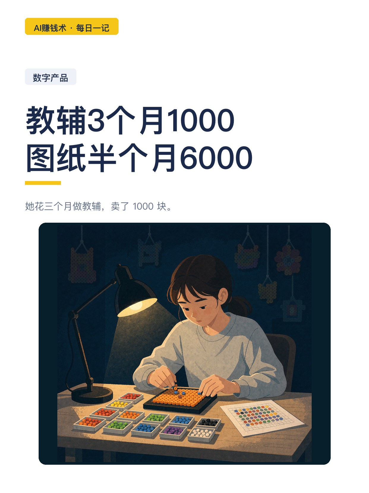
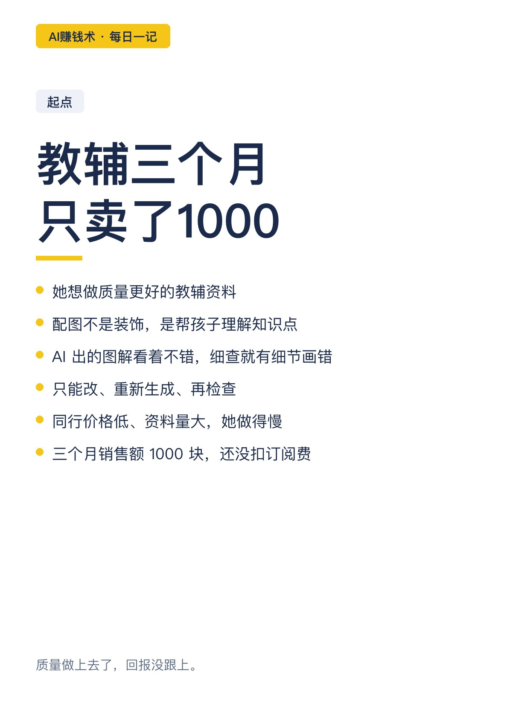
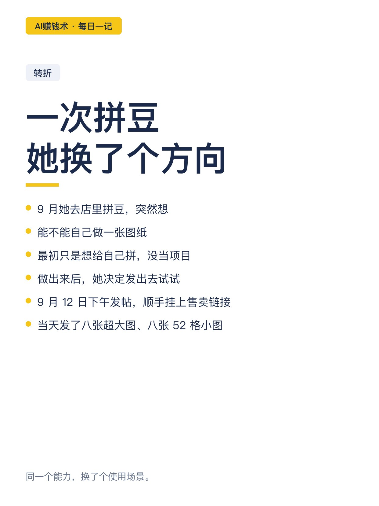
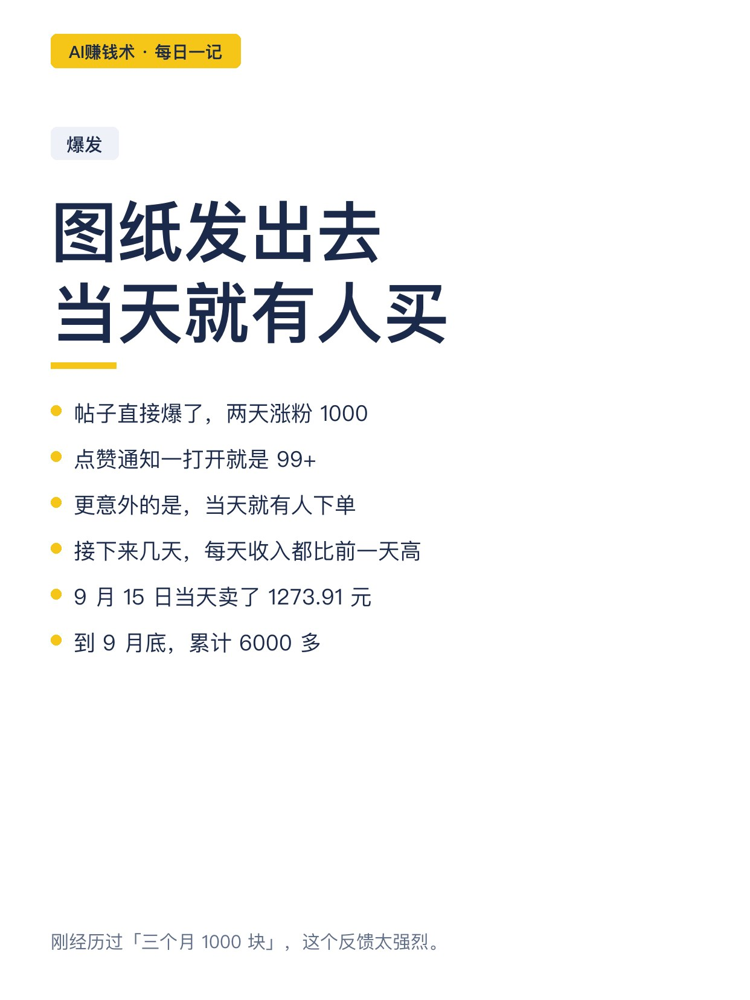
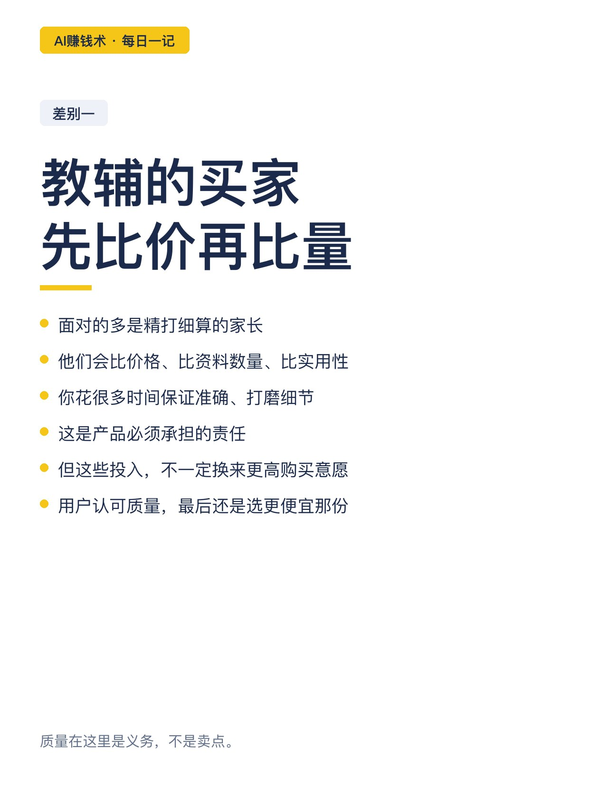
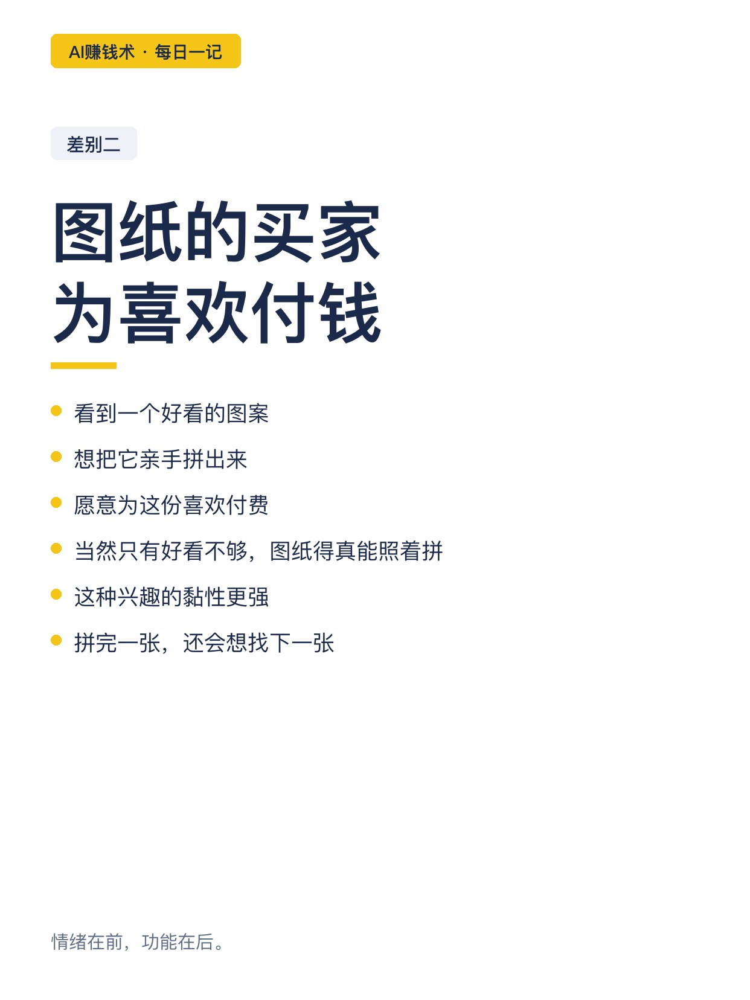
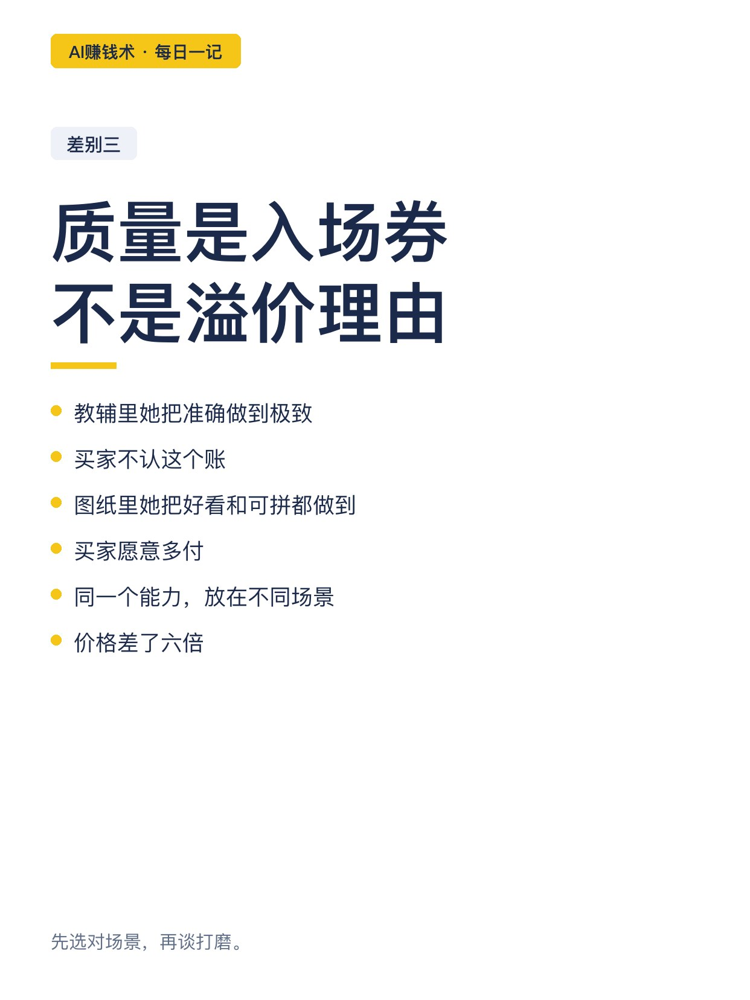
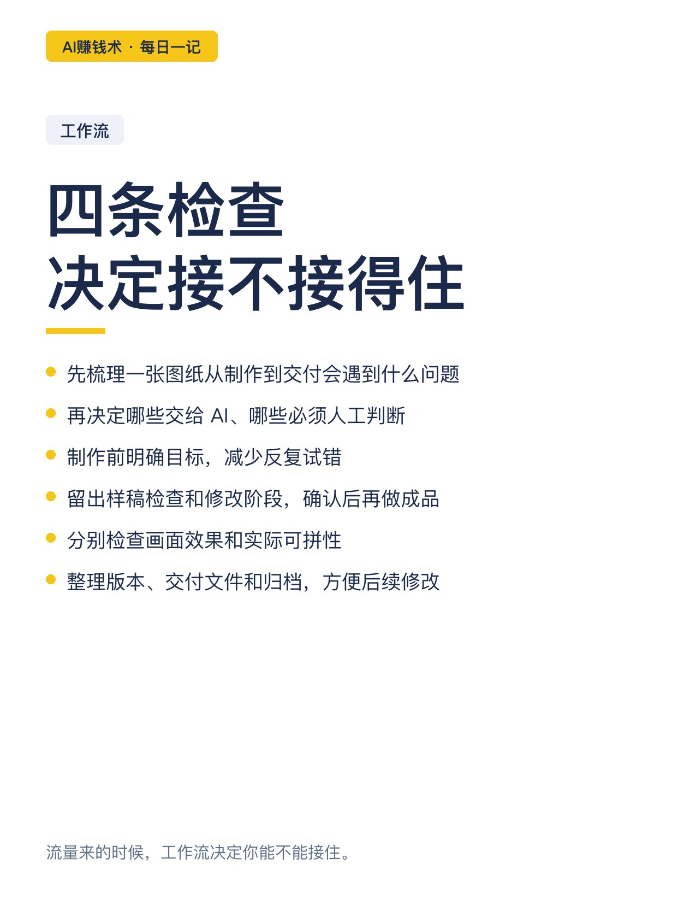
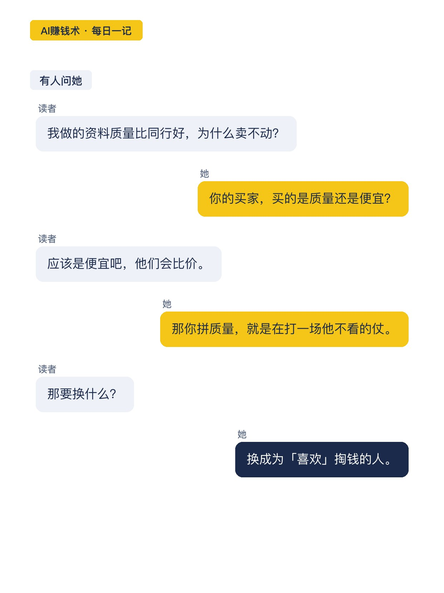
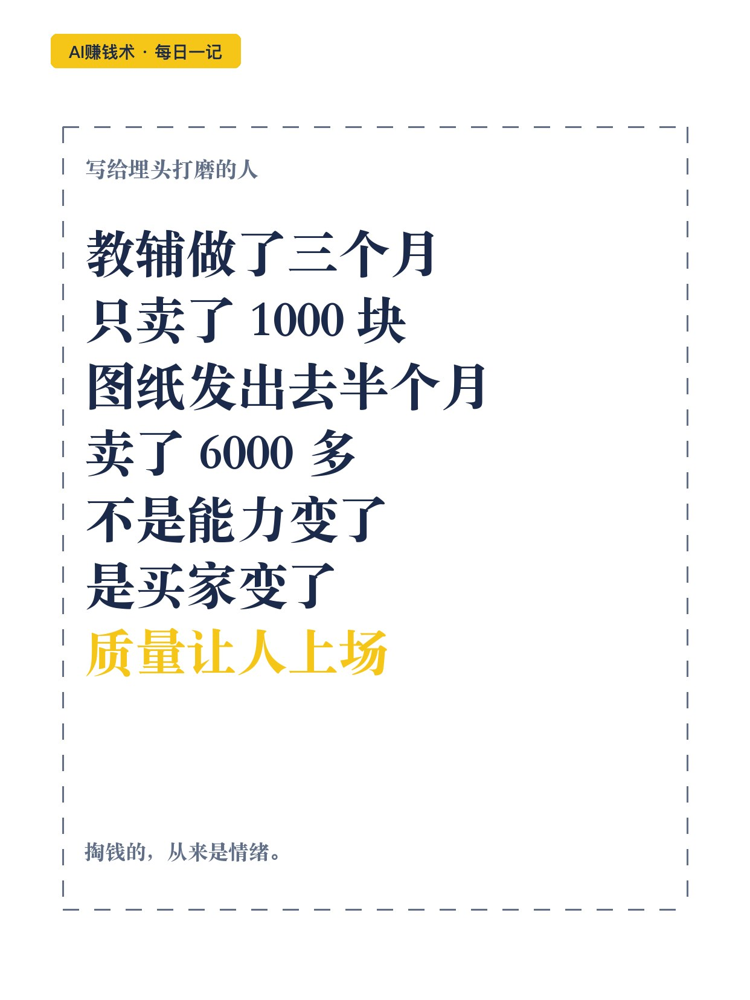

# 教辅3个月1000，图纸半个月6000

> — · 2026-10-29 22:05 发布 · AI 赚钱内容

## 标题（可直接复制）

```
教辅3个月1000，图纸半个月6000
```

## 正文（可直接复制发布）

她花三个月做教辅，卖了 1000 块。

配图不是装饰，是帮孩子理解知识点的，错一处都不行。AI 生成的图解看着不错，仔细查就发现某个细节画错了。只能改、重新生成、再检查。

同行价格低、资料量大，她做得慢，数量也不占优势。三个月下来销售额 1000 块，还没扣 AI 订阅费。

转折在 9 月一次拼豆体验。她坐在桌前想：能不能自己做一张图纸？

9 月 12 日下午，她把图纸发到一个图文平台，顺手挂上售卖链接。当天发了八张超大图、八张 52 格小图。

帖子直接爆了。两天涨粉 1000，点赞通知一打开就是 99+。更意外的是，当天就有人买图纸。

接下来几天，每天收入都比前一天高。9 月 15 日当天卖了 1273.91 元。

对一个刚经历过「三个月 1000 块」的人来说，这个反馈太强烈。

到 9 月底，卖图纸累计 6000 多。

同样是认真打磨视觉内容，换了个使用场景，市场反馈差了六倍。

差别在哪？

① 教辅的买家，是精打细算的家长
他们会比价格、比资料数量、比实用性。
你花很多时间保证准确、打磨细节，这是产品必须承担的责任，但这些投入不一定换来更高的购买意愿。
用户可能认可质量，最后还是选更便宜、内容更多的那份。

② 图纸的买家，为「喜欢」付费
看到一个好看的图案，想把它亲手拼出来，愿意为这份喜欢付钱。
当然只有好看不够，图纸必须真的能照着拼。
这种兴趣带来的黏性更强：拼完一张，还会想找下一张。

③ 质量是入场券，不是溢价理由
教辅里她把准确做到极致，买家不认这个账。
图纸里她把好看和可拼都做到，买家愿意多付。
同一个能力，放在不同场景，价格差六倍。

④ 工作流决定能不能接住流量
她先梳理一张图纸从制作到交付会遇到哪些问题，再决定哪些交给 AI、哪些必须人工判断。
制作前明确目标，减少反复试错。
留出样稿检查和修改阶段，确认后再做成品。
分别检查画面效果和实际可拼性。
整理版本、交付文件和归档，方便后续修改。

她的结论不是「教辅不好」，而是：做之前先想清楚，用户到底为什么掏钱。

质量让你有资格上场，情绪才让人掏钱。

## 话题标签

#AI赚钱术日记 #副业 #数字产品 #个人成长 #搞钱思路

## 配图（10 张）












## 发布信息

| 项 | 值 |
|---|---|
| 平台 | 小红书 |
| 期数 | — |
| 发布时间 | 2026-10-29 22:05 |
| 正文长度 | 886 字 |
| 图片数量 | 10 张 |
| 状态 | 已发布 |
