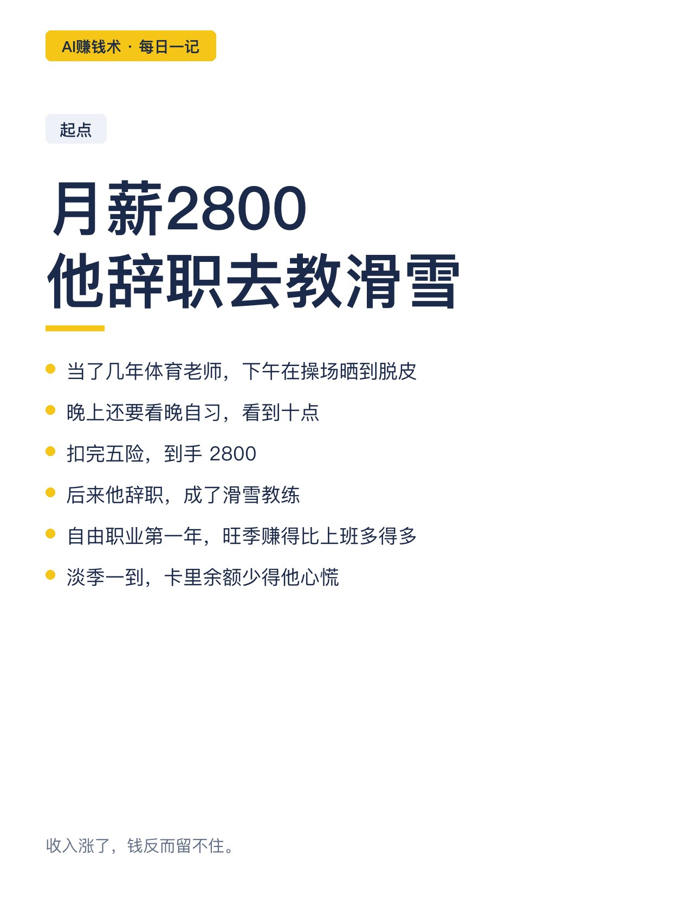
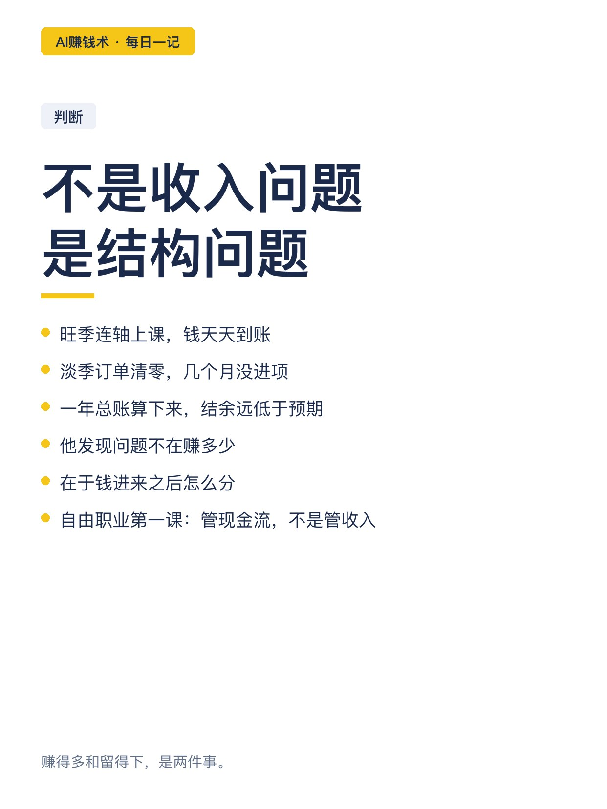
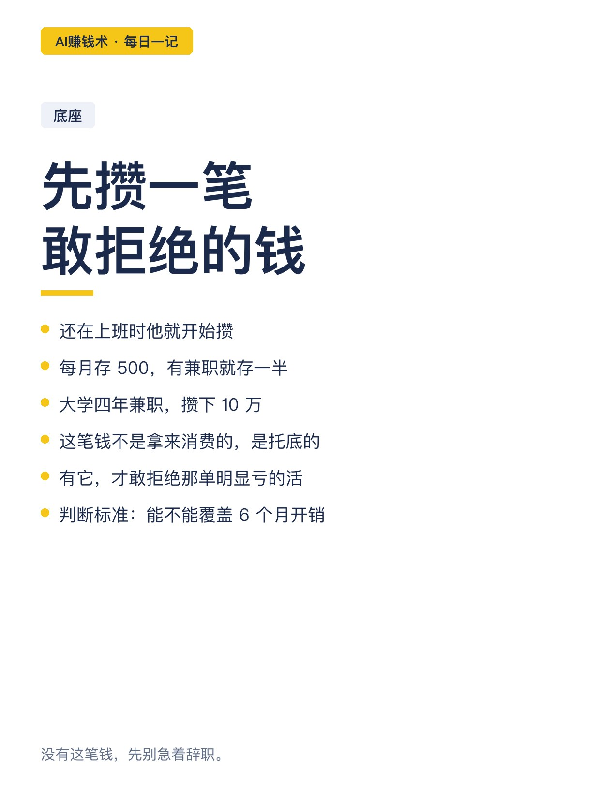
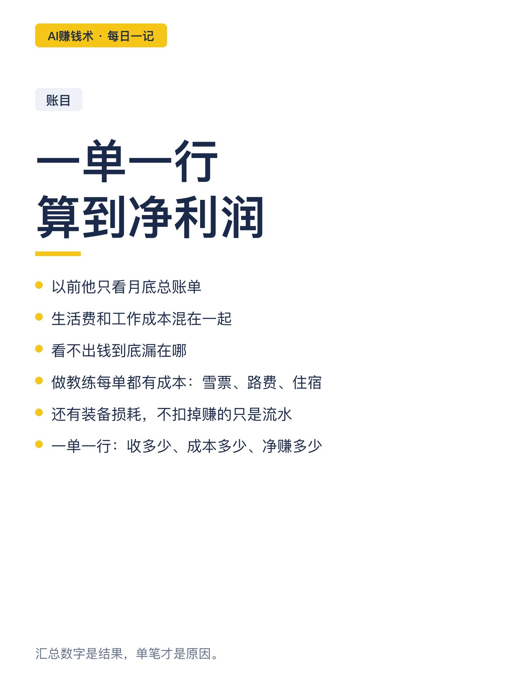
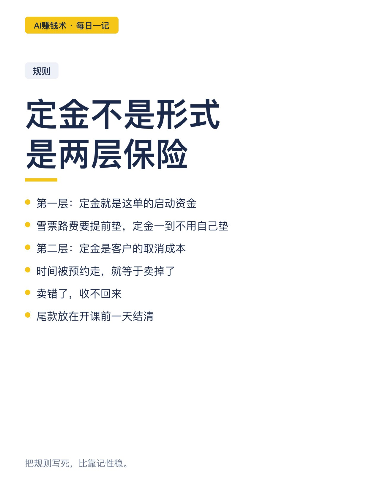
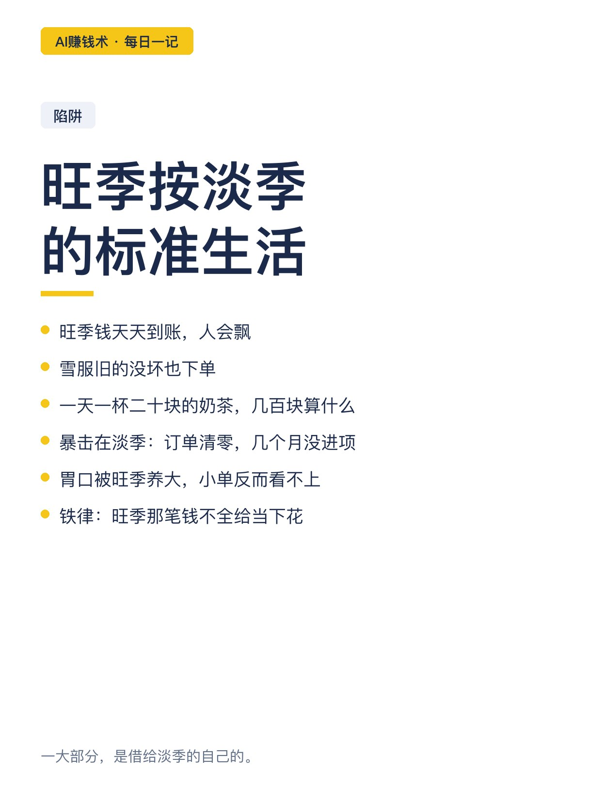
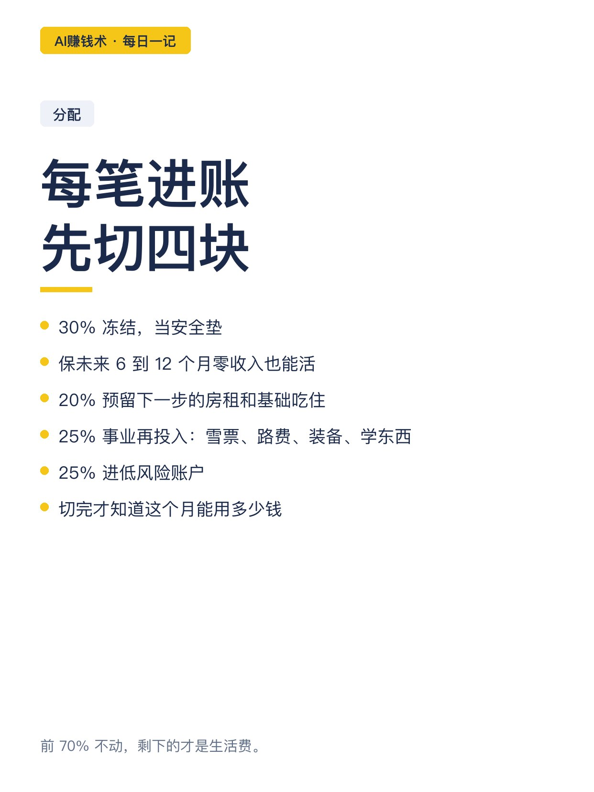
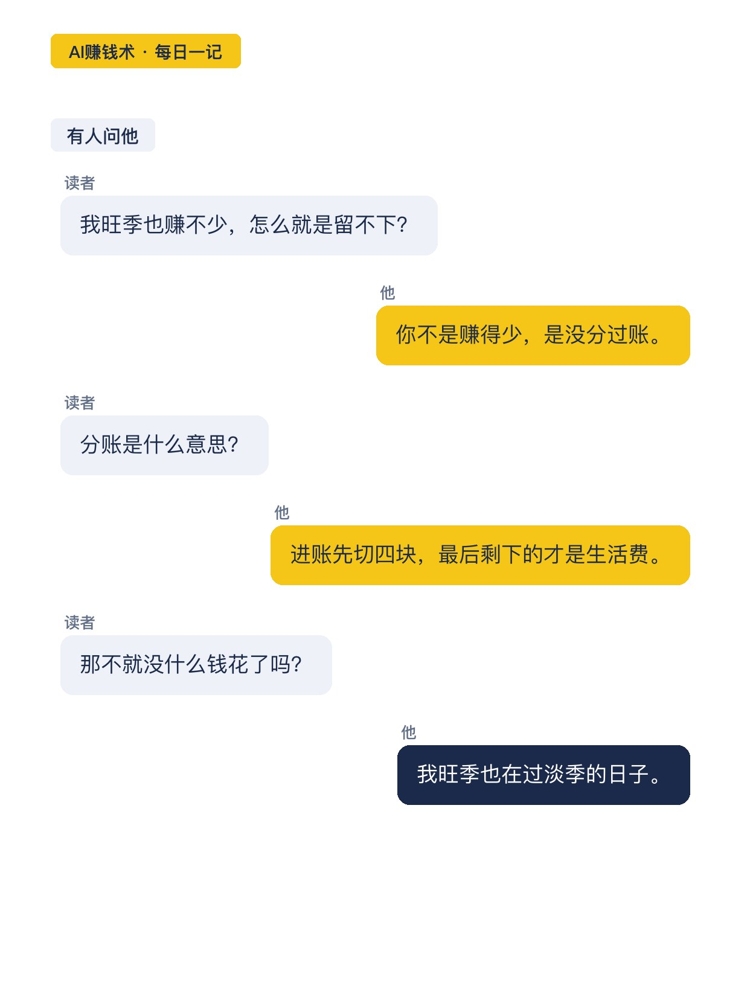
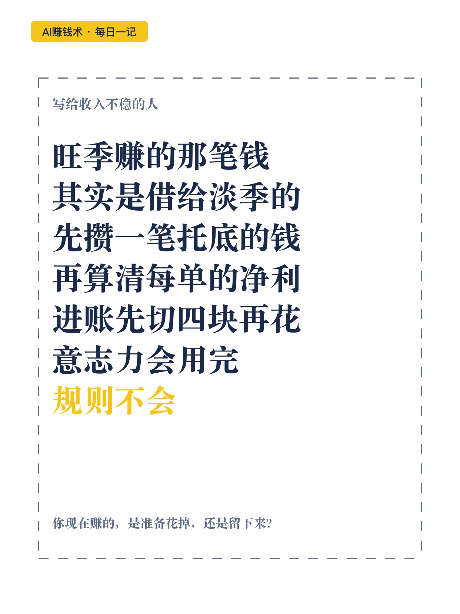

# 旺季赚的数万，是借给淡季的

> — · 2026-10-29 20:31 发布 · AI 赚钱内容

## 标题（可直接复制）

```
旺季赚的数万，是借给淡季的
```

## 正文（可直接复制发布）

他当了几年体育老师，扣完五险，到手 2800。
下午晒到脱皮，晚上还要看晚自习到十点。

后来他辞职去当滑雪教练。自由职业第一年，他踩了个大坑：旺季赚得比上班多得多，淡季一到，卡里余额少得让他心慌。

那时他才想明白——自由职业不是收入问题，是现金流结构问题。

① 先攒一笔「不接烂活」的钱
还在上班时他就在攒，每月存 500，有兼职就存一半，大学四年攒下 10 万。
这笔钱是拿来托底的，有它才敢拒绝那单明显亏的活。
判断标准很土：手里有没有能覆盖 6 个月开销的钱。没有就先攒，别急着辞职。

② 一单一行，算到净利润
以前他只看月底总账单，生活费和工作成本混在一起，看不出钱漏在哪。
做教练看着是上一天课赚一天钱，其实每单都有成本：雪票、路费、住宿、装备损耗。
不扣掉，赚的只是流水，不是利润。
他用一张表，一单一行：收多少、成本多少、净赚多少。月底一拉，哪单赚钱、哪单赔时间，一目了然。

③ 定金不是形式，是两层保险
第一层，定金就是启动资金。雪票路费要提前垫，定金一到，不用拿自己的钱垫。
第二层，定金是客户的取消成本。时间被预约走就等于卖掉了，卖错了收不回来。尾款在开课前一天结清。

④ 旺季按淡季的标准生活
旺季连轴上课，钱天天到账，人会飘。雪服旧的没坏也下单；一天一杯二十块的奶茶，「几百块算什么」。
暴击在淡季：订单清零，几个月没进项，人还看不上一天三五百的小单。
铁律是——旺季那笔钱，不是全给你花在当下的，其中一大部分，是你借给淡季那个零收入的自己的。

⑤ 每一笔进账，先切四块
30% 冻结当安全垫，保未来 6 到 12 个月零收入也能活。
20% 预留下一步的房租和基础吃住。
25% 事业再投入：雪票、路费、装备更新、学东西。
25% 进低风险账户。
切完才知道这个月能用多少钱。剩下的才是生活费，前 70% 不动。

⑥ 成本能变，就别固定
起步期不租贵场地、不开高底薪，按场次、按项目结算。有需求才付费，没业务时零成本。
打工有公司兜底固定成本，自由职业自己扛盈亏。

他还把存款比例、收入支出、每月最低生活成本交给 AI，换几个视角挑毛病。
想买东西的时候，人总能给自己找到理由。意志力会用完，规则不会。

旺季赚的那笔钱，其实是借给淡季的。
你现在赚的，是准备花掉，还是准备留下来？

## 话题标签

#AI赚钱术日记 #副业 #自由职业 #个人成长 #搞钱思路

## 配图（10 张）












## 发布信息

| 项 | 值 |
|---|---|
| 平台 | 小红书 |
| 期数 | — |
| 发布时间 | 2026-10-29 20:31 |
| 正文长度 | 963 字 |
| 图片数量 | 10 张 |
| 状态 | 已发布 |
