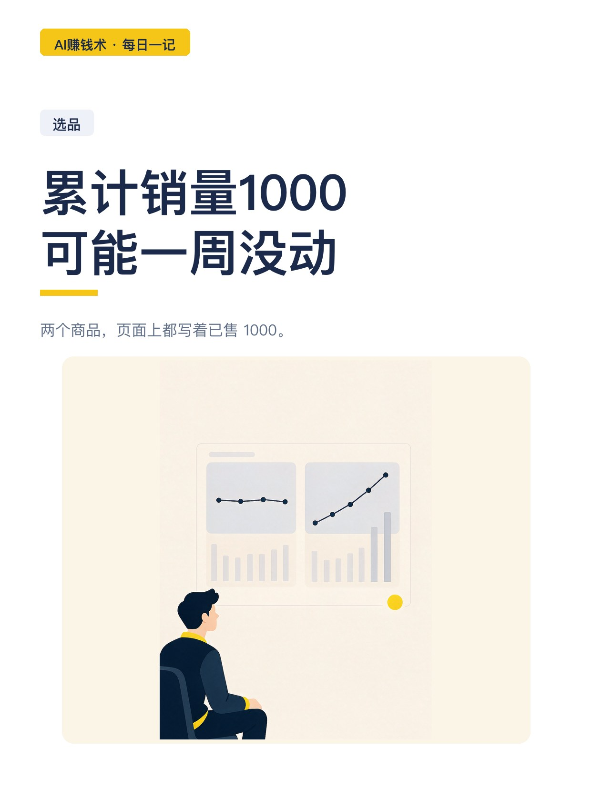
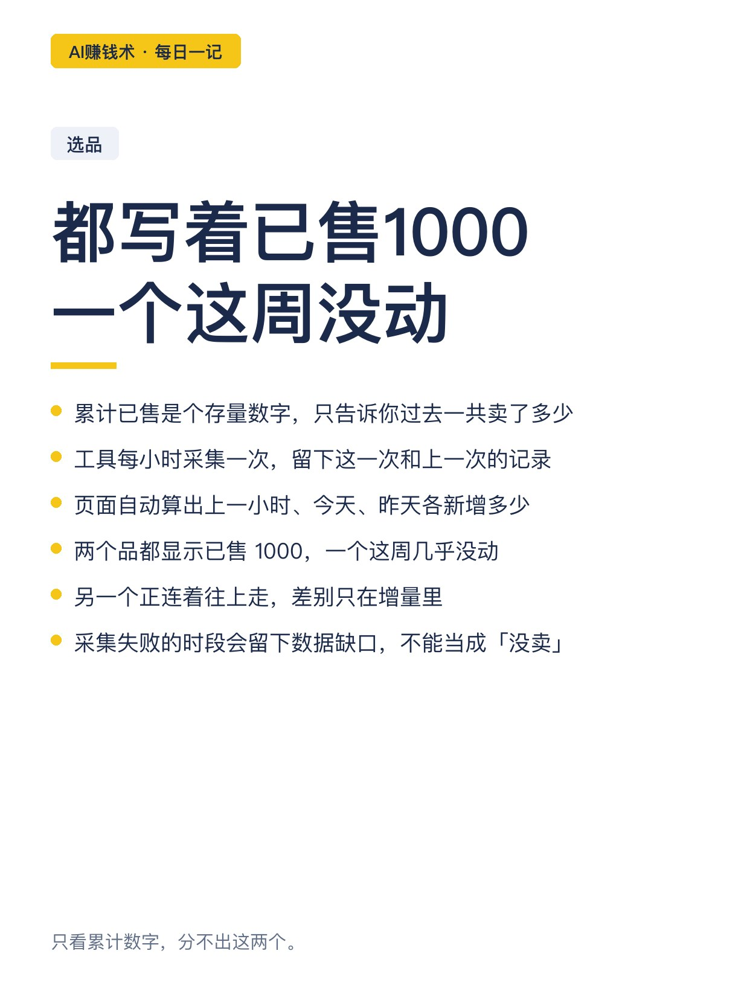
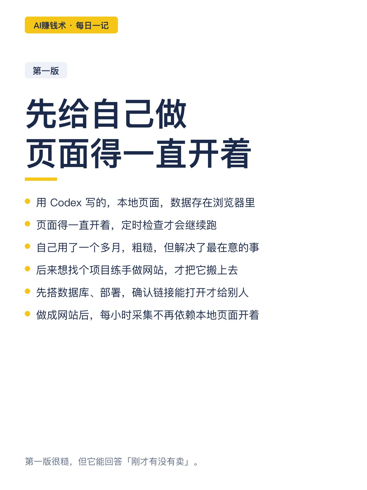
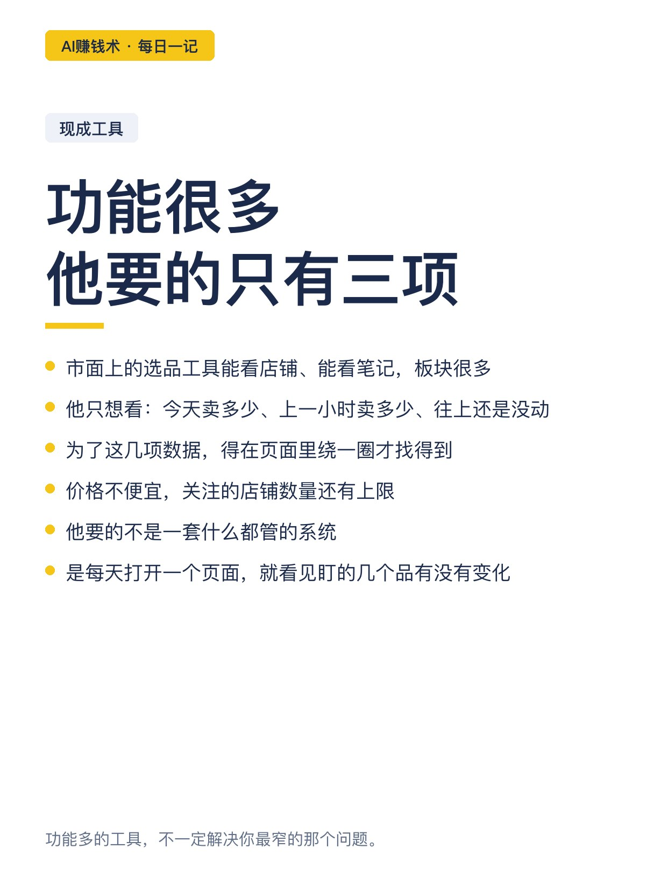
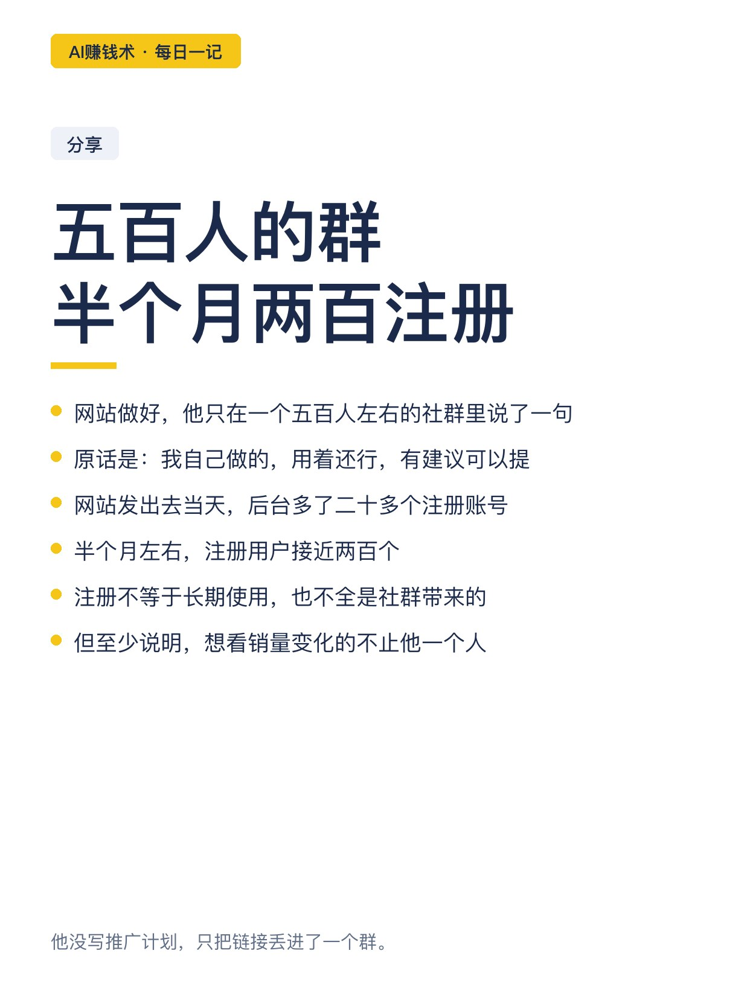
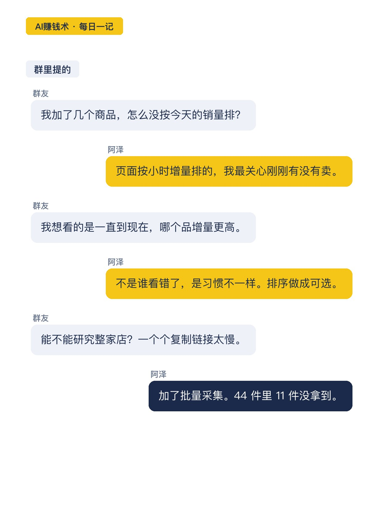
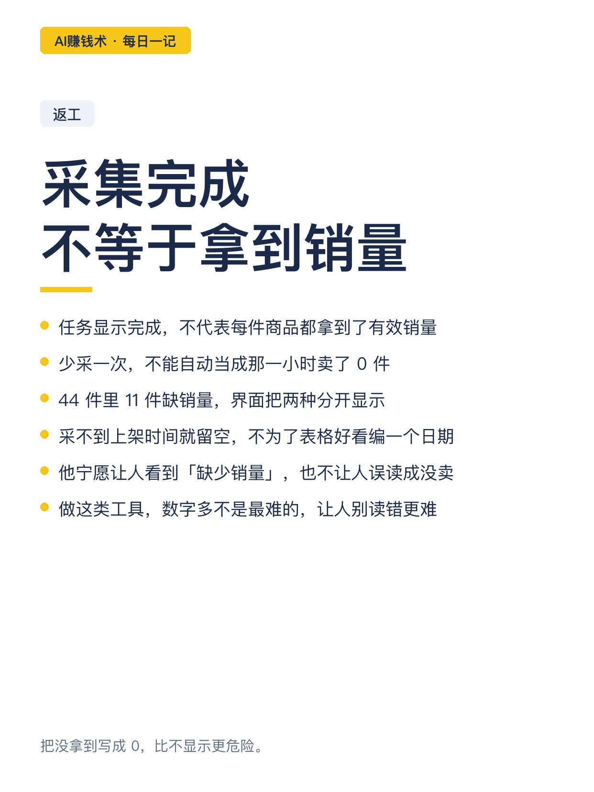
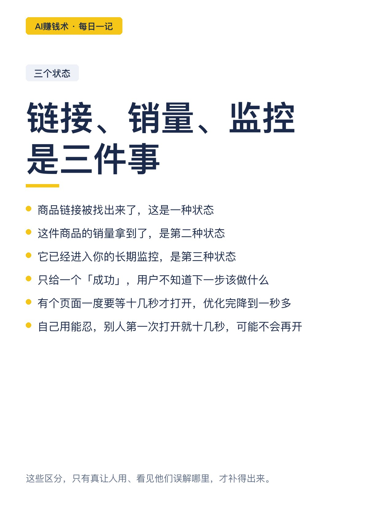
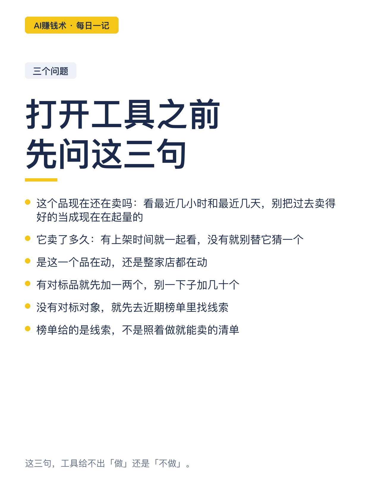
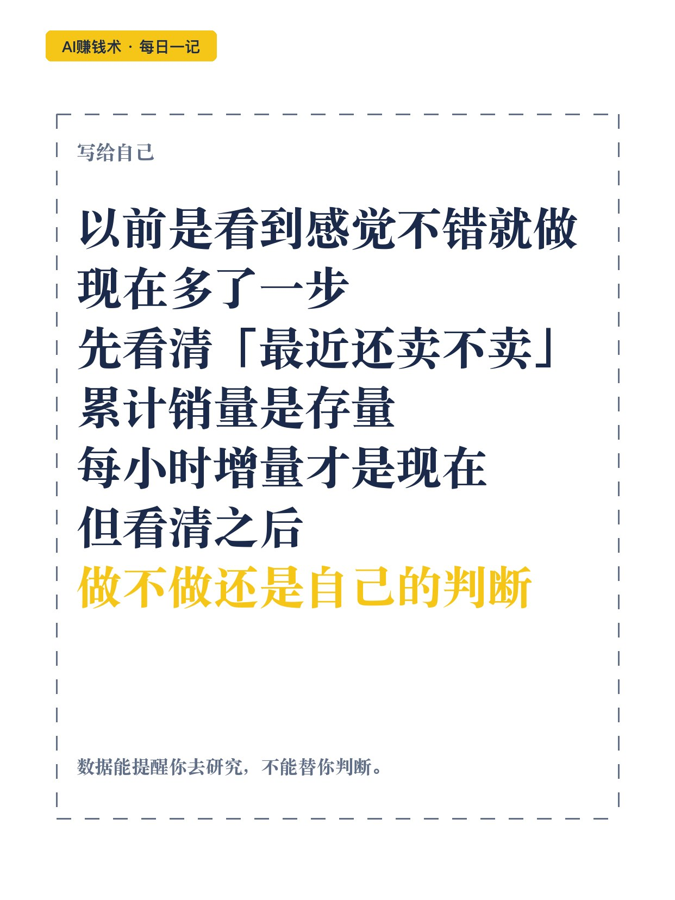

# 累计销量1000，可能一周没动

> — · 2026-10-29 12:21 发布 · AI 赚钱内容

## 标题（可直接复制）

```
累计销量1000，可能一周没动
```

## 正文（可直接复制发布）

两个商品，页面上都写着已售 1000。

一个这周几乎没动，一个正连着往上走。只看累计数字，分不出这两个。

阿泽做虚拟资料，选品靠翻对标店。他一直没看清一件事：这个品累计销量摆在那儿，最近到底还卖不卖。

📌 他先给自己做了个工具

用 Codex 写的。第一版很糙：本地页面，数据存在浏览器里，页面得一直开着，定时检查才跑。

加进链接，隔一阵记一次已售数，算上一小时、今天、昨天各增多少。

自己用了一个多月。后来想找个项目练手，才搬成网站。

📌 现成工具他都试过，但绕

能看店铺，能看笔记，板块多。可他要的很窄：每个对标品今天卖多少、上一小时卖多少、最近往上还是没动。为了这几项，得在页面里绕一圈。价格不便宜，关注店铺还有上限。

他要的不是什么都管的系统，是打开一个页面就看见盯的几个品有没有变化。

📌 功能不是规划出来的

网站做好，他只在一个五百人左右的社群里说：我自己做的，用着还行，有建议可以提。

当天后台多了二十多个注册，半个月接近两百个。

群里聊的不是「真好用」，是「能不能再加一个」：

有人问，我加了几个商品，怎么没按今天销量排？他原本按小时增量排，因为最关心刚刚有没有卖。这是他加的第一个开关。

有人说想研究整家店。于是他做了批量采集：粘贴店铺链接，逐件找出来。一次真实采集处理 44 件，33 件拿到销量，11 件缺。

有人问能不能看上架时间。同一个累计销量，刚上架和挂了半年的，读起来不是一回事。

📌 最难的不是加功能

采集任务显示完成，不代表每件商品都拿到了销量。少采一次，也不能当那一小时卖了 0 件。

链接找出来、销量拿到、加进监控，是三个状态。只给一个「成功」，用户不知道下一步该做什么。

有个页面一度要等十几秒才打开，优化完降到一秒多。自己用能忍，别人第一次打开就十几秒，可能不会再开。

📌 打开之前，先问三句

这个品现在还在卖吗——看最近几小时和几天的变化，别把过去卖得好的品当成现在还在起量的品。

它卖了多久——有上架时间就一起看，采不到就留空，别替它编一个日期。

是这一个品在动，还是整家店都在动。

这三句，工具给不出「做」还是「不做」。榜单是线索，不是照着做就能卖的清单。

他以前看到感觉不错就做。现在多一步：先看清「最近还卖不卖」。但看清之后，做不做还是自己的判断。

## 话题标签

#AI赚钱术日记 #副业 #选品 #AI工具 #独立开发

## 配图（10 张）












## 发布信息

| 项 | 值 |
|---|---|
| 平台 | 小红书 |
| 期数 | — |
| 发布时间 | 2026-10-29 12:21 |
| 正文长度 | 976 字 |
| 图片数量 | 10 张 |
| 状态 | 已发布 |
