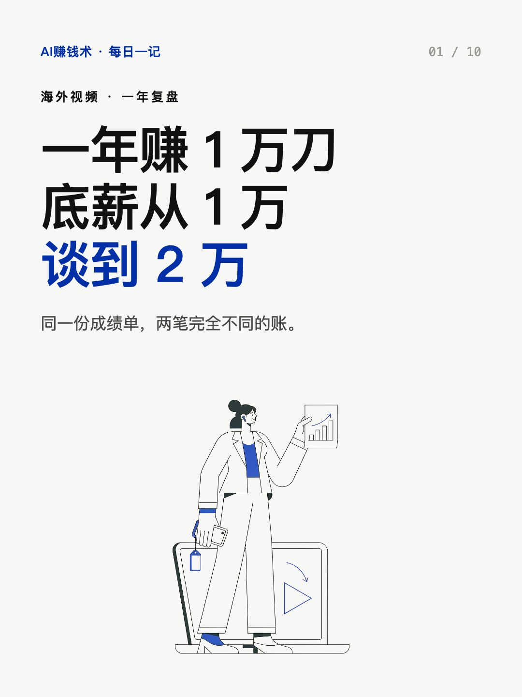
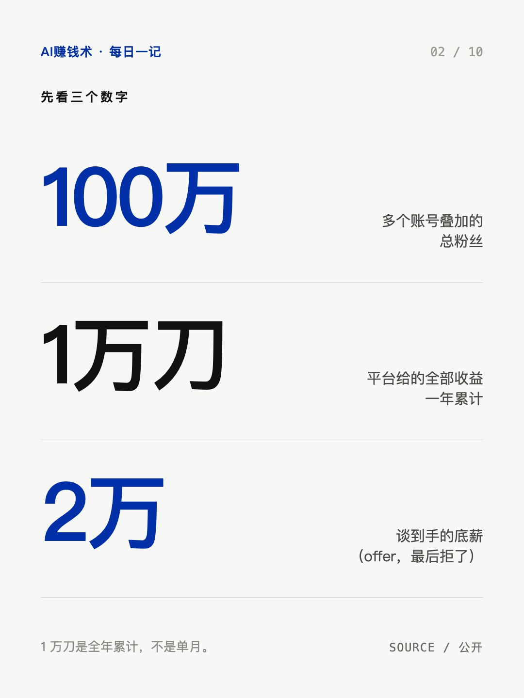
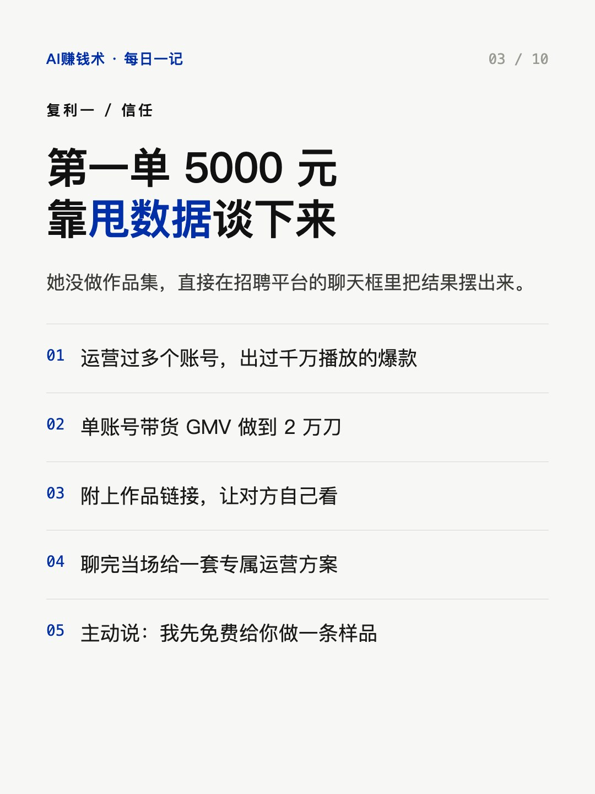
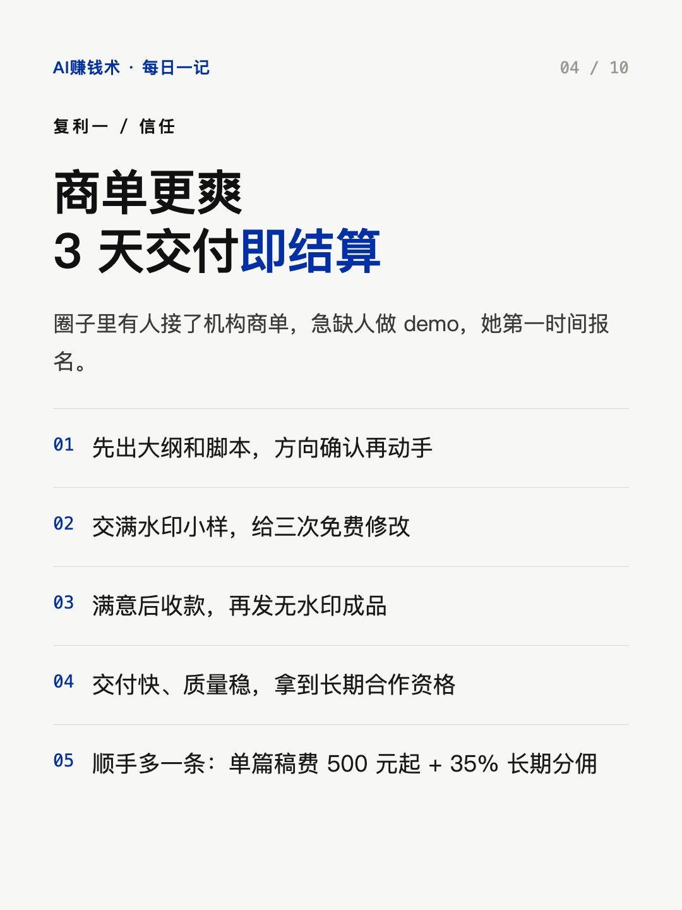
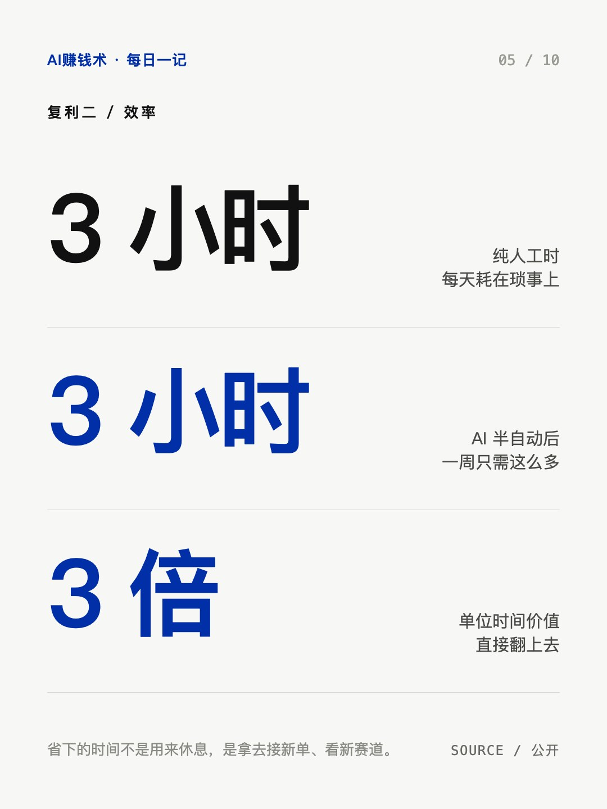
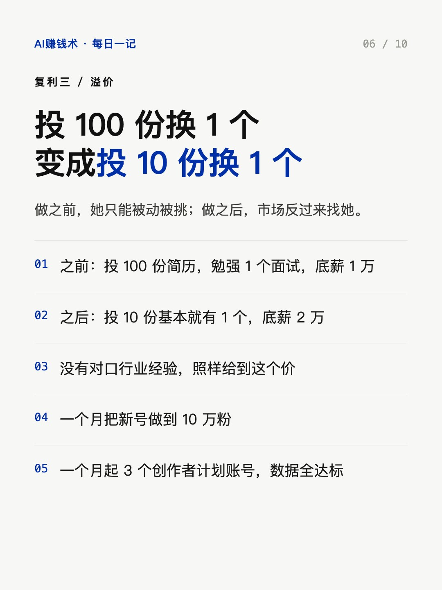
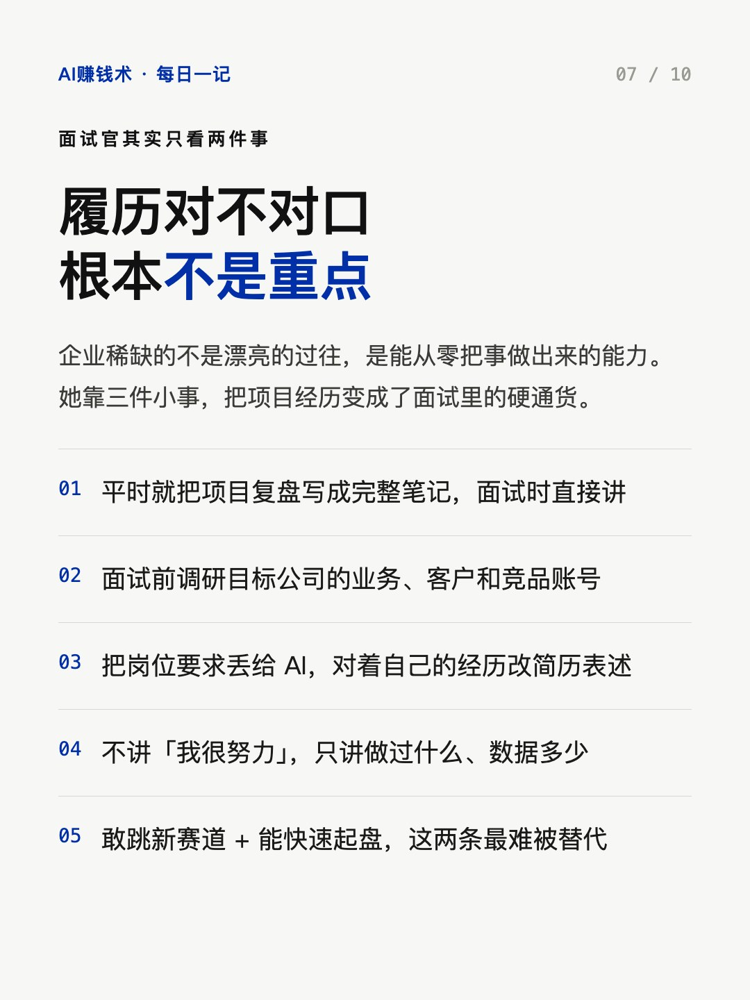
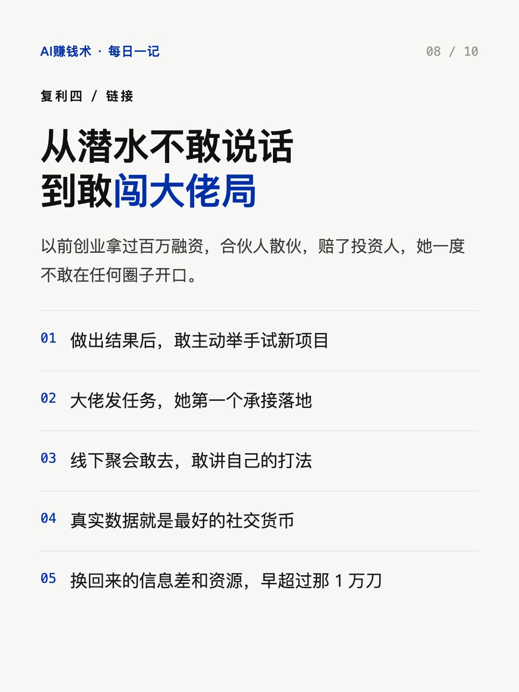
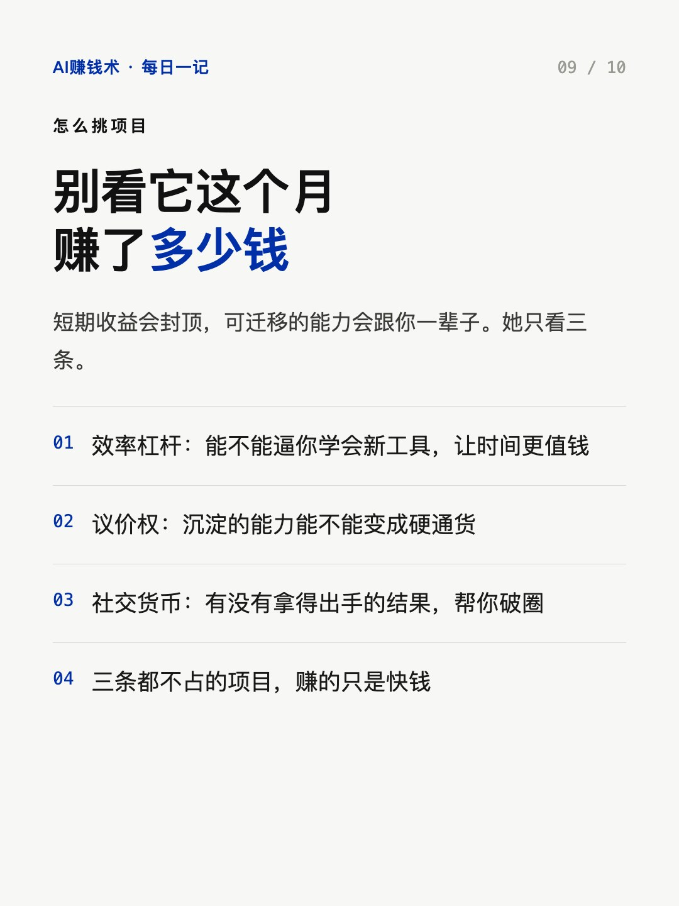
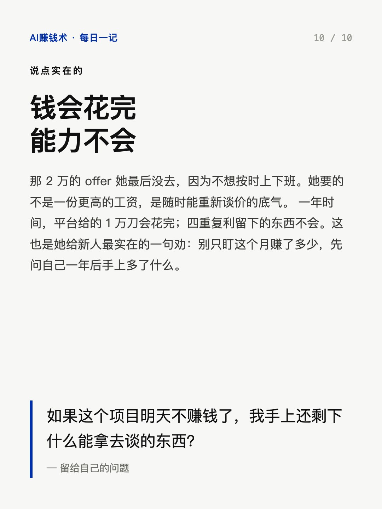

# 1万刀的副业，把底薪谈到2万

> — · 2026-10-30 14:13 发布 · AI 赚钱内容

## 标题（可直接复制）

```
1万刀的副业，把底薪谈到2万
```

## 正文（可直接复制发布）

做了一年海外视频，100 万粉，平台给我的钱是 1 万美金。

听起来不多。我自己也说，比起那些一个月赚上万刀的大佬，这 1 万刀微不足道。

但同一份成绩单，让我的底薪报价从 1 万变成了 2 万。

真正值钱的从来不是这 1 万刀，是它带出来的四重复利。

一、信任复利：结果就是最好的接单背书
我在招聘平台直接甩数据：多个账号、千万播放、单账号带货 2 万刀 GMV，附上作品链接。
聊完当场给对方一套运营方案，还主动说：我先免费给你做一条样品。
第二天敲定 5000 元海外社媒代运营。
后来商单也稳了：客户给需求，我 3 天做完，验收通过立刻结算。

二、效率复利：每天 3 小时，压到每周 3 小时
代运营的琐事最多：整理素材、分析用户、找对标、剪微调、排期、复盘。
我用 AI 搭了一套半自动流程，从信息录入到数据复盘全覆盖。
以前每天 3 小时，现在一周 3 小时，单位时间价值翻了 3 倍。

三、溢价复利：投 100 份简历 vs 投 10 份
做之前：投 100 份简历换 1 个面试，底薪 1 万。
做之后：投 10 份换 1 个，底薪 2 万。
面试官不看我行业对不对口，只看两件事：敢不敢跳进新赛道，能不能从零把事做出来。
那个 2 万的 offer 我最后没去，因为不想按时上下班。

四、链接复利：从潜水，到敢闯大佬局
以前创业拿过百万融资，合伙人散伙，赔了投资人，我一度不敢在任何圈子里说话。
做出结果之后，我敢主动举手、敢第一个承接任务、敢在大佬局上讲自己的打法。
真实结果，就是最好的社交货币。

判断一个项目值不值得做，我看三条：效率杠杆、议价权、社交货币。
短期的钱总有花完的一天，沉淀下来的能力会一直替你赚钱。

如果这个项目明天不赚钱了，我手上还剩下什么能拿去谈的东西？

## 话题标签

#副业 #AI #AI工具 #搞钱思路 #AI赚钱术日记

## 配图（10 张）












## 发布信息

| 项 | 值 |
|---|---|
| 平台 | 小红书 |
| 期数 | — |
| 发布时间 | 2026-10-30 14:13 |
| 正文长度 | 758 字 |
| 图片数量 | 10 张 |
| 状态 | 已发布 |
