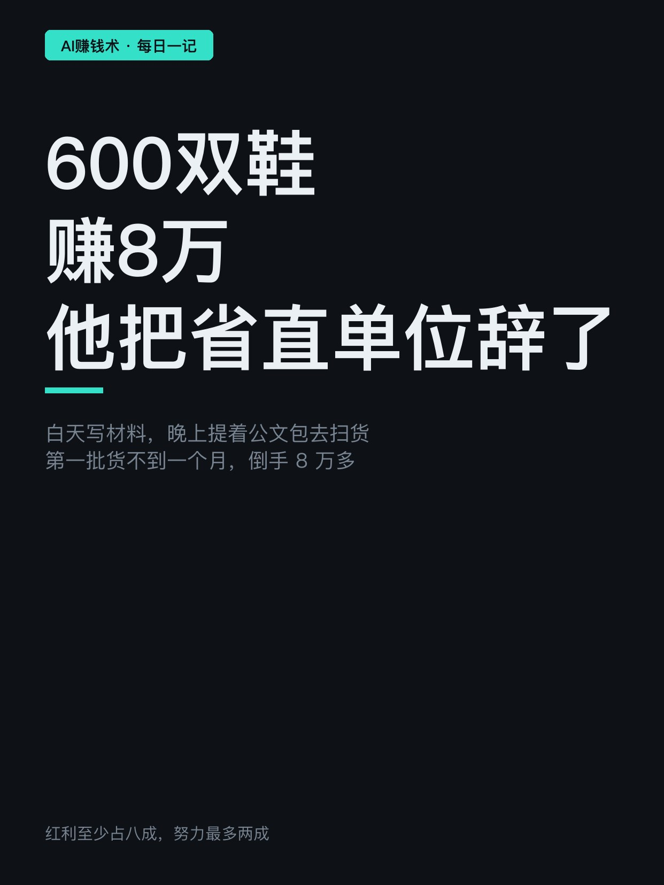
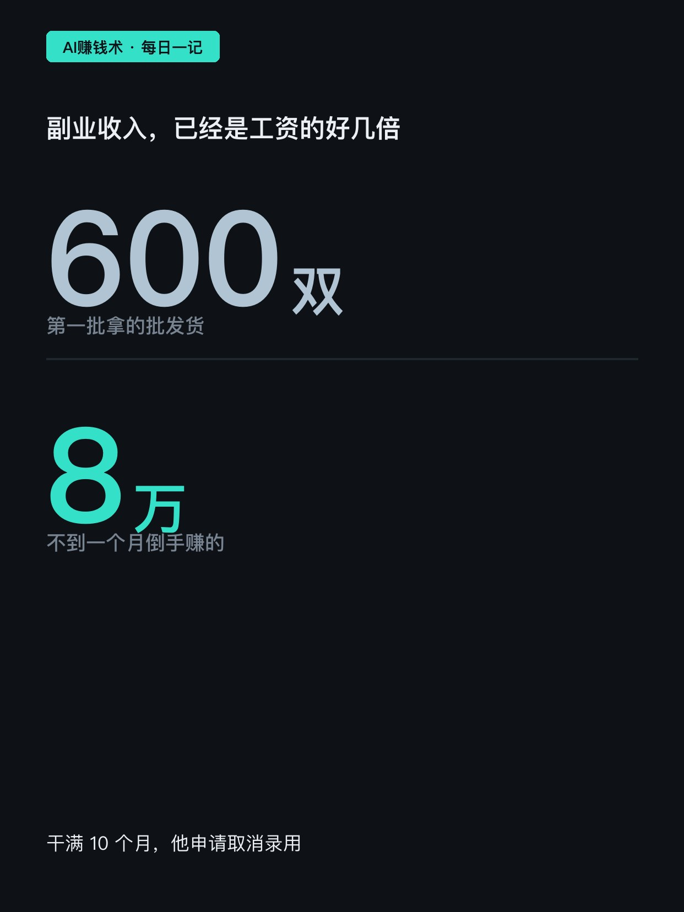
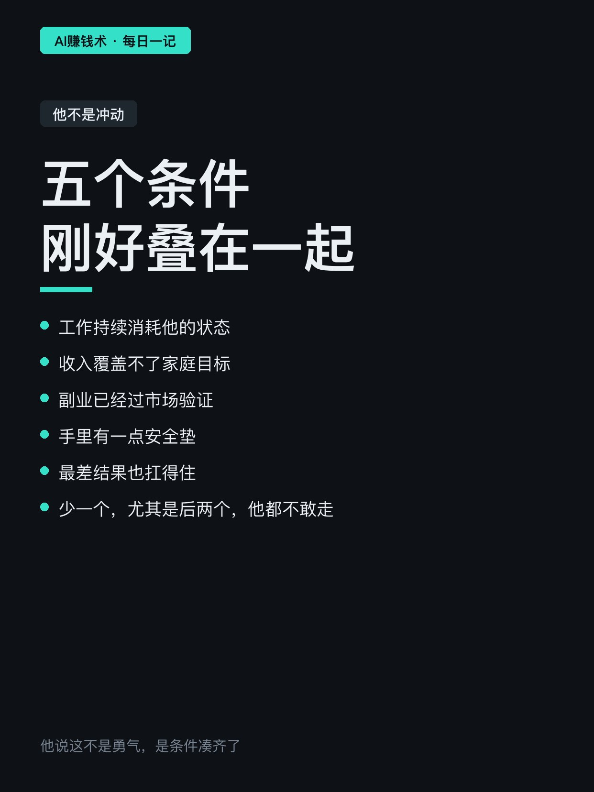
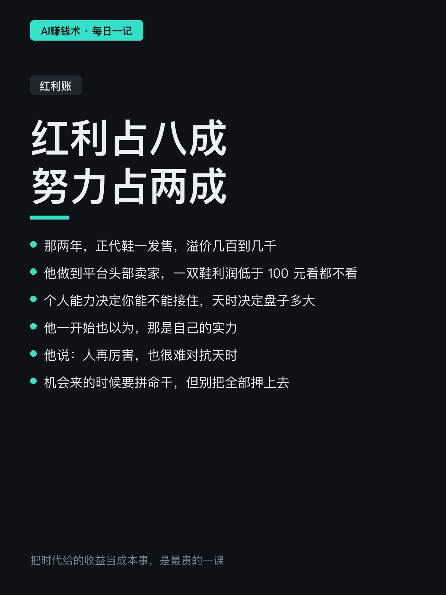
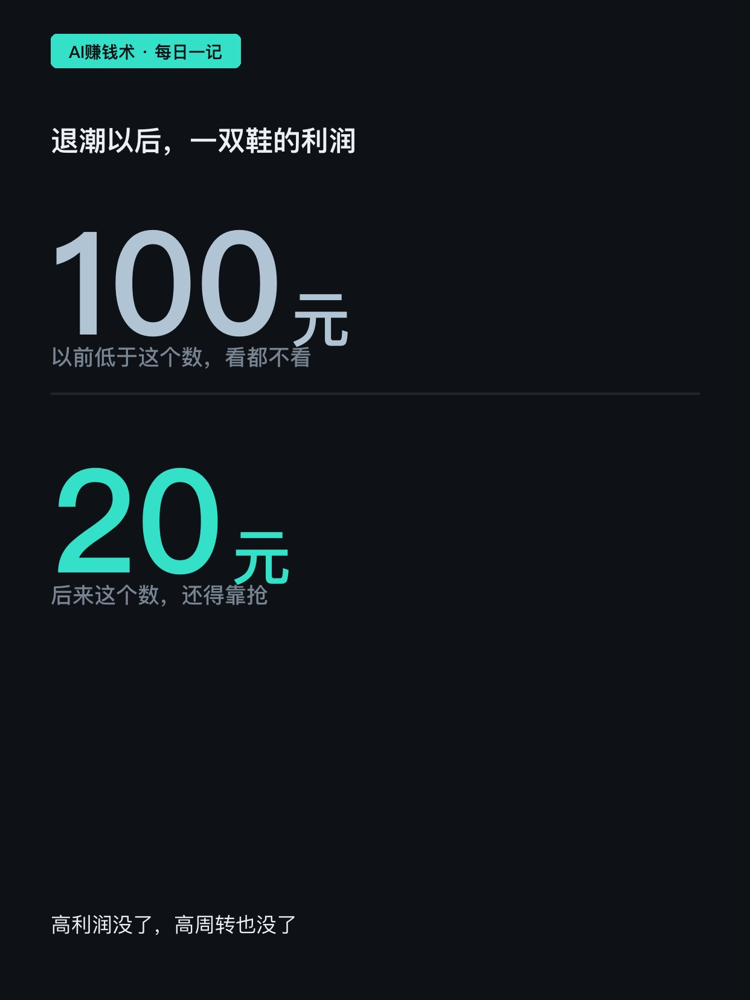
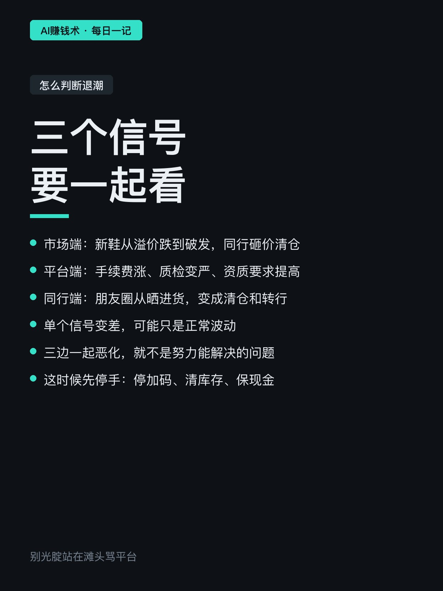
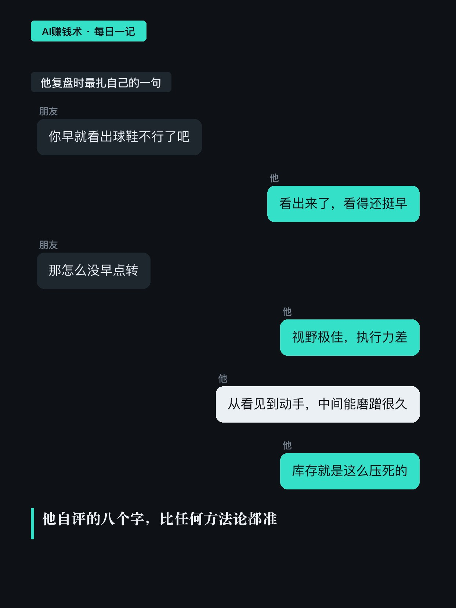
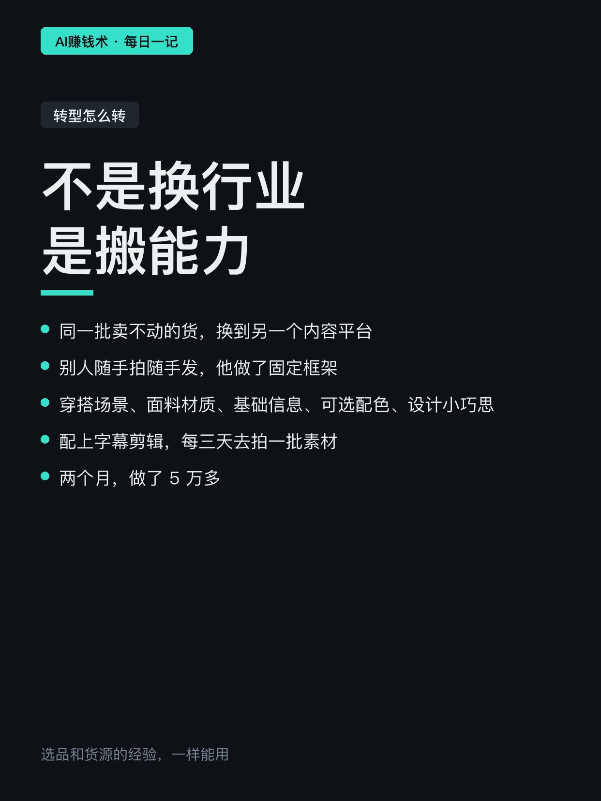
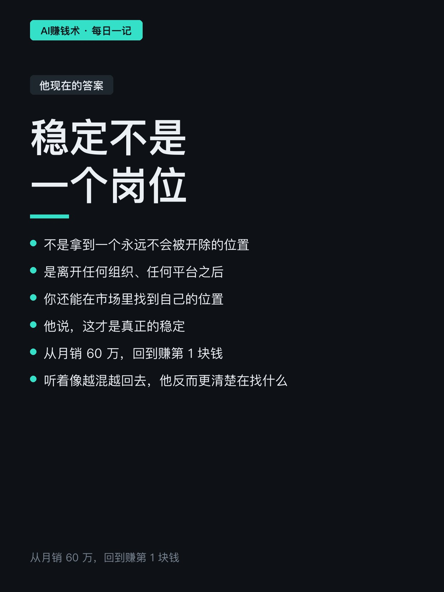
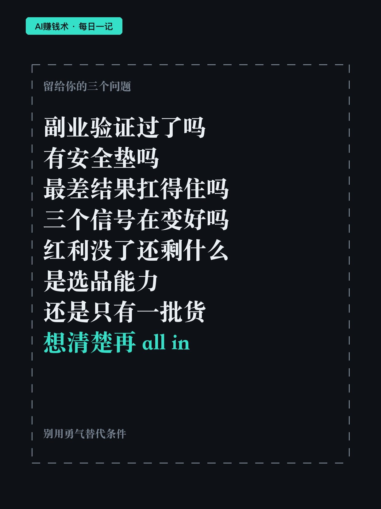

# 600双鞋赚8万，他把省直单位辞了

> — · 2026-10-30 20:27 发布 · AI 赚钱内容

## 标题（可直接复制）

```
600双鞋赚8万，他把省直单位辞了
```

## 正文（可直接复制发布）

2021 年，四川某省直单位的办公室里，他白天写材料。

下班不加班的日子，他换上衬衫提着公文包，往折扣商场和品牌直营店跑。店员盯了他半天，忍不住问：你应该不是全职干这个的吧。

确实不是。白天是刚上岸的公务员，晚上是到处扫货的鞋贩子。

第一批货 600 双，不到一个月倒手赚了 8 万多。副业收入已经是工资的好几倍。

干满 10 个月，他申请取消录用。

一、他不是冲动

他后来复盘，敢走是因为五个条件刚好叠在一起：

工作持续消耗状态；
收入覆盖不了家庭目标；
副业已经过市场验证；
手里有一点安全垫；
最差结果也扛得住。

他说，少一个条件，尤其是后两个，他都不敢走得那么干脆。

二、红利到底占多少

那两年正代鞋只要发售，溢价几百到几千都不稀奇。他做到平台头部卖家，一双鞋利润低于 100 元，看都不看。

但他自己算得很清楚：这波里红利至少占八成，他的努力最多两成。

个人能力决定你能不能接住，天时决定盘子有多大。

三、退潮时看三个信号

2021 年，市场端先冷：新鞋从溢价跌到破发，同行疯狂砸价清仓。
平台端跟着收紧：手续费涨、质检变严、资质要求提高。
同行端最直观——朋友圈从晒进货，变成清仓、转行、跑路。

他说，单个信号变差可能只是波动；三边一起恶化，就不是努力能解决的问题。

这时候别急着证明自己能逆天改命。停止加码、处理库存、保住现金，然后把旧能力搬到新渠道。

四、他真正踩的坑

不是看不清，是看清了没动手。

他自评：视野极佳，执行力差。红利退潮后他很早就知道旧路走不通，却磨蹭了很久才抓住下一次机会。库存压在手里，利润从一双一百多掉到二十块还要抢。

后来他把同一批卖不动的货，换到另一个内容平台，配上固定框架——穿搭场景、面料材质、基础信息、可选配色、设计小巧思，再打字幕。两个月做了 5 万多。

最后一句实话：真正的稳定，不是拿到一个不会被开除的岗位。是离开任何组织之后，你还能在市场里找到自己的位置。

## 话题标签

#副业 #搞钱思路 #创业复盘 #个人成长 #职业选择

## 配图（10 张）












## 发布信息

| 项 | 值 |
|---|---|
| 平台 | 小红书 |
| 期数 | — |
| 发布时间 | 2026-10-30 20:27 |
| 正文长度 | 827 字 |
| 图片数量 | 10 张 |
| 状态 | 已发布 |
