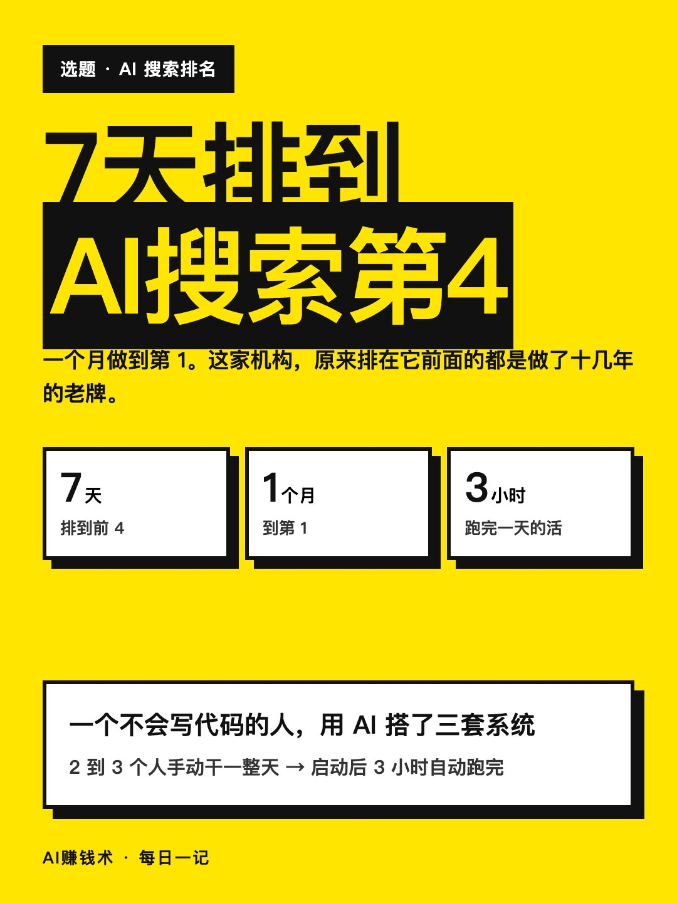
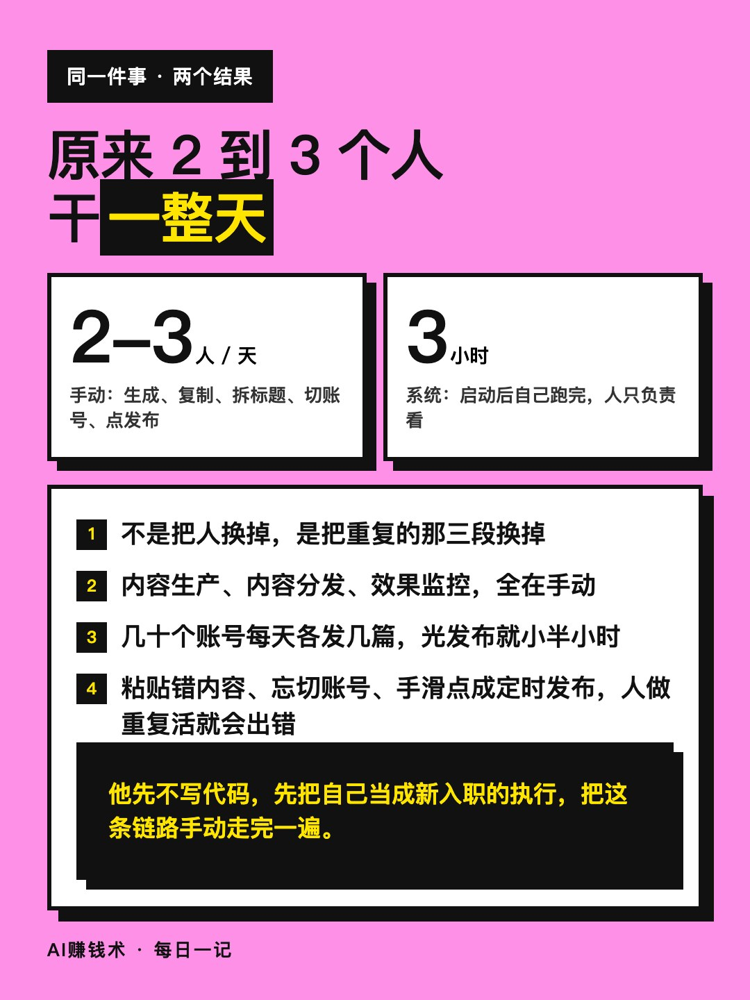
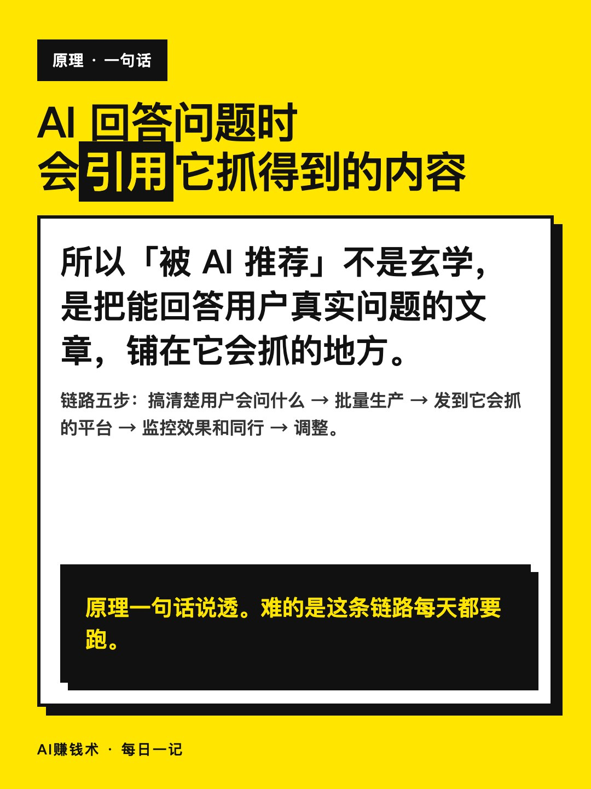
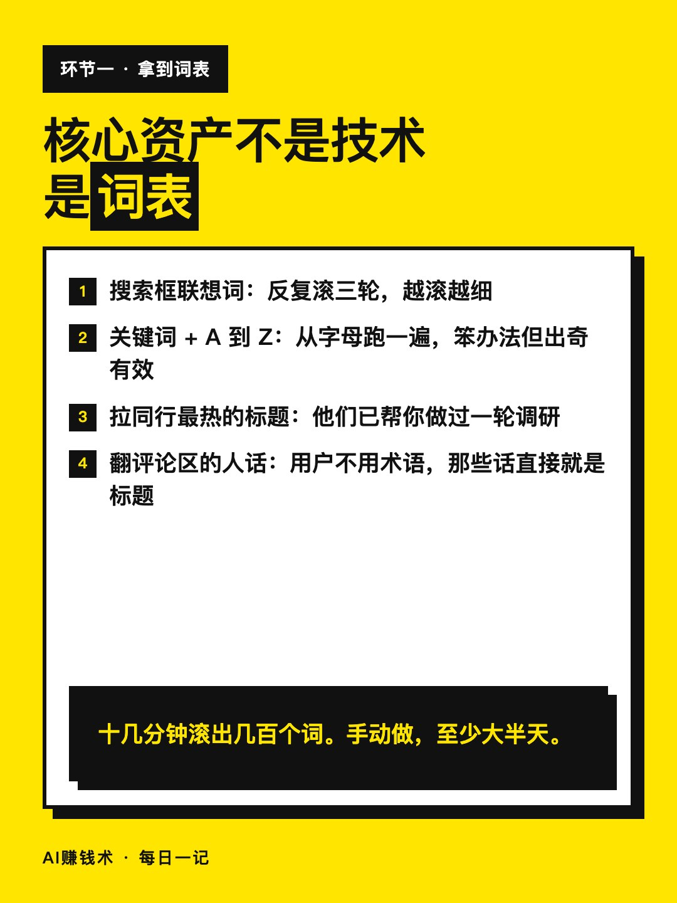
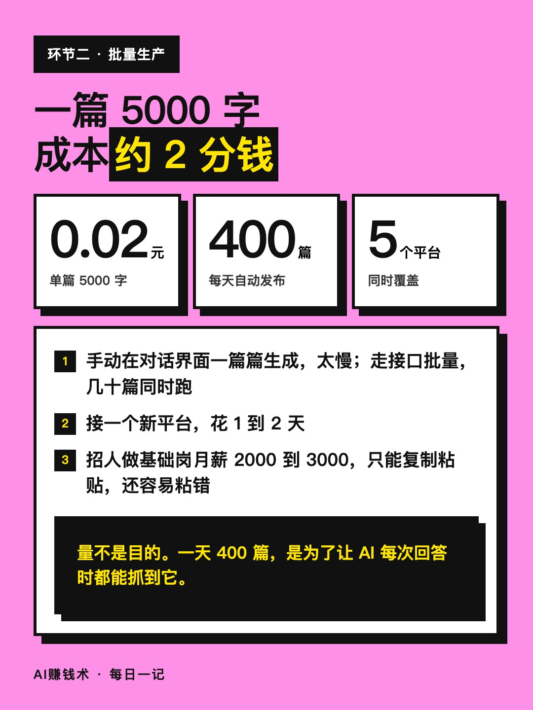
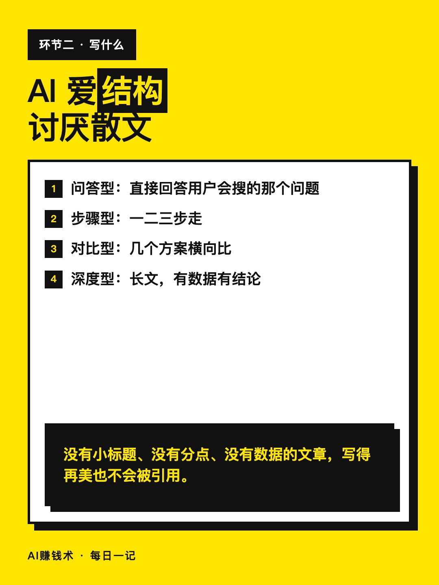
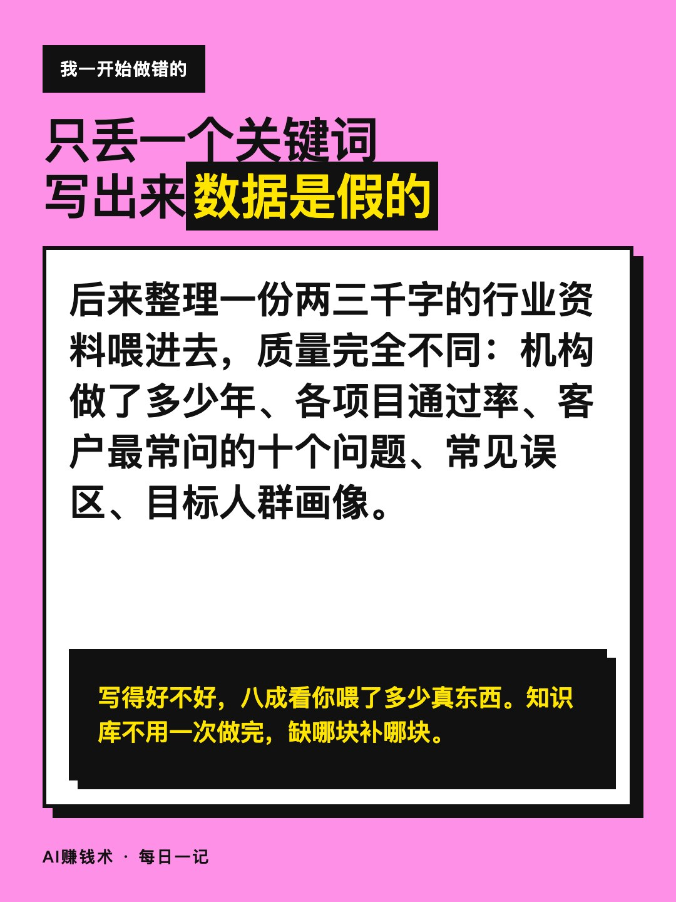
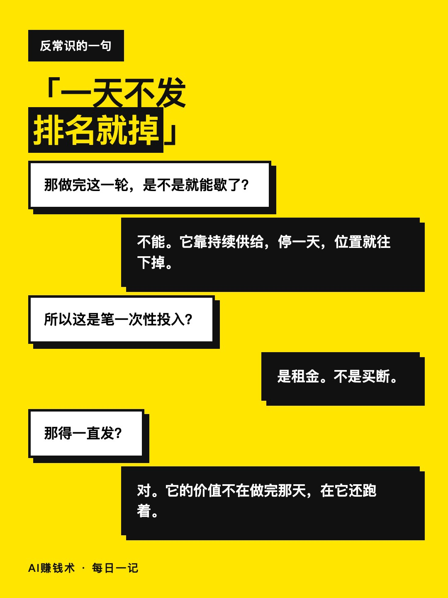
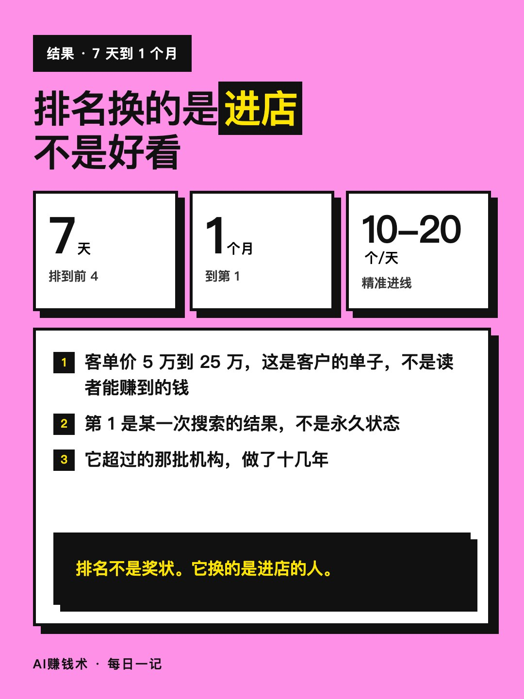
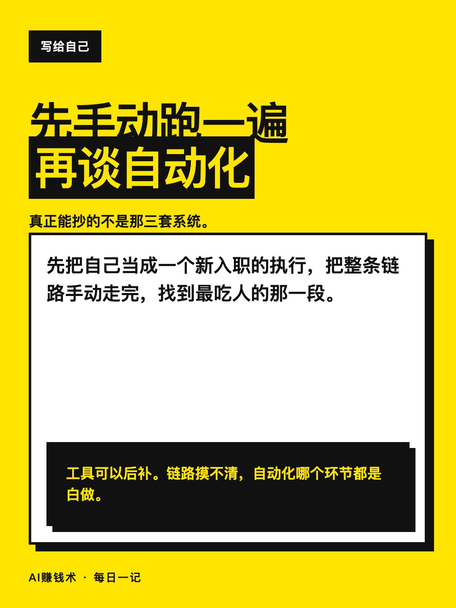

# 7天排到AI搜索第4，一个月第1

> — · 2026-10-30 12:06 发布 · AI 赚钱内容

## 标题（可直接复制）

```
7天排到AI搜索第4，一个月第1
```

## 正文（可直接复制发布）

有人在AI里问「出国服务找哪家靠谱」，被推荐出来的头一个，是一个做了不到一个月的新品牌。😳

排在它后面的，是做了十几年的老机构。

我接这个项目时，一行代码都写不出来。

第一件事不是写代码，是把自己当成新入职的执行，把整条链路手动走一遍：用户会问什么，批量生产内容，发到AI会抓的平台，监控效果和同行，再调整。

走完才知道，最吃人的是中间三段。原来2到3个人手动干一整天，现在启动后3小时自动跑完。

核心资产不是技术，是词表。📌

四种挖词法：
① 搜索框联想词，滚三轮
② 关键词加A到Z，跑一遍
③ 拉同行最热的标题
④ 翻评论区的人话

十几分钟滚出几百个词，手动要大半天。

写什么也有讲究。AI爱引用四种结构：问答、步骤、对比、深度分析。它讨厌散文，没有小标题、没有分点、没有数据的文章，基本不会被引用。

这里我一开始也做错了：只丢一个关键词让它写，写出来数据是假的，行业常识都是错的。后来整理一份两三千字的行业资料喂进去，质量完全不同。写得好不好，八成看你喂了多少真东西。

一篇5000字，成本约2分钱。一天发400篇到5个平台。

启动7天，排名到前4。一个月，到第1。

日均精准进线10到20个，客单价5万到25万。

但有一句话是他自己说的，也最反常识：
一天不发，排名就掉。⚠️

所以这不是做完就结束的项目，是一笔要一直交的租金。

真正能抄的不是那三套系统，是先手动跑一遍、找到最吃人的环节。工具可以后补，链路摸不清，自动化哪个环节都是白做。

## 话题标签

#副业 #AI #AI工具 #搞钱思路 #AI赚钱术日记

## 配图（10 张）












## 发布信息

| 项 | 值 |
|---|---|
| 平台 | 小红书 |
| 期数 | — |
| 发布时间 | 2026-10-30 12:06 |
| 正文长度 | 640 字 |
| 图片数量 | 10 张 |
| 状态 | 已发布 |
