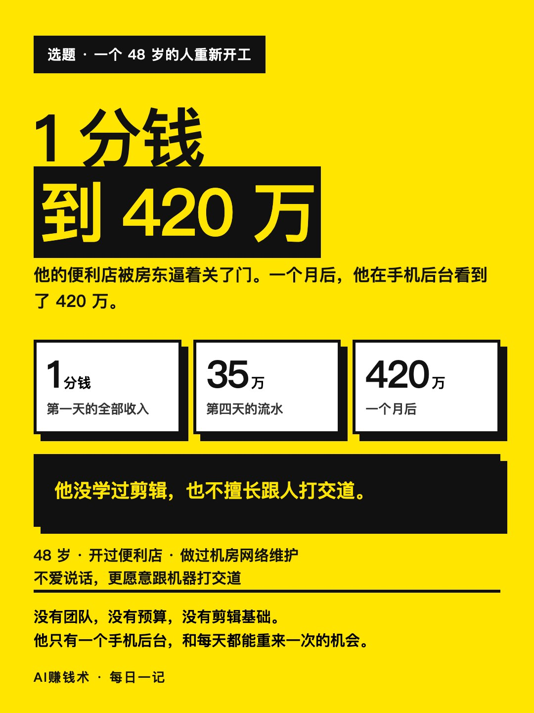
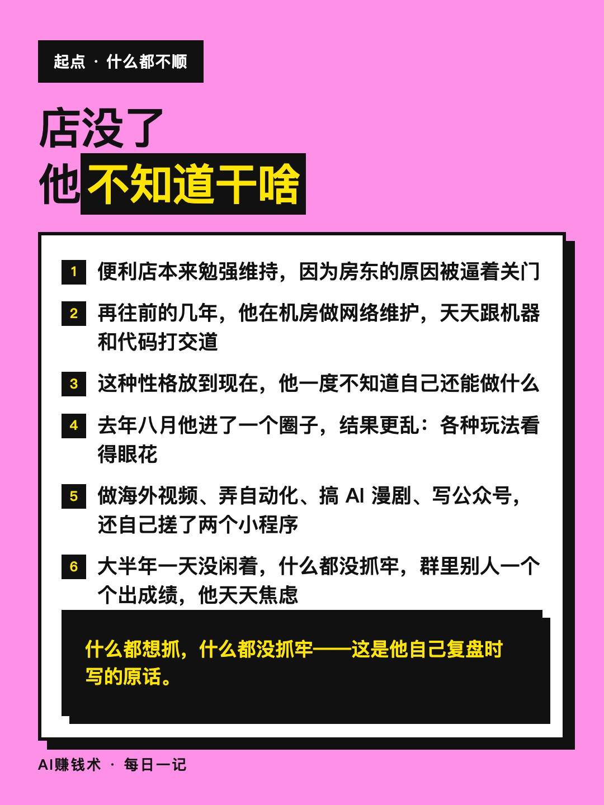
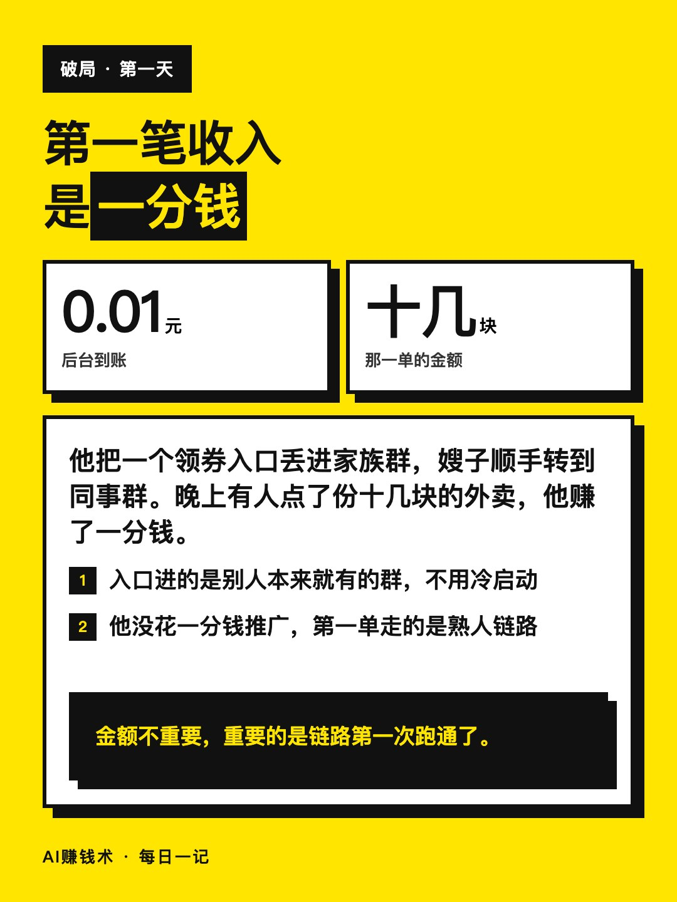
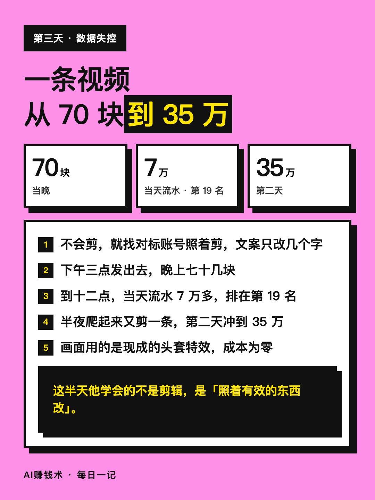
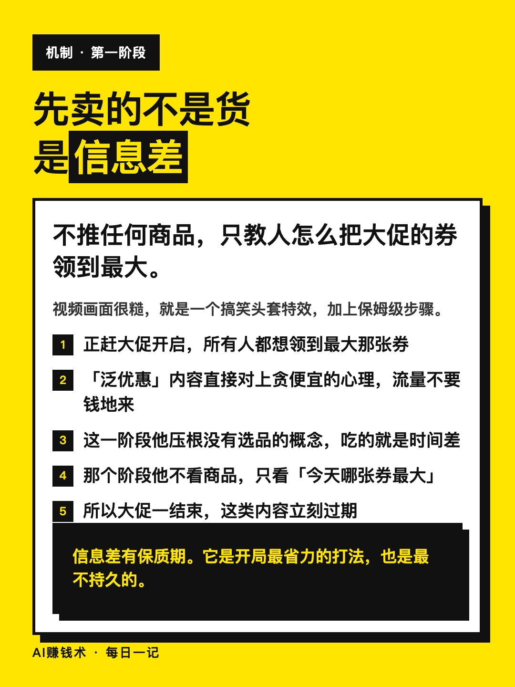
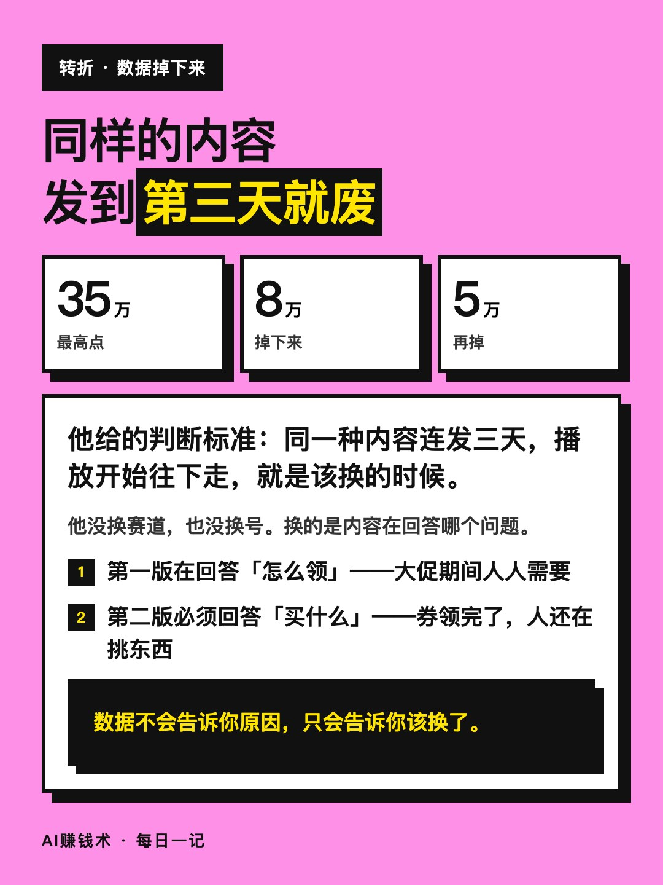
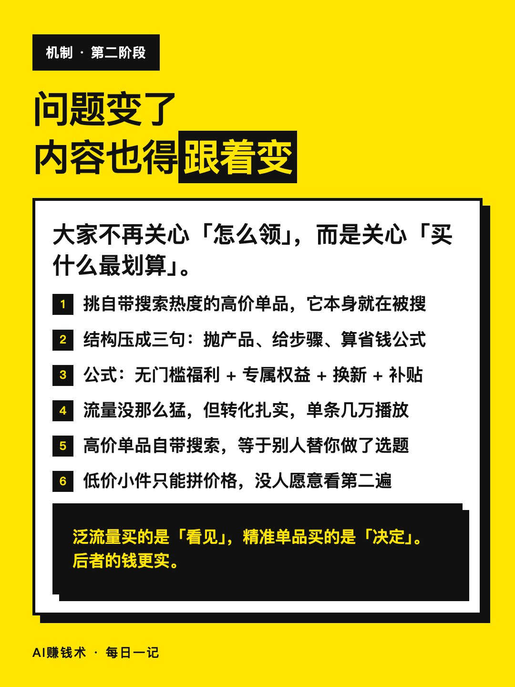
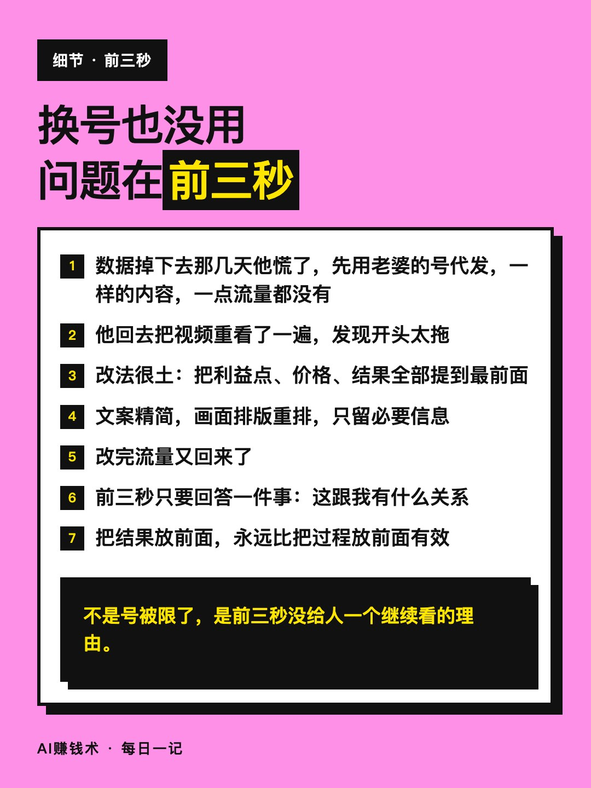
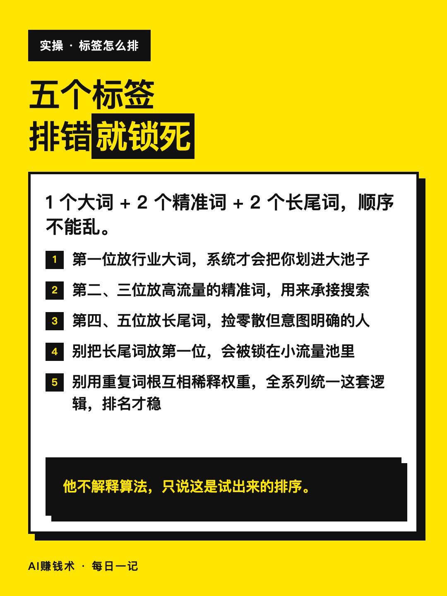
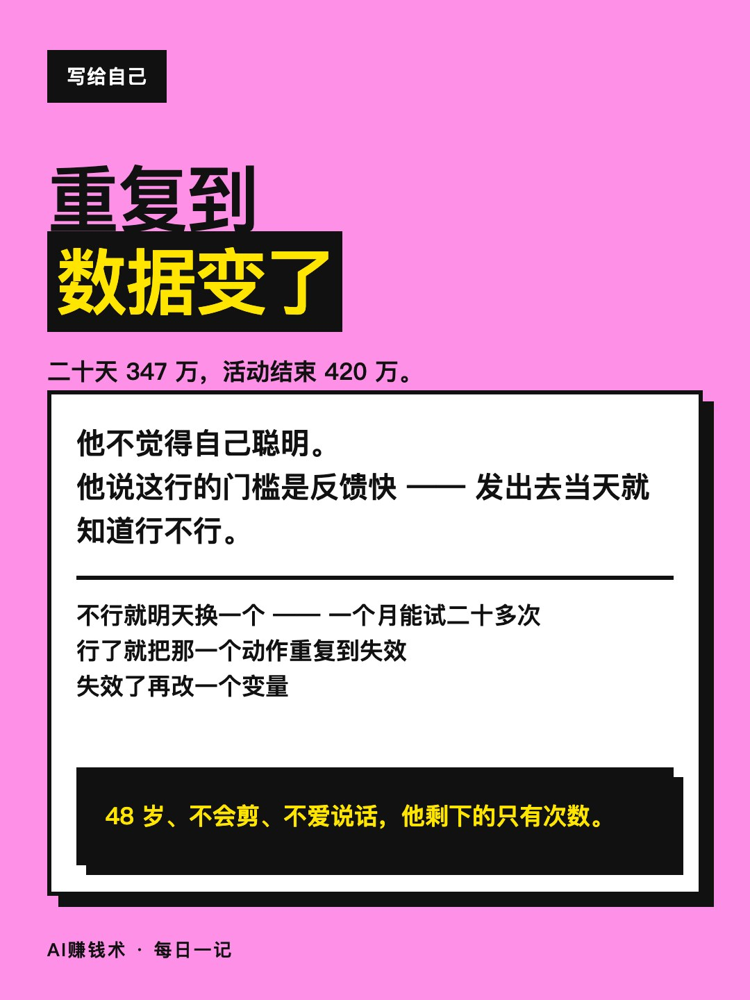

# 一分钱起步，一个月跑出420万流水

> — · 2026-10-30 20:19 发布 · AI 赚钱内容

## 标题（可直接复制）

```
一分钱起步，一个月跑出420万流水
```

## 正文（可直接复制发布）

他 48 岁，便利店被房东逼着关了门。

之前在机房做过几年网络维护，不爱说话，也不擅长跟人打交道。店没了以后，他在家待了一阵，不知道自己还能干什么。

五月底他跟着一个活动开始拍视频。第一天什么都不会，就把一个领券入口丢进家族群，嫂子顺手转到同事群。晚上后台跳出来 1 分钱——有人用他分享的入口点了份十几块的外卖。

他高兴了一整晚。这是他第一次从 0 到 1。

第三天下午，他照着对标账号一条一条对着剪，文案只改了几个字。下午三点发出去，晚上七十几块；到十二点，当天流水 7 万多，排在第 19 名。第二天直接冲到 35 万。

他自己总结，前面这一波吃的是信息差：不推任何商品，只教人怎么把大促的券领到最大。所有人都想省钱，这个内容就有人看。

但连着发几天同样的东西，数据断崖式往下掉，35 万掉到 8 万、5 万。他给了一个判断标准：同一种内容连发三天，播放开始往下走，就是该换的时候——不是内容变差了，是看的人已经学会了。

他发现大家的问题也变了：不再关心「怎么领」，而是关心「买什么最划算」。

于是内容从「教你领券」改成「教你买什么」。他挑自带搜索热度的高价单品，视频结构压成三句：先抛产品，再给领权益的步骤，最后把省下来的钱算成一条公式。

流量没第一波那么猛，但转化扎实，单条能跑到几万播放。

他还试过用老婆的号代发，一模一样的内容，一点流量都没有。不是号的问题，是前三秒太拖。把利益点和价格提到最前面，数据才回来。

标签他也摸出了排序：1 个大词、2 个精准词、2 个长尾词。长尾词放第一位，会被锁在小流量池里，账号起不来。

二十天，流水 347 万，在同期里排到最前面。活动结束，420 万。

他不觉得自己聪明。他说这行真正的门槛是反馈快：发出去当天就知道行不行，不行明天换一个，一个月能试二十多次。

他没学过剪辑，也没什么资源。做对的事只有一件：把一个动作重复到数据变了，再改下一个动作。

## 话题标签

#普通人搞钱 #副业 #信息差 #短视频 #电商

## 配图（10 张）












## 发布信息

| 项 | 值 |
|---|---|
| 平台 | 小红书 |
| 期数 | — |
| 发布时间 | 2026-10-30 20:19 |
| 正文长度 | 815 字 |
| 图片数量 | 10 张 |
| 状态 | 已发布 |
