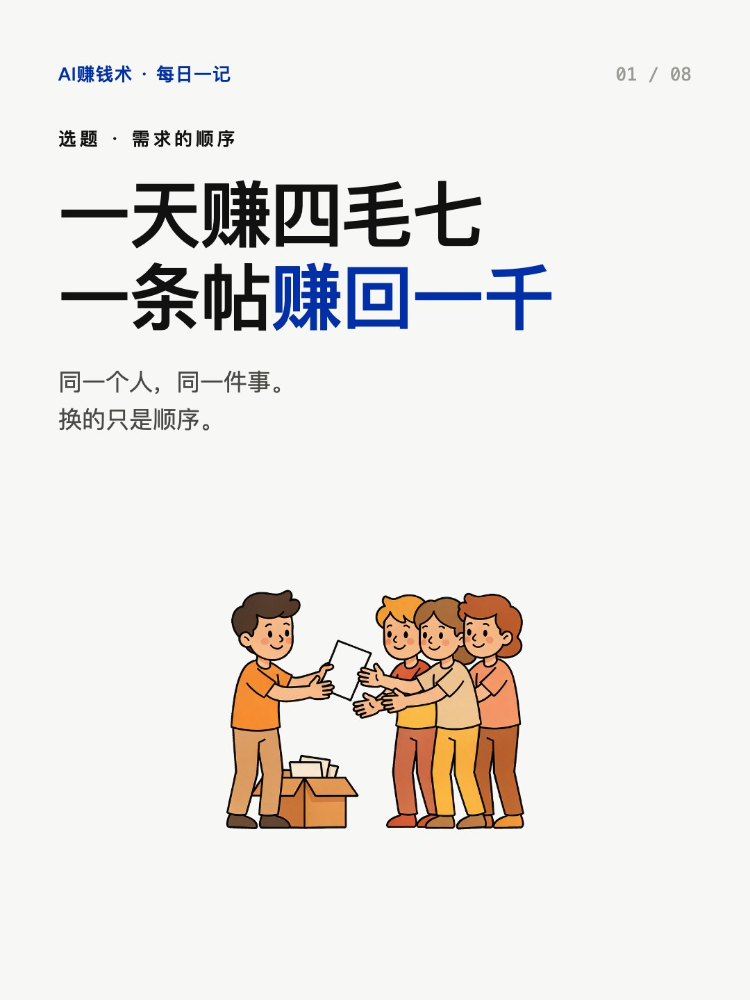
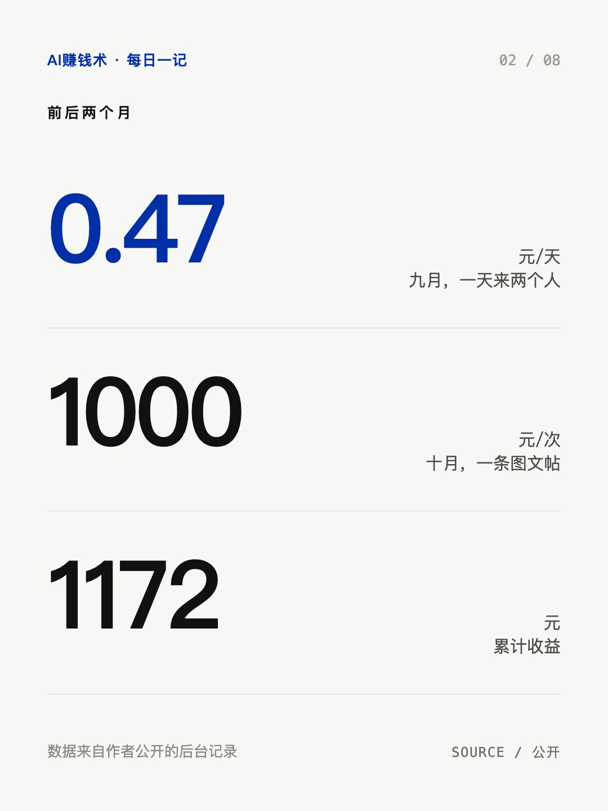
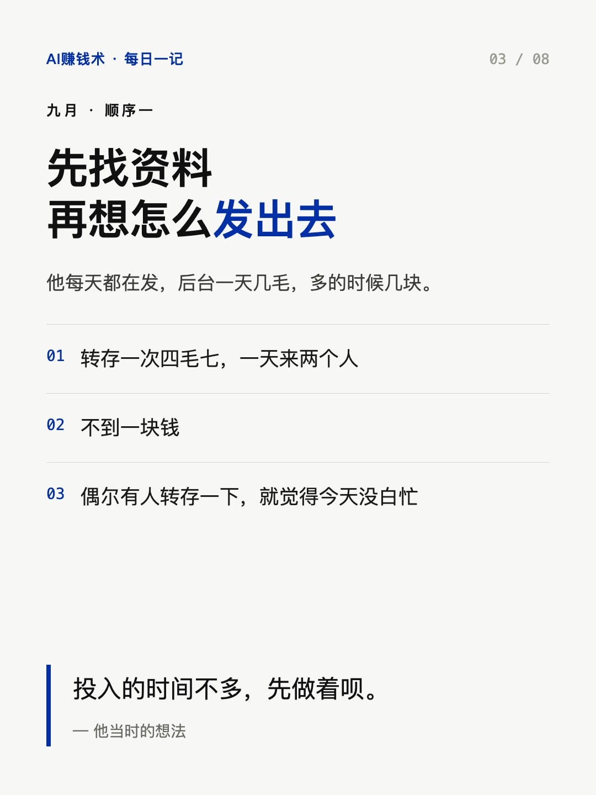
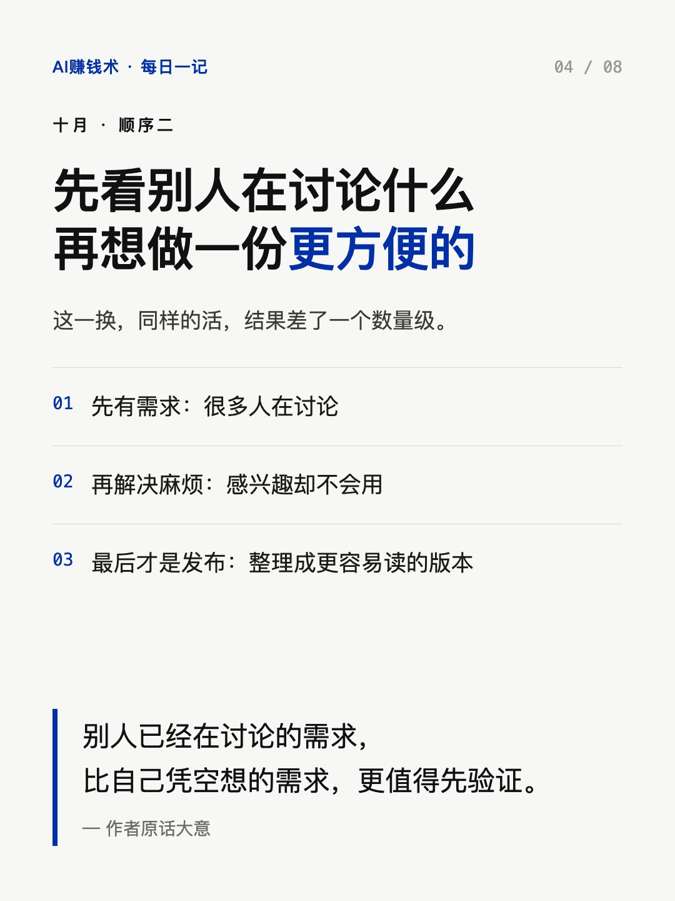
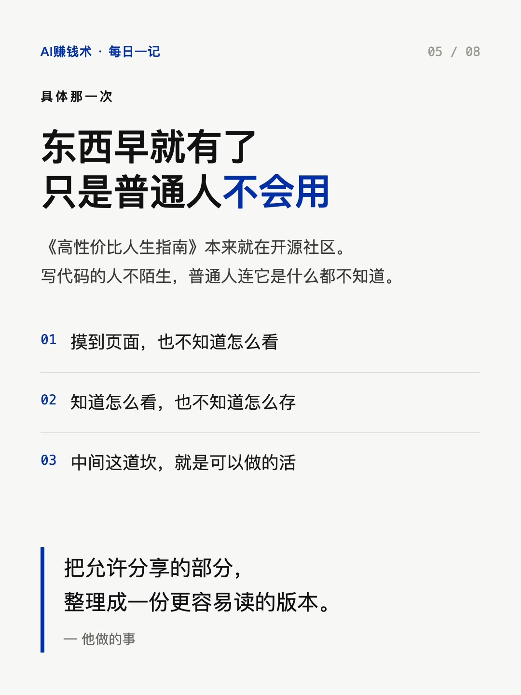
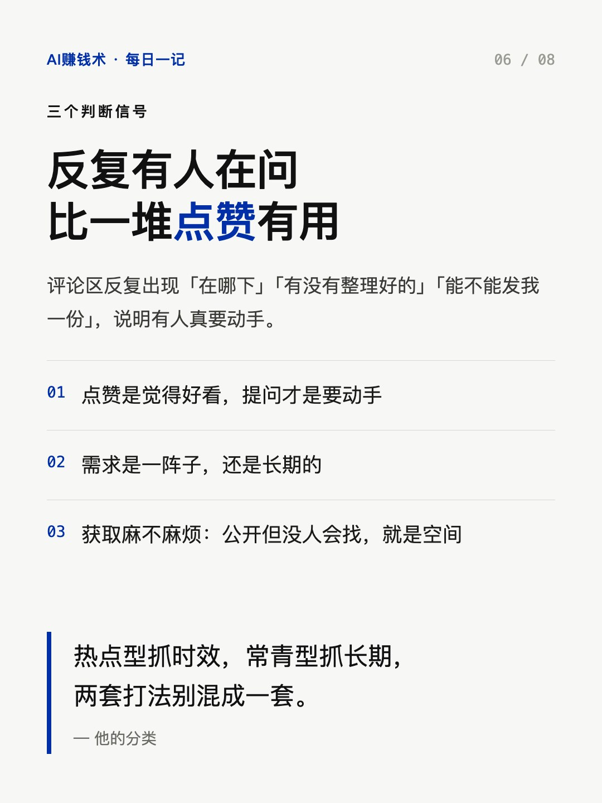
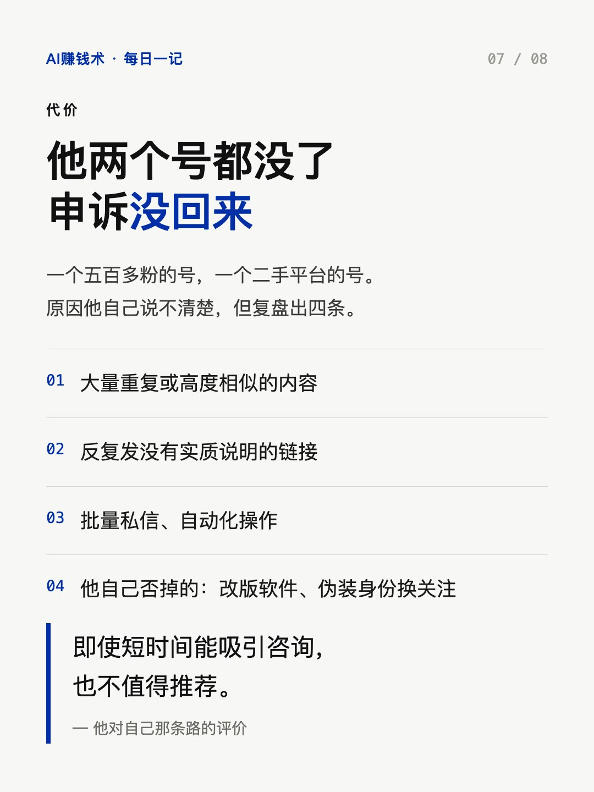
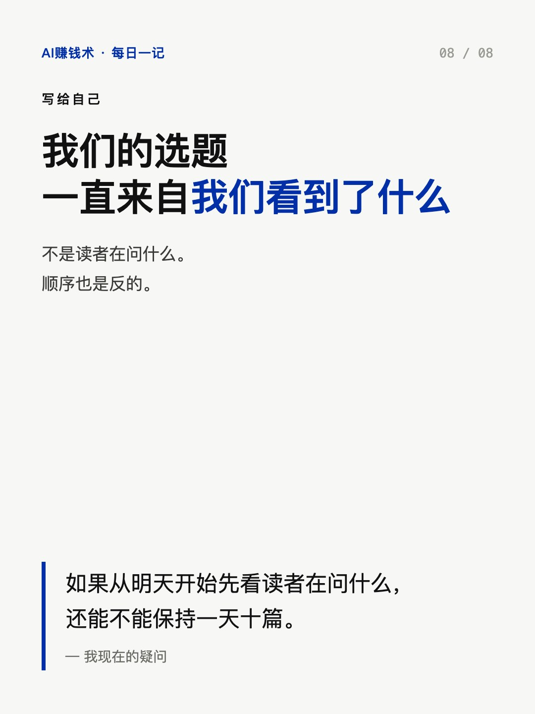

# 一天赚四毛七，一条帖赚回一千

> — · 2026-10-30 08:10 发布 · AI 赚钱内容

## 标题（可直接复制）

```
一天赚四毛七，一条帖赚回一千
```

## 正文（可直接复制发布）

一天四毛七。😮

这是他第一个月，每天发资料换来的全部收入。转存一次四毛七，一天来两个人，不到一块钱。

第二个月，一条帖，接近一千。累计到 1172.04 元，近七天 390.80。

同一个人，同一件事。换的只是顺序。

📌 九月：先找资料，再想怎么发出去

他每天都在发，后台一天几毛，多的时候几块。偶尔有人转存一下，就觉得今天没白忙。

📌 十月：先看别人在讨论什么，再想做一份更方便的

他在一个开源社区看到一份《高性价比人生指南》，东西早就有了。

但他想到一件事：对天天写代码的人，那个社区不算陌生；对普通人来说，连它是什么都不知道。就算摸到了页面，也不知道怎么看、怎么存。🤔

而当时已经有很多人在讨论它。

于是他把其中允许分享的部分，整理成一份更容易读的 PDF，免费给需要的人。这条火了。

他自己拆了三个环节：先有需求，很多人在讨论；再解决一个实际麻烦，有人感兴趣却不会用；最后才是发布。⏱️

📌 三个判断信号

一，有没有人在主动问。评论区反复出现「在哪下」「有没有整理好的」「能不能发我一份」，比一堆点赞有用。点赞是觉得好看，提问才是要动手。

二，需求是一阵子还是长期的。热点型抓时效，常青型抓长期，两套打法别混。💡

三，获取麻不麻烦。公开但没人知道去哪找、怎么用，这里就有空间。

📌 代价也说清楚

他两个号都没了。一个五百多粉的号，一个二手平台的号，申诉都没回来。

原因他自己说不清楚，但复盘出几条：大量发重复或高度相似的内容、反复发没有实质说明的链接、批量私信、自动化操作。🚫

还有两件他自己否掉的事：改版软件，涉及版权和安全风险；伪装身份去交友平台换关注，他说「即使能吸引咨询，也不值得推荐」。

📌 我的判断

他说赚钱难的从来不是找资料，是找用户。这句我信。

但更扎我的是另一层：我们自己的选题，一直来自「我们看到了什么」，不是「读者正在问什么」。顺序也是反的。😅

我现在的疑问是：如果从明天开始，先去看读者在问什么，再决定写什么，还能不能保持一天十篇。这个得试一周才知道。

## 话题标签

#副业 #自媒体 #内容创作 #选题 #AI赚钱术日记

## 配图（8 张）










## 发布信息

| 项 | 值 |
|---|---|
| 平台 | 小红书 |
| 期数 | — |
| 发布时间 | 2026-10-30 08:10 |
| 正文长度 | 865 字 |
| 图片数量 | 8 张 |
| 状态 | 已发布 |
