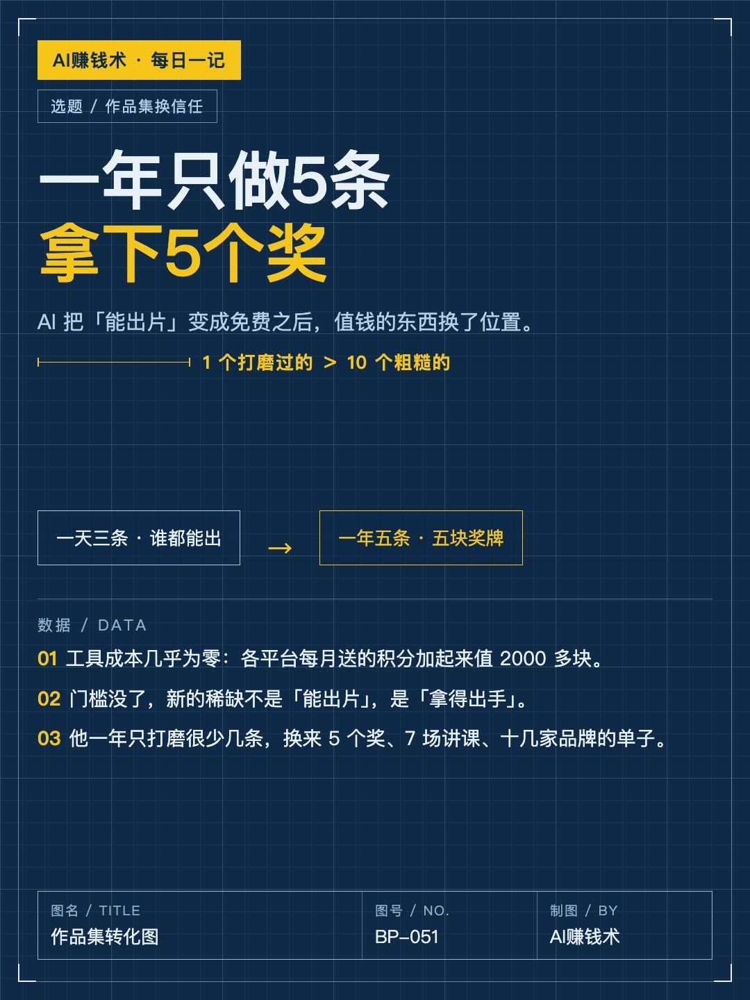
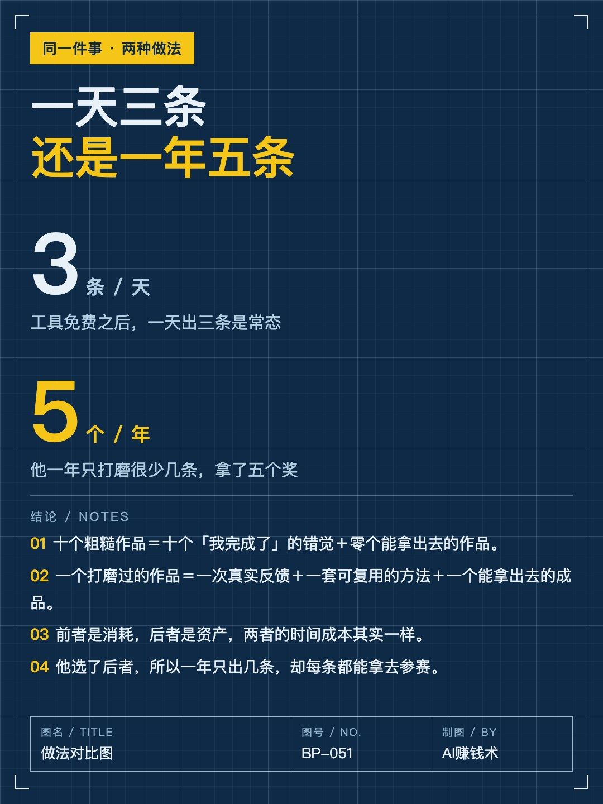
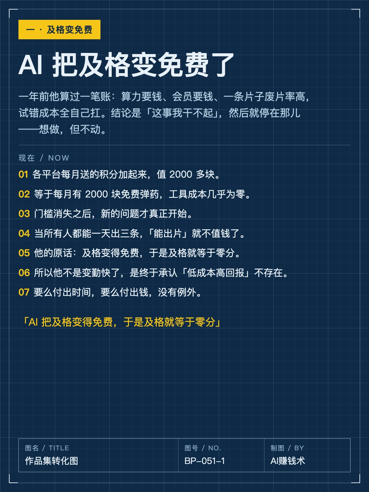
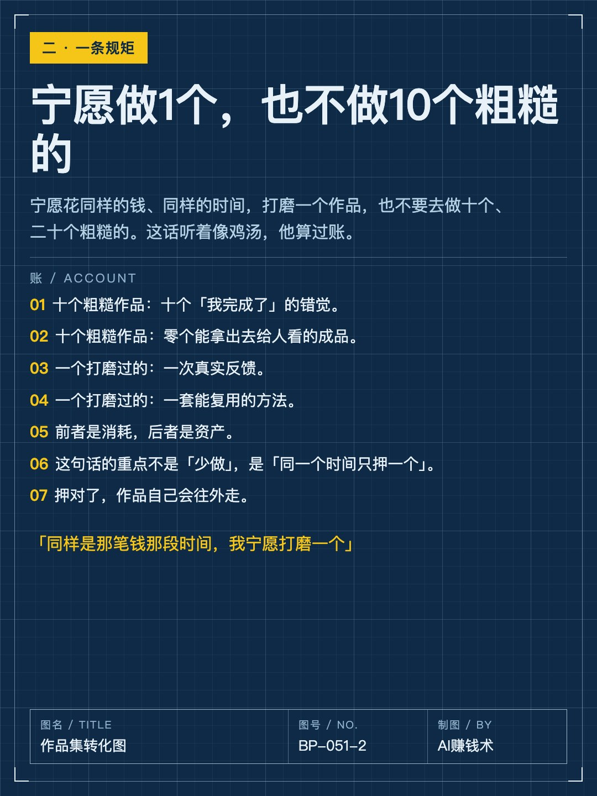
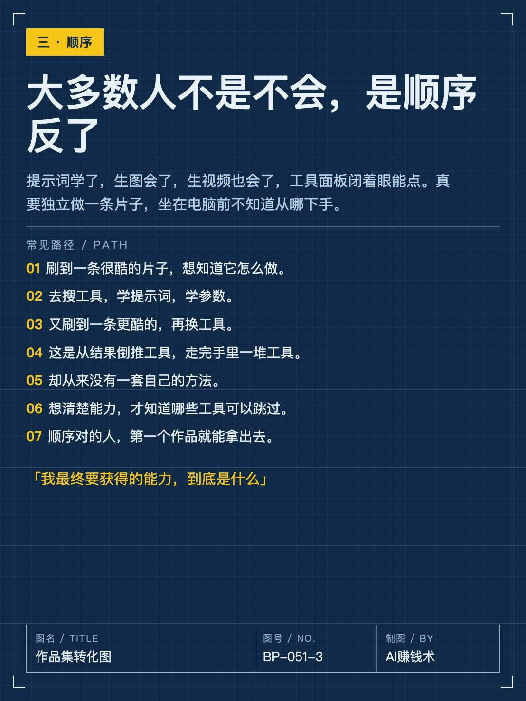
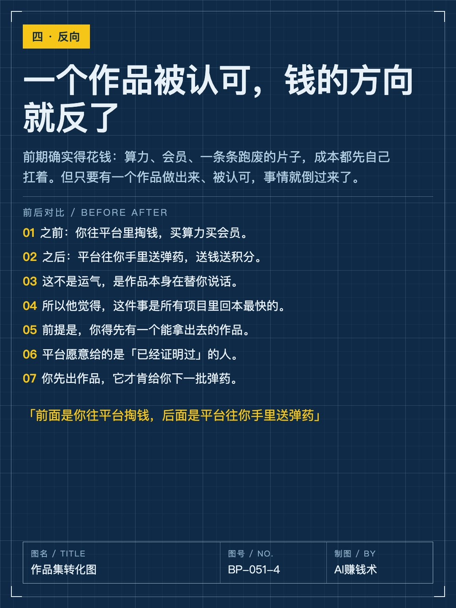
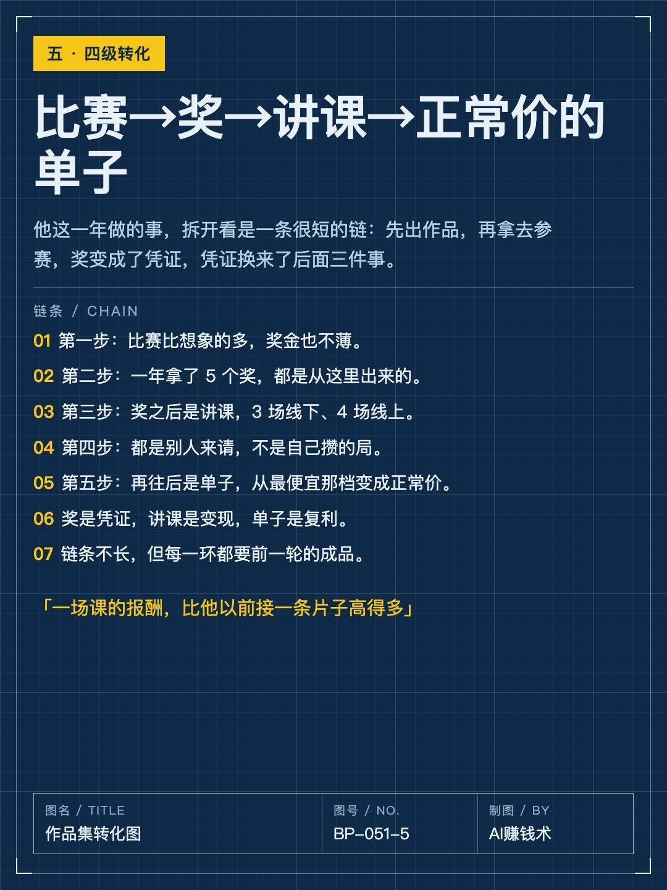
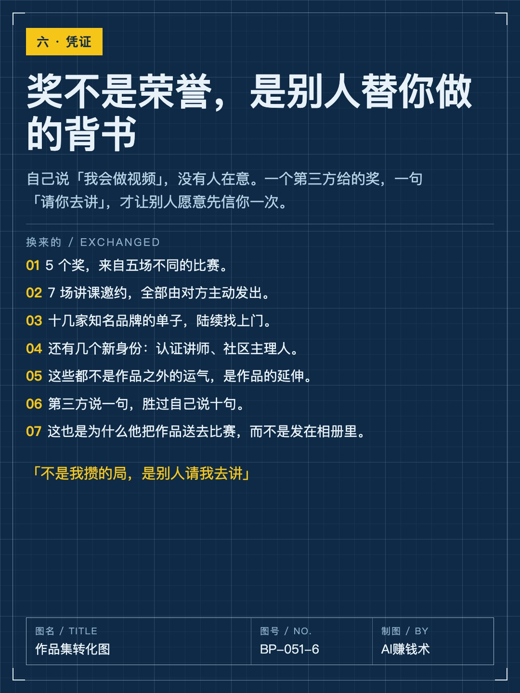
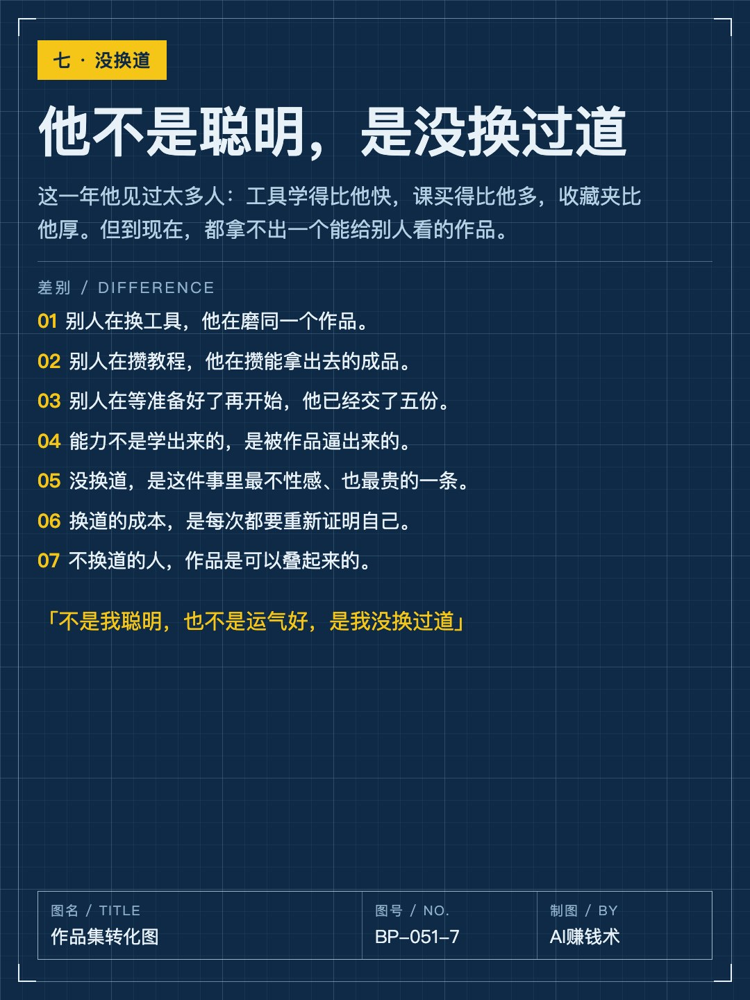
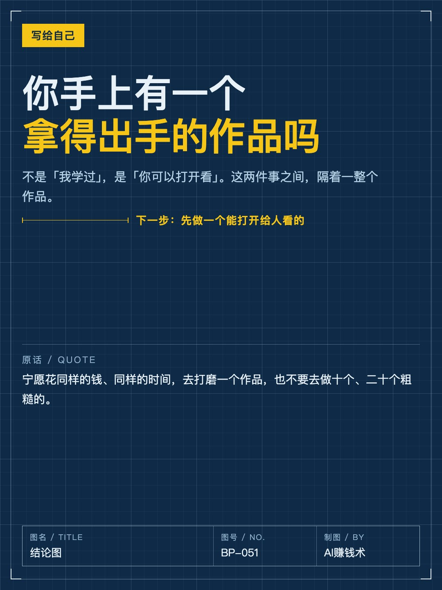

# 一年只做5条，拿下5个奖

> — · 2026-10-30 16:41 发布 · AI 赚钱内容

## 标题（可直接复制）

```
一年只做5条，拿下5个奖
```

## 正文（可直接复制发布）

去年八九月，他开始认真做 AI 视频。

一年后：5 个奖、7 场讲课邀约、十几家知名品牌的单子。

但他这一年，只打磨了很少几条片子。

📌 一、AI 把及格变免费了

现在做一条片子，工具成本几乎为零。各平台每月送的积分加起来值两千多块，等于每月有 2000 块免费弹药。

一年前他算过账：算力要钱、会员要钱、一条片子废片率高，试错成本全自己扛。他得出的结论是「这事我干不起」，然后就停在那儿了——想做，但不动。

现在门槛没了，新问题来了：当所有人都能一天出三条片子，「能出片」这件事就不值钱了。

他自己的话：AI 把及格变得免费，于是及格就等于零分。

📌 二、他给自己定了一条规矩

宁愿花同样的钱、同样的时间，打磨一个作品，也不要去做十个、二十个粗糙的。

这话听着像鸡汤，他算过账。

十个粗糙作品＝十个「我完成了」的错觉＋零个能拿出去的作品。

一个打磨过的作品＝一次真实反馈＋一套能复用的方法＋一个能拿出去的作品。

前者是消耗，后者是资产。

📌 三、大多数人卡在顺序上

提示词学了，生图会了，生视频也会了，工具面板闭着眼能点，真要独立做一条片子，坐在电脑前不知道从哪下手。

不是能力不够，是顺序错了。

常见路径：刷到一条很酷的片子 → 想知道怎么做 → 搜工具 → 学提示词 → 学参数 → 又刷到更酷的 → 换工具。

这是从结果倒推工具。走完，手里攒一堆工具，没有一套自己的方法。

因为他从没问过那个问题：我最终要获得的能力，到底是什么。

📌 四、作品会自己带来下一件事

只要有一个作品做出来、被认可，事情就反过来了：平台主动来找你，送钱送积分让你接着用。前面是你往平台掏钱，后面是平台往你手里送弹药。

比赛比想象的多，奖金也不薄。他这一年 5 个奖，都是从这些比赛里出来的。

奖之后是讲课——3 场线下、4 场线上，都是别人来请，不是自己攒的局。一场课的报酬，比他以前接一条片子高得多。

再往后是单子：从最便宜的那档，变成正常价。

📌 五、他没换过道

他说，见过太多人工具学得比他快、课买得比他多、收藏夹比他厚，但到现在拿不出一个能给别人看的作品。

不是聪明，也不是运气，是没换过道。

你呢？手上有一个能拿出去给人看的作品吗？

## 话题标签

#副业 #AI视频 #作品集 #自由职业 #AI赚钱术日记

## 配图（10 张）












## 发布信息

| 项 | 值 |
|---|---|
| 平台 | 小红书 |
| 期数 | — |
| 发布时间 | 2026-10-30 16:41 |
| 正文长度 | 942 字 |
| 图片数量 | 10 张 |
| 状态 | 已发布 |
