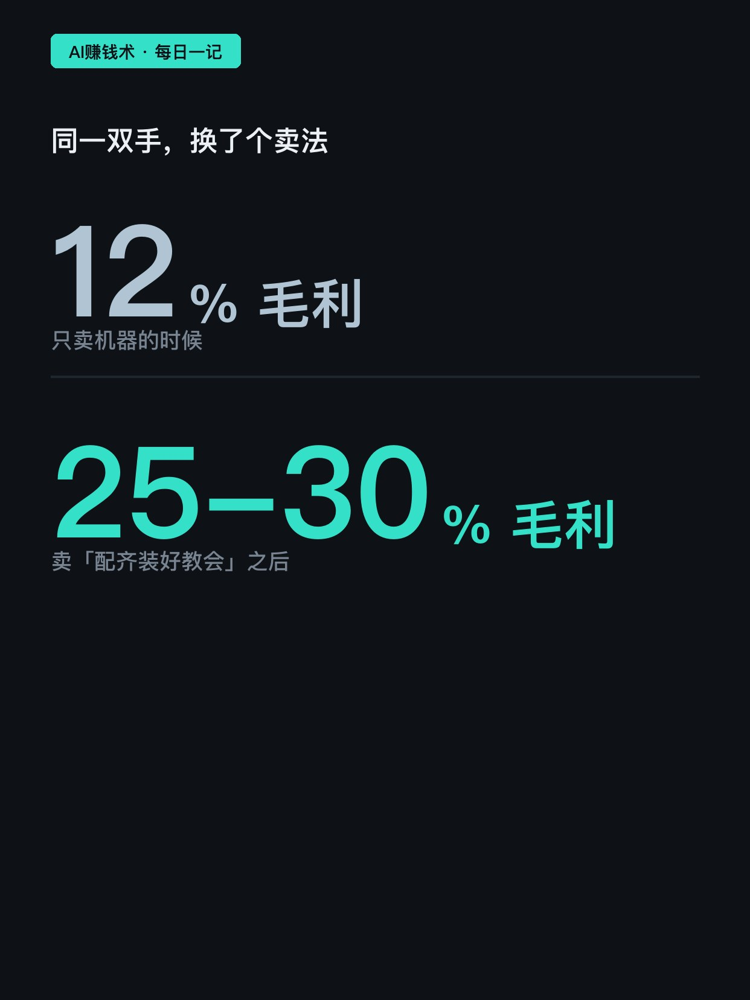
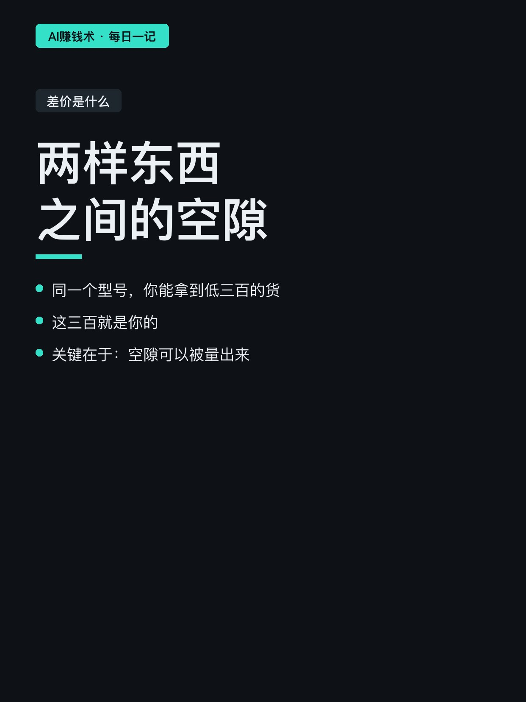
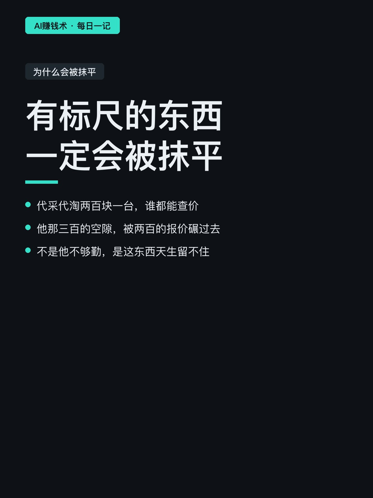
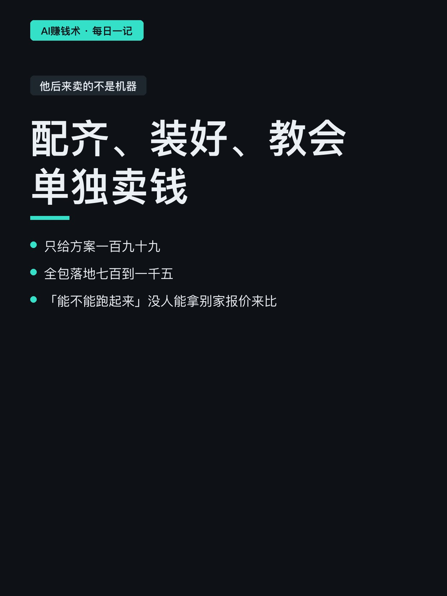
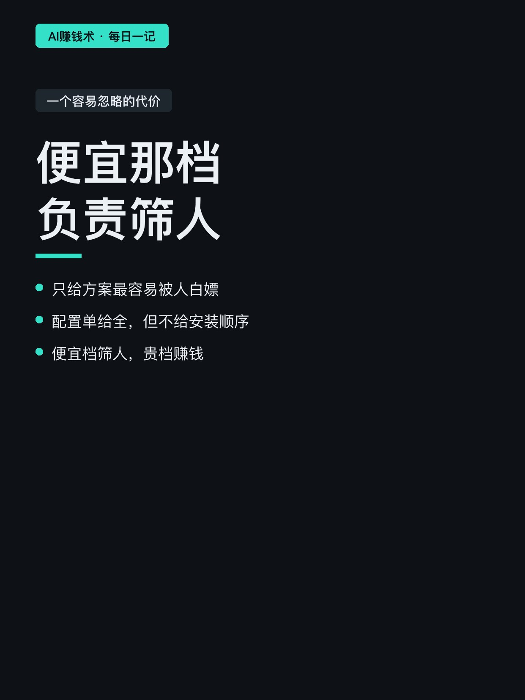
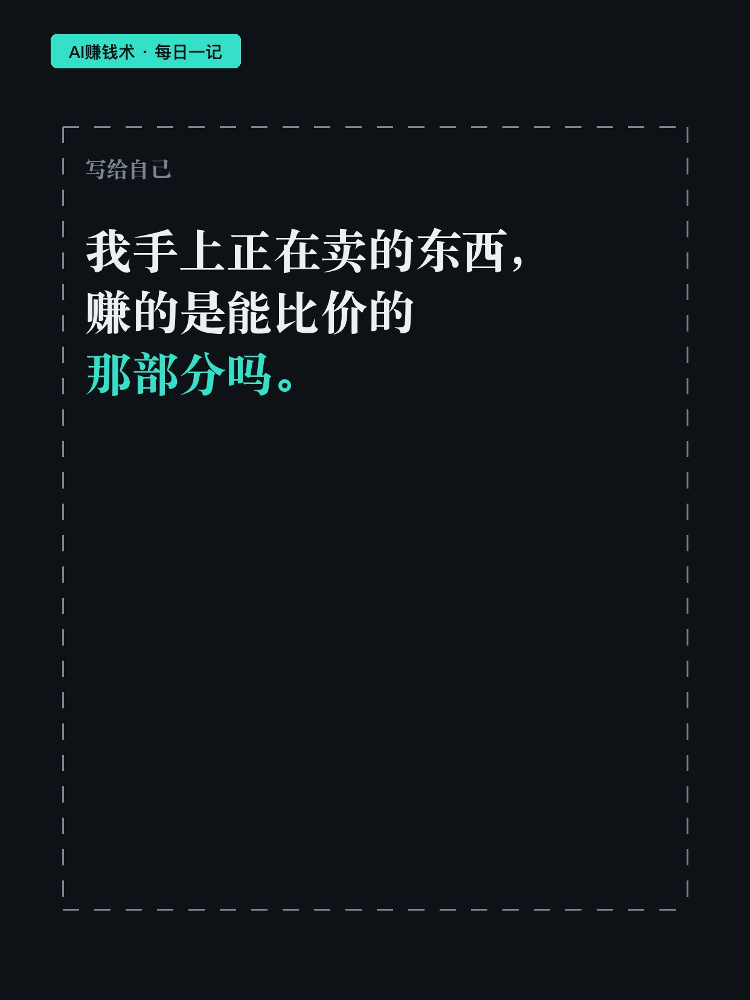

# 卖了8年手机，差价赚不动了

> — · 2026-10-30 12:04 发布 · AI 赚钱内容

## 标题（可直接复制）

```
卖了8年手机，差价赚不动了
```

## 正文（可直接复制发布）

他卖了八年二手手机，一台净利两百七到四百五，净利率九个点。😮

这个数字他认了八年，因为八年里它没怎么变过。

📌 九月的那个下午

一屋子用 AI 的人围着他问：该买哪台电脑。

他答不上来。

他熟的是「哪台便宜、哪台成色好」，他们要的是「这台跑不跑得动我那个模型」。同一台机器，两种问法，他手里只有前一种答案。🤔

📌 差价到底是什么

差价这门生意，本质是两样东西之间的空隙。

同一个型号，你能拿到比别人低三百的货，这三百就是你的。

关键在于：空隙可以被量出来。有标尺的东西，一定会被抹平。

现在市场里代采代淘两百块一台，谁都能查价，谁都敢压价。他那三百的空隙，被人用两百的报价直接碾过去。

📌 他后来卖的不是机器

他把「配齐、装好、教会」单独卖钱。

只给方案一百九十九；全包落地七百到一千五。

为什么这个能卖？因为「能不能跑起来」这件事，没人能拿另一家的报价来比。你说贵，他问你和谁比，你说不出。💡

毛利从一成二回到两成五到三成。同一双手，同一批客户，换了个卖法。

📌 差价没消失，是挪了位置

从「两台机器之间」的空隙，挪到「这台机器和你那件活之间」的空隙。

前一种有标尺，后一种没有。

海报上那条标尺，刻度到右边就断了。不是画漏了，是量不出来。

📌 一个容易忽略的代价

只给方案一百九十九，是最容易被白嫖的一档。

他的做法是把方案做成半成品：配置单给全，但不给安装顺序；讲清楚为什么这么配，但最后一公里要付钱才有人做。

便宜的那档负责筛人，贵的那档负责赚钱。⏱️

📌 我的判断

八年不是白干的。他守的那点信息差一直都在，只是从「哪儿能拿到便宜货」变成了「这台到底适不适合你」。

前者比价，后者没法比价。

比价的那部分，早晚会被算法和市场抹平；不能比价的那部分，才是能留下来的。

我现在想的是：我手上正在卖的东西，赚的是能比价的那部分，还是不能比价的那部分。这个得掰开算一遍。

## 话题标签

#副业 #自媒体 #商业思维 #定价 #AI赚钱术日记

## 配图（8 张）










## 发布信息

| 项 | 值 |
|---|---|
| 平台 | 小红书 |
| 期数 | — |
| 发布时间 | 2026-10-30 12:04 |
| 正文长度 | 814 字 |
| 图片数量 | 8 张 |
| 状态 | 已发布 |
