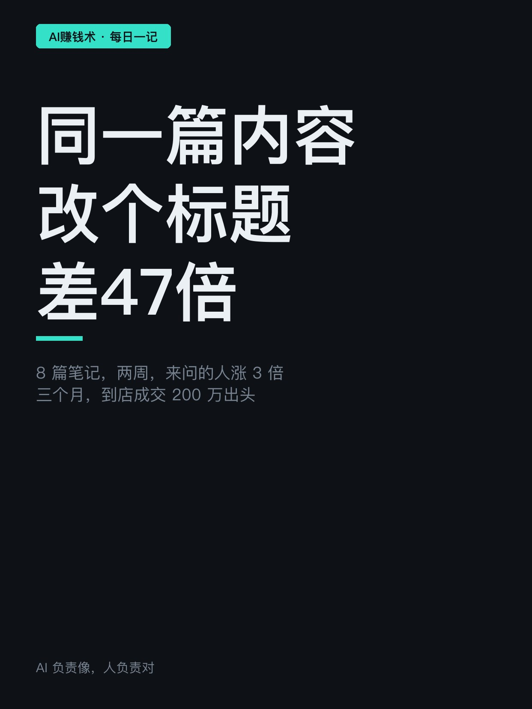
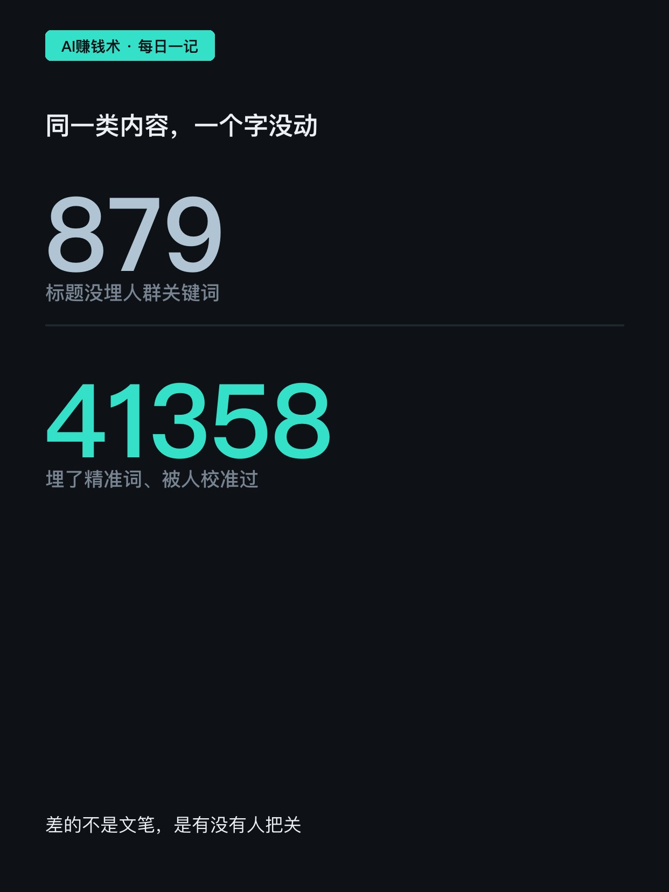
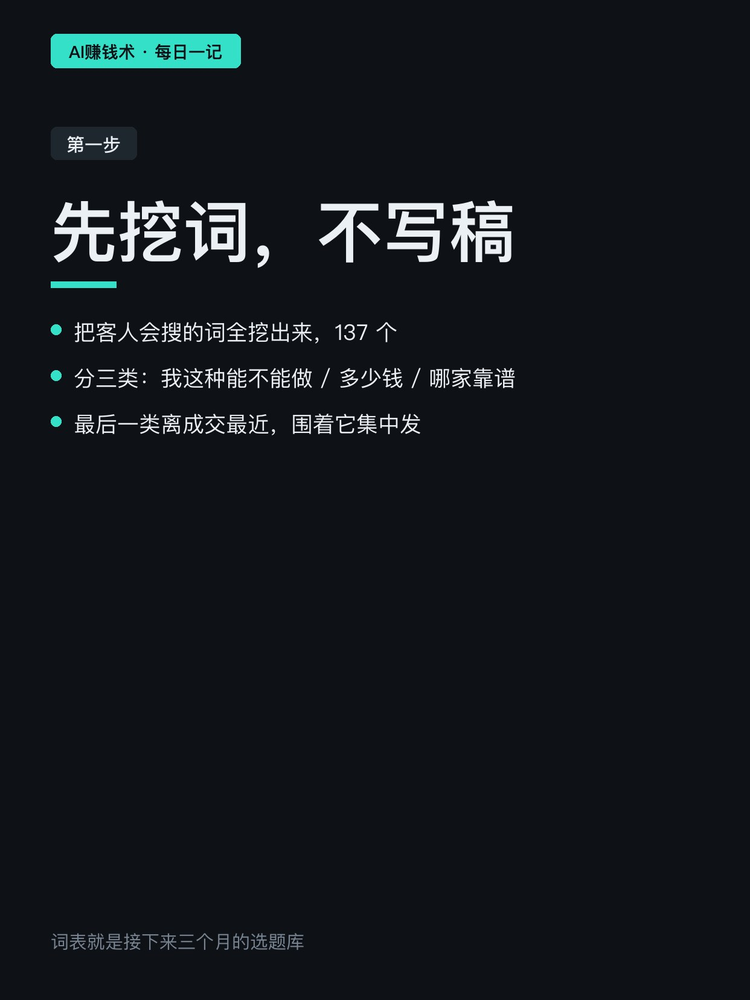
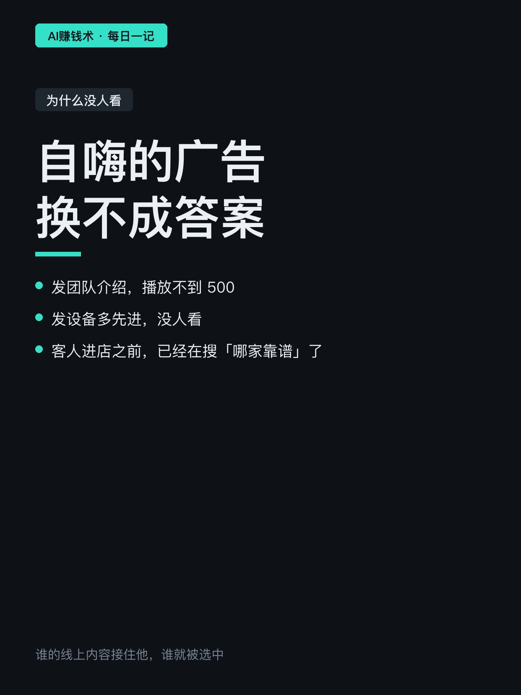
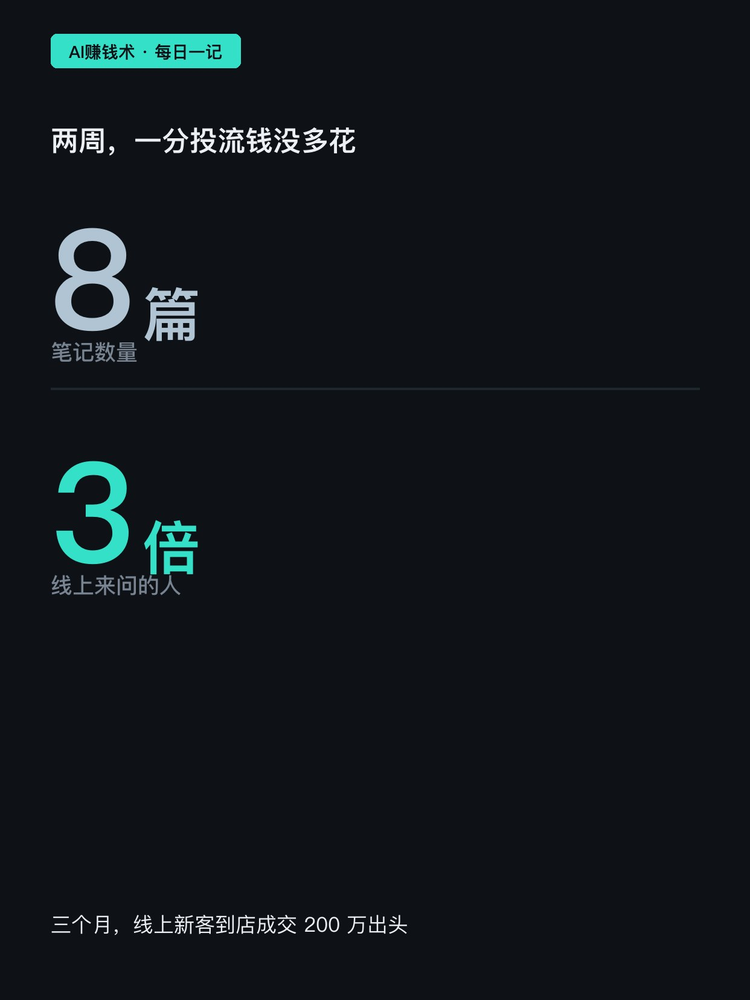
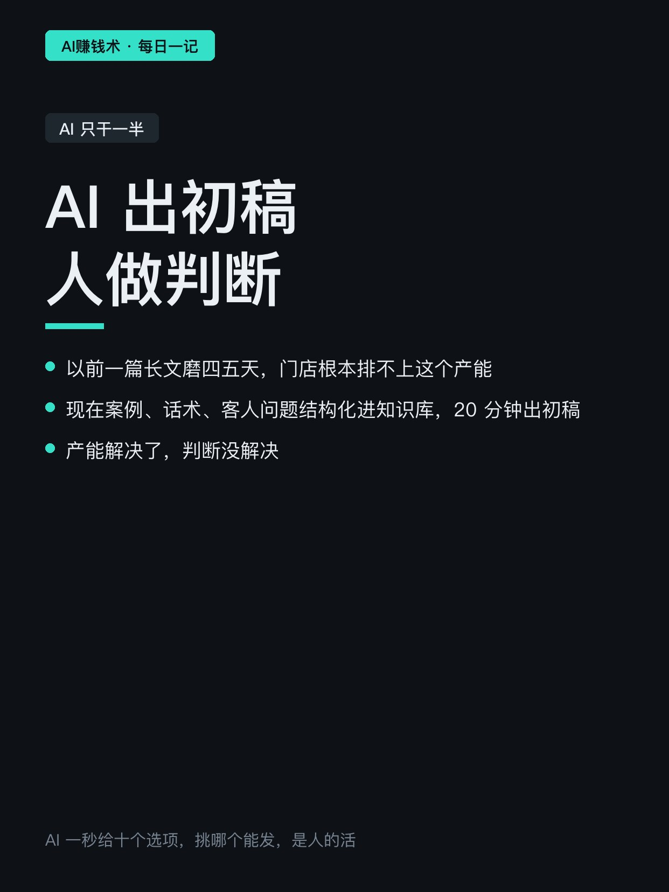
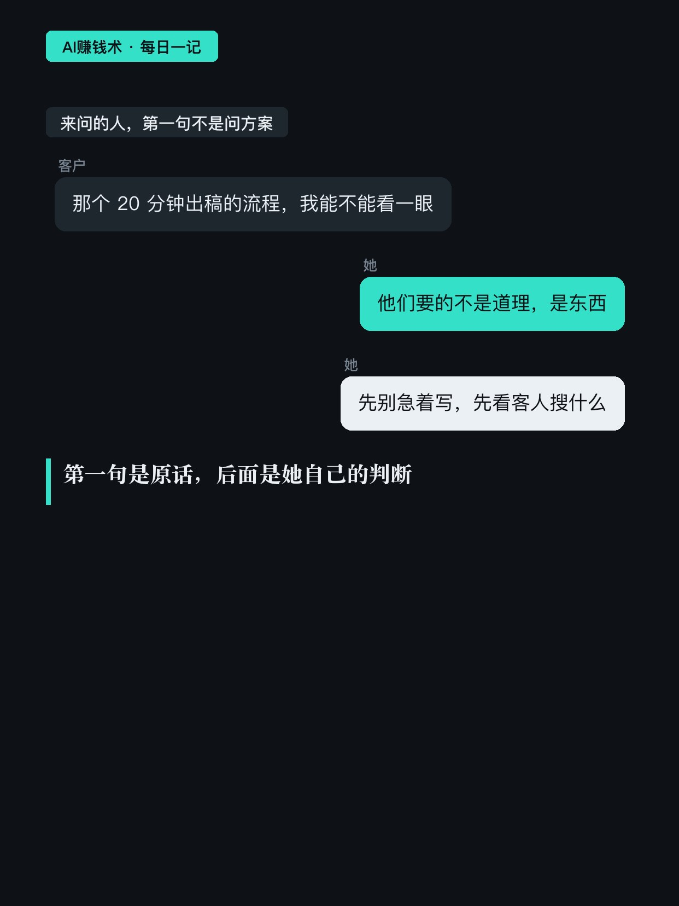
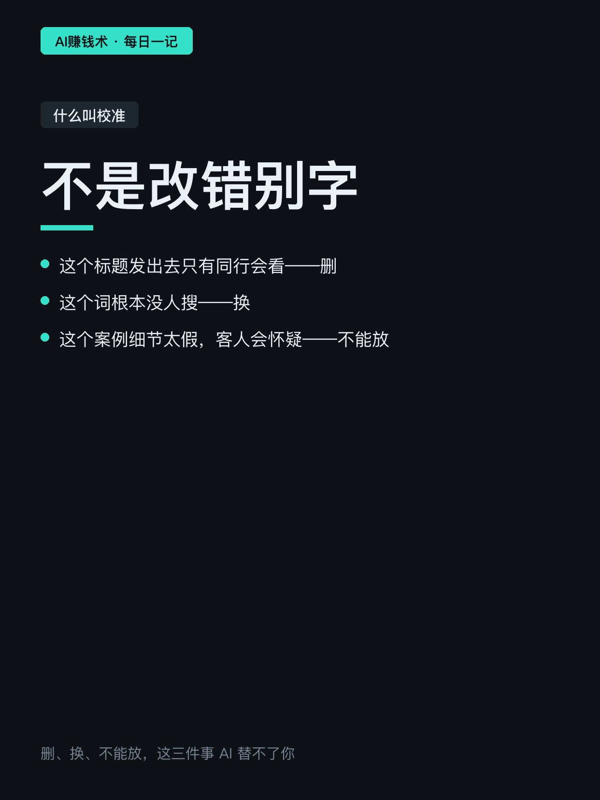
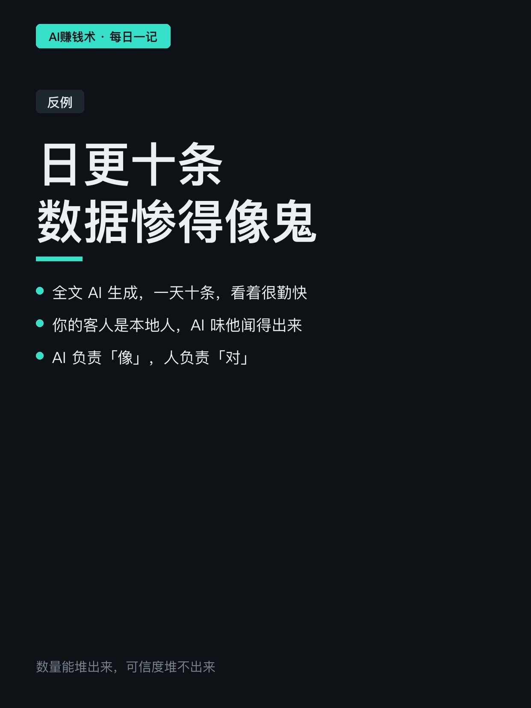
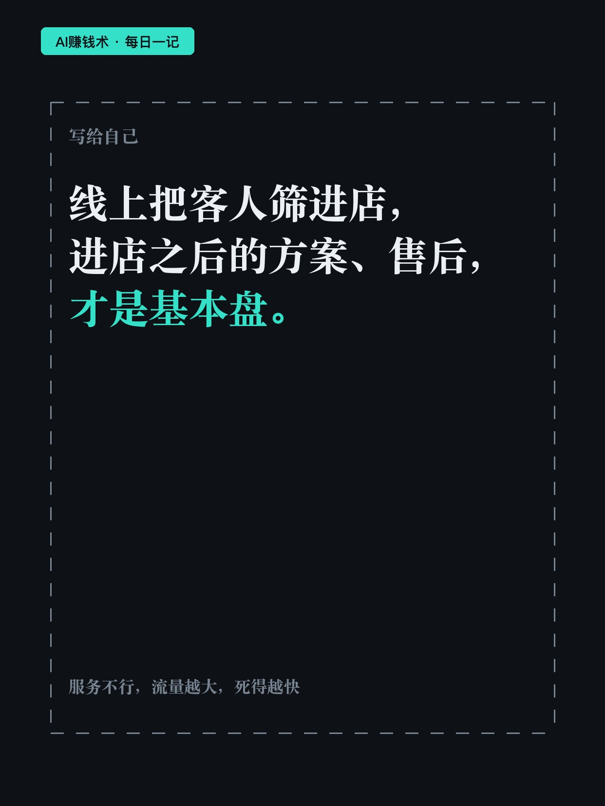

# 同一篇内容，改个标题，差47倍

> — · 2026-10-30 15:17 发布 · AI 赚钱内容

## 标题（可直接复制）

```
同一篇内容，改个标题，差47倍
```

## 正文（可直接复制发布）

做内容这件事，最贵的从来不是写，是判断。

她帮一家本地门店做内容：8 篇笔记，两周，线上来问的人涨了 3 倍，一分投流钱没多花。三个月，线上来的新客到店成交 200 万出头。

变的只有一件事——把自嗨的广告，换成客人正在搜的答案。

一、进场第一件事不是写稿，是挖词

把客人会搜的词全挖出来，137 个，分三类：
「我这种能不能做」是症状词；
「多少钱」是价格词；
「哪家靠谱」是决策词——离成交最近。

然后围着高搜索、低竞争的词，集中发。

在这之前，他们发团队介绍，播放不到 500；发设备多先进，没人看。不是内容不好，是发错了地方——客人进店之前，早就搜完、比完价了。谁的线上内容接住他，谁就被选中。

二、AI 只能干一半

同样一类内容，标题没埋人群关键词，阅读 879。埋了精准词、被她校准过之后发，阅读 41358。差 47 倍，内容一个字没动。

校准不是改错别字：
这个标题发出去只有同行会看——删；
这个词根本没人搜——换；
这个案例细节太假，客人会怀疑——不能放。

AI 一秒给你十个选项，判断哪个能发，是人的活。

以前一篇长文磨四五天，门店根本排不上这个产能。现在把案例、话术、客人问题结构化进知识库，AI 20 分钟出初稿。产能解决了，判断没解决。

三、反例就在身边

全文 AI 生成，日更十条，数据惨得像鬼。你的客人是本地人，AI 味他闻得出来。

AI 负责「像」，人负责「对」。

最后一句实话：线上把客人筛进店，进店之后的方案、售后，才是基本盘。服务不行，流量越大，死得越快。

## 话题标签

#AI做内容 #AI工具 #内容获客 #副业 #搞钱思路

## 配图（10 张）












## 发布信息

| 项 | 值 |
|---|---|
| 平台 | 小红书 |
| 期数 | — |
| 发布时间 | 2026-10-30 15:17 |
| 正文长度 | 663 字 |
| 图片数量 | 10 张 |
| 状态 | 已发布 |
