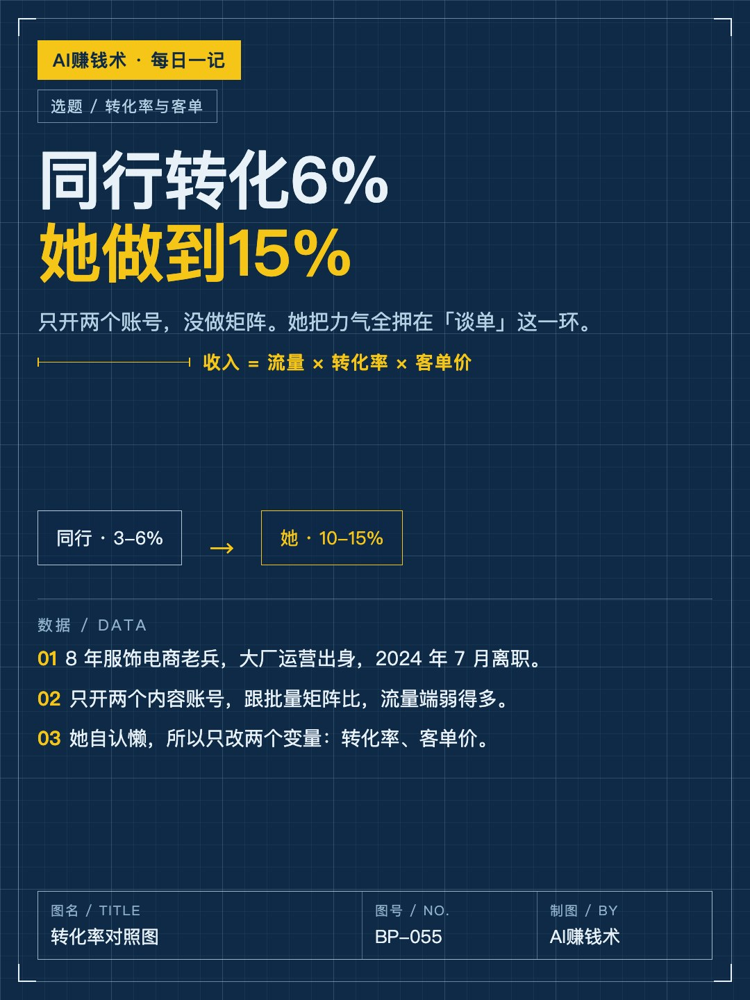
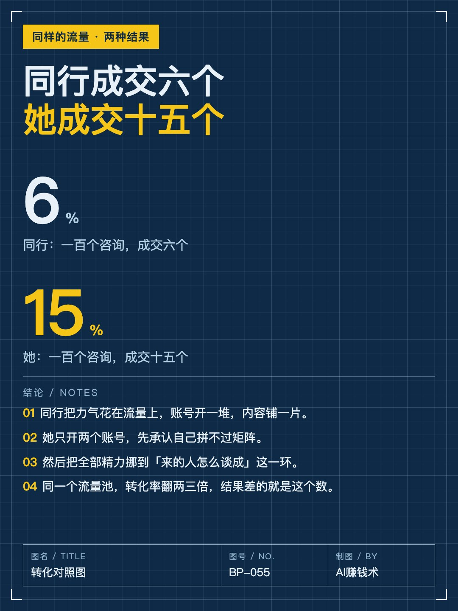
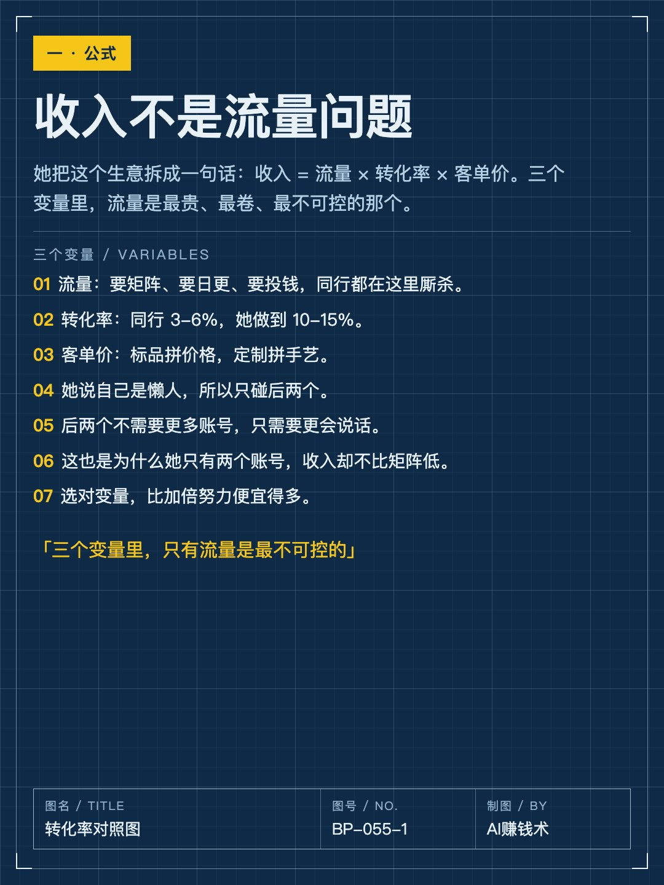
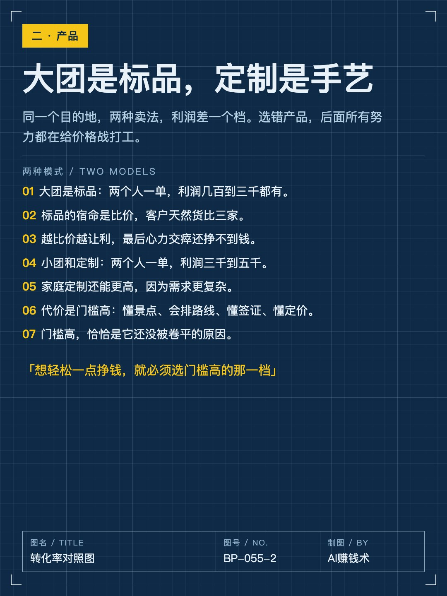
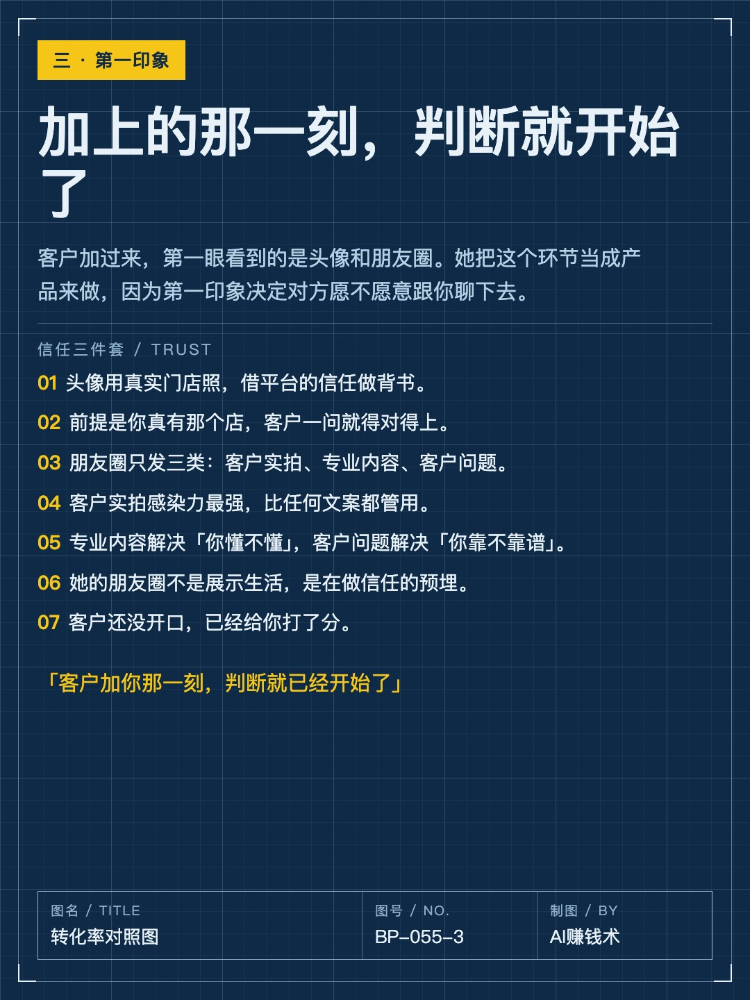
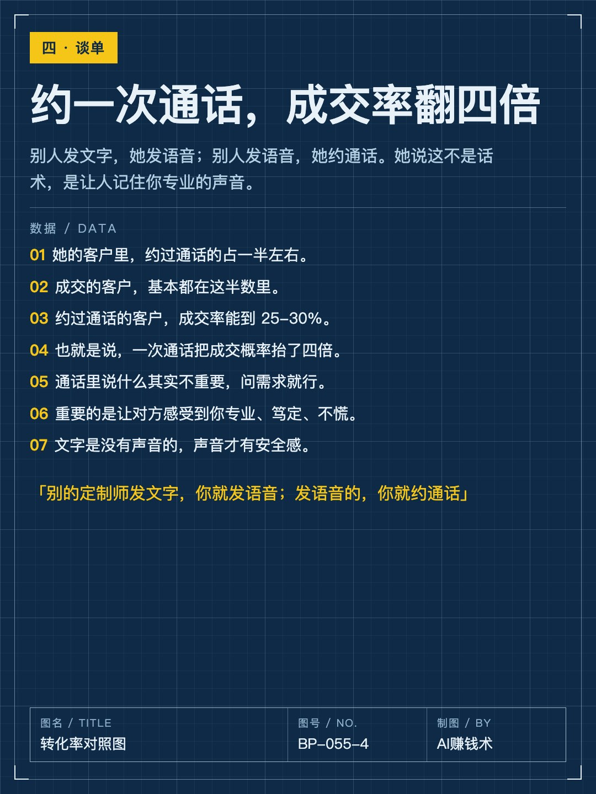
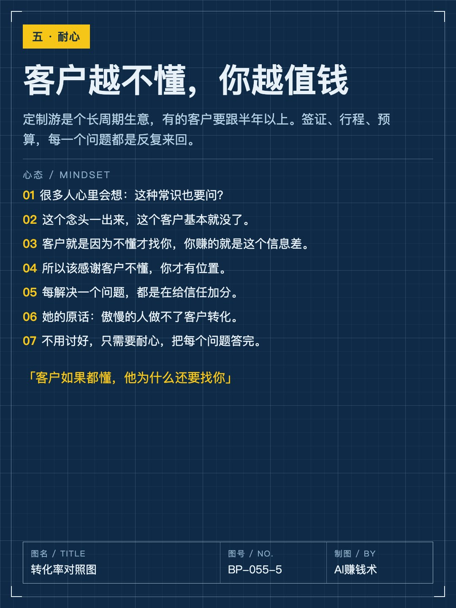
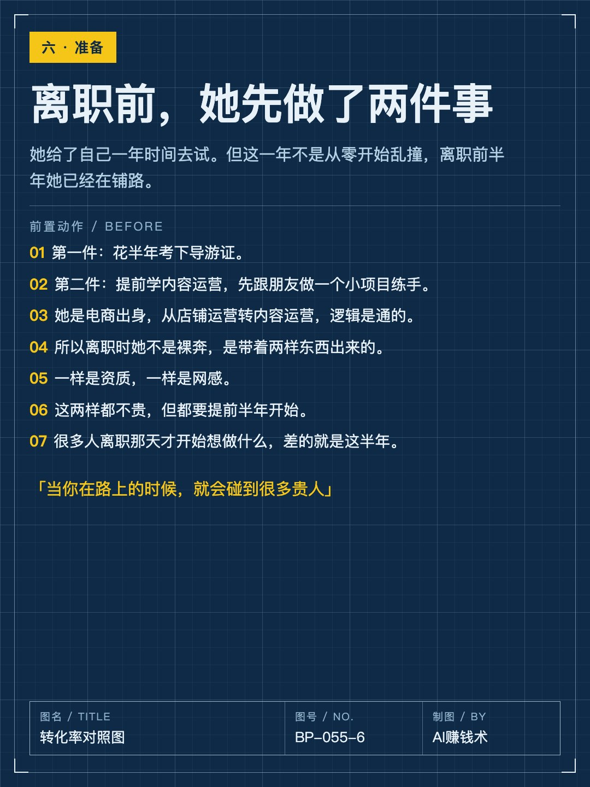
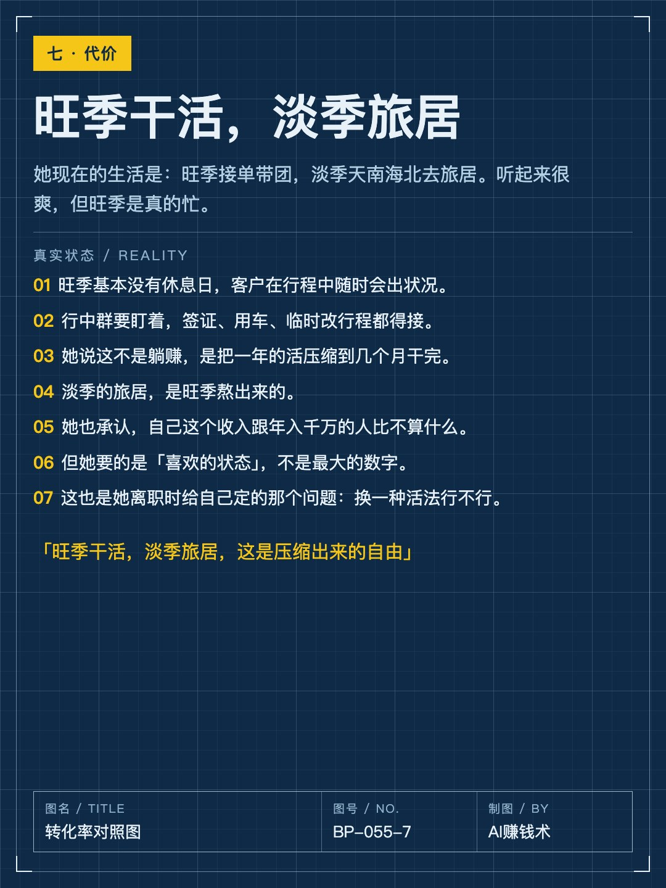
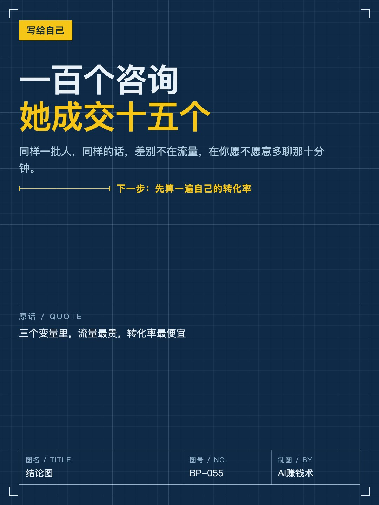

# 同行转化6%，她做到15%

> — · 2026-10-30 21:26 发布 · AI 赚钱内容

## 标题（可直接复制）

```
同行转化6%，她做到15%
```

## 正文（可直接复制发布）

2024 年 7 月，她离职了。

8 年服饰电商，在大厂带过品牌团队。走的时候她给自己定了一年：试试换一种活法行不行。

现在她做欧洲定制游。只开两个内容账号，跟那些批量矩阵的同行比，流量端弱得多。

但她的转化率是 10-15%。同行普遍 3-6%。

一、她只改了两个变量

她把这个生意拆成一句话：收入 = 流量 × 转化率 × 客单价。

三个变量里，流量最贵、最卷、最不可控。要矩阵、要日更、要投钱，同行全挤在这厮杀。

她说自己是懒人，所以只碰后两个：转化率、客单价。

后两个不需要更多账号，只需要更会说话。

二、先选对产品，再谈技巧

同一个目的地，两种卖法。

大团是标品：两个人一单，利润几百到三千都有。标品的宿命是比价，客户货比三家，越比越让利，最后心力交瘁还挣不到钱。

小团和定制：两个人一单，利润三千到五千，家庭定制更高。

代价是门槛：懂景点、会排路线、懂签证、懂定价、懂需求落地。

门槛高，恰恰是它还没被卷平的原因。

三、第一印象在加上那一刻就开始了

客户加过来，第一眼看到头像和朋友圈。她把这当成产品做。

头像用真实门店照，借平台信任做背书——前提是你真有那个店，客户一问就对得上。

朋友圈只发三类：客户实拍、专业内容、客户问题。

客户实拍感染力最强；专业内容回答「你懂不懂」；客户问题回答「你靠不靠谱」。

四、一次通话，把成交率抬四倍

别人发文字，她发语音；别人发语音，她约通话。

数据很直白：她约通话的比例在 50% 左右，成交的客户基本都在这半数里。约过通话的客户，成交率能到 25-30%。

通话里说什么其实不重要，问需求就行——现在怎么规划、有什么期待、预算大概多少。重要的是让对方感受到你专业、笃定、不慌。

文字是没有声音的，声音才有安全感。

五、客户越不懂，你越值钱

定制游是长周期生意，有的客户要跟半年以上。签证、行程、预算，反复来回。

很多人心里会冒出那句：这常识也要问？

这个念头一出来，客户基本就没了。客户就是因为不懂才找你，你赚的就是这个信息差。

她的原话：傲慢的人做不了客户转化。不用讨好，只需要耐心，把每个问题答完。

最后一句实话：她旺季基本没有休息日，客户在行程中随时会出状况。淡季的旅居，是旺季熬出来的。

## 话题标签

#副业 #搞钱思路 #自由职业 #个人成长 #成交

## 配图（10 张）












## 发布信息

| 项 | 值 |
|---|---|
| 平台 | 小红书 |
| 期数 | — |
| 发布时间 | 2026-10-30 21:26 |
| 正文长度 | 954 字 |
| 图片数量 | 10 张 |
| 状态 | 已发布 |
