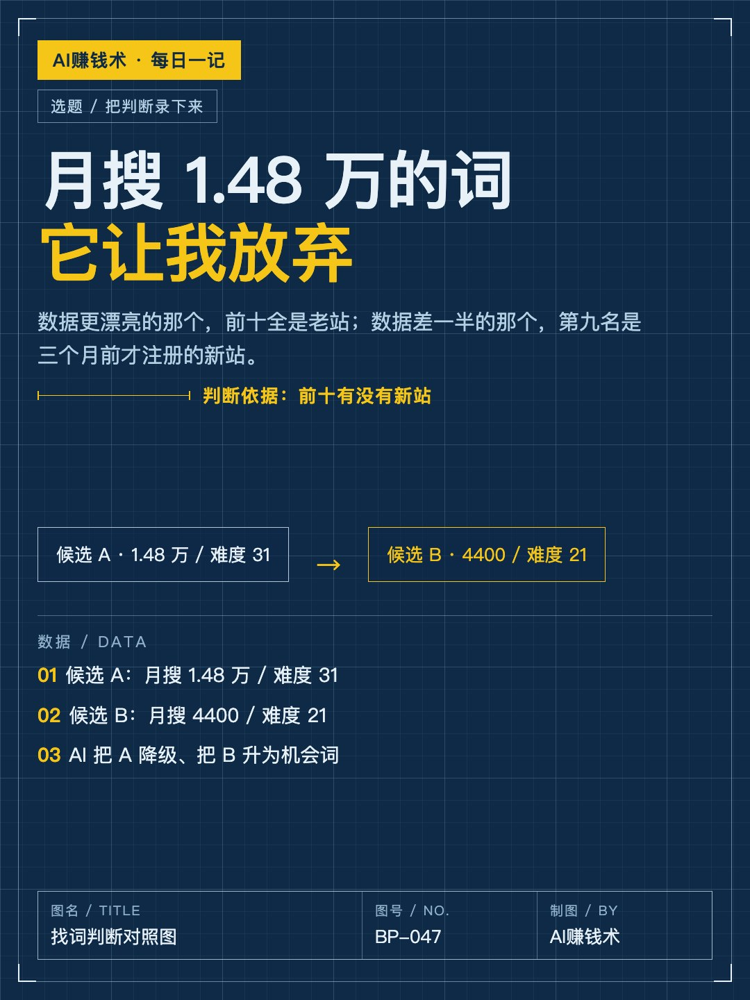
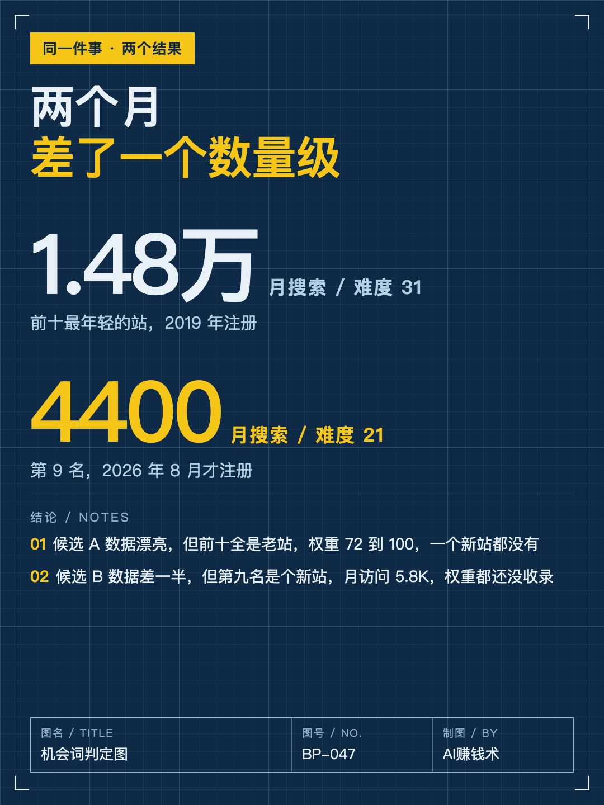
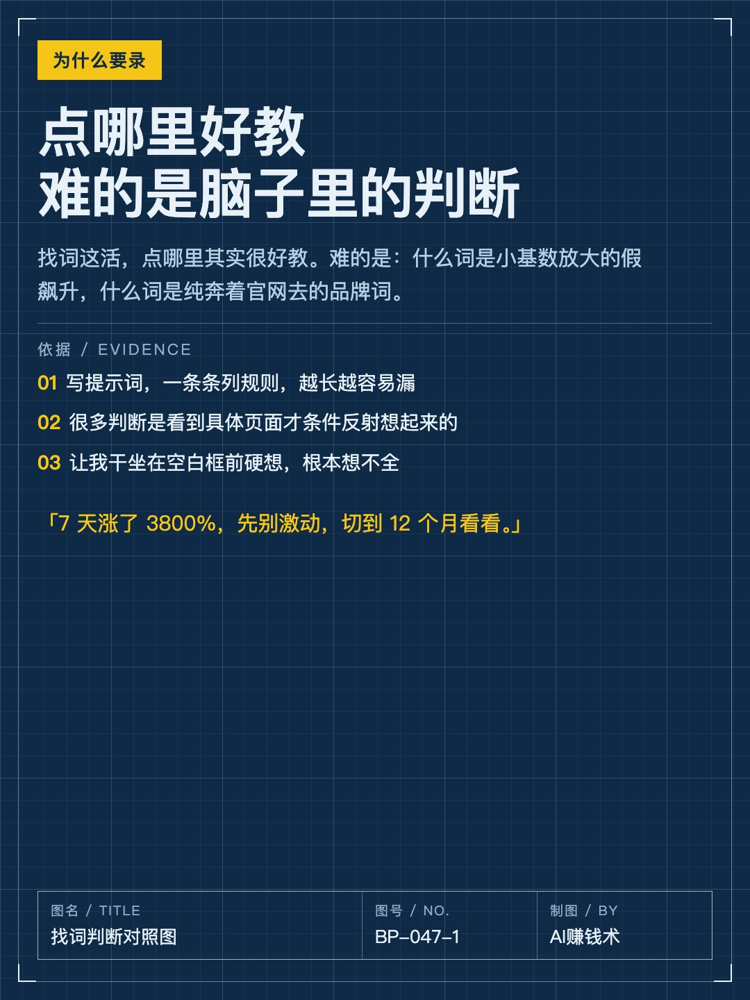
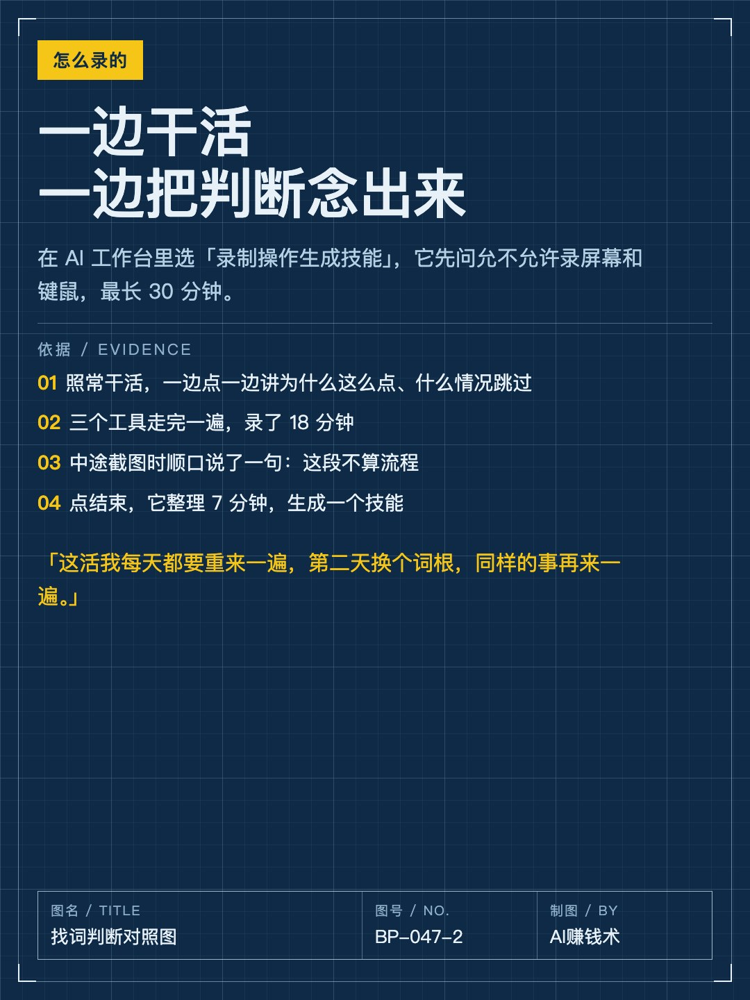
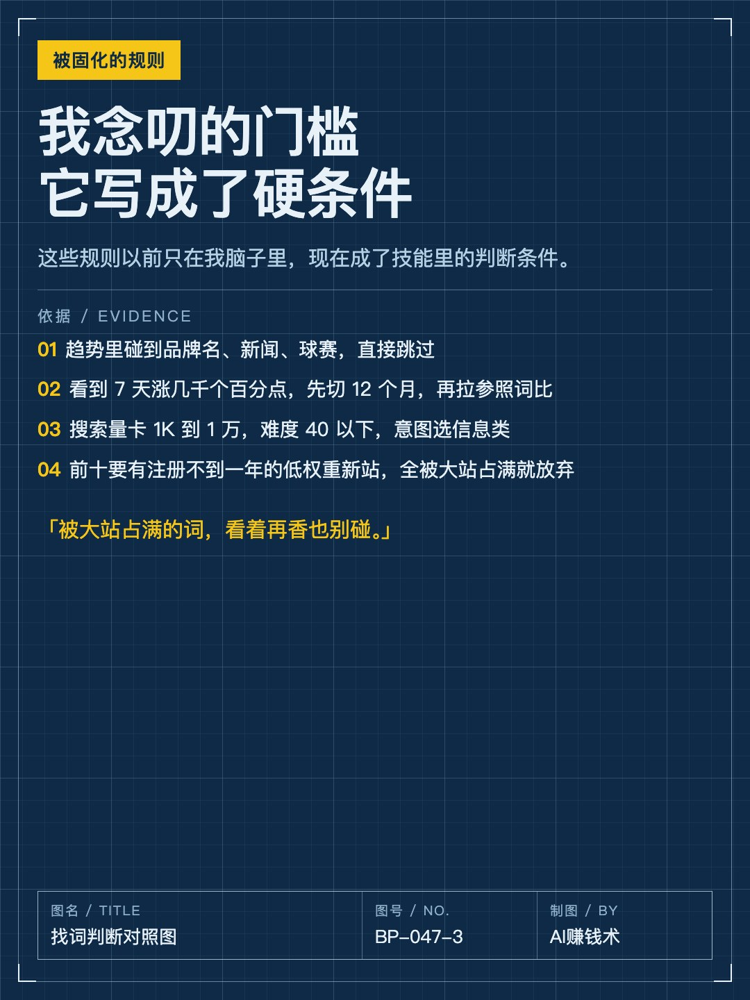
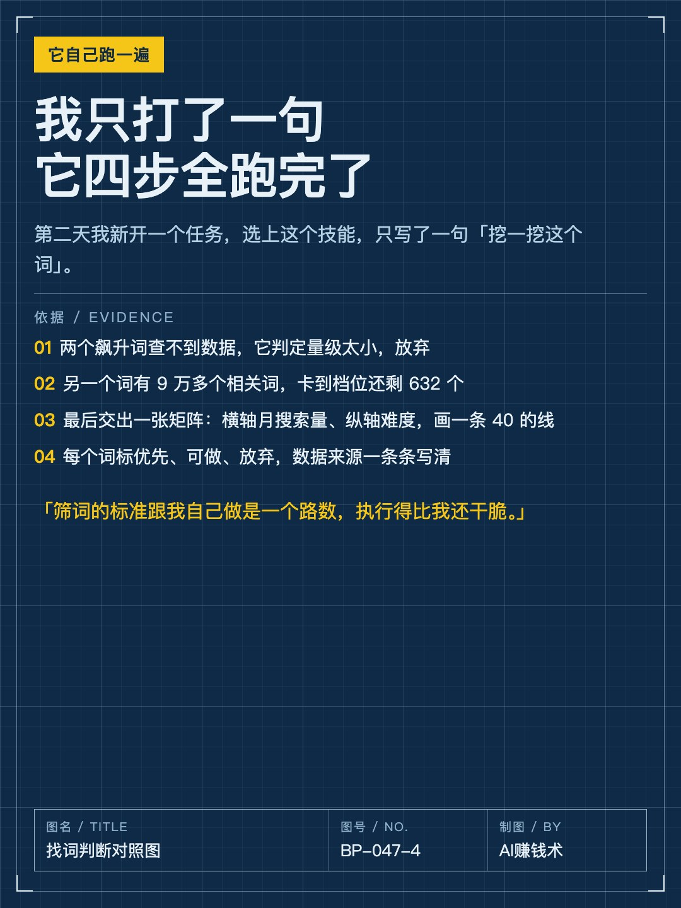
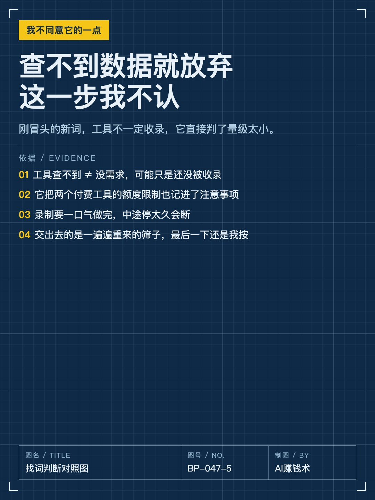

# 月搜1.48万的词，被它放弃

> 第47期 · 2026-10-30 09:23 发布 · AI 赚钱内容

## 标题（可直接复制）

```
月搜1.48万的词，被它放弃
```

## 正文（可直接复制发布）

昨天我把一件每天都要重做一遍的活，交给 AI 自己跑。😳

两个候选词：一个美国月搜 1.48 万、难度 31，另一个月搜 4400、难度 21。它把前者降级，后者标成机会词。

前者前十全是老站，最年轻的也是 2019 年注册，权重 72 到 100；后者第九名是 2026 年 8 月才注册的站，月访问 5.8K，权重还没收录。

数据更漂亮的那个，反而是坑。😅

📌 但这判断不是它想的，是它听我念的

我做的是出海工具站，目标明年 5 月前一个月 2000 美元，到了就辞职。白天上班，只有周末和工作日晚上，上午基本都花在找词上，第二天换词根再来。

点哪里好教，难的是判断：什么词是假飙升，什么词是品牌词，前十哪种坑位能抢。

以前我试过写提示词，一条条列规则，越长越容易漏。很多判断是看到页面才想起来的，比如「7 天涨了 3800%，先别激动，切到 12 个月看看」。干坐着硬想，想不全。

📌 换个教法：一边干一边念叨

我在 AI 工作台里选了「录制操作生成技能」，它先问能不能录屏和键鼠，最长 30 分钟。

然后照常干活，一边点一边讲为什么这么点、什么情况跳过。三个工具走完，录了 18 分钟。

念叨的很碎：碰到品牌名、新闻、球赛跳过；7 天涨几千个百分点的先切 12 个月比；搜索量卡 1K 到 1 万、难度 40 以下；最关键看前十有没有注册不到一年的低权重新站，全被大站占满就放弃。

中途我切到文档截图，说了句「这段不算流程」。点结束，它整理 7 分钟，生成技能。🔧

📌 第二天让它自己跑

我只打了一句「挖一挖这个词」，它自己开浏览器跑完四步。

两个飙升词查不到数据，它判定量级太小，放弃；另一个词 9 万多个相关词，卡到档位剩 632 个，筛出几个难度 40 以下的。

它还交了一张矩阵：横轴月搜索量、纵轴难度，画一条 40 的线，标出优先、可做、放弃。📈

📌 但有个地方我不同意它

查不到数据的词它直接放弃。刚冒头的新词，工具不一定收录，这一步我会再看一眼。

这不是替我决策，是把「每天重来一遍的筛子」交出去，最后那一下还是我按。💡

我现在的疑问是：我手上还有多少活，其实是「每天重来一遍、每一步全靠经验」的。这种活最适合交出去，但我一直以为它教不了。

## 话题标签

#副业 #AI #AI工具 #出海 #AI赚钱术日记

## 配图（8 张）










## 发布信息

| 项 | 值 |
|---|---|
| 平台 | 小红书 |
| 期数 | 第47期 |
| 发布时间 | 2026-10-30 09:23 |
| 正文长度 | 951 字 |
| 图片数量 | 8 张 |
| 状态 | 已发布 |
