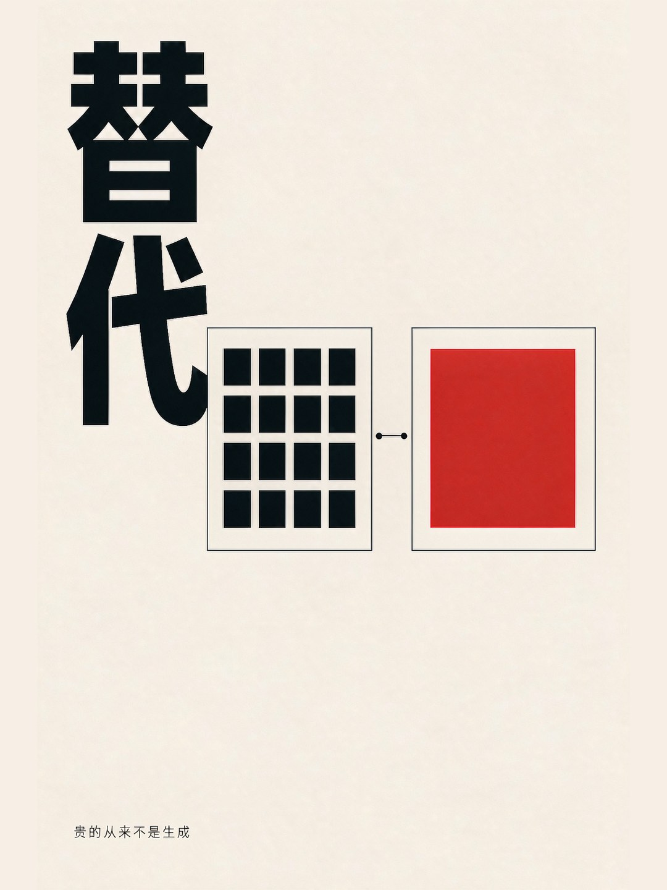
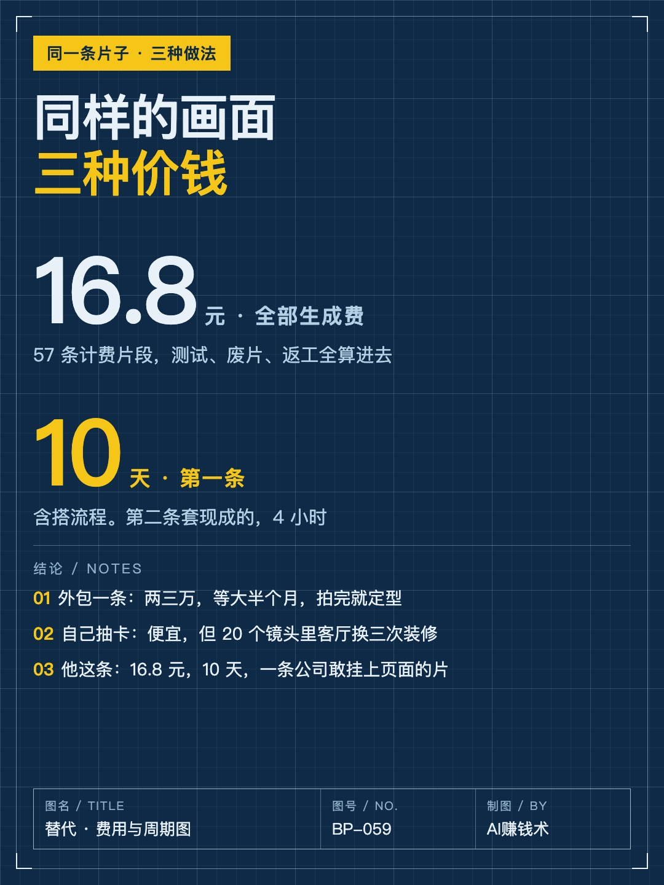
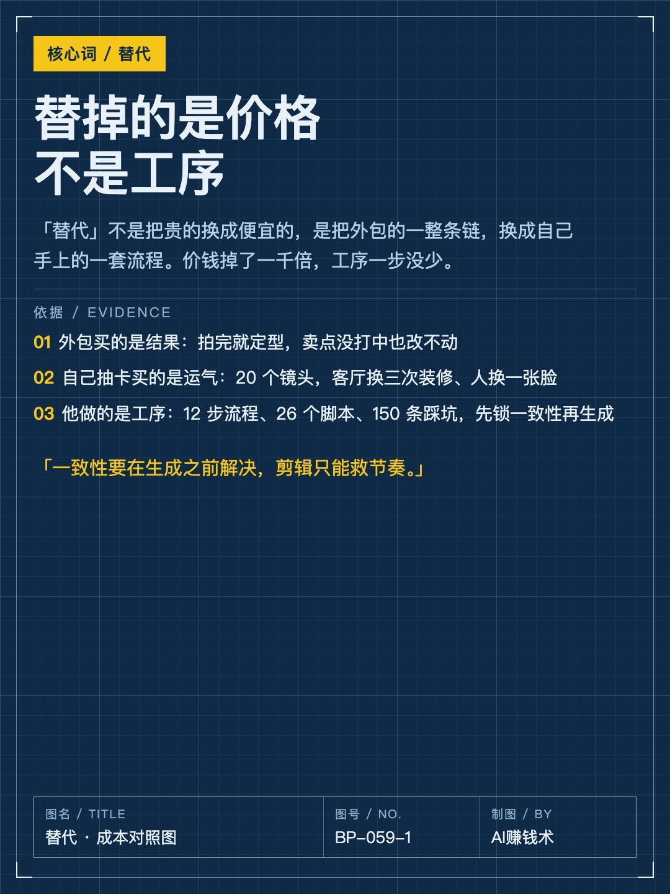
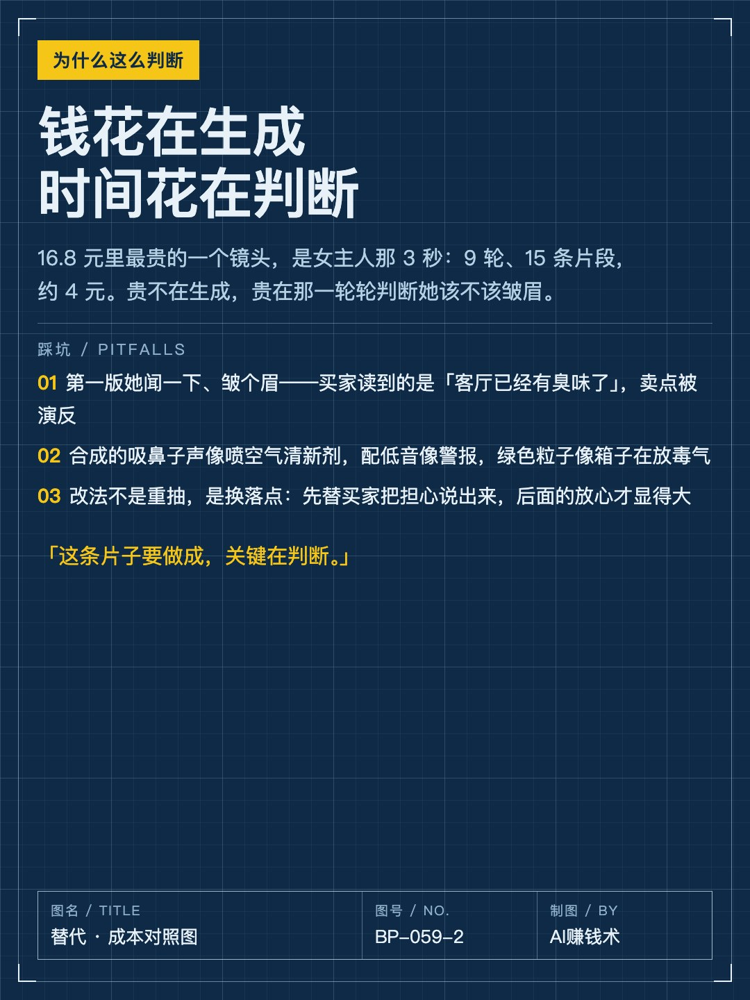
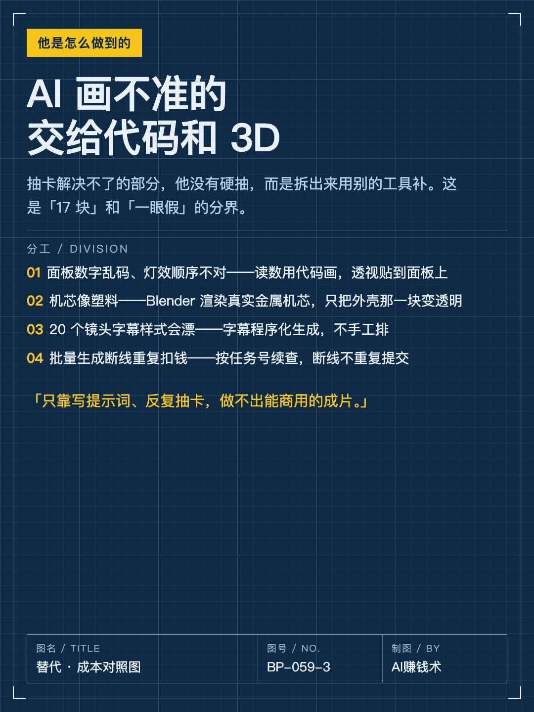
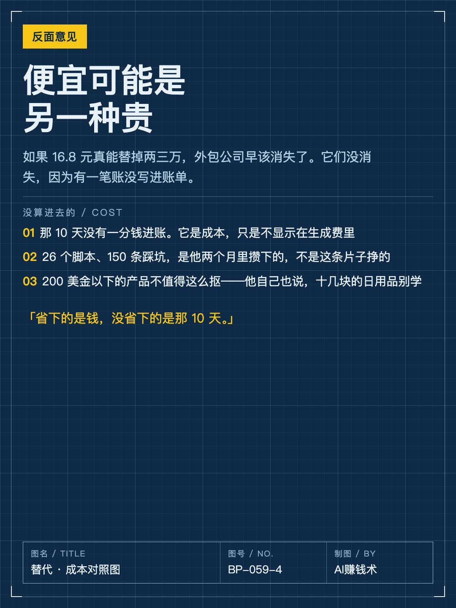
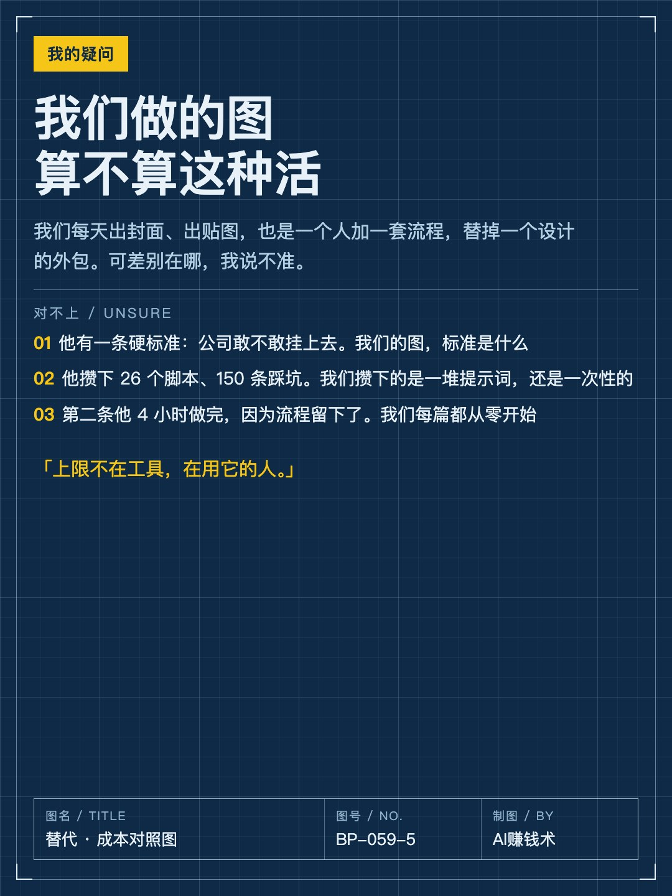
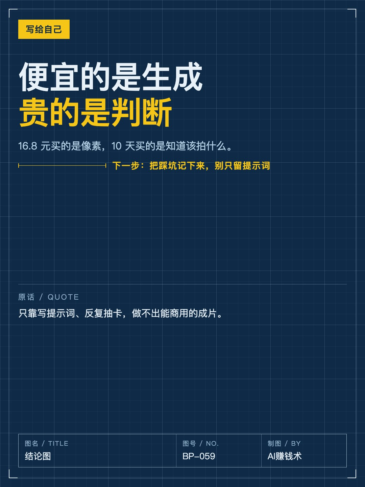

# 17块替掉两三万，他花了10天

> — · 2026-10-31 11:48 发布 · AI 赚钱内容

## 标题（可直接复制）

```
17块替掉两三万，他花了10天
```

## 正文（可直接复制发布）

一条 50 秒、20 个镜头的产品片，外包要两三万，等大半个月。他自己做，生成费 16.8 元，用了 10 天。😮

他叫陈陈，在深圳一家出海品牌做 AI 落地，没有影视编导经验，也不是计算机专业。

📌 先说这笔账

16.8 元是全部生成费，57 条计费片段，测试、废片、返工、A/B 全算在里面。真正进片的只有 5.3 元——每个镜头一遍过，就是这个数。

出图走订阅，3D 用本地 Blender 渲染，配乐音效用免费可商用素材，都是 0。

最贵的单个镜头，是女主人那 3 秒：9 轮、15 条片段，约 4 元。

📌 但便宜的不是生成

他第一版也翻车了。

女主人闻了一下，皱了个眉。他当时的想法是「闻东西本来就会皱眉」，可买家读到的信息是：这屋里已经有味道了。卖点被演反了。

还有：合成的吸鼻子声像在喷空气清新剂，配低音像警报，3D 绿色粒子像箱子在放毒气。

所以这条片子最贵的地方不在生成，在判断——判断每个画面会被读成什么意思。这一层，AI 替不了。

📌 他真正做的事

把「外包的一整条链」换成「自己手上的一套流程」：12 步制作流程、26 个本地脚本、150 条踩坑记录。

先排买家的心理节奏再排镜头；生成之前把「同一个世界」锁死；每个镜头写一张导演卡；先花几毛钱跑 480p 小样，摸清 AI 的脾气再正式生成。

AI 画不准的部分，他没有硬抽，而是拆出去用别的工具补：面板读数用代码画，机芯用 Blender 渲染真实金属，字幕程序化生成。

第二条片子，套现成的流程，4 小时做完。⏱️

📌 反面的话也得说

那 10 天没有一分钱进账。它是成本，只是不写进生成费里。

26 个脚本、150 条踩坑，是他两个月里攒下的，不是这条片子挣的。

他自己也说：200 美金以下的产品不值得这么抠，十几块的日用百货别学。

所以「16.8 元替掉两三万」这句话，省下的是钱，没省下的是时间和判断。

📌 我的判断

我们每天出封面、出贴图，也是一个人加一套流程，替掉设计的外包。可他有一条硬标准我们没有：公司敢不敢挂到页面上。

我们的图，标准是什么？攒下的是一堆提示词，还是一次性的东西？

他第二条 4 小时做完，是因为流程留下了。我们每篇都从零开始。

所以我现在想的是：先别急着夸 16.8 元，先看看自己有没有那 150 条踩坑。🤔

## 话题标签

#副业 #AI工具 #内容创作 #成本 #AI赚钱术日记

## 配图（8 张）










## 发布信息

| 项 | 值 |
|---|---|
| 平台 | 小红书 |
| 期数 | — |
| 发布时间 | 2026-10-31 11:48 |
| 正文长度 | 989 字 |
| 图片数量 | 8 张 |
| 状态 | 已发布 |
